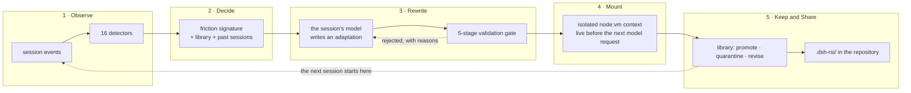

<div align="center">

**English** · [简体中文](docs/readme/README_zh.md) · [繁體中文](docs/readme/README_zh-TW.md) · [日本語](docs/readme/README_ja.md) · [한국어](docs/readme/README_ko.md) · [Türkçe](docs/readme/README_tr.md) · [Русский](docs/readme/README_ru.md) · [Tiếng Việt](docs/readme/README_vi.md) · [ไทย](docs/readme/README_th.md) · [Deutsch](docs/readme/README_de.md) · [Español](docs/readme/README_es.md) · [Français](docs/readme/README_fr.md) · [Українська](docs/readme/README_uk.md) · [Polski](docs/readme/README_pl.md) · [Português (Brasil)](docs/readme/README_pt-BR.md) · [العربية](docs/readme/README_ar.md) · [فارسی](docs/readme/README_fa.md) · [Bahasa Indonesia](docs/readme/README_id.md) · [Italiano](docs/readme/README_it.md) · [Ελληνικά](docs/readme/README_el.md) · [മലയാളം](docs/readme/README_ml.md) · [Roman Urdu](docs/readme/README_ur-Latn.md) · [Română](docs/readme/README_ro.md)

<br />


# DSHRSI: Recursive Self-Improvement for DeepSeek Harness

### **Observe → Improve → Build on It → Again. A harness that keeps getting better at being yours.**

<a href="https://qybaihe.github.io/dshrsi/trace.html">
  <picture>
    <source media="(prefers-color-scheme: dark)" srcset="assets/rsi-trace.dark.gif" />
    
  </picture>
</a>

**RSI means Recursive Self-Improvement, and DSHRSI is the open-source plugin that makes it real for DeepSeek Harness. The harness watches its own runs, has the session's own model write harness code for the trouble it finds, proves that code in a 5-stage gate, and mounts it before the turn is over. Then the improved harness runs the next session, and improves again. No fine-tuning. No pile of prompts. Code that is measured, kept, rewritten or thrown out.**

[](#rsi)
[](https://github.com/deepseek-ai/deepseek-harness)
[](#coverage)
[](#how-it-works)
[](#project-harness)
[](#benchmarks)
[](#contributing)
[](LICENSE)

**[🌐 Website](https://qybaihe.github.io/dshrsi/) · [📖 Plugin Reference](packages/dsh-rsi/README.md) · [🧩 Project Harness](packages/dsh-rsi/README.md#layers-and-the-project-harness) · [🔬 Validation Gate](packages/dsh-rsi/README.md#the-validation-gate) · [⚠️ Known Limits](packages/dsh-rsi/README.md#known-limits) · [🐛 Issues](https://github.com/qybaihe/dshrsi/issues)**

[What RSI Means](#rsi) · [Quick Start](#quick-start) · [How It Works](#how-it-works) · [Measured Results](#measured) · [Benchmarks](#benchmarks) · [Detectors & Capabilities](#coverage) · [Project Harness](#project-harness) · [Safety Defaults](#security) · [FAQ](#faq)

</div>

---

> [!IMPORTANT]
> **Developer Preview:** DSHRSI is built against DeepSeek Harness `0.2.2-rc.3`, which is itself a developer preview. **There will be compatibility-breaking changes.**
> An adaptation is code written by a model and run inside your harness. Its isolation guards against mistakes, **not against malicious code**. Read about [the validation gate](packages/dsh-rsi/README.md#the-validation-gate) before you run it.

<div align="center">

</div>

<br />

<table>
<tr>
<td width="33%" valign="top">

### 🔴 Without DSHRSI
Every session rediscovers the same facts: this machine has no `python`, this repository has a rule you already stated, this fix was never verified. In the control run, **5 sessions out of 5** made the same failed call, and a rule the user stated was broken again one session later.

</td>
<td width="33%" valign="top">

### 🧬 With DSHRSI
When the trouble comes back, the model writes a piece of harness code, it passes the gate, and it is live **in that same turn**. In 3 runs against a real model, **7 sessions out of 7** after the adaptation had no failed call. And the next improvement starts from there.

</td>
<td width="33%" valign="top">

### 🔒 Tighten-Only by Design
An adaptation can add information, refuse a call, ask you first, or demand verification. **No capability can allow what the harness would refuse.** Rewriting results, adding tools and running commands wait for your approval.

</td>
</tr>
</table>

---

<a id="rsi"></a>

## 🔁 RSI = Recursive Self-Improvement

Not "rewrite itself". **Recursive Self-Improvement**: a system uses its own abilities to improve itself, and the improved system carries out the next round. Three words, and DSHRSI has to earn each one:

| | What It Takes | How DSHRSI Does It |
| :--- | :--- | :--- |
| **Self** | What acts and what is changed are the same system | The harness changes the harness. The adaptation is written by the model of the very session that hit the trouble. Nobody tunes it from outside |
| **Improvement** | "Better" has to be checkable | Every adaptation passes a 5-stage gate before it is mounted, and later sessions are held against it: what works is promoted, what throws is quarantined |
| **Recursive** | One round's output starts the next | The next session runs on the improved harness and is observed with it. An adaptation that did not hold is rewritten stricter from the evidence. One that is needed in a second workspace widens to the whole machine, and a project's rules travel to every teammate's harness |

**Four loops, each inside the next:** inside a turn → from session to session → the improvement itself gets improved → from a project to a machine to a team.

What is deliberately **not** recursive: the model's weights never change, and the detectors, the trigger policy and the validation gate are fixed code that no adaptation can touch. The part that modifies itself is checked by a part it cannot modify.

---

<a id="quick-start"></a>

## ⚡ 30-Second Quick Start

### 1. Install It Where You Already Work
In the DeepSeek Harness desktop app or Web UI, open **Plugins → Add plugin → Install a third-party plugin**, paste the release package, select **Install**, then **Enable now**:

```text
https://github.com/qybaihe/dshrsi/releases/download/v0.1.2/dsh-rsi-0.1.2.tgz
```

Or from the command line. Each profile keeps its own plugins, and `dsh plugin add` calls `pnpm`, which has to be on `PATH`:

```bash
dsh plugin --profile web add https://github.com/qybaihe/dshrsi/releases/download/v0.1.2/dsh-rsi-0.1.2.tgz
dsh web
```

### 2. Just Work
There is nothing to configure. DSHRSI stays out of sight until the same trouble comes back. Then the **RSI** badge lights up, the pill under the composer tells you the harness has just changed itself, and the next session starts already improved:

<div align="center">

</div>

Type `/rsi` in any session to see what is mounted, which layer it belongs to, and what is waiting for your approval.

### 3. Give a Repository Its Own Harness
Rules learned in a repository can live in that repository, one file per adaptation:

```bash
# The command ships with the plugin, inside the profile it was installed into
alias dsh-rsi="$HOME/.dsh/profiles/web/node_modules/.bin/dsh-rsi"

dsh-rsi project init      # in the repository: creates .dsh-rsi/, then commit it
dsh-rsi trust             # on every other machine: accept the files after reading them
```

### 4. Run From Source

```bash
git clone https://github.com/qybaihe/dshrsi.git && cd dshrsi
npm install               # brings a pinned dsh and the pnpm it calls
npx dsh plugin --profile web add "$PWD/packages/dsh-rsi"
npx dsh web
```

The `desktop` and `headless` profiles, plugin indexes, local tarballs and loading for a single run are covered in the [plugin reference](packages/dsh-rsi/README.md#install).

---

<a id="how-it-works"></a>

## 🧠 How DSHRSI Works: a Closed Loop Inside the Harness, Run Again and Again

<div align="center">
<picture>
  <source media="(prefers-color-scheme: dark)" srcset="assets/pit-stop.dark.svg" />
  
</picture>
</div>

Skills, memory files and longer system prompts all work at the level of context: they add text and hope the model follows it. When it does not, the same failed call is made again in the next session.

**DSHRSI works at the level of the harness. What it learns becomes code on the harness's own extension points:**



| Stage | Mechanism | Effect |
| :--- | :--- | :--- |
| **1. Observe** | 16 detectors read normalized session events: calls that fail again, causes of failure that keep coming back, flailing, user corrections, turns that end with nothing verified. | Trouble gets a signature that is stable across sessions, such as `bash:command-not-found:python`. |
| **2. Rewrite** | The session's own model writes a JavaScript adaptation against a 10-capability API. Rejected code goes back with the reasons, twice at most, then a built-in template takes over. | The fix is harness code, not one more paragraph of prompt. |
| **3. Validate** | Static → load → replay → regression → permission. The adaptation has to act on the calls that triggered it and must leave alone every call that succeeded in this session. | Code that does nothing, or that breaks what already worked, is never mounted. |
| **4. Mount** | The adaptation runs in its own `node:vm` context behind a JSON bridge, with timeouts on every call, and takes effect before the next model request. | The turn that hit the trouble is the first to benefit. |
| **5. Keep and Share** | A library per machine with a ledger and an audit log. What works is promoted, what throws is quarantined, what did not hold is rewritten stricter, and project rules are written to `.dsh-rsi/`. | The next session starts adapted, and teammates get the project's rules after `dsh-rsi trust`. |
| **↻ Again** | The next session runs on the harness that stage 5 left behind, and stage 1 observes it with every adaptation in place. | Improvement is built on improvement. That is the recursion. |

---

<a id="measured"></a>

## 🔬 Measured Against a Real Model

These numbers come from running a real model, `mimo-v2.6-pro`, through real `dsh` sessions (`npm run test:live`). Nothing in this table is simulated.

> **How to read this:** the sample is small. One model, three scenarios, a handful of sessions each. It shows that the loop works end to end. It is **not** a statistical statement about success rates, and nothing got faster: writing an adaptation waits 30–60 seconds for the model. The larger runs are in [Benchmarks](#benchmarks).

| Scenario | Without DSHRSI | With DSHRSI | What the Harness Wrote |
| :--- | :--- | :--- | :--- |
| **Missing command**: the README says `python stats.py`, the machine only has `python3` | ❌ **5 / 5** sessions made the failed call | ✅ **0 / 7** sessions after the adaptation (9 / 9 before it) | `deny` + `prompt`, written by the model, passed the gate on the first attempt |
| **A rule the user stated once**: "never modify `notes.txt`, write to `notes.draft.txt`" | ❌ The next session edited `notes.txt` | ✅ The next session wrote to `notes.draft.txt` unprompted | `deny` + `prompt`, written by the model right after the correction |
| **A fix nobody asked to verify** | not run | ⚪ Nothing written: the model verified its fix in 3 / 3 sessions, so there was nothing to learn | none |

The first scenario was run three times with the plugin, each time from an empty library, plus one control run. The second was run once with it and once without.

**Missing command, session by session** (failed tool calls per session):

| Run | S1 | S2 | S3 | S4 | S5 | S6 |
| :--- | :---: | :---: | :---: | :---: | :---: | :---: |
| **Without DSHRSI** | ❌ 1 | ❌ 1 | ❌ 1 | ❌ 1 | ❌ 1 | |
| **With DSHRSI · run 1** | ❌ 1 | ❌ 1 | ❌ 1 → 🧬 | ✅ 0 | ✅ 0 | ✅ 0 |
| **With DSHRSI · run 2** | ❌ 1 | ❌ 1 | ❌ 1 → 🧬 | ✅ 0 | ✅ 0 | |
| **With DSHRSI · run 3** | ❌ 1 | ❌ 1 | ❌ 1 → 🧬 | ✅ 0 | ✅ 0 | |

🧬 marks the turn in which the model wrote the adaptation and the harness mounted it. In 3 of the 7 sessions after it, the model still tried `python`, and the harness refused the call before it ran. Every session in this scenario ended with the correct answer, with or without the plugin.

Reproduce locally:

```bash
MIMO_API_KEY=... npm run test:live -- python --sessions 6          # with the plugin
MIMO_API_KEY=... npm run test:live -- python --sessions 5 --off    # control run without it
```

<details>
<summary><strong>Not verified on this machine (click to expand)</strong></summary>

<br />

These paths exist in-tree and are covered by unit or end-to-end tests with a simulated model, but they have not been observed in a real session or a real app:

| Area | Why Unverified Here |
| :--- | :--- |
| The DeepSeek Harness desktop app | Not installed on the development machine. Verified on the `web` profile and the installation mechanism the app wraps |
| `negative-feedback`, `approval-denied`, `context-pressure`, `model-instability` | Tested with constructed events only, never triggered in a real session |
| Automated browser tests | None. The UI was walked through by hand in the real `dsh web` page, in light and dark mode |
| ACP and SDK profiles | No UI there, and not verified |
| Models outside the MiMo v2.6 family | No runs yet. The benchmarks used `mimo-v2.6-pro` and `mimo-v2.6-flash`; the three scenarios above used `mimo-v2.6-pro` |

</details>

---

<a id="benchmarks"></a>

## 📊 Benchmarks: Four Suites, Two Models, Task by Task

Stock DeepSeek Harness against DeepSeek Harness + DSHRSI, in 3,390 real `dsh` sessions: the same model, the same prompts, the same sandbox, the same tasks. The plugin runs at its default settings and starts every suite with an empty library. Tasks solved on the three suites that ran to the end:

<!-- bench:table:start -->
| Benchmark | Tasks | `mimo-v2.6-pro` Stock | `mimo-v2.6-pro` + DSHRSI | `mimo-v2.6-flash` Stock | `mimo-v2.6-flash` + DSHRSI |
| :--- | ---: | ---: | ---: | ---: | ---: |
| **Aider Polyglot**, first try | 225 | 224 (99.6%) | 224 (99.6%) | 220 (97.8%) | 223 (99.1%) |
| **Aider Polyglot**, within two tries | 225 | 225 (100.0%) | 225 (100.0%) | 225 (100.0%) | 225 (100.0%) |
| **HumanEval** | 164 | 163 (99.4%) | 162 (98.8%) | 162 (98.8%) | 162 (98.8%) |
| **HumanEval+** | 164 | 156 (95.1%) | 157 (95.7%) | 153 (93.3%) | 153 (93.3%) |
| **MBPP** | 378 | 374 (98.9%) | 371 (98.1%) | 368 (97.4%) | 369 (97.6%) |
| **MBPP+** | 378 | 320 (84.7%) | 319 (84.4%) | 308 (81.5%) | 315 (83.3%) |
<!-- bench:table:end -->

<div align="center">
<picture>
  <source media="(prefers-color-scheme: dark)" srcset="assets/bench-flash.dark.png" />
  
</picture>
</div>

> **How to read this:** on tasks solved, the two harnesses **cannot be told apart**. The largest gain is +7 (MBPP+ with `mimo-v2.6-flash`), the largest loss is −3 (MBPP with `mimo-v2.6-pro`), and no difference holds up in an exact McNemar test on the same tasks (smallest p = 0.17). When the agent can run its own code, these suites are close to their ceiling for both models, and every task is a fresh, clean directory: very little comes back for a harness to learn from.

**What DSHRSI did do, without a single hint, was change itself.** Across the eight runs the models wrote **56 adaptations**; 15 of them acted, and 10 of those had been widened to the whole machine. For each of the 10 we took the tasks that started after it and compared them with the very same tasks under stock DSH:

| Adaptation the Model Wrote | Failure It Answers | Stock DSH | DSH + DSHRSI | p |
| :--- | :--- | ---: | ---: | ---: |
| *Stop inline python checks that abort on first mismatch* (MBPP, `mimo-v2.6-pro`) | A test run that dies on its first failed assertion | 16 of 310 tasks | **3 of 310** | 0.002 |
| *Redirect missing lib.rs reads to a glob lookup* (Polyglot, `mimo-v2.6-flash`) | Reading `lib.rs` at a path that does not exist | 7 of 151 tasks | **1 of 151** | 0.07 |
| The other 8 | | no measurable change | | |

Neither of the two made more tasks pass, and the plugin cost about 8–9% more agent time and input tokens. All ten are listed in [`bench/README.md`](bench/README.md#did-those-adaptations-work).

**LiveCodeBench v6 was cut short:** the model account ran out of balance part-way through. On the tasks both sides had finished by then, stock DSH solved 94 and DSHRSI 96 of 105 with `mimo-v2.6-pro`, and 42 against 42 of 51 with `mimo-v2.6-flash`. For the same reason the second pass, the same tasks again on the library the first pass left behind, has not been run yet.

Reproduce locally:

```bash
bench/setup.sh                                                        # toolchains, datasets, scoring code
MIMO_API_KEY=... node bench/run.mjs polyglot --arm dsh --run dsh-p1   # stock DeepSeek Harness
MIMO_API_KEY=... node bench/run.mjs polyglot --arm rsi --run rsi-p1   # with the plugin
node bench/report.mjs --write                                         # tables and bench/results/*.json
```

The protocol, the cost and failure tables and the limits are in [`bench/README.md`](bench/README.md); per-task results are in [`bench/results/`](bench/results).

---

<a id="coverage"></a>

## 🛡️ Detectors & Capabilities

**16 detectors** decide when the harness should change. The same detectors run on a live session and on a session stored on disk (`dsh-rsi mine`):

| Detector | What It Finds | Response |
| :--- | :--- | :---: |
| `repeat-failing-call` | The same call fails again with the same arguments | adapts |
| `failure-signature` | The same cause of failure keeps coming back: missing command, missing dependency, network, permission, port in use, path not found, edit mismatch, invalid arguments, out of memory | adapts |
| `command-flailing` | The same kind of command fails in a row with varying arguments | adapts |
| `read-thrash` | The same unchanged file is read over and over | adapts |
| `edit-churn` | The same file is edited many times in one turn | adapts |
| `error-storm` | Most of the recent tool calls failed | adapts |
| `stall` | Failures in a row with no success in between | adapts |
| `timeout-recurrence` | The same kind of command keeps timing out | adapts |
| `output-flood` | The same kind of command keeps producing oversized output | adapts |
| `approval-denied` / `denied-repeat` | The user keeps denying the same kind of action, or a denied call is retried unchanged | adapts |
| `user-correction` | The user corrected the model, or interrupted and changed direction | adapts |
| `premature-completion` | Code was changed and the turn is about to end with no check run | adapts |
| `negative-feedback` | The user marked a reply as bad and wrote a reason | adapts |
| `user-interrupt` | The user interrupted mid-turn | recorded |
| `model-instability` | Model requests keep failing, being retried, or hitting the output limit | recorded |
| `context-pressure` | The context was compacted in the middle of the task | recorded |

**10 capabilities** are everything an adaptation can do. It reaches the harness only through them:

| Capability | What It Does | Tier |
| :--- | :--- | :---: |
| `annotate` | Appends a note to a tool result | ✅ automatic |
| `steer` | Adds a note before the next model request | ✅ automatic |
| `deny` | Refuses a tool call and gives the reason | ✅ automatic |
| `ask` | Requires the user's approval for a call | ✅ automatic |
| `block` | Turns a tool result into an error that carries a correction | ✅ automatic |
| `verify` | Keeps the turn from ending while a condition is not met | ✅ automatic |
| `prompt` | Adds a standing section to the system prompt | ✅ automatic |
| `rewrite` | Replaces the text of a tool result | 🔐 needs approval |
| `tool` | Registers a new tool for the model | 🔐 needs approval |
| `exec` | Runs a command through the harness's shell tool, under the same sandbox and approval rules | 🔐 needs approval |

This is the adaptation the model wrote in the first scenario above:

```js
define({
  title: 'Route python invocations to python3',
  description: '...',
  capabilities: ['deny', 'prompt'],
  setup(h) {
    h.promptSection('On this machine there is no `python` executable; use `python3`.')
    h.beforeTool({ tool: 'bash', command: /(^|[;&|(]\s*)python(\s|$)/ },
      () => h.deny('`python` is not installed on this machine. Use `python3` instead.'))
  },
})
```

---

<a id="project-harness"></a>

## 🧩 Three Layers, and a Harness per Project

Every adaptation belongs to one of three layers. Each layer can be switched off on its own:

| Layer | What It Holds | Example | Where It Applies |
| :--- | :--- | :--- | :--- |
| **`machine`** | Facts about this computer | No `python`; a port is taken; an internal host does not resolve | The workspace where it was learned, then the whole machine once a second workspace hits it |
| **`user`** | How you want to be treated | A reply marked as bad with the reason "too long" | The whole machine |
| **`project`** | The rules and habits of one repository | "This repository uses pnpm, always" | The workspace, and the repository itself through `.dsh-rsi/` |

**The project layer travels with the code:**

```
.dsh-rsi/
  harness.json           format marker and project-level settings
  adaptations/
    remember-the-user-s-instruction-3f2a1c.js     learned, then written here
    no-force-push.js                              a hand-written one works the same way
```

- **Commit to share, delete to unplug.** One file is one adaptation.
- **Nothing runs because it was cloned.** Each machine accepts the exact content of the files with `dsh-rsi trust`, and accepts them again when they change.
- **A project can only make the harness more conservative**, never less. Settings such as `autonomy` are out of a project's reach.
- **Portable beyond a repository.** `dsh-rsi export` and `dsh-rsi import` carry the machine and user layers to another computer as one file.

---

<a id="security"></a>

## 🔒 Safety & Configuration Defaults

- **Tighten-Only Automatic Tier** — Without your approval, an adaptation can only add information, refuse, ask, or demand verification. Its `deny` and `ask` can only make the verdict of the other policies stricter.
- **Approval for Power (`autonomy: tighten`)** — Adaptations that rewrite results, add tools or run commands are stored as `proposed` and wait for `dsh-rsi approve <id>`.
- **Invisible Until Needed** — With no friction and nothing mounted, the system prompt, the tool list and the messages are unchanged byte for byte. An end-to-end test guards this.
- **Contained Failures** — A handler that throws never affects the tool call it is attached to. After three errors the adaptation is quarantined.
- **Everything on Record** — Every decision is in `audit.jsonl`, every friction, mount and action in `ledger.jsonl`. `dsh-rsi disable`, `retire` and `rollback` take an adaptation out or back.
- **Three Modes** — `adapt` mounts directly (the default), `propose` generates and waits for you, `observe` only records.

---

<a id="faq"></a>

## ❓ FAQ

<details>
<summary><strong>Does DSHRSI fine-tune or change the model?</strong></summary>

No. The model's weights are untouched and nothing is trained. What changes is the harness: the code that runs around the model's prompts and tool calls. RSI here is Recursive Self-Improvement at the level of the harness: it improves itself from its own runs, and every round starts from the harness the last round left behind.
</details>

<details>
<summary><strong>Is this really "recursive", or just a harness that learns rules?</strong></summary>

The recursion is concrete and it is in the code. A new session mounts everything the library holds, so the detectors observe a harness that has already changed. When the same trouble occurs twice in sessions that had an adaptation mounted, the model gets the current source and the evidence, and writes a stricter version; the old one is kept for rollback. Trouble met in a second workspace widens an adaptation to the whole machine. What does not recurse is the judge: detectors, trigger policy and validation gate cannot be changed by any adaptation.
</details>

<details>
<summary><strong>How is this different from skills, memory files or a longer system prompt?</strong></summary>

Those add text that the model may or may not follow. An adaptation is code on the harness's extension points: it can refuse a tool call before it runs, require your approval, or keep a turn from ending while nothing was verified. In the measured runs, the model still tried `python` in 3 sessions after being told not to, and the call was refused before it ran.
</details>

<details>
<summary><strong>Does it slow my sessions down?</strong></summary>

Writing an adaptation waits for one full model response: 30–60 seconds on `mimo-v2.6-pro`, during which the step stands still. Mounted adaptations run in-process with timeouts. No speedup was measured and none is claimed.
</details>

<details>
<summary><strong>Can a model-written adaptation do something dangerous?</strong></summary>

The automatic tier cannot allow anything the harness would refuse, and the powerful capabilities wait for your approval. The code runs in its own `node:vm` context behind a JSON bridge. This guards against mistakes and casual misuse. It is **not** a security boundary against malicious code, so read a project's `.dsh-rsi/` files before you run `dsh-rsi trust`.
</details>

<details>
<summary><strong>Which models does it work with?</strong></summary>

Adaptations are written by the session's current model, or by the one you set with `provider` and `model`. If the model cannot produce code that passes the gate, built-in templates take over. Runs so far used two models of one family, `mimo-v2.6-pro` and `mimo-v2.6-flash`.
</details>

<details>
<summary><strong>Does it work in the DeepSeek Harness desktop app?</strong></summary>

It ships as an ordinary third-party plugin with the metadata the plugin pages read, and it installs into the `web` profile the app wraps. It has not been verified inside the real desktop app yet.
</details>

<details>
<summary><strong>How do I see, undo or turn off what it learned?</strong></summary>

`/rsi` in a session, or `dsh-rsi status` in a terminal. `dsh-rsi show <id>` prints an adaptation's source and validation report; `disable`, `retire` and `rollback` take it out or back. Set `mode: observe` to record without changing anything.
</details>

---

<a id="docs"></a>

## 📚 Documentation & Links

- [📖 Plugin Reference](packages/dsh-rsi/README.md) — every detector, capability, command and setting
- [🚀 Installation Sources & Profiles](packages/dsh-rsi/README.md#install)
- [🧩 Layers & the Project Harness](packages/dsh-rsi/README.md#layers-and-the-project-harness)
- [🔬 The Validation Gate](packages/dsh-rsi/README.md#the-validation-gate)
- [🛠️ `dsh-rsi` Command Line](packages/dsh-rsi/README.md#command-line) · [⚙️ Configuration](packages/dsh-rsi/README.md#configuration)
- [⚠️ Known Limits](packages/dsh-rsi/README.md#known-limits)
- [📊 Benchmark Protocol & Results](bench/README.md)
- [🌐 Website source](website) — recursive self-improvement, how it works, writing adaptations, evaluation; open `website/index.html` in a browser
- [🧱 DeepSeek Harness](https://github.com/deepseek-ai/deepseek-harness) — the harness this plugs into

<a id="contributing"></a>

## 🤝 Contributing & Community

Issues and PRs are welcome at [qybaihe/dshrsi](https://github.com/qybaihe/dshrsi). Before submitting a PR:

```bash
npm install && npm test    # 130 unit tests, then 29 end-to-end tests; no key needed
```

The end-to-end tests replace the model endpoint with a simulated one. Everything else is real: the `dsh` process, tool execution, the session log and plugin installation.

```
packages/dsh-rsi/        the plugin bundle (plain ESM, no build step)
  index.js               host half: bindings to DSH's extension points
  client.js              browser half: RSI badge and status pill
  src/engine.js          observe → decide → generate → validate → mount → keep → share
  src/signals.js         the 16 detectors
  src/validate.js        the validation gate
  src/sandbox.js         where adaptation code runs
  src/project.js         the project harness: <repository>/.dsh-rsi
  bin/rsi.js             the dsh-rsi command
market/index.json        a plugin index that can be added to DSH
test/unit/  test/e2e/    unit tests, and end-to-end tests on a real dsh process
test/live/               runs against a real model (need MIMO_API_KEY)
bench/                   benchmarks: stock DSH against DSH + dsh-rsi
website/                 the website (static pages, no build step)
```

## 📄 License

[MIT](LICENSE)

---

Created in [T3 Code](https://t3.codes).
