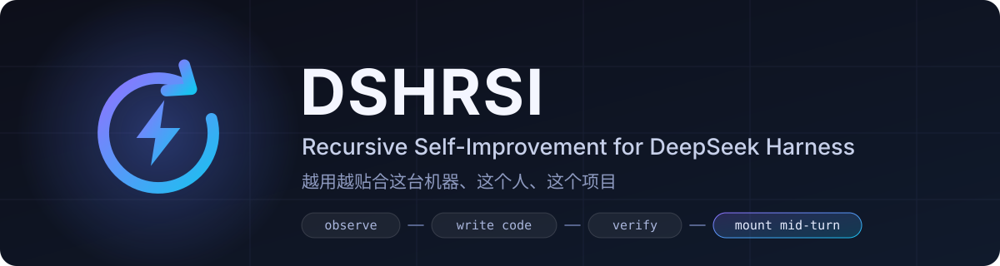

<p align="center">
  
</p>

# DSHRSI

**DeepSeek Harness RSI**：让 Harness 从自己的执行过程里学会改造自己。它盯着每一次运行里反复出现的麻烦，让会话里的模型当场写一段 Harness 代码，校验后在同一轮任务还没结束时挂进运行中的会话，有效的留给以后。用得越久，这份 Harness 越贴合这台机器、这个人、这个项目。

它是一个普通的 [DeepSeek Harness](https://www.npmjs.com/package/@deepseek-ai/dsh) 插件，不改 DSH 一行源码，纯 ESM，没有构建步骤。

## 看起来是什么样

模型照着 README 跑了两次这台机器上没有的命令。第三次请求之前，Harness 已经给自己写好了一段代码：把这个事实写进提示词，并在工具入口拦下这条命令。


下一次会话从一开始就带着它。模型还是想跑那条命令，被 Harness 在执行前拦下：


## 它做了什么

```
会话事件 ─▶ 16 个判断点 ─▶ 发现反复出现的麻烦
                               │
       适配库、历史会话 ─▶ 值不值得改、现在改还是收工时改
                               │
   模型写适配代码 ─▶ 校验关（静态 / 加载 / 重演 / 回归 / 权限）─▶ 不过就带着原因打回重写
                               │                                  └ 写不出来用内置模板
                               ▼
             挂载到运行中的会话，下一次模型请求之前生效
                               │
   沉淀：有效的转正，出错的隔离，没拦住的改写成更严的版本
                               │
   项目层的写进仓库的 .dsh-rsi/，跟着代码走到每个人的机器上
```

- **Harness 级，不是提示词级。** 适配是代码：拒绝一次工具调用、要求先经你确认、在没验证时不让这一轮结束、给模型注册新工具。它不能放行 Harness 本来会拒绝的操作。
- **三层。** 机器层（这台电脑的事实）、用户层（你希望怎样被对待）、项目层（这个仓库的规矩）。每层可以单独关掉。
- **项目专属的 Harness。** 项目层的适配写成仓库里的 `.dsh-rsi/adaptations/*.js`，一个文件一个适配：提交就共享，删掉就拔掉，也可以手写。别人的机器要先 `dsh-rsi trust` 才运行。
- **可以带走。** `dsh-rsi export` / `import` 把学到的东西打成一个文件，带到另一台机器。
- **看得见。** Web 界面和桌面 App 里有 RSI 徽标、状态条和 `/rsi` 命令；终端里有 `dsh-rsi status`。

## 实测

真实模型 `mimo-v2.6-pro`，本机只有 `python3`，README 让它跑 `python stats.py`。同一个任务重复多次会话：

| | 每次会话的失败调用 |
|---|---|
| 不装插件（5 次会话） | 1, 1, 1, 1, 1 |
| 装了，第 1 轮（6 次） | 1, 1, 1, **0, 0, 0** |
| 装了，第 2 轮（5 次） | 1, 1, 1, **0, 0** |
| 装了，第 3 轮（5 次） | 1, 1, 1, **0, 0** |

三轮都是在第 3 次会话里由模型自己写出适配，一次通过校验，当轮挂载。此后 7 次会话没有一次失败调用，其中 3 次是模型仍想跑 `python`、被 Harness 在执行前拦下。所有会话的最终答案都正确。

样本很小：一个模型、一个场景。它说明这条链路是通的，不是成功率的统计结论。速度也没有变快：写一次适配要等模型 30–60 秒。

## 安装

在桌面 App 或 Web 界面里：**Plugins → Add plugin → Install a third-party plugin**，填发布包地址或本地路径，**Install**，再 **Enable now**。

```
https://github.com/qybaihe/dshrsi/releases/download/v0.1.0/dsh-rsi-0.1.0.tgz
```

命令行：

```sh
dsh plugin --profile web add <发布包地址或 packages/dsh-rsi 的绝对路径>
dsh web
```

发布包地址和插件源索引（`market/index.json`）要等仓库公开后才能被别的机器访问；在那之前用本地路径。各种安装方式、配置项、命令和限制见 [packages/dsh-rsi/README.md](packages/dsh-rsi/README.md)。

## 仓库结构

```
packages/dsh-rsi/        插件包本体
  index.js               宿主部分：与 DSH 扩展点的绑定
  client.js              浏览器部分：徽标和状态条（手写，无构建）
  src/engine.js          主流程：观察 → 决策 → 生成 → 校验 → 挂载 → 沉淀 → 共享
  src/signals.js         16 个判断点
  src/generate.js        让模型写适配；打回重写；模板兜底
  src/validate.js        校验关
  src/sandbox.js         适配代码的运行环境
  src/layers.js          三层的划分
  src/project.js         项目 Harness：<仓库>/.dsh-rsi
  src/pack.js            导出 / 导入
  src/surface.js         界面读的会话读模型，和 /rsi 的回答
  src/library.js         本机适配库、账本、信任记录
  bin/rsi.js             命令行
market/index.json        可以加进 DSH 的插件源索引
test/unit/               单元测试，不依赖 DSH
test/e2e/                端到端：真实的 dsh 进程 + 模拟模型
test/live/               真实模型实测（需要 MIMO_API_KEY，不在 npm test 里）
```

## 开发与测试

```sh
npm install
npm test                 # 单元 129 个 + 端到端 29 个，不需要任何密钥
npm run rsi -- status    # 查看本机适配库

MIMO_API_KEY=... npm run test:live -- python --sessions 6          # 真实模型，插件开
MIMO_API_KEY=... npm run test:live -- python --sessions 5 --off    # 对照组
```

端到端测试用一个模拟模型服务顶替模型接口，DSH 的其余部分都是真的：真实的 `dsh` 进程、真实的工具执行、真实的会话日志、真实的插件安装。

## 局限

- 钉在 DSH `0.2.2-rc.3`（开发者预览版）上，它的扩展点还在变。
- 桌面 App 没有在本机实际装过；验证做在它所包的同一套 Web 页面和安装机制上。
- 界面在真实页面里走查过亮色和暗色，没有自动化的浏览器用例。
- 适配代码的隔离防的是写错和随手滥用，不是对抗恶意代码的安全边界。项目 Harness 的信任只认文件内容，接受之前请自己读。
- 完整清单见 [packages/dsh-rsi/README.md](packages/dsh-rsi/README.md#已知限制)。

## 许可

[MIT](LICENSE)

---

Created in [T3 Code](https://t3.codes).
