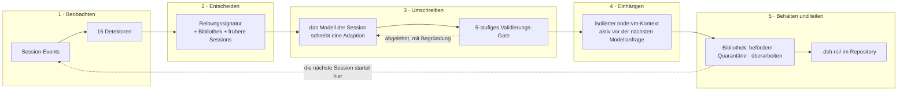

<div align="center">

[English](../../README.md) · [简体中文](README_zh.md) · [繁體中文](README_zh-TW.md) · [日本語](README_ja.md) · [한국어](README_ko.md) · [Türkçe](README_tr.md) · [Русский](README_ru.md) · [Tiếng Việt](README_vi.md) · [ไทย](README_th.md) · **Deutsch** · [Español](README_es.md) · [Français](README_fr.md) · [Українська](README_uk.md) · [Polski](README_pl.md) · [Português (Brasil)](README_pt-BR.md) · [العربية](README_ar.md) · [فارسی](README_fa.md) · [Bahasa Indonesia](README_id.md) · [Italiano](README_it.md) · [Ελληνικά](README_el.md) · [മലയാളം](README_ml.md) · [Roman Urdu](README_ur-Latn.md) · [Română](README_ro.md)

<br />


# DSHRSI: Rekursive Selbstverbesserung (Recursive Self-Improvement) für DeepSeek Harness

### **Beobachten → Verbessern → Darauf aufbauen → Und wieder von vorn. Ein Harness, das immer besser darin wird, deins zu sein.**

<a href="https://qybaihe.github.io/dshrsi/trace.html">
  <picture>
    <source media="(prefers-color-scheme: dark)" srcset="../../assets/rsi-trace.dark.gif" />
    
  </picture>
</a>

**RSI steht für Recursive Self-Improvement, rekursive Selbstverbesserung, und DSHRSI ist das Open-Source-Plugin, das sie für DeepSeek Harness Wirklichkeit werden lässt. Das Harness beobachtet seine eigenen Läufe, lässt das Modell der laufenden Session Harness-Code für die Probleme schreiben, die es dabei findet, prüft diesen Code in einem 5-stufigen Gate und hängt ihn ein, noch bevor der Turn zu Ende ist. Dann fährt das verbesserte Harness die nächste Session und verbessert sich erneut. Kein Fine-Tuning. Kein Berg von Prompts. Sondern Code, der gemessen, behalten, umgeschrieben oder verworfen wird.**

[](#rsi)
[](https://github.com/deepseek-ai/deepseek-harness)
[](#coverage)
[](#how-it-works)
[](#project-harness)
[](#benchmarks)
[](#contributing)
[](../../LICENSE)

**[🌐 Website](https://qybaihe.github.io/dshrsi/) · [📖 Plugin-Referenz](../../packages/dsh-rsi/README.md) · [🧩 Projekt-Harness](../../packages/dsh-rsi/README.md#layers-and-the-project-harness) · [🔬 Validierungs-Gate](../../packages/dsh-rsi/README.md#the-validation-gate) · [⚠️ Bekannte Einschränkungen](../../packages/dsh-rsi/README.md#known-limits) · [🐛 Issues](https://github.com/qybaihe/dshrsi/issues)**

[Was RSI bedeutet](#rsi) · [Schnellstart](#quick-start) · [Funktionsweise](#how-it-works) · [Messergebnisse](#measured) · [Benchmarks](#benchmarks) · [Detektoren & Capabilities](#coverage) · [Projekt-Harness](#project-harness) · [Sicherheits-Defaults](#security) · [FAQ](#faq)

</div>

---

> [!IMPORTANT]
> **Developer Preview:** DSHRSI wurde gegen DeepSeek Harness `0.2.2-rc.3` gebaut, das selbst eine Developer Preview ist. **Es wird Breaking Changes geben.**
> Eine Adaption ist Code, den ein Modell geschrieben hat und der in deinem Harness läuft. Ihre Isolation schützt vor Fehlern, **nicht vor bösartigem Code**. Lies den Abschnitt über [das Validierungs-Gate](../../packages/dsh-rsi/README.md#the-validation-gate), bevor du das Plugin laufen lässt.

<div align="center">

</div>

<br />

<table>
<tr>
<td width="33%" valign="top">

### 🔴 Ohne DSHRSI
Jede Session entdeckt dieselben Tatsachen neu: Auf dieser Maschine gibt es kein `python`, in diesem Repository gilt eine Regel, die du längst genannt hast, dieser Fix wurde nie verifiziert. Im Kontrolllauf setzten **5 von 5 Sessions** denselben fehlgeschlagenen Aufruf ab, und eine Regel, die der Nutzer genannt hatte, wurde eine Session später wieder gebrochen.

</td>
<td width="33%" valign="top">

### 🧬 Mit DSHRSI
Taucht das Problem wieder auf, schreibt das Modell ein Stück Harness-Code, der Code besteht das Gate und ist **noch im selben Turn** aktiv. In 3 Läufen gegen ein echtes Modell hatten **7 von 7 Sessions** nach der Adaption keinen fehlgeschlagenen Aufruf mehr. Und die nächste Verbesserung setzt genau dort an.

</td>
<td width="33%" valign="top">

### 🔒 Nur verschärfen – by Design
Eine Adaption kann Informationen ergänzen, einen Aufruf ablehnen, dich vorher fragen oder eine Verifikation verlangen. **Keine Capability kann erlauben, was das Harness ablehnen würde.** Ergebnisse umschreiben, Tools hinzufügen, Befehle ausführen: All das wartet auf deine Freigabe.

</td>
</tr>
</table>

---

<a id="rsi"></a>

## 🔁 RSI = Recursive Self-Improvement, rekursive Selbstverbesserung

Nicht „rewrite itself“. **Recursive Self-Improvement**, rekursive Selbstverbesserung: Ein System nutzt seine eigenen Fähigkeiten, um sich selbst zu verbessern, und das verbesserte System übernimmt die nächste Runde. Drei Wörter, und DSHRSI muss sich jedes einzelne verdienen:

| | Was es dafür braucht | Wie DSHRSI es umsetzt |
| :--- | :--- | :--- |
| **Self** (selbst) | Was handelt und was verändert wird, ist dasselbe System | Das Harness verändert das Harness. Geschrieben wird die Adaption vom Modell genau der Session, die auf das Problem gestoßen ist. Niemand justiert von außen nach |
| **Improvement** (Verbesserung) | „Besser“ muss überprüfbar sein | Jede Adaption muss durch ein 5-stufiges Gate, bevor sie eingehängt wird, und wird danach an späteren Sessions gemessen: Was funktioniert, wird befördert, was Fehler wirft, kommt in Quarantäne |
| **Recursive** (rekursiv) | Das Ergebnis einer Runde ist der Start der nächsten | Die nächste Session läuft auf dem verbesserten Harness und wird mit ihm beobachtet. Eine Adaption, die nicht gehalten hat, wird anhand der Belege strenger neu geschrieben. Eine, die in einem zweiten Workspace gebraucht wird, weitet sich auf die ganze Maschine aus, und die Regeln eines Projekts wandern in das Harness jedes Teammitglieds |

**Vier Schleifen, jede in der nächsten verschachtelt:** innerhalb eines Turns → von Session zu Session → die Verbesserung wird selbst verbessert → vom Projekt über die Maschine bis zum Team.

Was bewusst **nicht** rekursiv ist: Die Gewichte des Modells ändern sich nie, und die Detektoren, die Trigger-Policy und das Validierungs-Gate sind fester Code, an den keine Adaption herankommt. Der Teil, der sich selbst verändert, wird von einem Teil geprüft, den er nicht verändern kann.

---

<a id="quick-start"></a>

## ⚡ Schnellstart in 30 Sekunden

### 1. Dort installieren, wo du ohnehin arbeitest
Öffne in der Desktop-App oder der Web-UI von DeepSeek Harness **Plugins → Add plugin → Install a third-party plugin**, füge das Release-Paket ein, wähle **Install** und dann **Enable now**:

```text
https://github.com/qybaihe/dshrsi/releases/download/v0.1.1/dsh-rsi-0.1.1.tgz
```

Oder über die Kommandozeile. Jedes Profil hat seine eigenen Plugins, und `dsh plugin add` ruft `pnpm` auf, das im `PATH` liegen muss:

```bash
dsh plugin --profile web add https://github.com/qybaihe/dshrsi/releases/download/v0.1.1/dsh-rsi-0.1.1.tgz
dsh web
```

### 2. Einfach arbeiten
Zu konfigurieren gibt es nichts. DSHRSI bleibt unsichtbar, bis dasselbe Problem wieder auftaucht. Dann leuchtet das **RSI**-Badge auf, die Status-Pill unter dem Eingabefeld meldet, dass das Harness sich gerade selbst verändert hat, und die nächste Session startet bereits verbessert:

<div align="center">

</div>

Tippe in einer beliebigen Session `/rsi`, um zu sehen, was eingehängt ist, zu welcher Ebene es gehört und was auf deine Freigabe wartet.

### 3. Einem Repository sein eigenes Harness geben
Regeln, die in einem Repository gelernt wurden, können direkt in diesem Repository liegen, eine Datei pro Adaption:

```bash
# Der Befehl kommt mit dem Plugin und liegt in dem Profil, in das es installiert wurde
alias dsh-rsi="$HOME/.dsh/profiles/web/node_modules/.bin/dsh-rsi"

dsh-rsi project init      # im Repository: legt .dsh-rsi/ an, danach committen
dsh-rsi trust             # auf jeder anderen Maschine: die Dateien lesen und dann akzeptieren
```

### 4. Aus dem Quellcode starten

```bash
git clone https://github.com/qybaihe/dshrsi.git && cd dshrsi
npm install               # bringt ein gepinntes dsh mit und das pnpm, das es aufruft
npx dsh plugin --profile web add "$PWD/packages/dsh-rsi"
npx dsh web
```

Die Profile `desktop` und `headless`, Plugin-Indizes, lokale Tarballs und das Laden für einen einzelnen Lauf beschreibt die [Plugin-Referenz](../../packages/dsh-rsi/README.md#install).

---

<a id="how-it-works"></a>

## 🧠 So funktioniert DSHRSI: ein geschlossener Kreislauf im Harness, wieder und wieder durchlaufen

Skills, Memory-Dateien und längere System-Prompts arbeiten alle auf Kontext-Ebene: Sie fügen Text hinzu und hoffen, dass das Modell sich daran hält. Tut es das nicht, kommt derselbe fehlgeschlagene Aufruf in der nächsten Session wieder.

**DSHRSI arbeitet auf Harness-Ebene. Was es lernt, wird zu Code an den Erweiterungspunkten des Harness:**



| Phase | Mechanismus | Wirkung |
| :--- | :--- | :--- |
| **1. Beobachten** | 16 Detektoren lesen normalisierte Session-Events: Aufrufe, die erneut scheitern, Fehlerursachen, die immer wiederkehren, planloses Herumprobieren, Korrekturen durch den Nutzer, Turns, die enden, ohne dass irgendetwas verifiziert wurde. | Das Problem bekommt eine Signatur, die über Sessions hinweg stabil ist, etwa `bash:command-not-found:python`. |
| **2. Umschreiben** | Das Modell der Session schreibt eine JavaScript-Adaption gegen eine API mit 10 Capabilities. Abgelehnter Code geht mit Begründung zurück, höchstens zweimal, dann übernimmt ein eingebautes Template. | Der Fix ist Harness-Code, nicht noch ein Absatz im Prompt. |
| **3. Validieren** | Statisch → Laden → Replay → Regression → Berechtigungen. Die Adaption muss auf die Aufrufe wirken, die sie ausgelöst haben, und jeden Aufruf in Ruhe lassen, der in dieser Session erfolgreich war. | Code, der nichts tut oder kaputt macht, was schon funktioniert hat, wird nie eingehängt. |
| **4. Einhängen** | Die Adaption läuft in ihrem eigenen `node:vm`-Kontext hinter einer JSON-Bridge, mit Timeouts für jeden Aufruf, und greift vor der nächsten Modellanfrage. | Der Turn, der auf das Problem gestoßen ist, profitiert als erster. |
| **5. Behalten und teilen** | Eine Bibliothek pro Maschine mit Ledger und Audit-Log. Was funktioniert, wird befördert, was Fehler wirft, kommt in Quarantäne, was nicht gehalten hat, wird strenger neu geschrieben, und Projektregeln landen in `.dsh-rsi/`. | Die nächste Session startet bereits angepasst, und Teammitglieder bekommen die Regeln des Projekts nach `dsh-rsi trust`. |
| **↻ Und wieder von vorn** | Die nächste Session läuft auf dem Harness, das Phase 5 hinterlassen hat, und Phase 1 beobachtet sie mit allen eingehängten Adaptionen. | Verbesserung baut auf Verbesserung auf. Das ist die Rekursion. |

---

<a id="measured"></a>

## 🔬 Gemessen mit einem echten Modell

Diese Zahlen stammen von einem echten Modell, `mimo-v2.6-pro`, in echten `dsh`-Sessions (`npm run test:live`). Nichts in dieser Tabelle ist simuliert.

> **So ist das zu lesen:** Die Stichprobe ist klein. Ein Modell, drei Szenarien, jeweils eine Handvoll Sessions. Sie zeigt, dass der Kreislauf von Anfang bis Ende funktioniert. Sie ist **keine** statistische Aussage über Erfolgsquoten, und schneller wurde nichts: Für das Schreiben einer Adaption wartet man 30–60 Sekunden auf das Modell. Die größeren Läufe stehen unter [Benchmarks](#benchmarks).

| Szenario | Ohne DSHRSI | Mit DSHRSI | Was das Harness geschrieben hat |
| :--- | :--- | :--- | :--- |
| **Fehlender Befehl**: Im README steht `python stats.py`, die Maschine hat nur `python3` | ❌ **5 / 5** Sessions setzten den fehlgeschlagenen Aufruf ab | ✅ **0 / 7** Sessions nach der Adaption (9 / 9 davor) | `deny` + `prompt`, vom Modell geschrieben, Gate im ersten Anlauf bestanden |
| **Eine Regel, die der Nutzer einmal genannt hat**: „ändere niemals `notes.txt`, schreib nach `notes.draft.txt`“ | ❌ Die nächste Session hat `notes.txt` bearbeitet | ✅ Die nächste Session schrieb unaufgefordert nach `notes.draft.txt` | `deny` + `prompt`, vom Modell direkt nach der Korrektur geschrieben |
| **Ein Fix, dessen Verifikation niemand verlangt hat** | nicht gelaufen | ⚪ Nichts geschrieben: Das Modell hat seinen Fix in 3 / 3 Sessions verifiziert, es gab also nichts zu lernen | nichts |

Das erste Szenario lief dreimal mit dem Plugin, jedes Mal ausgehend von einer leeren Bibliothek, dazu ein Kontrolllauf. Das zweite lief einmal mit und einmal ohne.

**Fehlender Befehl, Session für Session** (fehlgeschlagene Tool-Aufrufe pro Session):

| Lauf | S1 | S2 | S3 | S4 | S5 | S6 |
| :--- | :---: | :---: | :---: | :---: | :---: | :---: |
| **Ohne DSHRSI** | ❌ 1 | ❌ 1 | ❌ 1 | ❌ 1 | ❌ 1 | |
| **Mit DSHRSI · Lauf 1** | ❌ 1 | ❌ 1 | ❌ 1 → 🧬 | ✅ 0 | ✅ 0 | ✅ 0 |
| **Mit DSHRSI · Lauf 2** | ❌ 1 | ❌ 1 | ❌ 1 → 🧬 | ✅ 0 | ✅ 0 | |
| **Mit DSHRSI · Lauf 3** | ❌ 1 | ❌ 1 | ❌ 1 → 🧬 | ✅ 0 | ✅ 0 | |

🧬 markiert den Turn, in dem das Modell die Adaption geschrieben und das Harness sie eingehängt hat. In 3 der 7 Sessions danach versuchte das Modell es trotzdem mit `python`, und das Harness lehnte den Aufruf ab, bevor er ausgeführt wurde. Jede Session in diesem Szenario endete mit der richtigen Antwort, mit oder ohne Plugin.

Lokal reproduzieren:

```bash
MIMO_API_KEY=... npm run test:live -- python --sessions 6          # mit dem Plugin
MIMO_API_KEY=... npm run test:live -- python --sessions 5 --off    # Kontrolllauf ohne Plugin
```

<details>
<summary><strong>Auf dieser Maschine nicht verifiziert (zum Aufklappen klicken)</strong></summary>

<br />

Diese Pfade sind im Repository vorhanden und durch Unit- oder End-to-End-Tests mit einem simulierten Modell abgedeckt, wurden aber noch nicht in einer echten Session oder einer echten App beobachtet:

| Bereich | Warum hier nicht verifiziert |
| :--- | :--- |
| Die Desktop-App von DeepSeek Harness | Auf der Entwicklungsmaschine nicht installiert. Verifiziert mit dem `web`-Profil und dem Installationsmechanismus, den die App kapselt |
| `negative-feedback`, `approval-denied`, `context-pressure`, `model-instability` | Nur mit konstruierten Events getestet, nie in einer echten Session ausgelöst |
| Automatisierte Browser-Tests | Keine. Die UI wurde von Hand auf der echten Seite von `dsh web` durchgegangen, im Light- und im Dark-Mode |
| ACP- und SDK-Profile | Dort gibt es keine UI, und verifiziert ist es nicht |
| Modelle außerhalb der MiMo-v2.6-Familie | Bisher keine Läufe. Die Benchmarks liefen mit `mimo-v2.6-pro` und `mimo-v2.6-flash`, die drei Szenarien oben mit `mimo-v2.6-pro` |

</details>

---

<a id="benchmarks"></a>

## 📊 Benchmarks: vier Suiten, zwei Modelle, Aufgabe für Aufgabe

DeepSeek Harness im Originalzustand gegen DeepSeek Harness + DSHRSI, in 3,390 echten `dsh`-Sessions: dasselbe Modell, dieselben Prompts, dieselbe Sandbox, dieselben Aufgaben. Das Plugin läuft mit seinen Standardeinstellungen und beginnt jede Suite mit einer leeren Bibliothek. Gelöste Aufgaben in den drei Suiten, die bis zum Ende durchliefen:

<!-- bench:table:start -->
| Benchmark | Aufgaben | `mimo-v2.6-pro` Original | `mimo-v2.6-pro` + DSHRSI | `mimo-v2.6-flash` Original | `mimo-v2.6-flash` + DSHRSI |
| :--- | ---: | ---: | ---: | ---: | ---: |
| **Aider Polyglot**, erster Versuch | 225 | 224 (99.6%) | 224 (99.6%) | 220 (97.8%) | 223 (99.1%) |
| **Aider Polyglot**, innerhalb von zwei Versuchen | 225 | 225 (100.0%) | 225 (100.0%) | 225 (100.0%) | 225 (100.0%) |
| **HumanEval** | 164 | 163 (99.4%) | 162 (98.8%) | 162 (98.8%) | 162 (98.8%) |
| **HumanEval+** | 164 | 156 (95.1%) | 157 (95.7%) | 153 (93.3%) | 153 (93.3%) |
| **MBPP** | 378 | 374 (98.9%) | 371 (98.1%) | 368 (97.4%) | 369 (97.6%) |
| **MBPP+** | 378 | 320 (84.7%) | 319 (84.4%) | 308 (81.5%) | 315 (83.3%) |
<!-- bench:table:end -->

<div align="center">
<picture>
  <source media="(prefers-color-scheme: dark)" srcset="../../assets/bench-flash.dark.png" />
  
</picture>
</div>

> **So ist das zu lesen:** Bei den gelösten Aufgaben sind die beiden Harnesses **nicht zu unterscheiden**. Der größte Gewinn ist +7 (MBPP+ mit `mimo-v2.6-flash`), der größte Verlust −3 (MBPP mit `mimo-v2.6-pro`), und kein Unterschied hält einem exakten McNemar-Test auf denselben Aufgaben stand (kleinstes p = 0.17). Wenn der Agent seinen eigenen Code ausführen kann, liegen diese Suiten für beide Modelle nahe an ihrer Obergrenze, und jede Aufgabe ist ein frisches, sauberes Verzeichnis: Es kehrt kaum etwas wieder, aus dem ein Harness lernen könnte.

**Was DSHRSI sehr wohl getan hat, ohne einen einzigen Hinweis: sich selbst verändert.** Über die acht Läufe hinweg schrieben die Modelle **56 Adaptionen**; 15 davon haben eingegriffen, und 10 von diesen waren auf die ganze Maschine ausgeweitet worden. Für jede der 10 haben wir die Aufgaben genommen, die nach ihr begannen, und sie mit exakt denselben Aufgaben unter Original-DSH verglichen:

| Adaption, die das Modell geschrieben hat | Fehler, auf den sie antwortet | Original-DSH | DSH + DSHRSI | p |
| :--- | :--- | ---: | ---: | ---: |
| *Stop inline python checks that abort on first mismatch* (MBPP, `mimo-v2.6-pro`) | Ein Testlauf, der bei der ersten fehlgeschlagenen Assertion abbricht | 16 von 310 Aufgaben | **3 von 310** | 0.002 |
| *Redirect missing lib.rs reads to a glob lookup* (Polyglot, `mimo-v2.6-flash`) | Lesen von `lib.rs` unter einem Pfad, den es nicht gibt | 7 von 151 Aufgaben | **1 von 151** | 0.07 |
| Die anderen 8 | | keine messbare Veränderung | | |

Keine der beiden hat dafür gesorgt, dass mehr Aufgaben bestanden wurden, und das Plugin kostete etwa 8–9% mehr Agent-Laufzeit und Input-Tokens. Alle zehn sind in [`bench/README.md`](../../bench/README.md#did-those-adaptations-work) aufgeführt.

**LiveCodeBench v6 wurde vorzeitig abgebrochen:** Dem Modell-Account ging mittendrin das Guthaben aus. Bei den Aufgaben, die beide Seiten bis dahin abgeschlossen hatten, löste Original-DSH mit `mimo-v2.6-pro` 94 und DSHRSI 96 von 105, mit `mimo-v2.6-flash` steht es 42 gegen 42 von 51. Aus demselben Grund ist der zweite Durchgang, dieselben Aufgaben noch einmal auf der Bibliothek, die der erste Durchgang hinterlassen hat, noch nicht gelaufen.

Lokal reproduzieren:

```bash
bench/setup.sh                                                        # Toolchains, Datensätze, Scoring-Code
MIMO_API_KEY=... node bench/run.mjs polyglot --arm dsh --run dsh-p1   # DeepSeek Harness im Originalzustand
MIMO_API_KEY=... node bench/run.mjs polyglot --arm rsi --run rsi-p1   # mit dem Plugin
node bench/report.mjs --write                                         # Tabellen und bench/results/*.json
```

Das Protokoll, die Kosten- und Fehlertabellen und die Einschränkungen stehen in [`bench/README.md`](../../bench/README.md); die Ergebnisse pro Aufgabe liegen in [`bench/results/`](../../bench/results).

---

<a id="coverage"></a>

## 🛡️ Detektoren & Capabilities

**16 Detektoren** entscheiden, wann sich das Harness ändern soll. Dieselben Detektoren laufen auf einer Live-Session und auf einer Session, die auf der Festplatte gespeichert ist (`dsh-rsi mine`):

| Detektor | Was er findet | Reaktion |
| :--- | :--- | :---: |
| `repeat-failing-call` | Derselbe Aufruf scheitert erneut mit denselben Argumenten | adaptiert |
| `failure-signature` | Dieselbe Fehlerursache kehrt immer wieder: fehlender Befehl, fehlende Abhängigkeit, Netzwerk, Berechtigung, Port belegt, Pfad nicht gefunden, Edit-Mismatch, ungültige Argumente, Speicher erschöpft | adaptiert |
| `command-flailing` | Dieselbe Art von Befehl scheitert mehrmals hintereinander mit wechselnden Argumenten | adaptiert |
| `read-thrash` | Dieselbe unveränderte Datei wird wieder und wieder gelesen | adaptiert |
| `edit-churn` | Dieselbe Datei wird in einem Turn viele Male bearbeitet | adaptiert |
| `error-storm` | Die meisten der letzten Tool-Aufrufe sind fehlgeschlagen | adaptiert |
| `stall` | Fehlschläge in Folge, ohne einen Erfolg dazwischen | adaptiert |
| `timeout-recurrence` | Dieselbe Art von Befehl läuft immer wieder in den Timeout | adaptiert |
| `output-flood` | Dieselbe Art von Befehl produziert immer wieder übergroße Ausgaben | adaptiert |
| `approval-denied` / `denied-repeat` | Der Nutzer lehnt dieselbe Art von Aktion immer wieder ab, oder ein abgelehnter Aufruf wird unverändert wiederholt | adaptiert |
| `user-correction` | Der Nutzer hat das Modell korrigiert oder unterbrochen und die Richtung geändert | adaptiert |
| `premature-completion` | Code wurde geändert, und der Turn steht kurz vor dem Ende, ohne dass eine Prüfung gelaufen ist | adaptiert |
| `negative-feedback` | Der Nutzer hat eine Antwort als schlecht markiert und einen Grund dazugeschrieben | adaptiert |
| `user-interrupt` | Der Nutzer hat mitten im Turn unterbrochen | protokolliert |
| `model-instability` | Modellanfragen scheitern immer wieder, werden wiederholt oder stoßen ans Output-Limit | protokolliert |
| `context-pressure` | Der Kontext wurde mitten in der Aufgabe verdichtet | protokolliert |

**10 Capabilities** sind alles, was eine Adaption tun kann. Nur über sie erreicht sie das Harness:

| Capability | Was sie tut | Stufe |
| :--- | :--- | :---: |
| `annotate` | Hängt eine Notiz an ein Tool-Ergebnis an | ✅ automatisch |
| `steer` | Fügt vor der nächsten Modellanfrage eine Notiz ein | ✅ automatisch |
| `deny` | Lehnt einen Tool-Aufruf ab und nennt den Grund | ✅ automatisch |
| `ask` | Verlangt für einen Aufruf die Freigabe des Nutzers | ✅ automatisch |
| `block` | Macht aus einem Tool-Ergebnis einen Fehler, der eine Korrektur mitbringt | ✅ automatisch |
| `verify` | Lässt den Turn nicht enden, solange eine Bedingung nicht erfüllt ist | ✅ automatisch |
| `prompt` | Fügt dem System-Prompt einen dauerhaften Abschnitt hinzu | ✅ automatisch |
| `rewrite` | Ersetzt den Text eines Tool-Ergebnisses | 🔐 braucht Freigabe |
| `tool` | Registriert ein neues Tool für das Modell | 🔐 braucht Freigabe |
| `exec` | Führt einen Befehl über das Shell-Tool des Harness aus, unter denselben Sandbox- und Freigaberegeln | 🔐 braucht Freigabe |

Das ist die Adaption, die das Modell im ersten Szenario oben geschrieben hat:

```js
define({
  title: 'Route python invocations to python3',
  description: '...',
  capabilities: ['deny', 'prompt'],
  setup(h) {
    h.promptSection('On this machine there is no `python` executable; use `python3`.')
    h.beforeTool({ tool: 'bash', command: /(^|[;&|(]\s*)python(\s|$)/ },
      () => h.deny('`python` is not installed on this machine. Use `python3` instead.'))
  },
})
```

---

<a id="project-harness"></a>

## 🧩 Drei Ebenen und ein Harness pro Projekt

Jede Adaption gehört zu einer von drei Ebenen. Jede Ebene lässt sich einzeln abschalten:

| Ebene | Was sie enthält | Beispiel | Wo sie gilt |
| :--- | :--- | :--- | :--- |
| **`machine`** | Fakten über diesen Rechner | Kein `python`; ein Port ist belegt; ein interner Host lässt sich nicht auflösen | Der Workspace, in dem es gelernt wurde, dann die ganze Maschine, sobald ein zweiter Workspace darauf stößt |
| **`user`** | Wie du behandelt werden willst | Eine als schlecht markierte Antwort mit dem Grund „zu lang“ | Die ganze Maschine |
| **`project`** | Die Regeln und Gewohnheiten eines Repositorys | „Dieses Repository nutzt pnpm, immer“ | Der Workspace und über `.dsh-rsi/` das Repository selbst |

**Die Projektebene reist mit dem Code:**

```
.dsh-rsi/
  harness.json           Formatmarker und projektweite Einstellungen
  adaptations/
    remember-the-user-s-instruction-3f2a1c.js     gelernt und dann hierher geschrieben
    no-force-push.js                              eine handgeschriebene funktioniert genauso
```

- **Committen heißt teilen, löschen heißt ausstöpseln.** Eine Datei ist eine Adaption.
- **Nichts läuft, nur weil es geklont wurde.** Jede Maschine akzeptiert den exakten Inhalt der Dateien mit `dsh-rsi trust` und akzeptiert sie erneut, wenn sie sich ändern.
- **Ein Projekt kann das Harness nur konservativer machen**, nie lockerer. Einstellungen wie `autonomy` liegen außerhalb der Reichweite eines Projekts.
- **Portabel auch über ein Repository hinaus.** `dsh-rsi export` und `dsh-rsi import` bringen die Maschinen- und die Nutzerebene als eine Datei auf einen anderen Rechner.

---

<a id="security"></a>

## 🔒 Sicherheits- & Konfigurations-Defaults

- **Automatische Stufe: nur verschärfen** – Ohne deine Freigabe kann eine Adaption nur Informationen ergänzen, ablehnen, nachfragen oder eine Verifikation verlangen. Ihr `deny` und ihr `ask` können das Urteil der anderen Policies nur verschärfen.
- **Freigabe für mächtige Capabilities (`autonomy: tighten`)** – Adaptionen, die Ergebnisse umschreiben, Tools hinzufügen oder Befehle ausführen, werden als `proposed` gespeichert und warten auf `dsh-rsi approve <id>`.
- **Unsichtbar, bis es gebraucht wird** – Ohne Reibung und ohne eingehängte Adaption bleiben System-Prompt, Tool-Liste und Nachrichten Byte für Byte unverändert. Ein End-to-End-Test wacht darüber.
- **Eingedämmte Fehler** – Ein Handler, der eine Exception wirft, beeinflusst nie den Tool-Aufruf, an dem er hängt. Nach drei Fehlern kommt die Adaption in Quarantäne.
- **Alles protokolliert** – Jede Entscheidung steht in `audit.jsonl`, jede Reibung, jedes Einhängen und jede Aktion in `ledger.jsonl`. `dsh-rsi disable`, `retire` und `rollback` nehmen eine Adaption heraus oder setzen sie zurück.
- **Drei Modi** – `adapt` hängt direkt ein (der Default), `propose` generiert und wartet auf dich, `observe` protokolliert nur.

---

<a id="faq"></a>

## ❓ FAQ

<details>
<summary><strong>Macht DSHRSI Fine-Tuning oder verändert es das Modell?</strong></summary>

Nein. Die Gewichte des Modells bleiben unangetastet, und trainiert wird nichts. Was sich ändert, ist das Harness: der Code, der um die Prompts und Tool-Aufrufe des Modells herum läuft. RSI ist hier rekursive Selbstverbesserung auf Harness-Ebene: Das Harness verbessert sich aus seinen eigenen Läufen heraus, und jede Runde startet mit dem Harness, das die vorige hinterlassen hat.
</details>

<details>
<summary><strong>Ist das wirklich „rekursiv“ oder nur ein Harness, das Regeln lernt?</strong></summary>

Die Rekursion ist konkret, und sie steht im Code. Eine neue Session hängt alles ein, was die Bibliothek enthält, die Detektoren beobachten also ein Harness, das sich bereits verändert hat. Tritt dasselbe Problem zweimal in Sessions auf, in denen eine Adaption eingehängt war, bekommt das Modell den aktuellen Quellcode und die Belege und schreibt eine strengere Version; die alte bleibt für ein Rollback erhalten. Ein Problem, das in einem zweiten Workspace auftaucht, weitet eine Adaption auf die ganze Maschine aus. Was nicht rekursiv ist, ist der Schiedsrichter: Detektoren, Trigger-Policy und Validierungs-Gate kann keine Adaption verändern.
</details>

<details>
<summary><strong>Worin unterscheidet sich das von Skills, Memory-Dateien oder einem längeren System-Prompt?</strong></summary>

All das fügt Text hinzu, an den sich das Modell halten kann oder auch nicht. Eine Adaption ist Code an den Erweiterungspunkten des Harness: Sie kann einen Tool-Aufruf ablehnen, bevor er ausgeführt wird, deine Freigabe verlangen oder einen Turn nicht enden lassen, solange nichts verifiziert wurde. In den gemessenen Läufen versuchte das Modell es in 3 Sessions trotzdem mit `python`, obwohl ihm gesagt worden war, es zu lassen, und der Aufruf wurde abgelehnt, bevor er ausgeführt wurde.
</details>

<details>
<summary><strong>Bremst es meine Sessions aus?</strong></summary>

Für jede neue Adaption muss eine vollständige Modellantwort abgewartet werden: 30–60 Sekunden mit `mimo-v2.6-pro`, in denen der Schritt stillsteht. Eingehängte Adaptionen laufen im selben Prozess, mit Timeouts. Eine Beschleunigung wurde nicht gemessen und wird auch nicht behauptet.
</details>

<details>
<summary><strong>Kann eine vom Modell geschriebene Adaption etwas Gefährliches tun?</strong></summary>

Die automatische Stufe kann nichts erlauben, was das Harness ablehnen würde, und die mächtigen Capabilities warten auf deine Freigabe. Der Code läuft in seinem eigenen `node:vm`-Kontext hinter einer JSON-Bridge. Das schützt vor Fehlern und beiläufigem Missbrauch. Es ist **keine** Sicherheitsgrenze gegen bösartigen Code, lies also die `.dsh-rsi/`-Dateien eines Projekts, bevor du `dsh-rsi trust` ausführst.
</details>

<details>
<summary><strong>Mit welchen Modellen funktioniert es?</strong></summary>

Adaptionen werden vom aktuellen Modell der Session geschrieben oder von dem, das du mit `provider` und `model` festlegst. Bringt das Modell keinen Code zustande, der das Gate besteht, übernehmen eingebaute Templates. Die bisherigen Läufe nutzten zwei Modelle einer Familie, `mimo-v2.6-pro` und `mimo-v2.6-flash`.
</details>

<details>
<summary><strong>Funktioniert es in der Desktop-App von DeepSeek Harness?</strong></summary>

Es kommt als gewöhnliches Drittanbieter-Plugin mit den Metadaten, die die Plugin-Seiten lesen, und installiert sich in das `web`-Profil, das die App kapselt. In der echten Desktop-App wurde es noch nicht verifiziert.
</details>

<details>
<summary><strong>Wie sehe ich, was es gelernt hat, und wie mache ich es rückgängig oder schalte es ab?</strong></summary>

`/rsi` in einer Session oder `dsh-rsi status` im Terminal. `dsh-rsi show <id>` gibt den Quellcode und den Validierungsbericht einer Adaption aus; `disable`, `retire` und `rollback` nehmen sie heraus oder setzen sie zurück. Setze `mode: observe`, um zu protokollieren, ohne etwas zu verändern.
</details>

---

<a id="docs"></a>

## 📚 Dokumentation & Links

- [📖 Plugin-Referenz](../../packages/dsh-rsi/README.md) – jeder Detektor, jede Capability, jeder Befehl und jede Einstellung
- [🚀 Installationsquellen & Profile](../../packages/dsh-rsi/README.md#install)
- [🧩 Ebenen & das Projekt-Harness](../../packages/dsh-rsi/README.md#layers-and-the-project-harness)
- [🔬 Das Validierungs-Gate](../../packages/dsh-rsi/README.md#the-validation-gate)
- [🛠️ `dsh-rsi` auf der Kommandozeile](../../packages/dsh-rsi/README.md#command-line) · [⚙️ Konfiguration](../../packages/dsh-rsi/README.md#configuration)
- [⚠️ Bekannte Einschränkungen](../../packages/dsh-rsi/README.md#known-limits)
- [📊 Benchmark-Protokoll & Ergebnisse](../../bench/README.md)
- [🌐 Quellcode der Website](../../website) – rekursive Selbstverbesserung, Funktionsweise, Adaptionen schreiben, Evaluation; öffne `website/index.html` im Browser
- [🧱 DeepSeek Harness](https://github.com/deepseek-ai/deepseek-harness) – das Harness, in das sich dieses Plugin einklinkt

<a id="contributing"></a>

## 🤝 Mitmachen & Community

Issues und PRs sind unter [qybaihe/dshrsi](https://github.com/qybaihe/dshrsi) willkommen. Bevor du einen PR einreichst:

```bash
npm install && npm test    # 130 Unit-Tests, dann 29 End-to-End-Tests; kein Key nötig
```

Die End-to-End-Tests ersetzen den Modell-Endpunkt durch einen simulierten. Alles andere ist echt: der `dsh`-Prozess, die Tool-Ausführung, das Session-Log und die Plugin-Installation.

```
packages/dsh-rsi/        das Plugin-Bundle (reines ESM, kein Build-Schritt)
  index.js               Host-Hälfte: Bindings an die Erweiterungspunkte von DSH
  client.js              Browser-Hälfte: RSI-Badge und Status-Pill
  src/engine.js          beobachten → entscheiden → generieren → validieren → einhängen → behalten → teilen
  src/signals.js         die 16 Detektoren
  src/validate.js        das Validierungs-Gate
  src/sandbox.js         hier läuft der Adaptionscode
  src/project.js         das Projekt-Harness: <Repository>/.dsh-rsi
  bin/rsi.js             der Befehl dsh-rsi
market/index.json        ein Plugin-Index, der sich zu DSH hinzufügen lässt
test/unit/  test/e2e/    Unit-Tests und End-to-End-Tests auf einem echten dsh-Prozess
test/live/               Läufe gegen ein echtes Modell (brauchen MIMO_API_KEY)
bench/                   Benchmarks: Original-DSH gegen DSH + dsh-rsi
website/                 die Website (statische Seiten, kein Build-Schritt)
```

## 📄 Lizenz

[MIT](../../LICENSE)

---

Created in [T3 Code](https://t3.codes).
