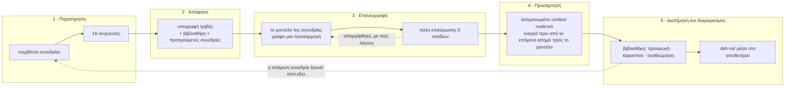

<div align="center">

[English](../../README.md) · [简体中文](README_zh.md) · [繁體中文](README_zh-TW.md) · [日本語](README_ja.md) · [한국어](README_ko.md) · [Türkçe](README_tr.md) · [Русский](README_ru.md) · [Tiếng Việt](README_vi.md) · [ไทย](README_th.md) · [Deutsch](README_de.md) · [Español](README_es.md) · [Français](README_fr.md) · [Українська](README_uk.md) · [Polski](README_pl.md) · [Português (Brasil)](README_pt-BR.md) · [العربية](README_ar.md) · [فارسی](README_fa.md) · [Bahasa Indonesia](README_id.md) · [Italiano](README_it.md) · **Ελληνικά** · [മലയാളം](README_ml.md) · [Roman Urdu](README_ur-Latn.md) · [Română](README_ro.md)

<br />


# DSHRSI: Recursive Self-Improvement, αναδρομική αυτοβελτίωση για το DeepSeek Harness

### **Παρατηρεί → Βελτιώνεται → Χτίζει πάνω σε αυτό → Ξανά. Ένα harness που γίνεται όλο και πιο δικό σου.**

<a href="https://qybaihe.github.io/dshrsi/trace.html">
  <picture>
    <source media="(prefers-color-scheme: dark)" srcset="../../assets/rsi-trace.dark.gif" />
    
  </picture>
</a>

**RSI σημαίνει Recursive Self-Improvement, αναδρομική αυτοβελτίωση, και το DSHRSI είναι το plugin ανοιχτού κώδικα που την κάνει πράξη στο DeepSeek Harness. Το harness παρακολουθεί τις δικές του εκτελέσεις, βάζει το ίδιο το μοντέλο της συνεδρίας να γράψει κώδικα harness για τα προβλήματα που βρίσκει, επικυρώνει αυτόν τον κώδικα σε μια πύλη 5 σταδίων και τον προσαρτά πριν τελειώσει ο γύρος. Έπειτα το βελτιωμένο harness τρέχει την επόμενη συνεδρία και βελτιώνεται ξανά. Χωρίς fine-tuning. Χωρίς σωρό από prompts. Κώδικας που μετριέται, κρατιέται, ξαναγράφεται ή πετιέται.**

[](#rsi)
[](https://github.com/deepseek-ai/deepseek-harness)
[](#coverage)
[](#how-it-works)
[](#project-harness)
[](#benchmarks)
[](#contributing)
[](../../LICENSE)

**[🌐 Ιστότοπος](https://qybaihe.github.io/dshrsi/) · [📖 Οδηγός αναφοράς του plugin](../../packages/dsh-rsi/README.md) · [🧩 Harness του project](../../packages/dsh-rsi/README.md#layers-and-the-project-harness) · [🔬 Πύλη επικύρωσης](../../packages/dsh-rsi/README.md#the-validation-gate) · [⚠️ Γνωστοί περιορισμοί](../../packages/dsh-rsi/README.md#known-limits) · [🐛 Issues](https://github.com/qybaihe/dshrsi/issues)**

[Τι σημαίνει RSI](#rsi) · [Γρήγορη εκκίνηση](#quick-start) · [Πώς δουλεύει](#how-it-works) · [Μετρημένα αποτελέσματα](#measured) · [Benchmarks](#benchmarks) · [Ανιχνευτές & δυνατότητες](#coverage) · [Harness του project](#project-harness) · [Προεπιλογές ασφαλείας](#security) · [Συχνές ερωτήσεις](#faq)

</div>

---

> [!IMPORTANT]
> **Προεπισκόπηση για προγραμματιστές:** Το DSHRSI είναι φτιαγμένο πάνω στο DeepSeek Harness `0.2.2-rc.3`, που είναι κι αυτό έκδοση προεπισκόπησης για προγραμματιστές. **Θα υπάρξουν αλλαγές που σπάνε τη συμβατότητα.**
> Μια προσαρμογή είναι κώδικας γραμμένος από μοντέλο, που τρέχει μέσα στο harness σου. Η απομόνωσή της προστατεύει από λάθη, **όχι από κακόβουλο κώδικα**. Διάβασε για [την πύλη επικύρωσης](../../packages/dsh-rsi/README.md#the-validation-gate) πριν το τρέξεις.

<div align="center">

</div>

<br />

<table>
<tr>
<td width="33%" valign="top">

### 🔴 Χωρίς το DSHRSI
Κάθε συνεδρία ανακαλύπτει από την αρχή τα ίδια δεδομένα: αυτό το μηχάνημα δεν έχει `python`, αυτό το αποθετήριο έχει έναν κανόνα που έχεις ήδη δηλώσει, αυτή η διόρθωση δεν επαληθεύτηκε ποτέ. Στην εκτέλεση ελέγχου (control run), **5 συνεδρίες στις 5** έκαναν την ίδια αποτυχημένη κλήση, και ένας κανόνας που είχε δηλώσει ο χρήστης παραβιάστηκε ξανά μία συνεδρία αργότερα.

</td>
<td width="33%" valign="top">

### 🧬 Με το DSHRSI
Όταν το πρόβλημα επανέρχεται, το μοντέλο γράφει ένα κομμάτι κώδικα harness, ο κώδικας περνά την πύλη και είναι ενεργός **μέσα στον ίδιο γύρο**. Σε 3 εκτελέσεις με πραγματικό μοντέλο, **7 συνεδρίες στις 7** μετά την προσαρμογή δεν είχαν καμία αποτυχημένη κλήση. Και η επόμενη βελτίωση ξεκινά από εκεί.

</td>
<td width="33%" valign="top">

### 🔒 Μόνο προς το αυστηρότερο, εκ σχεδιασμού
Μια προσαρμογή μπορεί να προσθέσει πληροφορία, να αρνηθεί μια κλήση, να σε ρωτήσει πρώτα ή να απαιτήσει επαλήθευση. **Καμία δυνατότητα δεν μπορεί να επιτρέψει κάτι που το harness θα αρνιόταν.** Η επανεγγραφή αποτελεσμάτων, η προσθήκη εργαλείων και η εκτέλεση εντολών περιμένουν την έγκρισή σου.

</td>
</tr>
</table>

---

<a id="rsi"></a>

## 🔁 RSI = Recursive Self-Improvement, αναδρομική αυτοβελτίωση

Όχι «rewrite itself». **Recursive Self-Improvement**, αναδρομική αυτοβελτίωση: ένα σύστημα χρησιμοποιεί τις δικές του ικανότητες για να βελτιώσει τον εαυτό του, και το βελτιωμένο σύστημα αναλαμβάνει τον επόμενο κύκλο. Τρεις λέξεις, και το DSHRSI πρέπει να κερδίσει την καθεμία:

| | Τι απαιτεί | Πώς το κάνει το DSHRSI |
| :--- | :--- | :--- |
| **Self (αυτο-)** | Αυτό που δρα και αυτό που αλλάζει είναι το ίδιο σύστημα | Το harness αλλάζει το harness. Την προσαρμογή τη γράφει το μοντέλο της ίδιας της συνεδρίας που έπεσε πάνω στο πρόβλημα. Κανείς δεν το ρυθμίζει απ' έξω |
| **Improvement (βελτίωση)** | Το «καλύτερο» πρέπει να μπορεί να ελεγχθεί | Κάθε προσαρμογή περνά από πύλη 5 σταδίων πριν προσαρτηθεί, και οι επόμενες συνεδρίες τη βάζουν ξανά σε δοκιμασία: ό,τι δουλεύει προάγεται, ό,τι πετάει σφάλμα μπαίνει σε καραντίνα |
| **Recursive (αναδρομική)** | Το αποτέλεσμα ενός κύκλου ξεκινά τον επόμενο | Η επόμενη συνεδρία τρέχει στο βελτιωμένο harness και παρατηρείται πάνω σε αυτό. Μια προσαρμογή που δεν έπιασε ξαναγράφεται αυστηρότερη με βάση τα στοιχεία. Μια προσαρμογή που χρειάζεται και σε δεύτερο χώρο εργασίας επεκτείνεται σε όλο το μηχάνημα, και οι κανόνες ενός project ταξιδεύουν στο harness κάθε μέλους της ομάδας |

**Τέσσερις βρόχοι, ο καθένας μέσα στον επόμενο:** μέσα σε έναν γύρο → από συνεδρία σε συνεδρία → η ίδια η βελτίωση βελτιώνεται → από το project στο μηχάνημα και στην ομάδα.

Τι σκόπιμα **δεν** είναι αναδρομικό: τα βάρη του μοντέλου δεν αλλάζουν ποτέ, και οι ανιχνευτές, η πολιτική ενεργοποίησης και η πύλη επικύρωσης είναι σταθερός κώδικας που καμία προσαρμογή δεν μπορεί να αγγίξει. Το κομμάτι που τροποποιεί τον εαυτό του ελέγχεται από ένα κομμάτι που δεν μπορεί να τροποποιήσει.

---

<a id="quick-start"></a>

## ⚡ Γρήγορη εκκίνηση σε 30 δευτερόλεπτα

### 1. Εγκατάστησέ το εκεί που ήδη δουλεύεις
Στην εφαρμογή desktop ή στο Web UI του DeepSeek Harness, άνοιξε **Plugins → Add plugin → Install a third-party plugin**, επικόλλησε τη διεύθυνση του πακέτου της έκδοσης, πάτησε **Install** και μετά **Enable now**:

```text
https://github.com/qybaihe/dshrsi/releases/download/v0.1.1/dsh-rsi-0.1.1.tgz
```

Ή από τη γραμμή εντολών. Κάθε προφίλ κρατά τα δικά του plugins, και το `dsh plugin add` καλεί το `pnpm`, που πρέπει να βρίσκεται στο `PATH`:

```bash
dsh plugin --profile web add https://github.com/qybaihe/dshrsi/releases/download/v0.1.1/dsh-rsi-0.1.1.tgz
dsh web
```

### 2. Απλώς δούλεψε
Δεν χρειάζεται καμία ρύθμιση. Το DSHRSI μένει αθέατο μέχρι να επανέλθει το ίδιο πρόβλημα. Τότε ανάβει το badge **RSI**, το pill κάτω από το πεδίο εισαγωγής σου λέει ότι το harness μόλις άλλαξε τον εαυτό του, και η επόμενη συνεδρία ξεκινά ήδη βελτιωμένη:

<div align="center">

</div>

Γράψε `/rsi` σε οποιαδήποτε συνεδρία για να δεις τι είναι προσαρτημένο, σε ποιο επίπεδο ανήκει και τι περιμένει την έγκρισή σου.

### 3. Δώσε σε ένα αποθετήριο το δικό του harness
Οι κανόνες που μαθαίνονται σε ένα αποθετήριο μπορούν να ζουν μέσα σε αυτό, ένα αρχείο ανά προσαρμογή:

```bash
# Η εντολή έρχεται μαζί με το plugin, μέσα στο προφίλ όπου εγκαταστάθηκε
alias dsh-rsi="$HOME/.dsh/profiles/web/node_modules/.bin/dsh-rsi"

dsh-rsi project init      # μέσα στο αποθετήριο: δημιουργεί το .dsh-rsi/, μετά κάνε το commit
dsh-rsi trust             # σε κάθε άλλο μηχάνημα: αποδέξου τα αρχεία αφού τα διαβάσεις
```

### 4. Τρέξε το από τον πηγαίο κώδικα

```bash
git clone https://github.com/qybaihe/dshrsi.git && cd dshrsi
npm install               # φέρνει μια κλειδωμένη έκδοση του dsh και το pnpm που αυτό καλεί
npx dsh plugin --profile web add "$PWD/packages/dsh-rsi"
npx dsh web
```

Τα προφίλ `desktop` και `headless`, τα ευρετήρια plugins, τα τοπικά tarballs και η φόρτωση για μία μόνο εκτέλεση καλύπτονται στον [οδηγό αναφοράς του plugin](../../packages/dsh-rsi/README.md#install).

---

<a id="how-it-works"></a>

## 🧠 Πώς δουλεύει το DSHRSI: ένας κλειστός βρόχος μέσα στο harness, ξανά και ξανά

Τα skills, τα αρχεία μνήμης και τα μακρύτερα system prompts δουλεύουν όλα σε επίπεδο context: προσθέτουν κείμενο και ελπίζουν ότι το μοντέλο θα το ακολουθήσει. Όταν δεν το ακολουθεί, η ίδια αποτυχημένη κλήση γίνεται ξανά στην επόμενη συνεδρία.

**Το DSHRSI δουλεύει σε επίπεδο harness. Ό,τι μαθαίνει γίνεται κώδικας πάνω στα σημεία επέκτασης του ίδιου του harness:**



| Στάδιο | Μηχανισμός | Αποτέλεσμα |
| :--- | :--- | :--- |
| **1. Παρατήρηση** | 16 ανιχνευτές διαβάζουν κανονικοποιημένα συμβάντα συνεδρίας: κλήσεις που αποτυγχάνουν ξανά, αιτίες αποτυχίας που επανέρχονται, σπασμωδικές απόπειρες, διορθώσεις από τον χρήστη, γύρους που τελειώνουν χωρίς να έχει επαληθευτεί τίποτα. | Το πρόβλημα αποκτά μια υπογραφή που μένει σταθερή από συνεδρία σε συνεδρία, όπως `bash:command-not-found:python`. |
| **2. Επανεγγραφή** | Το ίδιο το μοντέλο της συνεδρίας γράφει μια προσαρμογή σε JavaScript πάνω σε ένα API 10 δυνατοτήτων. Ο κώδικας που απορρίπτεται γυρίζει πίσω μαζί με τους λόγους, το πολύ δύο φορές, και μετά αναλαμβάνει ένα ενσωματωμένο template. | Η διόρθωση είναι κώδικας harness, όχι μία ακόμη παράγραφος στο prompt. |
| **3. Επικύρωση** | Στατικός έλεγχος → φόρτωση → αναπαραγωγή → regression → δικαιώματα. Η προσαρμογή πρέπει να δρα πάνω στις κλήσεις που την προκάλεσαν και να αφήνει ανέγγιχτη κάθε κλήση που πέτυχε σε αυτή τη συνεδρία. | Κώδικας που δεν κάνει τίποτα, ή που χαλάει κάτι που ήδη δούλευε, δεν προσαρτάται ποτέ. |
| **4. Προσάρτηση** | Η προσαρμογή τρέχει στο δικό της context `node:vm` πίσω από μια γέφυρα JSON, με timeout σε κάθε κλήση, και ισχύει πριν από το επόμενο αίτημα προς το μοντέλο. | Ο γύρος που έπεσε πάνω στο πρόβλημα είναι ο πρώτος που ωφελείται. |
| **5. Διατήρηση και διαμοιρασμός** | Μια βιβλιοθήκη ανά μηχάνημα, με ledger και audit log. Ό,τι δουλεύει προάγεται, ό,τι πετάει σφάλμα μπαίνει σε καραντίνα, ό,τι δεν έπιασε ξαναγράφεται αυστηρότερο, και οι κανόνες του project γράφονται στο `.dsh-rsi/`. | Η επόμενη συνεδρία ξεκινά ήδη προσαρμοσμένη, και τα υπόλοιπα μέλη της ομάδας παίρνουν τους κανόνες του project μετά από ένα `dsh-rsi trust`. |
| **↻ Ξανά** | Η επόμενη συνεδρία τρέχει στο harness που άφησε πίσω του το στάδιο 5, και το στάδιο 1 την παρατηρεί με όλες τις προσαρμογές στη θέση τους. | Η βελτίωση χτίζεται πάνω στη βελτίωση. Αυτή είναι η αναδρομή. |

---

<a id="measured"></a>

## 🔬 Μετρήσεις με πραγματικό μοντέλο

Αυτοί οι αριθμοί προέρχονται από ένα πραγματικό μοντέλο, το `mimo-v2.6-pro`, σε πραγματικές συνεδρίες `dsh` (`npm run test:live`). Τίποτα σε αυτόν τον πίνακα δεν είναι προσομοιωμένο.

> **Πώς να το διαβάσεις:** το δείγμα είναι μικρό. Ένα μοντέλο, τρία σενάρια, λίγες συνεδρίες το καθένα. Δείχνει ότι ο βρόχος δουλεύει από άκρη σε άκρη. **Δεν** είναι στατιστικό συμπέρασμα για ποσοστά επιτυχίας, και τίποτα δεν έγινε πιο γρήγορο: για να γραφτεί μια προσαρμογή, περιμένεις το μοντέλο 30–60 δευτερόλεπτα. Οι μεγαλύτερες εκτελέσεις βρίσκονται στα [Benchmarks](#benchmarks).

| Σενάριο | Χωρίς το DSHRSI | Με το DSHRSI | Τι έγραψε το harness |
| :--- | :--- | :--- | :--- |
| **Εντολή που λείπει**: το README λέει `python stats.py`, το μηχάνημα έχει μόνο `python3` | ❌ **5 / 5** συνεδρίες έκαναν την αποτυχημένη κλήση | ✅ **0 / 7** συνεδρίες μετά την προσαρμογή (9 / 9 πριν από αυτήν) | `deny` + `prompt`, γραμμένα από το μοντέλο, πέρασαν την πύλη με την πρώτη προσπάθεια |
| **Ένας κανόνας που ο χρήστης είπε μία φορά**: «ποτέ μην τροποποιείς το `notes.txt`, γράφε στο `notes.draft.txt`» | ❌ Η επόμενη συνεδρία τροποποίησε το `notes.txt` | ✅ Η επόμενη συνεδρία έγραψε στο `notes.draft.txt` χωρίς να της το πει κανείς | `deny` + `prompt`, γραμμένα από το μοντέλο αμέσως μετά τη διόρθωση |
| **Μια διόρθωση που κανείς δεν ζήτησε να επαληθευτεί** | δεν εκτελέστηκε | ⚪ Δεν γράφτηκε τίποτα: το μοντέλο επαλήθευσε τη διόρθωσή του σε 3 / 3 συνεδρίες, άρα δεν υπήρχε τίποτα να μάθει | καμία |

Το πρώτο σενάριο εκτελέστηκε τρεις φορές με το plugin, κάθε φορά από άδεια βιβλιοθήκη, συν μία εκτέλεση ελέγχου. Το δεύτερο εκτελέστηκε μία φορά με το plugin και μία χωρίς.

**Εντολή που λείπει, συνεδρία προς συνεδρία** (αποτυχημένες κλήσεις εργαλείων ανά συνεδρία):

| Εκτέλεση | S1 | S2 | S3 | S4 | S5 | S6 |
| :--- | :---: | :---: | :---: | :---: | :---: | :---: |
| **Χωρίς το DSHRSI** | ❌ 1 | ❌ 1 | ❌ 1 | ❌ 1 | ❌ 1 | |
| **Με το DSHRSI · εκτέλεση 1** | ❌ 1 | ❌ 1 | ❌ 1 → 🧬 | ✅ 0 | ✅ 0 | ✅ 0 |
| **Με το DSHRSI · εκτέλεση 2** | ❌ 1 | ❌ 1 | ❌ 1 → 🧬 | ✅ 0 | ✅ 0 | |
| **Με το DSHRSI · εκτέλεση 3** | ❌ 1 | ❌ 1 | ❌ 1 → 🧬 | ✅ 0 | ✅ 0 | |

Το 🧬 σημειώνει τον γύρο στον οποίο το μοντέλο έγραψε την προσαρμογή και το harness την προσάρτησε. Σε 3 από τις 7 συνεδρίες που ακολούθησαν, το μοντέλο δοκίμασε και πάλι `python`, και το harness αρνήθηκε την κλήση πριν εκτελεστεί. Κάθε συνεδρία σε αυτό το σενάριο κατέληξε στη σωστή απάντηση, με ή χωρίς το plugin.

Για αναπαραγωγή τοπικά:

```bash
MIMO_API_KEY=... npm run test:live -- python --sessions 6          # με το plugin
MIMO_API_KEY=... npm run test:live -- python --sessions 5 --off    # εκτέλεση ελέγχου, χωρίς το plugin
```

<details>
<summary><strong>Τι δεν έχει επαληθευτεί σε αυτό το μηχάνημα (κλικ για ανάπτυξη)</strong></summary>

<br />

Αυτά τα μονοπάτια υπάρχουν στον κώδικα και καλύπτονται από unit ή end-to-end tests με προσομοιωμένο μοντέλο, αλλά δεν έχουν παρατηρηθεί σε πραγματική συνεδρία ή σε πραγματική εφαρμογή:

| Περιοχή | Γιατί δεν έχει επαληθευτεί εδώ |
| :--- | :--- |
| Η εφαρμογή desktop του DeepSeek Harness | Δεν είναι εγκατεστημένη στο μηχάνημα ανάπτυξης. Επαληθεύτηκε στο προφίλ `web` και στον μηχανισμό εγκατάστασης που τυλίγει η εφαρμογή |
| `negative-feedback`, `approval-denied`, `context-pressure`, `model-instability` | Δοκιμασμένα μόνο με κατασκευασμένα συμβάντα, δεν ενεργοποιήθηκαν ποτέ σε πραγματική συνεδρία |
| Αυτοματοποιημένα tests σε browser | Κανένα. Το UI ελέγχθηκε με το χέρι στην πραγματική σελίδα `dsh web`, σε φωτεινό και σκοτεινό θέμα |
| Προφίλ ACP και SDK | Εκεί δεν υπάρχει UI, και δεν έχουν επαληθευτεί |
| Μοντέλα εκτός της οικογένειας MiMo v2.6 | Καμία εκτέλεση ακόμη. Τα benchmarks χρησιμοποίησαν τα `mimo-v2.6-pro` και `mimo-v2.6-flash`. Τα τρία παραπάνω σενάρια χρησιμοποίησαν το `mimo-v2.6-pro` |

</details>

---

<a id="benchmarks"></a>

## 📊 Benchmarks: τέσσερις σουίτες, δύο μοντέλα, εργασία προς εργασία

Το σκέτο DeepSeek Harness απέναντι στο DeepSeek Harness + DSHRSI, σε 3,390 πραγματικές συνεδρίες `dsh`: το ίδιο μοντέλο, τα ίδια prompts, το ίδιο sandbox, οι ίδιες εργασίες. Το plugin τρέχει με τις προεπιλεγμένες ρυθμίσεις του και ξεκινά κάθε σουίτα με άδεια βιβλιοθήκη. Εργασίες που λύθηκαν στις τρεις σουίτες που έτρεξαν ως το τέλος:

<!-- bench:table:start -->
| Benchmark | Εργασίες | `mimo-v2.6-pro` σκέτο | `mimo-v2.6-pro` + DSHRSI | `mimo-v2.6-flash` σκέτο | `mimo-v2.6-flash` + DSHRSI |
| :--- | ---: | ---: | ---: | ---: | ---: |
| **Aider Polyglot**, με την πρώτη προσπάθεια | 225 | 224 (99.6%) | 224 (99.6%) | 220 (97.8%) | 223 (99.1%) |
| **Aider Polyglot**, μέσα σε δύο προσπάθειες | 225 | 225 (100.0%) | 225 (100.0%) | 225 (100.0%) | 225 (100.0%) |
| **HumanEval** | 164 | 163 (99.4%) | 162 (98.8%) | 162 (98.8%) | 162 (98.8%) |
| **HumanEval+** | 164 | 156 (95.1%) | 157 (95.7%) | 153 (93.3%) | 153 (93.3%) |
| **MBPP** | 378 | 374 (98.9%) | 371 (98.1%) | 368 (97.4%) | 369 (97.6%) |
| **MBPP+** | 378 | 320 (84.7%) | 319 (84.4%) | 308 (81.5%) | 315 (83.3%) |
<!-- bench:table:end -->

<div align="center">
<picture>
  <source media="(prefers-color-scheme: dark)" srcset="../../assets/bench-flash.dark.png" />
  
</picture>
</div>

> **Πώς να το διαβάσεις:** στις εργασίες που λύθηκαν, τα δύο harness **δεν διακρίνονται το ένα από το άλλο**. Το μεγαλύτερο κέρδος είναι +7 (MBPP+ με `mimo-v2.6-flash`), η μεγαλύτερη απώλεια είναι −3 (MBPP με `mimo-v2.6-pro`), και καμία διαφορά δεν στέκει σε ακριβή έλεγχο McNemar πάνω στις ίδιες εργασίες (μικρότερο p = 0.17). Όταν ο agent μπορεί να τρέξει τον δικό του κώδικα, αυτές οι σουίτες βρίσκονται κοντά στο ταβάνι τους και για τα δύο μοντέλα, και κάθε εργασία είναι ένας καινούργιος, καθαρός κατάλογος: ελάχιστα πράγματα επανέρχονται ώστε να έχει κάτι να μάθει ένα harness.

**Αυτό που όντως έκανε το DSHRSI, χωρίς ούτε μία υπόδειξη, ήταν να αλλάξει τον εαυτό του.** Στις οκτώ εκτελέσεις τα μοντέλα έγραψαν **56 προσαρμογές**. Από αυτές έδρασαν οι 15, και 10 από εκείνες είχαν επεκταθεί σε όλο το μηχάνημα. Για καθεμία από τις 10 πήραμε τις εργασίες που ξεκίνησαν μετά από αυτήν και τις συγκρίναμε με τις ίδιες ακριβώς εργασίες στο σκέτο DSH:

| Προσαρμογή που έγραψε το μοντέλο | Αποτυχία στην οποία απαντά | Σκέτο DSH | DSH + DSHRSI | p |
| :--- | :--- | ---: | ---: | ---: |
| *Stop inline python checks that abort on first mismatch* (MBPP, `mimo-v2.6-pro`) | Εκτέλεση tests που πεθαίνει στο πρώτο αποτυχημένο assertion | 16 από 310 εργασίες | **3 από 310** | 0.002 |
| *Redirect missing lib.rs reads to a glob lookup* (Polyglot, `mimo-v2.6-flash`) | Ανάγνωση του `lib.rs` σε διαδρομή που δεν υπάρχει | 7 από 151 εργασίες | **1 από 151** | 0.07 |
| Οι άλλες 8 | | καμία μετρήσιμη αλλαγή | | |

Καμία από τις δύο δεν έκανε περισσότερες εργασίες να περάσουν, και το plugin κόστισε περίπου 8–9% παραπάνω σε χρόνο agent και σε input tokens. Και οι δέκα παρατίθενται στο [`bench/README.md`](../../bench/README.md#did-those-adaptations-work).

**Το LiveCodeBench v6 διακόπηκε πρόωρα:** ο λογαριασμός του μοντέλου έμεινε από υπόλοιπο στη μέση της διαδρομής. Στις εργασίες που είχαν ολοκληρώσει ως τότε και οι δύο πλευρές, το σκέτο DSH έλυσε 94 και το DSHRSI 96 από τις 105 με `mimo-v2.6-pro`, και 42 έναντι 42 από τις 51 με `mimo-v2.6-flash`. Για τον ίδιο λόγο δεν έχει εκτελεστεί ακόμη το δεύτερο πέρασμα, δηλαδή οι ίδιες εργασίες ξανά, πάνω στη βιβλιοθήκη που άφησε πίσω του το πρώτο.

Για αναπαραγωγή τοπικά:

```bash
bench/setup.sh                                                        # toolchains, datasets, κώδικας βαθμολόγησης
MIMO_API_KEY=... node bench/run.mjs polyglot --arm dsh --run dsh-p1   # σκέτο DeepSeek Harness
MIMO_API_KEY=... node bench/run.mjs polyglot --arm rsi --run rsi-p1   # με το plugin
node bench/report.mjs --write                                         # πίνακες και bench/results/*.json
```

Το πρωτόκολλο, οι πίνακες κόστους και αποτυχιών και οι περιορισμοί βρίσκονται στο [`bench/README.md`](../../bench/README.md), και τα αποτελέσματα ανά εργασία στο [`bench/results/`](../../bench/results).

---

<a id="coverage"></a>

## 🛡️ Ανιχνευτές & δυνατότητες

**16 ανιχνευτές** αποφασίζουν πότε πρέπει να αλλάξει το harness. Οι ίδιοι ανιχνευτές τρέχουν σε ζωντανή συνεδρία και σε συνεδρία αποθηκευμένη στον δίσκο (`dsh-rsi mine`):

| Ανιχνευτής | Τι εντοπίζει | Αντίδραση |
| :--- | :--- | :---: |
| `repeat-failing-call` | Η ίδια κλήση αποτυγχάνει ξανά με τα ίδια ορίσματα | προσαρμογή |
| `failure-signature` | Η ίδια αιτία αποτυχίας επανέρχεται συνεχώς: εντολή που λείπει, εξάρτηση που λείπει, δίκτυο, δικαιώματα, θύρα σε χρήση, διαδρομή που δεν βρέθηκε, αναντιστοιχία σε edit, μη έγκυρα ορίσματα, εξάντληση μνήμης | προσαρμογή |
| `command-flailing` | Το ίδιο είδος εντολής αποτυγχάνει απανωτά με διαφορετικά ορίσματα | προσαρμογή |
| `read-thrash` | Το ίδιο αρχείο, χωρίς να έχει αλλάξει, διαβάζεται ξανά και ξανά | προσαρμογή |
| `edit-churn` | Το ίδιο αρχείο τροποποιείται πολλές φορές μέσα σε έναν γύρο | προσαρμογή |
| `error-storm` | Οι περισσότερες από τις πρόσφατες κλήσεις εργαλείων απέτυχαν | προσαρμογή |
| `stall` | Απανωτές αποτυχίες, χωρίς καμία επιτυχία ενδιάμεσα | προσαρμογή |
| `timeout-recurrence` | Το ίδιο είδος εντολής κάνει συνεχώς timeout | προσαρμογή |
| `output-flood` | Το ίδιο είδος εντολής βγάζει συνεχώς υπερβολικά μεγάλη έξοδο | προσαρμογή |
| `approval-denied` / `denied-repeat` | Ο χρήστης αρνείται συνεχώς το ίδιο είδος ενέργειας, ή μια κλήση που απορρίφθηκε επαναλαμβάνεται αυτούσια | προσαρμογή |
| `user-correction` | Ο χρήστης διόρθωσε το μοντέλο, ή το διέκοψε και άλλαξε κατεύθυνση | προσαρμογή |
| `premature-completion` | Άλλαξε κώδικας και ο γύρος πάει να τελειώσει χωρίς να έχει τρέξει κανένας έλεγχος | προσαρμογή |
| `negative-feedback` | Ο χρήστης σημείωσε μια απάντηση ως κακή και έγραψε τον λόγο | προσαρμογή |
| `user-interrupt` | Ο χρήστης διέκοψε στη μέση του γύρου | καταγραφή |
| `model-instability` | Τα αιτήματα προς το μοντέλο αποτυγχάνουν συνεχώς, επαναλαμβάνονται ή χτυπούν το όριο εξόδου | καταγραφή |
| `context-pressure` | Το context συμπιέστηκε στη μέση της εργασίας | καταγραφή |

**10 δυνατότητες** είναι όλα όσα μπορεί να κάνει μια προσαρμογή. Φτάνει στο harness μόνο μέσα από αυτές:

| Δυνατότητα | Τι κάνει | Βαθμίδα |
| :--- | :--- | :---: |
| `annotate` | Προσθέτει μια σημείωση στο τέλος ενός αποτελέσματος εργαλείου | ✅ αυτόματη |
| `steer` | Προσθέτει μια σημείωση πριν από το επόμενο αίτημα προς το μοντέλο | ✅ αυτόματη |
| `deny` | Αρνείται μια κλήση εργαλείου και δίνει τον λόγο | ✅ αυτόματη |
| `ask` | Απαιτεί την έγκριση του χρήστη για μια κλήση | ✅ αυτόματη |
| `block` | Μετατρέπει ένα αποτέλεσμα εργαλείου σε σφάλμα που φέρει μια διόρθωση | ✅ αυτόματη |
| `verify` | Δεν αφήνει τον γύρο να τελειώσει όσο δεν ικανοποιείται μια συνθήκη | ✅ αυτόματη |
| `prompt` | Προσθέτει μια μόνιμη ενότητα στο system prompt | ✅ αυτόματη |
| `rewrite` | Αντικαθιστά το κείμενο ενός αποτελέσματος εργαλείου | 🔐 θέλει έγκριση |
| `tool` | Καταχωρίζει ένα νέο εργαλείο για το μοντέλο | 🔐 θέλει έγκριση |
| `exec` | Εκτελεί μια εντολή μέσω του εργαλείου shell του harness, με τους ίδιους κανόνες sandbox και έγκρισης | 🔐 θέλει έγκριση |

Αυτή είναι η προσαρμογή που έγραψε το μοντέλο στο πρώτο σενάριο παραπάνω:

```js
define({
  title: 'Route python invocations to python3',
  description: '...',
  capabilities: ['deny', 'prompt'],
  setup(h) {
    h.promptSection('On this machine there is no `python` executable; use `python3`.')
    h.beforeTool({ tool: 'bash', command: /(^|[;&|(]\s*)python(\s|$)/ },
      () => h.deny('`python` is not installed on this machine. Use `python3` instead.'))
  },
})
```

---

<a id="project-harness"></a>

## 🧩 Τρία επίπεδα, και ένα harness ανά project

Κάθε προσαρμογή ανήκει σε ένα από τρία επίπεδα. Κάθε επίπεδο μπορεί να απενεργοποιηθεί ξεχωριστά:

| Επίπεδο | Τι περιέχει | Παράδειγμα | Πού ισχύει |
| :--- | :--- | :--- | :--- |
| **`machine`** | Δεδομένα για αυτόν τον υπολογιστή | Δεν υπάρχει `python`, μια θύρα είναι πιασμένη, ένας εσωτερικός host δεν επιλύεται | Στον χώρο εργασίας όπου μαθεύτηκε, και μετά σε όλο το μηχάνημα μόλις το συναντήσει και δεύτερος χώρος εργασίας |
| **`user`** | Πώς θέλεις να σου φέρονται | Μια απάντηση που σημειώθηκε ως κακή με αιτιολογία «πολύ μεγάλη» | Σε όλο το μηχάνημα |
| **`project`** | Οι κανόνες και οι συνήθειες ενός αποθετηρίου | «Αυτό το αποθετήριο χρησιμοποιεί pnpm, πάντα» | Στον χώρο εργασίας, και στο ίδιο το αποθετήριο μέσω του `.dsh-rsi/` |

**Το επίπεδο project ταξιδεύει μαζί με τον κώδικα:**

```
.dsh-rsi/
  harness.json           δείκτης μορφής και ρυθμίσεις σε επίπεδο project
  adaptations/
    remember-the-user-s-instruction-3f2a1c.js     μαθεύτηκε και μετά γράφτηκε εδώ
    no-force-push.js                              μια γραμμένη με το χέρι δουλεύει με τον ίδιο τρόπο
```

- **Κάνε commit για να μοιραστείς, σβήσε για να αποσυνδέσεις.** Ένα αρχείο είναι μία προσαρμογή.
- **Τίποτα δεν τρέχει μόνο και μόνο επειδή έγινε clone.** Κάθε μηχάνημα αποδέχεται το ακριβές περιεχόμενο των αρχείων με `dsh-rsi trust`, και το αποδέχεται ξανά όταν αυτά αλλάξουν.
- **Ένα project μπορεί μόνο να κάνει το harness πιο συντηρητικό**, ποτέ λιγότερο. Ρυθμίσεις όπως το `autonomy` είναι έξω από την εμβέλεια ενός project.
- **Φορητό και πέρα από ένα αποθετήριο.** Τα `dsh-rsi export` και `dsh-rsi import` μεταφέρουν τα επίπεδα του μηχανήματος και του χρήστη σε άλλον υπολογιστή ως ένα αρχείο.

---

<a id="security"></a>

## 🔒 Ασφάλεια & προεπιλεγμένες ρυθμίσεις

- **Αυτόματη βαθμίδα μόνο προς το αυστηρότερο** — Χωρίς την έγκρισή σου, μια προσαρμογή μπορεί μόνο να προσθέσει πληροφορία, να αρνηθεί, να ρωτήσει ή να απαιτήσει επαλήθευση. Τα `deny` και `ask` της μπορούν μόνο να κάνουν αυστηρότερη την ετυμηγορία των άλλων πολιτικών.
- **Η ισχύς θέλει έγκριση (`autonomy: tighten`)** — Οι προσαρμογές που ξαναγράφουν αποτελέσματα, προσθέτουν εργαλεία ή εκτελούν εντολές αποθηκεύονται ως `proposed` και περιμένουν το `dsh-rsi approve <id>`.
- **Αόρατο μέχρι να χρειαστεί** — Χωρίς τριβή και χωρίς τίποτα προσαρτημένο, το system prompt, η λίστα εργαλείων και τα μηνύματα μένουν ίδια byte προς byte. Ένα end-to-end test το φυλάει.
- **Αστοχίες που δεν εξαπλώνονται** — Ένας handler που πετάει exception δεν επηρεάζει ποτέ την κλήση εργαλείου στην οποία είναι δεμένος. Μετά από τρία σφάλματα η προσαρμογή μπαίνει σε καραντίνα.
- **Όλα καταγράφονται** — Κάθε απόφαση βρίσκεται στο `audit.jsonl`, κάθε τριβή, προσάρτηση και ενέργεια στο `ledger.jsonl`. Τα `dsh-rsi disable`, `retire` και `rollback` βγάζουν μια προσαρμογή εκτός ή τη γυρίζουν πίσω.
- **Τρεις λειτουργίες** — Το `adapt` προσαρτά απευθείας (η προεπιλογή), το `propose` παράγει και σε περιμένει, το `observe` μόνο καταγράφει.

---

<a id="faq"></a>

## ❓ Συχνές ερωτήσεις

<details>
<summary><strong>Κάνει το DSHRSI fine-tuning ή αλλάζει το μοντέλο;</strong></summary>

Όχι. Τα βάρη του μοντέλου μένουν ανέγγιχτα και τίποτα δεν εκπαιδεύεται. Αυτό που αλλάζει είναι το harness: ο κώδικας που τρέχει γύρω από τα prompts και τις κλήσεις εργαλείων του μοντέλου. Το RSI εδώ είναι αναδρομική αυτοβελτίωση σε επίπεδο harness: βελτιώνει τον εαυτό του από τις δικές του εκτελέσεις, και κάθε κύκλος ξεκινά από το harness που άφησε πίσω του ο προηγούμενος.
</details>

<details>
<summary><strong>Είναι στ' αλήθεια «αναδρομικό», ή απλώς ένα harness που μαθαίνει κανόνες;</strong></summary>

Η αναδρομή είναι συγκεκριμένη και βρίσκεται μέσα στον κώδικα. Μια νέα συνεδρία προσαρτά ό,τι περιέχει η βιβλιοθήκη, οπότε οι ανιχνευτές παρατηρούν ένα harness που έχει ήδη αλλάξει. Όταν το ίδιο πρόβλημα εμφανιστεί δύο φορές σε συνεδρίες που είχαν μια προσαρμογή προσαρτημένη, το μοντέλο παίρνει τον τρέχοντα πηγαίο κώδικα και τα στοιχεία και γράφει μια αυστηρότερη εκδοχή. Η παλιά κρατιέται για rollback. Ένα πρόβλημα που εμφανίζεται και σε δεύτερο χώρο εργασίας επεκτείνει την προσαρμογή σε όλο το μηχάνημα. Αυτό που μένει έξω από την αναδρομή είναι ο κριτής: ανιχνευτές, πολιτική ενεργοποίησης και πύλη επικύρωσης δεν μπορούν να αλλάξουν από καμία προσαρμογή.
</details>

<details>
<summary><strong>Σε τι διαφέρει από τα skills, τα αρχεία μνήμης ή ένα μακρύτερο system prompt;</strong></summary>

Εκείνα προσθέτουν κείμενο που το μοντέλο μπορεί να ακολουθήσει, μπορεί και όχι. Μια προσαρμογή είναι κώδικας πάνω στα σημεία επέκτασης του harness: μπορεί να αρνηθεί μια κλήση εργαλείου πριν εκτελεστεί, να απαιτήσει την έγκρισή σου ή να μην αφήσει έναν γύρο να τελειώσει όσο δεν έχει επαληθευτεί τίποτα. Στις μετρημένες εκτελέσεις, το μοντέλο δοκίμασε και πάλι `python` σε 3 συνεδρίες αφού του είχε ειπωθεί να μην το κάνει, και η κλήση απορρίφθηκε πριν εκτελεστεί.
</details>

<details>
<summary><strong>Καθυστερεί τις συνεδρίες μου;</strong></summary>

Για να γραφτεί μια προσαρμογή χρειάζεται μία πλήρης απάντηση του μοντέλου: 30–60 δευτερόλεπτα στο `mimo-v2.6-pro`, κατά τα οποία το βήμα μένει στάσιμο. Οι προσαρτημένες προσαρμογές τρέχουν μέσα στο ίδιο process, με timeouts. Καμία επιτάχυνση δεν μετρήθηκε και δεν ισχυριζόμαστε καμία.
</details>

<details>
<summary><strong>Μπορεί μια προσαρμογή γραμμένη από μοντέλο να κάνει κάτι επικίνδυνο;</strong></summary>

Η αυτόματη βαθμίδα δεν μπορεί να επιτρέψει τίποτα που το harness θα αρνιόταν, και οι ισχυρές δυνατότητες περιμένουν την έγκρισή σου. Ο κώδικας τρέχει στο δικό του context `node:vm` πίσω από μια γέφυρα JSON. Αυτό προστατεύει από λάθη και από απρόσεκτη κακή χρήση. **Δεν** είναι όριο ασφαλείας απέναντι σε κακόβουλο κώδικα, γι' αυτό διάβασε τα αρχεία `.dsh-rsi/` ενός project πριν τρέξεις `dsh-rsi trust`.
</details>

<details>
<summary><strong>Με ποια μοντέλα δουλεύει;</strong></summary>

Τις προσαρμογές τις γράφει το τρέχον μοντέλο της συνεδρίας, ή εκείνο που ορίζεις με τα `provider` και `model`. Αν το μοντέλο δεν μπορεί να βγάλει κώδικα που περνά την πύλη, αναλαμβάνουν τα ενσωματωμένα templates. Οι ως τώρα εκτελέσεις χρησιμοποίησαν δύο μοντέλα μίας οικογένειας, τα `mimo-v2.6-pro` και `mimo-v2.6-flash`.
</details>

<details>
<summary><strong>Δουλεύει στην εφαρμογή desktop του DeepSeek Harness;</strong></summary>

Διανέμεται ως ένα συνηθισμένο plugin τρίτων, με τα μεταδεδομένα που διαβάζουν οι σελίδες των plugins, και εγκαθίσταται στο προφίλ `web` που τυλίγει η εφαρμογή. Δεν έχει επαληθευτεί ακόμη μέσα στην πραγματική εφαρμογή desktop.
</details>

<details>
<summary><strong>Πώς βλέπω, αναιρώ ή απενεργοποιώ όσα έμαθε;</strong></summary>

Με `/rsi` μέσα σε μια συνεδρία, ή με `dsh-rsi status` σε ένα τερματικό. Το `dsh-rsi show <id>` τυπώνει τον πηγαίο κώδικα και την αναφορά επικύρωσης μιας προσαρμογής. Τα `disable`, `retire` και `rollback` τη βγάζουν εκτός ή τη γυρίζουν πίσω. Όρισε `mode: observe` για να καταγράφει χωρίς να αλλάζει τίποτα.
</details>

---

<a id="docs"></a>

## 📚 Τεκμηρίωση & σύνδεσμοι

- [📖 Οδηγός αναφοράς του plugin](../../packages/dsh-rsi/README.md) — κάθε ανιχνευτής, δυνατότητα, εντολή και ρύθμιση
- [🚀 Πηγές εγκατάστασης & προφίλ](../../packages/dsh-rsi/README.md#install)
- [🧩 Τα επίπεδα & το harness του project](../../packages/dsh-rsi/README.md#layers-and-the-project-harness)
- [🔬 Η πύλη επικύρωσης](../../packages/dsh-rsi/README.md#the-validation-gate)
- [🛠️ Γραμμή εντολών `dsh-rsi`](../../packages/dsh-rsi/README.md#command-line) · [⚙️ Ρυθμίσεις](../../packages/dsh-rsi/README.md#configuration)
- [⚠️ Γνωστοί περιορισμοί](../../packages/dsh-rsi/README.md#known-limits)
- [📊 Πρωτόκολλο & αποτελέσματα των benchmarks](../../bench/README.md)
- [🌐 Πηγαίος κώδικας του website](../../website) — αναδρομική αυτοβελτίωση, πώς δουλεύει, πώς γράφονται οι προσαρμογές, αξιολόγηση. Άνοιξε το `website/index.html` σε έναν browser
- [🧱 DeepSeek Harness](https://github.com/deepseek-ai/deepseek-harness) — το harness στο οποίο συνδέεται αυτό το plugin

<a id="contributing"></a>

## 🤝 Συνεισφορά & κοινότητα

Issues και PRs είναι ευπρόσδεκτα στο [qybaihe/dshrsi](https://github.com/qybaihe/dshrsi). Πριν υποβάλεις ένα PR:

```bash
npm install && npm test    # 130 unit tests και μετά 29 end-to-end tests, δεν χρειάζεται κλειδί
```

Τα end-to-end tests αντικαθιστούν το endpoint του μοντέλου με ένα προσομοιωμένο. Όλα τα άλλα είναι πραγματικά: το process `dsh`, η εκτέλεση εργαλείων, το log της συνεδρίας και η εγκατάσταση του plugin.

```
packages/dsh-rsi/        το πακέτο του plugin (απλό ESM, χωρίς βήμα build)
  index.js               πλευρά host: συνδέσεις με τα σημεία επέκτασης του DSH
  client.js              πλευρά browser: badge RSI και pill κατάστασης
  src/engine.js          παρατήρηση → απόφαση → παραγωγή → επικύρωση → προσάρτηση → διατήρηση → διαμοιρασμός
  src/signals.js         οι 16 ανιχνευτές
  src/validate.js        η πύλη επικύρωσης
  src/sandbox.js         εκεί όπου τρέχει ο κώδικας των προσαρμογών
  src/project.js         το harness του project: <αποθετήριο>/.dsh-rsi
  bin/rsi.js             η εντολή dsh-rsi
market/index.json        ένα ευρετήριο plugins που μπορεί να προστεθεί στο DSH
test/unit/  test/e2e/    unit tests, και end-to-end tests πάνω σε πραγματικό process dsh
test/live/               εκτελέσεις με πραγματικό μοντέλο (θέλουν MIMO_API_KEY)
bench/                   benchmarks: σκέτο DSH απέναντι σε DSH + dsh-rsi
website/                 το website (στατικές σελίδες, χωρίς βήμα build)
```

## 📄 Άδεια χρήσης

[MIT](../../LICENSE)

---

Created in [T3 Code](https://t3.codes).
