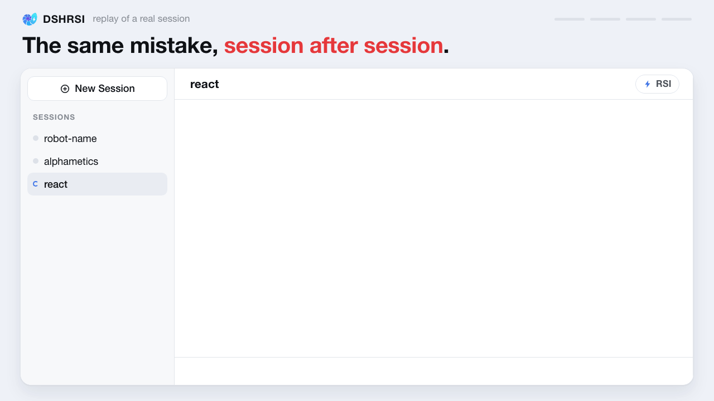
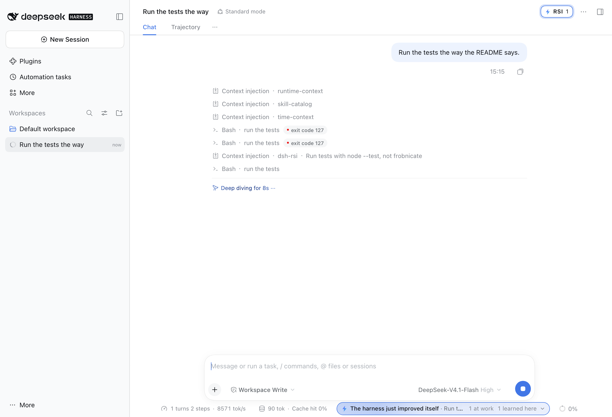
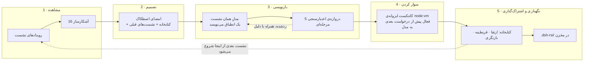

<div align="center">

[English](../../README.md) · [简体中文](README_zh.md) · [繁體中文](README_zh-TW.md) · [日本語](README_ja.md) · [한국어](README_ko.md) · [Türkçe](README_tr.md) · [Русский](README_ru.md) · [Tiếng Việt](README_vi.md) · [ไทย](README_th.md) · [Deutsch](README_de.md) · [Español](README_es.md) · [Français](README_fr.md) · [Українська](README_uk.md) · [Polski](README_pl.md) · [Português (Brasil)](README_pt-BR.md) · [العربية](README_ar.md) · **فارسی** · [Bahasa Indonesia](README_id.md) · [Italiano](README_it.md) · [Ελληνικά](README_el.md) · [മലയാളം](README_ml.md) · [Roman Urdu](README_ur-Latn.md) · [Română](README_ro.md)

<br />


# پلاگین DSHRSI: خودبهبودی بازگشتی (Recursive Self-Improvement) برای DeepSeek Harness

### **مشاهده ← بهبود ← ساختن روی همان بهبود ← و باز از نو. یک harness که روزبه‌روز بیشتر مال خودتان می‌شود.**

<a href="https://qybaihe.github.io/dshrsi/trace.html">
  <picture>
    <source media="(prefers-color-scheme: dark)" srcset="../../assets/rsi-trace.dark.gif" />
    
  </picture>
</a>

**عبارت RSI مخفف Recursive Self-Improvement است، یعنی خودبهبودی بازگشتی؛ و DSHRSI پلاگین متن‌بازی است که آن را برای DeepSeek Harness به واقعیت تبدیل می‌کند. خودِ harness اجراهایش را زیر نظر می‌گیرد، از مدلِ همان نشست می‌خواهد برای دردسری که پیدا کرده کد harness بنویسد، درستی آن کد را در یک دروازه‌ی 5 مرحله‌ای ثابت می‌کند و پیش از تمام شدن نوبت آن را سوار (mount) می‌کند. بعد harness بهبودیافته نشست بعدی را اجرا می‌کند و باز هم بهتر می‌شود. نه فاین‌تیون. نه کوهی از پرامپت. کد؛ کدی که سنجیده می‌شود و بعد یا می‌ماند، یا بازنویسی می‌شود، یا دور ریخته می‌شود.**

[](#rsi)
[](https://github.com/deepseek-ai/deepseek-harness)
[](#coverage)
[](#how-it-works)
[](#project-harness)
[](#benchmarks)
[](#contributing)
[](../../LICENSE)

**[🌐 وب‌سایت](https://qybaihe.github.io/dshrsi/) · [📖 مرجع پلاگین](../../packages/dsh-rsi/README.md) · [🧩 harness پروژه](../../packages/dsh-rsi/README.md#layers-and-the-project-harness) · [🔬 دروازه‌ی اعتبارسنجی](../../packages/dsh-rsi/README.md#the-validation-gate) · [⚠️ محدودیت‌های شناخته‌شده](../../packages/dsh-rsi/README.md#known-limits) · [🐛 Issues](https://github.com/qybaihe/dshrsi/issues)**

[معنای RSI](#rsi) · [شروع سریع](#quick-start) · [سازوکار](#how-it-works) · [نتایج اندازه‌گیری‌شده](#measured) · [بنچمارک‌ها](#benchmarks) · [آشکارسازها و قابلیت‌ها](#coverage) · [harness پروژه](#project-harness) · [پیش‌فرض‌های ایمنی](#security) · [پرسش‌های متداول](#faq)

</div>

---

> [!IMPORTANT]
> **پیش‌نمایش توسعه‌دهندگان:** DSHRSI بر اساس DeepSeek Harness `0.2.2-rc.3` ساخته شده که خودش هم یک پیش‌نمایش توسعه‌دهندگان است. **تغییراتی در راه است که سازگاری را می‌شکنند.**
> انطباق (adaptation) کدی است که یک مدل می‌نویسد و درون harness شما اجرا می‌شود. ایزوله‌سازی‌اش جلوی اشتباه را می‌گیرد، **نه جلوی کد مخرب را**. پیش از اجرا، درباره‌ی [دروازه‌ی اعتبارسنجی](../../packages/dsh-rsi/README.md#the-validation-gate) بخوانید.

<div align="center">

</div>

<br />

<table>
<tr>
<td width="33%" valign="top">

### 🔴 بدون DSHRSI
هر نشست همان واقعیت‌ها را از نو کشف می‌کند: این ماشین `python` ندارد، این مخزن قاعده‌ای دارد که قبلاً گفته‌اید، این اصلاح هیچ‌وقت راستی‌آزمایی نشده. در اجرای کنترل، **5 نشست از 5 نشست** همان فراخوانی ناموفق را انجام دادند و قاعده‌ای که کاربر گفته بود، یک نشست بعد دوباره زیر پا گذاشته شد.

</td>
<td width="33%" valign="top">

### 🧬 با DSHRSI
وقتی دردسر برمی‌گردد، مدل یک تکه کد harness می‌نویسد، آن کد از دروازه می‌گذرد و **در همان نوبت** فعال می‌شود. در 3 اجرا روی یک مدل واقعی، **7 نشست از 7 نشست** بعد از انطباق هیچ فراخوانی ناموفقی نداشتند. بهبود بعدی هم از همین‌جا شروع می‌شود.

</td>
<td width="33%" valign="top">

### 🔒 فقط سخت‌گیرتر، و این عمدی است
انطباق می‌تواند اطلاعات اضافه کند، یک فراخوانی را رد کند، اول از شما بپرسد یا راستی‌آزمایی بخواهد. **هیچ قابلیتی نمی‌تواند چیزی را مجاز کند که harness خودش ردش می‌کرد.** بازنویسی نتیجه‌ها، افزودن ابزار و اجرای فرمان منتظر تأیید شما می‌مانند.

</td>
</tr>
</table>

---

<a id="rsi"></a>

## 🔁 خودبهبودی بازگشتی: RSI = Recursive Self-Improvement

منظور «rewrite itself» (خودش را بازنویسی کند) نیست. **خودبهبودی بازگشتی** یعنی یک سیستم با توانایی‌های خودش، خودش را بهبود می‌دهد و سیستمِ بهبودیافته دور بعد را پیش می‌برد. سه واژه، و DSHRSI باید از عهده‌ی تک‌تکشان بربیاید:

| | چه لازم دارد | DSHRSI چطور انجامش می‌دهد |
| :--- | :--- | :--- |
| **خود (Self)** | آنچه عمل می‌کند و آنچه تغییر می‌کند یک سیستم است | این harness است که harness را تغییر می‌دهد. انطباق را مدلِ همان نشستی می‌نویسد که به دردسر خورده. کسی از بیرون تنظیمش نمی‌کند |
| **بهبود (Improvement)** | «بهتر» باید قابل‌سنجش باشد | هر انطباق پیش از سوار شدن از یک دروازه‌ی 5 مرحله‌ای می‌گذرد و نشست‌های بعدی هم آن را محک می‌زنند: آنچه کار می‌کند ارتقا می‌یابد، آنچه خطا می‌دهد قرنطینه می‌شود |
| **بازگشتی (Recursive)** | خروجی هر دور نقطه‌ی شروع دور بعد است | نشست بعدی روی harness بهبودیافته اجرا می‌شود و با همان هم زیر نظر گرفته می‌شود. انطباقی که جواب نداده، بر پایه‌ی شواهد سخت‌گیرانه‌تر بازنویسی می‌شود. انطباقی که در یک فضای کاری دوم هم لازم شود به کل ماشین گسترش می‌یابد و قواعد یک پروژه به harness تک‌تک هم‌تیمی‌ها می‌رسد |

**چهار حلقه، هر کدام درون بعدی:** درون یک نوبت ← از نشستی به نشست دیگر ← خودِ بهبود هم بهبود می‌یابد ← از پروژه به ماشین و بعد به تیم.

آنچه عمداً بازگشتی **نیست**: وزن‌های مدل هرگز تغییر نمی‌کنند و آشکارسازها، سیاست فعال‌سازی و دروازه‌ی اعتبارسنجی کد ثابتی هستند که دست هیچ انطباقی به آن‌ها نمی‌رسد. بخشی که خودش را تغییر می‌دهد، به دست بخشی بررسی می‌شود که نمی‌تواند تغییرش دهد.

---

<a id="quick-start"></a>

## ⚡ شروع سریع در 30 ثانیه

### 1. همان‌جایی نصبش کنید که از قبل کار می‌کنید
در اپ دسکتاپ DeepSeek Harness یا رابط وب آن، **Plugins → Add plugin → Install a third-party plugin** را باز کنید، نشانی بسته‌ی انتشار را بچسبانید، **Install** و بعد **Enable now** را انتخاب کنید:

```text
https://github.com/qybaihe/dshrsi/releases/download/v0.1.1/dsh-rsi-0.1.1.tgz
```

یا از خط فرمان. هر پروفایل پلاگین‌های خودش را دارد و `dsh plugin add` هم `pnpm` را صدا می‌زند که باید در `PATH` باشد:

```bash
dsh plugin --profile web add https://github.com/qybaihe/dshrsi/releases/download/v0.1.1/dsh-rsi-0.1.1.tgz
dsh web
```

### 2. فقط کارتان را بکنید
چیزی برای پیکربندی وجود ندارد. تا وقتی همان دردسر دوباره پیش نیاید، DSHRSI جلوی چشم نیست. آن‌وقت است که نشان **RSI** روشن می‌شود، برچسب وضعیتِ زیر کادر پیام خبر می‌دهد که harness همین حالا خودش را تغییر داده، و نشست بعدی از همان ابتدا بهبودیافته شروع می‌شود:

<div align="center">

</div>

در هر نشستی `/rsi` را تایپ کنید تا ببینید چه چیزی سوار شده، به کدام لایه تعلق دارد و چه چیزی منتظر تأیید شماست.

### 3. به هر مخزن harness خودش را بدهید
قواعدی که در یک مخزن یاد گرفته شده‌اند می‌توانند در همان مخزن بمانند؛ هر انطباق در یک فایل:

```bash
# dsh-rsi همراه پلاگین می‌آید، درون همان پروفایلی که پلاگین در آن نصب شده
alias dsh-rsi="$HOME/.dsh/profiles/web/node_modules/.bin/dsh-rsi"

dsh-rsi project init      # .dsh-rsi/ را در مخزن می‌سازد؛ بعد کامیتش کنید
dsh-rsi trust             # روی هر ماشین دیگر: فایل‌ها را بعد از خواندن بپذیرید
```

### 4. اجرا از روی سورس

```bash
git clone https://github.com/qybaihe/dshrsi.git && cd dshrsi
npm install               # dsh با نسخه‌ی پین‌شده را می‌آورد، همراه pnpm که صدایش می‌زند
npx dsh plugin --profile web add "$PWD/packages/dsh-rsi"
npx dsh web
```

پروفایل‌های `desktop` و `headless`، ایندکس‌های پلاگین، فایل‌های tarball محلی و بارگذاری فقط برای یک اجرا در [مرجع پلاگین](../../packages/dsh-rsi/README.md#install) توضیح داده شده‌اند.

---

<a id="how-it-works"></a>

## 🧠 سازوکار DSHRSI: یک حلقه‌ی بسته درون harness که بارها و بارها اجرا می‌شود

اسکیل‌ها، فایل‌های حافظه و پرامپت‌های سیستمی طولانی‌تر همه در سطح کانتکست کار می‌کنند: متنی اضافه می‌کنند و امیدوارند مدل از آن پیروی کند. وقتی پیروی نکند، همان فراخوانی ناموفق در نشست بعدی دوباره انجام می‌شود.

**کار DSHRSI در سطح harness است. آنچه یاد می‌گیرد به کدی روی نقاط توسعه‌ی خودِ harness تبدیل می‌شود:**



| مرحله | سازوکار | نتیجه |
| :--- | :--- | :--- |
| **1. مشاهده** | رویدادهای نرمال‌شده‌ی نشست را 16 آشکارساز می‌خوانند: فراخوانی‌هایی که دوباره شکست می‌خورند، علت‌های شکستی که مدام برمی‌گردند، دست‌وپا زدن بی‌هدف، تصحیح‌های کاربر، و نوبت‌هایی که بدون هیچ راستی‌آزمایی تمام می‌شوند | دردسر امضایی می‌گیرد که از نشستی به نشست دیگر ثابت می‌ماند، مثل `bash:command-not-found:python` |
| **2. بازنویسی** | مدلِ همان نشست یک انطباق به زبان JavaScript و بر پایه‌ی یک API با 10 قابلیت می‌نویسد. کدِ ردشده همراه با دلیل‌ها برمی‌گردد، حداکثر دو بار؛ بعد یک قالب داخلی کار را به دست می‌گیرد | راه‌حل، کد harness است، نه یک پاراگراف دیگر در پرامپت |
| **3. اعتبارسنجی** | ایستا ← بارگذاری ← بازپخش ← رگرسیون ← مجوز. انطباق باید روی همان فراخوانی‌هایی که باعث ساختنش شدند عمل کند و به هیچ‌کدام از فراخوانی‌های موفق این نشست دست نزند | کدی که کاری نمی‌کند، یا چیزی را که سالم کار می‌کرد خراب می‌کند، هرگز سوار نمی‌شود |
| **4. سوار کردن** | انطباق در کانتکست `node:vm` مخصوص خودش و پشت یک پل JSON اجرا می‌شود، هر فراخوانی‌اش تایم‌اوت دارد، و پیش از درخواست بعدی به مدل اثر می‌کند | همان نوبتی که به دردسر خورده، اولین نوبتی است که سود می‌برد |
| **5. نگهداری و اشتراک‌گذاری** | برای هر ماشین یک کتابخانه، همراه با دفتر ثبت و لاگ ممیزی. آنچه کار می‌کند ارتقا می‌یابد، آنچه خطا می‌دهد قرنطینه می‌شود، آنچه جواب نداده سخت‌گیرانه‌تر بازنویسی می‌شود و قواعد پروژه در `.dsh-rsi/` نوشته می‌شوند | نشست بعدی انطباق‌یافته شروع می‌شود و هم‌تیمی‌ها بعد از `dsh-rsi trust` قواعد پروژه را می‌گیرند |
| **↻ دوباره** | نشست بعدی روی همان harness اجرا می‌شود که مرحله‌ی 5 به جا گذاشته، و مرحله‌ی 1 آن را با همه‌ی انطباق‌های سوارشده زیر نظر می‌گیرد | بهبود روی بهبود ساخته می‌شود. بازگشتی بودن یعنی همین |

---

<a id="measured"></a>

## 🔬 اندازه‌گیری روی یک مدل واقعی

این عددها از اجرای یک مدل واقعی، `mimo-v2.6-pro`، در نشست‌های واقعی `dsh` به دست آمده‌اند (`npm run test:live`). هیچ‌چیز در این جدول شبیه‌سازی نشده است.

> **این را چطور بخوانید:** نمونه کوچک است. یک مدل، سه سناریو و برای هر سناریو چند نشست. نشان می‌دهد که حلقه از ابتدا تا انتها کار می‌کند. این یک حکم آماری درباره‌ی نرخ موفقیت **نیست** و چیزی هم سریع‌تر نشده: برای نوشتن هر انطباق باید 30–60 ثانیه منتظر مدل ماند. اجراهای بزرگ‌تر در بخش [بنچمارک‌ها](#benchmarks) آمده‌اند.

| سناریو | بدون DSHRSI | با DSHRSI | آنچه harness نوشت |
| :--- | :--- | :--- | :--- |
| **فرمان ناموجود**: در README نوشته `python stats.py`، ماشین فقط `python3` دارد | ❌ در **5 / 5** نشست فراخوانی ناموفق انجام شد | ✅ در **0 / 7** نشست پس از انطباق (پیش از آن 9 / 9) | `deny` + `prompt`، نوشته‌ی مدل، در همان تلاش اول از دروازه گذشت |
| **قاعده‌ای که کاربر فقط یک بار گفته**: «هرگز `notes.txt` را تغییر نده، در `notes.draft.txt` بنویس» | ❌ نشست بعدی `notes.txt` را ویرایش کرد | ✅ نشست بعدی بدون یادآوری در `notes.draft.txt` نوشت | `deny` + `prompt`، نوشته‌ی مدل، درست بعد از تصحیح |
| **اصلاحی که کسی راستی‌آزمایی‌اش را نخواسته بود** | اجرا نشد | ⚪ چیزی نوشته نشد: مدل در 3 / 3 نشست اصلاحش را خودش راستی‌آزمایی کرد، پس چیزی برای یاد گرفتن نبود | هیچ |

سناریوی اول سه بار با پلاگین اجرا شد، هر بار از یک کتابخانه‌ی خالی، به‌اضافه‌ی یک اجرای کنترل. سناریوی دوم یک بار با پلاگین و یک بار بدون آن اجرا شد.

**فرمان ناموجود، نشست به نشست** (تعداد فراخوانی‌های ناموفق ابزار در هر نشست):

| اجرا | S1 | S2 | S3 | S4 | S5 | S6 |
| :--- | :---: | :---: | :---: | :---: | :---: | :---: |
| **بدون DSHRSI** | ❌ 1 | ❌ 1 | ❌ 1 | ❌ 1 | ❌ 1 | |
| **با DSHRSI · اجرای 1** | ❌ 1 | ❌ 1 | ❌ 1 → 🧬 | ✅ 0 | ✅ 0 | ✅ 0 |
| **با DSHRSI · اجرای 2** | ❌ 1 | ❌ 1 | ❌ 1 → 🧬 | ✅ 0 | ✅ 0 | |
| **با DSHRSI · اجرای 3** | ❌ 1 | ❌ 1 | ❌ 1 → 🧬 | ✅ 0 | ✅ 0 | |

نماد 🧬 نوبتی را نشان می‌دهد که مدل در آن انطباق را نوشت و harness سوارش کرد. در 3 نشست از 7 نشستِ بعد از آن، مدل باز هم `python` را امتحان کرد و harness فراخوانی را پیش از اجرا رد کرد. همه‌ی نشست‌های این سناریو، با پلاگین یا بدون آن، به پاسخ درست رسیدند.

بازتولید روی ماشین خودتان:

```bash
MIMO_API_KEY=... npm run test:live -- python --sessions 6          # با پلاگین
MIMO_API_KEY=... npm run test:live -- python --sessions 5 --off    # اجرای کنترل، بدون پلاگین
```

<details>
<summary><strong>آنچه روی این ماشین راستی‌آزمایی نشده (برای باز کردن کلیک کنید)</strong></summary>

<br />

این مسیرها در کد مخزن وجود دارند و تست‌های واحد یا تست‌های end-to-end با مدل شبیه‌سازی‌شده پوشش‌شان می‌دهند، اما در یک نشست واقعی یا اپ واقعی دیده نشده‌اند:

| حوزه | چرا اینجا راستی‌آزمایی نشده |
| :--- | :--- |
| اپ دسکتاپ DeepSeek Harness | روی ماشین توسعه نصب نیست. راستی‌آزمایی روی پروفایل `web` و همان سازوکار نصبی انجام شده که اپ پوسته‌ای روی آن است |
| `negative-feedback`, `approval-denied`, `context-pressure`, `model-instability` | فقط با رویدادهای ساختگی تست شده‌اند و هرگز در یک نشست واقعی فعال نشده‌اند |
| تست‌های خودکار مرورگر | وجود ندارد. رابط کاربری در صفحه‌ی واقعی `dsh web` دستی مرور شده، در حالت روشن و تیره |
| پروفایل‌های ACP و SDK | آنجا رابط کاربری‌ای نیست و راستی‌آزمایی هم نشده |
| مدل‌های بیرون از خانواده‌ی MiMo v2.6 | هنوز اجرایی نداشته‌اند. بنچمارک‌ها با `mimo-v2.6-pro` و `mimo-v2.6-flash` اجرا شدند؛ سه سناریوی بالا با `mimo-v2.6-pro` |

</details>

---

<a id="benchmarks"></a>

## 📊 بنچمارک‌ها: چهار مجموعه، دو مدل، تسک به تسک

مقایسه‌ی DeepSeek Harness پایه با DeepSeek Harness + DSHRSI در 3,390 نشست واقعی `dsh`: همان مدل، همان پرامپت‌ها، همان سندباکس، همان تسک‌ها. پلاگین با تنظیمات پیش‌فرضش اجرا می‌شود و هر مجموعه را با کتابخانه‌ی خالی شروع می‌کند. تسک‌های حل‌شده در سه مجموعه‌ای که تا آخر اجرا شدند:

<!-- bench:table:start -->
| بنچمارک | تسک‌ها | `mimo-v2.6-pro` پایه | `mimo-v2.6-pro` + DSHRSI | `mimo-v2.6-flash` پایه | `mimo-v2.6-flash` + DSHRSI |
| :--- | ---: | ---: | ---: | ---: | ---: |
| **Aider Polyglot**، تلاش اول | 225 | 224 (99.6%) | 224 (99.6%) | 220 (97.8%) | 223 (99.1%) |
| **Aider Polyglot**، حداکثر در دو تلاش | 225 | 225 (100.0%) | 225 (100.0%) | 225 (100.0%) | 225 (100.0%) |
| **HumanEval** | 164 | 163 (99.4%) | 162 (98.8%) | 162 (98.8%) | 162 (98.8%) |
| **HumanEval+** | 164 | 156 (95.1%) | 157 (95.7%) | 153 (93.3%) | 153 (93.3%) |
| **MBPP** | 378 | 374 (98.9%) | 371 (98.1%) | 368 (97.4%) | 369 (97.6%) |
| **MBPP+** | 378 | 320 (84.7%) | 319 (84.4%) | 308 (81.5%) | 315 (83.3%) |
<!-- bench:table:end -->

<div align="center">
<picture>
  <source media="(prefers-color-scheme: dark)" srcset="../../assets/bench-flash.dark.png" />
  
</picture>
</div>

> **این را چطور بخوانید:** از نظر تعداد تسک‌های حل‌شده، این دو harness را **نمی‌شود از هم تشخیص داد**. بزرگ‌ترین بهبود +7 است (MBPP+, `mimo-v2.6-flash`)، بزرگ‌ترین افت −3 (MBPP, `mimo-v2.6-pro`)، و هیچ تفاوتی در آزمون دقیق McNemar روی همان تسک‌ها دوام نمی‌آورد (کوچک‌ترین p = 0.17). وقتی ایجنت می‌تواند کد خودش را اجرا کند، این مجموعه‌ها برای هر دو مدل به سقف‌شان نزدیک‌اند، و هر تسک هم یک پوشه‌ی تازه و تمیز است: چیز زیادی تکرار نمی‌شود که harness از آن یاد بگیرد.

**کاری که DSHRSI واقعاً کرد، آن هم بدون حتی یک راهنمایی، تغییر دادن خودش بود.** در مجموعِ هشت اجرا، مدل‌ها **56 انطباق** نوشتند؛ 15 تای آن‌ها وارد عمل شدند و 10 تا از همین‌ها به کل ماشین گسترش یافته بودند. برای هر کدام از این 10 تا، تسک‌هایی را که بعد از آن شروع شده بودند برداشتیم و با دقیقاً همان تسک‌ها زیر DSH پایه مقایسه کردیم:

| انطباقی که مدل نوشت | شکستی که به آن پاسخ می‌دهد | DSH پایه | DSH + DSHRSI | p |
| :--- | :--- | ---: | ---: | ---: |
| *Stop inline python checks that abort on first mismatch* (MBPP, `mimo-v2.6-pro`) | اجرای تستی که با اولین assertion ناموفق از کار می‌افتد | در 16 تسک از 310 | **در 3 از 310** | 0.002 |
| *Redirect missing lib.rs reads to a glob lookup* (Polyglot, `mimo-v2.6-flash`) | خواندن `lib.rs` از مسیری که وجود ندارد | در 7 تسک از 151 | **در 1 از 151** | 0.07 |
| آن 8 تای دیگر | | بدون تغییر قابل‌اندازه‌گیری | | |

هیچ‌کدام از این دو باعث نشد تسک‌های بیشتری پاس شوند، و پلاگین حدود 8–9% زمان ایجنت و توکن ورودی بیشتری مصرف کرد. هر ده انطباق در [`bench/README.md`](../../bench/README.md#did-those-adaptations-work) فهرست شده‌اند.

**اجرای LiveCodeBench v6 نیمه‌کاره ماند:** موجودی حساب مدل وسط کار تمام شد. در تسک‌هایی که هر دو طرف تا آن لحظه تمام کرده بودند، با `mimo-v2.6-pro` از 105 تسک، DSH پایه 94 و DSHRSI 96 تسک را حل کرد، و با `mimo-v2.6-flash` از 51 تسک، 42 در برابر 42. به همین دلیل دور دوم، یعنی همان تسک‌ها این بار روی کتابخانه‌ای که دور اول به جا گذاشته، هنوز اجرا نشده است.

بازتولید روی ماشین خودتان:

```bash
bench/setup.sh                                                        # زنجیره‌ابزارها، دیتاست‌ها، کد نمره‌دهی
MIMO_API_KEY=... node bench/run.mjs polyglot --arm dsh --run dsh-p1   # DeepSeek Harness پایه
MIMO_API_KEY=... node bench/run.mjs polyglot --arm rsi --run rsi-p1   # با پلاگین
node bench/report.mjs --write                                         # جدول‌ها و bench/results/*.json
```

پروتکل، جدول‌های هزینه و شکست و محدودیت‌ها در [`bench/README.md`](../../bench/README.md) آمده‌اند؛ نتایج تک‌تک تسک‌ها در [`bench/results/`](../../bench/results) است.

---

<a id="coverage"></a>

## 🛡️ آشکارسازها و قابلیت‌ها

**16 آشکارساز** تعیین می‌کنند harness چه وقت باید تغییر کند. همین آشکارسازها هم روی نشست زنده اجرا می‌شوند و هم روی نشستی که روی دیسک ذخیره شده (`dsh-rsi mine`):

| آشکارساز | چه چیزی پیدا می‌کند | واکنش |
| :--- | :--- | :---: |
| `repeat-failing-call` | همان فراخوانی با همان آرگومان‌ها دوباره شکست می‌خورد | انطباق می‌یابد |
| `failure-signature` | همان علت شکست مدام برمی‌گردد: فرمان ناموجود، وابستگی ناموجود، شبکه، مجوز، پورت اشغال‌شده، مسیر پیدانشده، ناهمخوانی ویرایش، آرگومان نامعتبر، کمبود حافظه | انطباق می‌یابد |
| `command-flailing` | همان نوع فرمان با آرگومان‌های مختلف پشت سر هم شکست می‌خورد | انطباق می‌یابد |
| `read-thrash` | همان فایلِ تغییرنکرده بارها و بارها خوانده می‌شود | انطباق می‌یابد |
| `edit-churn` | همان فایل در یک نوبت بارها ویرایش می‌شود | انطباق می‌یابد |
| `error-storm` | بیشتر فراخوانی‌های اخیر ابزار شکست خورده‌اند | انطباق می‌یابد |
| `stall` | شکست‌های پشت سر هم، بدون هیچ موفقیتی در میانشان | انطباق می‌یابد |
| `timeout-recurrence` | همان نوع فرمان مدام تایم‌اوت می‌شود | انطباق می‌یابد |
| `output-flood` | همان نوع فرمان مدام خروجی بیش‌ازحد بزرگ تولید می‌کند | انطباق می‌یابد |
| `approval-denied` / `denied-repeat` | کاربر مدام همان نوع کار را رد می‌کند، یا یک فراخوانیِ ردشده بدون تغییر دوباره امتحان می‌شود | انطباق می‌یابد |
| `user-correction` | کاربر مدل را تصحیح کرده، یا کار را قطع کرده و مسیر را عوض کرده | انطباق می‌یابد |
| `premature-completion` | کد تغییر کرده و نوبت دارد بدون اجرای هیچ بررسی‌ای تمام می‌شود | انطباق می‌یابد |
| `negative-feedback` | کاربر یک پاسخ را بد علامت زده و دلیلش را نوشته | انطباق می‌یابد |
| `user-interrupt` | کاربر وسط نوبت کار را قطع کرده | ثبت می‌شود |
| `model-instability` | درخواست‌های مدل مدام شکست می‌خورند، دوباره تلاش می‌شوند یا به سقف خروجی می‌خورند | ثبت می‌شود |
| `context-pressure` | کانتکست وسط کار فشرده شده | ثبت می‌شود |

**10 قابلیت** همه‌ی آن چیزی است که یک انطباق می‌تواند انجام دهد. دستش فقط از راه همین‌ها به harness می‌رسد:

| قابلیت | چه می‌کند | رده |
| :--- | :--- | :---: |
| `annotate` | یادداشتی به انتهای نتیجه‌ی یک ابزار اضافه می‌کند | ✅ خودکار |
| `steer` | پیش از درخواست بعدی به مدل یادداشتی اضافه می‌کند | ✅ خودکار |
| `deny` | یک فراخوانی ابزار را رد می‌کند و دلیلش را می‌گوید | ✅ خودکار |
| `ask` | برای یک فراخوانی، تأیید کاربر را لازم می‌کند | ✅ خودکار |
| `block` | نتیجه‌ی یک ابزار را به خطایی تبدیل می‌کند که اصلاحیه‌ای همراه دارد | ✅ خودکار |
| `verify` | تا وقتی شرطی برآورده نشده، نمی‌گذارد نوبت تمام شود | ✅ خودکار |
| `prompt` | بخشی دائمی به پرامپت سیستمی اضافه می‌کند | ✅ خودکار |
| `rewrite` | متن نتیجه‌ی یک ابزار را جایگزین می‌کند | 🔐 نیازمند تأیید |
| `tool` | ابزار تازه‌ای برای مدل ثبت می‌کند | 🔐 نیازمند تأیید |
| `exec` | فرمانی را از طریق ابزار shell خودِ harness اجرا می‌کند، زیر همان قواعد سندباکس و تأیید | 🔐 نیازمند تأیید |

این همان انطباقی است که مدل در سناریوی اولِ بالا نوشت:

```js
define({
  title: 'Route python invocations to python3',
  description: '...',
  capabilities: ['deny', 'prompt'],
  setup(h) {
    h.promptSection('On this machine there is no `python` executable; use `python3`.')
    h.beforeTool({ tool: 'bash', command: /(^|[;&|(]\s*)python(\s|$)/ },
      () => h.deny('`python` is not installed on this machine. Use `python3` instead.'))
  },
})
```

---

<a id="project-harness"></a>

## 🧩 سه لایه، و یک harness برای هر پروژه

هر انطباق به یکی از سه لایه تعلق دارد. هر لایه را می‌توان جداگانه خاموش کرد:

| لایه | چه چیزی نگه می‌دارد | نمونه | کجا اعمال می‌شود |
| :--- | :--- | :--- | :--- |
| **`machine`** | واقعیت‌های مربوط به این کامپیوتر | نبودِ `python`؛ پورتی که اشغال است؛ هاست داخلی‌ای که resolve نمی‌شود | فضای کاری‌ای که در آن یاد گرفته شده، و بعد کل ماشین، همین که یک فضای کاری دوم هم به آن بخورد |
| **`user`** | اینکه دوست دارید با شما چطور رفتار شود | پاسخی که با دلیل «خیلی طولانی» بد علامت خورده | کل ماشین |
| **`project`** | قواعد و عادت‌های یک مخزن | «این مخزن همیشه از pnpm استفاده می‌کند» | فضای کاری، و خودِ مخزن از طریق `.dsh-rsi/` |

**لایه‌ی پروژه همراه کد جابه‌جا می‌شود:**

```
.dsh-rsi/
  harness.json           نشانگر فرمت و تنظیمات سطح پروژه
  adaptations/
    remember-the-user-s-instruction-3f2a1c.js     یاد گرفته شده و بعد اینجا نوشته شده
    no-force-push.js                              انطباق دست‌نویس هم همین‌طور کار می‌کند
```

- **برای اشتراک‌گذاری کامیت کنید، برای جدا کردن حذف کنید.** هر فایل یک انطباق است.
- **هیچ‌چیز فقط به این دلیل که clone شده اجرا نمی‌شود.** هر ماشین محتوای دقیق فایل‌ها را با `dsh-rsi trust` می‌پذیرد و هر وقت تغییر کنند دوباره می‌پذیرد.
- **یک پروژه فقط می‌تواند harness را محافظه‌کارتر کند**، نه برعکس. تنظیماتی مثل `autonomy` از دسترس پروژه بیرون‌اند.
- **قابل‌حمل، حتی بیرون از مخزن.** با `dsh-rsi export` و `dsh-rsi import` لایه‌های ماشین و کاربر در قالب یک فایل به کامپیوتر دیگری می‌روند.

---

<a id="security"></a>

## 🔒 ایمنی و پیش‌فرض‌های پیکربندی

- **رده‌ی خودکار، فقط سخت‌گیرتر** — بدون تأیید شما، انطباق فقط می‌تواند اطلاعات اضافه کند، رد کند، بپرسد یا راستی‌آزمایی بخواهد. `deny` و `ask` آن فقط می‌توانند حکم سیاست‌های دیگر را سخت‌گیرانه‌تر کنند.
- **قدرت در گرو تأیید (`autonomy: tighten`)** — انطباق‌هایی که نتیجه‌ها را بازنویسی می‌کنند، ابزار اضافه می‌کنند یا فرمان اجرا می‌کنند با وضعیت `proposed` ذخیره می‌شوند و منتظر `dsh-rsi approve <id>` می‌مانند.
- **نامرئی تا وقتی لازم شود** — وقتی اصطکاکی نیست و چیزی سوار نشده، پرامپت سیستمی، فهرست ابزارها و پیام‌ها بایت‌به‌بایت بدون تغییر می‌مانند. یک تست end-to-end مراقب همین است.
- **خطاهای مهارشده** — هندلری که خطا بدهد هرگز روی فراخوانی ابزاری که به آن وصل است اثر نمی‌گذارد. بعد از سه خطا، انطباق قرنطینه می‌شود.
- **همه‌چیز ثبت می‌شود** — هر تصمیم در `audit.jsonl` است و هر اصطکاک، هر سوار شدن و هر اقدام در `ledger.jsonl`. با `dsh-rsi disable`، `retire` و `rollback` می‌توان یک انطباق را کنار گذاشت یا به عقب برگرداند.
- **سه حالت** — `adapt` مستقیم سوار می‌کند (پیش‌فرض)، `propose` تولید می‌کند و منتظر شما می‌ماند، `observe` فقط ثبت می‌کند.

---

<a id="faq"></a>

## ❓ پرسش‌های متداول

<details>
<summary><strong>DSHRSI مدل را فاین‌تیون می‌کند یا تغییرش می‌دهد؟</strong></summary>

نه. وزن‌های مدل دست‌نخورده می‌مانند و هیچ‌چیز آموزش داده نمی‌شود. آنچه تغییر می‌کند harness است: کدی که پیرامون پرامپت‌ها و فراخوانی‌های ابزارِ مدل اجرا می‌شود. RSI در اینجا یعنی خودبهبودی بازگشتی در سطح harness: از روی اجراهای خودش خودش را بهبود می‌دهد و هر دور از همان harness شروع می‌شود که دور قبل به جا گذاشته است.
</details>

<details>
<summary><strong>این واقعاً «بازگشتی» است یا فقط یک harness که قاعده یاد می‌گیرد؟</strong></summary>

بازگشت در اینجا عینی است و در خودِ کد قرار دارد. هر نشست تازه هرچه را در کتابخانه هست سوار می‌کند، پس آشکارسازها یک harness را زیر نظر می‌گیرند که از قبل تغییر کرده است. وقتی همان دردسر در نشست‌هایی که انطباقی در آن‌ها سوار بوده دو بار پیش بیاید، مدل سورس فعلی و شواهد را می‌گیرد و نسخه‌ی سخت‌گیرانه‌تری می‌نویسد؛ نسخه‌ی قبلی برای بازگردانی نگه داشته می‌شود. دردسری که در یک فضای کاری دوم هم دیده شود، انطباق را به کل ماشین گسترش می‌دهد. آنچه بازگشتی نیست داور است: هیچ انطباقی نمی‌تواند آشکارسازها، سیاست فعال‌سازی و دروازه‌ی اعتبارسنجی را تغییر دهد.
</details>

<details>
<summary><strong>فرق این با اسکیل‌ها، فایل‌های حافظه یا یک پرامپت سیستمی طولانی‌تر چیست؟</strong></summary>

آن‌ها متنی اضافه می‌کنند که مدل ممکن است از آن پیروی کند یا نکند. انطباق کدی است روی نقاط توسعه‌ی harness: می‌تواند یک فراخوانی ابزار را پیش از اجرا رد کند، تأیید شما را لازم کند، یا تا وقتی چیزی راستی‌آزمایی نشده نگذارد نوبت تمام شود. در اجراهای اندازه‌گیری‌شده، مدل حتی بعد از اینکه به او گفته شده بود این کار را نکند، در 3 نشست باز هم `python` را امتحان کرد و فراخوانی پیش از اجرا رد شد.
</details>

<details>
<summary><strong>آیا نشست‌هایم را کند می‌کند؟</strong></summary>

نوشتن یک انطباق یعنی انتظار برای یک پاسخ کامل مدل: 30–60 ثانیه روی `mimo-v2.6-pro`، و در این مدت آن گام متوقف می‌ماند. انطباق‌های سوارشده درون همان پردازه و با تایم‌اوت اجرا می‌شوند. هیچ افزایش سرعتی اندازه‌گیری نشده و ادعایش را هم نداریم.
</details>

<details>
<summary><strong>آیا انطباقی که مدل نوشته می‌تواند کار خطرناکی بکند؟</strong></summary>

رده‌ی خودکار نمی‌تواند چیزی را مجاز کند که harness خودش ردش می‌کرد، و قابلیت‌های قدرتمند منتظر تأیید شما می‌مانند. کد در کانتکست `node:vm` مخصوص خودش و پشت یک پل JSON اجرا می‌شود. این جلوی اشتباه و سوءاستفاده‌ی سرسری را می‌گیرد. اما یک مرز امنیتی در برابر کد مخرب **نیست**؛ پس پیش از اجرای `dsh-rsi trust`، فایل‌های `.dsh-rsi/` پروژه را بخوانید.
</details>

<details>
<summary><strong>با کدام مدل‌ها کار می‌کند؟</strong></summary>

انطباق‌ها را مدل فعلی نشست می‌نویسد، یا مدلی که با `provider` و `model` تعیین می‌کنید. اگر مدل نتواند کدی تولید کند که از دروازه بگذرد، قالب‌های داخلی کار را به دست می‌گیرند. اجراهای تا امروز با دو مدل از یک خانواده بوده‌اند: `mimo-v2.6-pro` و `mimo-v2.6-flash`.
</details>

<details>
<summary><strong>در اپ دسکتاپ DeepSeek Harness هم کار می‌کند؟</strong></summary>

به شکل یک پلاگین شخص‌ثالث معمولی عرضه می‌شود، با همان متادیتایی که صفحه‌های پلاگین می‌خوانند، و در پروفایل `web` نصب می‌شود که اپ پوسته‌ای روی آن است. هنوز درون اپ دسکتاپ واقعی راستی‌آزمایی نشده است.
</details>

<details>
<summary><strong>چطور چیزهایی را که یاد گرفته ببینم، برگردانم یا خاموش کنم؟</strong></summary>

در نشست `/rsi` را بزنید یا در ترمینال `dsh-rsi status` را. `dsh-rsi show <id>` سورس و گزارش اعتبارسنجی یک انطباق را چاپ می‌کند؛ `disable`، `retire` و `rollback` آن را کنار می‌گذارند یا به عقب برمی‌گردانند. برای ثبتِ بدون هیچ تغییری، `mode: observe` را تنظیم کنید.
</details>

---

<a id="docs"></a>

## 📚 مستندات و پیوندها

- [📖 مرجع پلاگین](../../packages/dsh-rsi/README.md) — همه‌ی آشکارسازها، قابلیت‌ها، فرمان‌ها و تنظیمات
- [🚀 منابع نصب و پروفایل‌ها](../../packages/dsh-rsi/README.md#install)
- [🧩 لایه‌ها و harness پروژه](../../packages/dsh-rsi/README.md#layers-and-the-project-harness)
- [🔬 دروازه‌ی اعتبارسنجی](../../packages/dsh-rsi/README.md#the-validation-gate)
- [🛠️ خط فرمان `dsh-rsi`](../../packages/dsh-rsi/README.md#command-line) · [⚙️ پیکربندی](../../packages/dsh-rsi/README.md#configuration)
- [⚠️ محدودیت‌های شناخته‌شده](../../packages/dsh-rsi/README.md#known-limits)
- [📊 پروتکل و نتایج بنچمارک](../../bench/README.md)
- [🌐 سورس وب‌سایت](../../website) — خودبهبودی بازگشتی، سازوکار، نوشتن انطباق، ارزیابی؛ `website/index.html` را در مرورگر باز کنید
- [🧱 DeepSeek Harness](https://github.com/deepseek-ai/deepseek-harness) — همان harness که این پلاگین به آن وصل می‌شود

<a id="contributing"></a>

## 🤝 مشارکت و جامعه

از Issue و PR در [qybaihe/dshrsi](https://github.com/qybaihe/dshrsi) استقبال می‌کنیم. پیش از فرستادن PR:

```bash
npm install && npm test    # 130 تست واحد، سپس 29 تست end-to-end؛ بدون نیاز به کلید
```

تست‌های end-to-end به‌جای endpoint مدل یک نمونه‌ی شبیه‌سازی‌شده می‌گذارند. بقیه‌ی چیزها واقعی است: پردازه‌ی `dsh`، اجرای ابزارها، لاگ نشست و نصب پلاگین.

```
packages/dsh-rsi/        بسته‌ی پلاگین (ESM ساده، بدون مرحله‌ی build)
  index.js               نیمه‌ی میزبان: اتصال به نقاط توسعه‌ی DSH
  client.js              نیمه‌ی مرورگر: نشان RSI و برچسب وضعیت
  src/engine.js          مشاهده ← تصمیم ← تولید ← اعتبارسنجی ← سوار کردن ← نگهداری ← اشتراک‌گذاری
  src/signals.js         16 آشکارساز
  src/validate.js        دروازه‌ی اعتبارسنجی
  src/sandbox.js         جایی که کد انطباق اجرا می‌شود
  src/project.js         harness پروژه: <repository>/.dsh-rsi
  bin/rsi.js             فرمان dsh-rsi
market/index.json        یک ایندکس پلاگین که می‌توان به DSH اضافه کرد
test/unit/  test/e2e/    تست‌های واحد، و تست‌های end-to-end روی یک پردازه‌ی واقعی dsh
test/live/               اجرا روی یک مدل واقعی (نیازمند MIMO_API_KEY)
bench/                   بنچمارک‌ها: DSH پایه در برابر DSH + dsh-rsi
website/                 وب‌سایت (صفحه‌های ایستا، بدون مرحله‌ی build)
```

## 📄 لایسنس

[MIT](../../LICENSE)

---

Created in [T3 Code](https://t3.codes).
