<div align="center">

[English](../../README.md) · [简体中文](README_zh.md) · [繁體中文](README_zh-TW.md) · [日本語](README_ja.md) · [한국어](README_ko.md) · [Türkçe](README_tr.md) · [Русский](README_ru.md) · [Tiếng Việt](README_vi.md) · [ไทย](README_th.md) · [Deutsch](README_de.md) · [Español](README_es.md) · **Français** · [Українська](README_uk.md) · [Polski](README_pl.md) · [Português (Brasil)](README_pt-BR.md) · [العربية](README_ar.md) · [فارسی](README_fa.md) · [Bahasa Indonesia](README_id.md) · [Italiano](README_it.md) · [Ελληνικά](README_el.md) · [മലയാളം](README_ml.md) · [Roman Urdu](README_ur-Latn.md) · [Română](README_ro.md)

<br />


# DSHRSI : Recursive Self-Improvement, l'auto-amélioration récursive pour DeepSeek Harness

### **Observer → Améliorer → Bâtir dessus → Recommencer. Un harness qui devient toujours un peu plus le vôtre.**

<a href="https://qybaihe.github.io/dshrsi/trace.html">
  <picture>
    <source media="(prefers-color-scheme: dark)" srcset="../../assets/rsi-trace.dark.gif" />
    
  </picture>
</a>

**RSI signifie Recursive Self-Improvement (auto-amélioration récursive), et DSHRSI est le plugin open source qui en fait une réalité pour DeepSeek Harness. Le harness observe ses propres exécutions, fait écrire au modèle même de la session du code de harness pour les problèmes qu'il rencontre, valide ce code à travers une barrière en 5 étapes et le monte avant la fin du tour. Ensuite, c'est le harness amélioré qui exécute la session suivante, et il s'améliore encore. Pas de fine-tuning. Pas d'empilement de prompts. Du code, qui est mesuré, puis conservé, réécrit ou jeté.**

[](#rsi)
[](https://github.com/deepseek-ai/deepseek-harness)
[](#how-it-works)
[](#benchmarks)
[](../../LICENSE)

**[🌐 Site web](https://qybaihe.github.io/dshrsi/) · [📖 Référence du plugin](../../packages/dsh-rsi/README.md) · [🐛 Issues](https://github.com/qybaihe/dshrsi/issues)**

[Ce que RSI veut dire](#rsi) · [Démarrage rapide](#quick-start) · [Fonctionnement](#how-it-works) · [Résultats mesurés](#measured) · [Benchmarks](#benchmarks) · [Détecteurs et capacités](#coverage) · [Harness de projet](#project-harness) · [Sécurité par défaut](#security) · [FAQ](#faq)

</div>

---

> [!IMPORTANT]
> **Préversion développeur :** DSHRSI cible DeepSeek Harness `0.2.2-rc.3`, lui-même en préversion développeur. **Il y aura des ruptures de compatibilité.**
> Une adaptation est du code écrit par un modèle et exécuté à l'intérieur de votre harness. Son isolation protège des erreurs, **pas du code malveillant**. Renseignez-vous sur [la barrière de validation](../../packages/dsh-rsi/README.md#the-validation-gate) avant de lancer le plugin.

<div align="center">

</div>

<br />

<table>
<tr>
<td width="33%" valign="top">

### 🔴 Sans DSHRSI
Chaque session redécouvre les mêmes faits : cette machine n'a pas de `python`, ce dépôt a une règle que vous avez déjà énoncée, ce correctif n'a jamais été vérifié. Dans l'exécution témoin, **5 sessions sur 5** ont refait le même appel en échec, et une règle énoncée par l'utilisateur a de nouveau été enfreinte une session plus tard.

</td>
<td width="33%" valign="top">

### 🧬 Avec DSHRSI
Quand le problème revient, le modèle écrit un morceau de code de harness, ce code franchit la barrière et il est actif **dans ce même tour**. Sur 3 exécutions face à un vrai modèle, **7 sessions sur 7** après l'adaptation n'ont eu aucun appel en échec. Et la prochaine amélioration part de là.

</td>
<td width="33%" valign="top">

### 🔒 Ne peut que restreindre, par conception
Une adaptation peut ajouter de l'information, refuser un appel, vous demander d'abord votre accord ou exiger une vérification. **Aucune capacité ne peut autoriser ce que le harness refuserait.** Réécrire des résultats, ajouter des outils et exécuter des commandes, tout cela attend votre approbation.

</td>
</tr>
</table>

---

<a id="rsi"></a>

## 🔁 RSI = Recursive Self-Improvement, l'auto-amélioration récursive

Pas « se réécrire ». **Auto-amélioration récursive** : un système se sert de ses propres capacités pour s'améliorer, et c'est le système amélioré qui mène le cycle suivant. Trois mots, et DSHRSI doit mériter chacun d'eux :

| | Ce que cela exige | Comment DSHRSI s'y prend |
| :--- | :--- | :--- |
| **Auto (Self)** | Ce qui agit et ce qui est modifié sont un seul et même système | Le harness modifie le harness. L'adaptation est écrite par le modèle de la session même qui a buté sur le problème. Personne ne le règle de l'extérieur |
| **Amélioration (Improvement)** | « Mieux » doit pouvoir se vérifier | Chaque adaptation franchit une barrière en 5 étapes avant d'être montée, puis les sessions suivantes la mettent à l'épreuve : ce qui fonctionne est promu, ce qui lève une exception est mis en quarantaine |
| **Récursive (Recursive)** | Le résultat d'un cycle est le point de départ du suivant | La session suivante tourne sur le harness amélioré, et c'est avec lui qu'elle est observée. Une adaptation qui n'a pas tenu est réécrite en plus strict à partir des preuves. Celle dont un deuxième espace de travail a besoin s'étend à toute la machine, et les règles d'un projet voyagent jusqu'au harness de chaque coéquipier |

**Quatre boucles, chacune imbriquée dans la suivante :** à l'intérieur d'un tour → de session en session → l'amélioration elle-même est améliorée → d'un projet à une machine, puis à une équipe.

Ce qui, délibérément, n'est **pas** récursif : les poids du modèle ne changent jamais, et les détecteurs, la politique de déclenchement et la barrière de validation sont du code figé qu'aucune adaptation ne peut toucher. La partie qui se modifie elle-même est contrôlée par une partie qu'elle ne peut pas modifier.

---

<a id="quick-start"></a>

## ⚡ Démarrage rapide en 30 secondes

### 1. Installez-le là où vous travaillez déjà
Dans l'application de bureau ou l'interface web de DeepSeek Harness, ouvrez **Plugins → Add plugin → Install a third-party plugin**, collez le lien du paquet de release, choisissez **Install**, puis **Enable now** :

```text
https://github.com/qybaihe/dshrsi/releases/download/v0.1.3/dsh-rsi-0.1.3.tgz
```

Ou bien en ligne de commande. Chaque profil garde ses propres plugins, et `dsh plugin add` appelle `pnpm`, que votre `PATH` doit permettre de trouver :

```bash
dsh plugin --profile web add https://github.com/qybaihe/dshrsi/releases/download/v0.1.3/dsh-rsi-0.1.3.tgz
dsh web
```

### 2. Travaillez, tout simplement
Il n'y a rien à configurer. DSHRSI reste hors de vue tant que le même problème ne revient pas. Quand il revient, le badge **RSI** s'allume, la pastille sous la zone de saisie vous indique que le harness vient de se modifier lui-même, et la session suivante démarre déjà améliorée :

<div align="center">

</div>

Tapez `/rsi` dans n'importe quelle session pour voir ce qui est monté, à quelle couche cela appartient et ce qui attend votre approbation.

Les profils `desktop` et `headless`, les index de plugins, les tarballs locaux et le chargement pour une seule exécution sont décrits dans la [référence du plugin](../../packages/dsh-rsi/README.md#install).

---

<a id="how-it-works"></a>

## 🧠 Comment fonctionne DSHRSI : une boucle fermée à l'intérieur du harness, rejouée encore et encore

<div align="center">
<picture>
  <source media="(prefers-color-scheme: dark)" srcset="../../assets/pit-stop.dark.svg" />
  
</picture>
</div>

Les skills, les fichiers de mémoire et les prompts système plus longs agissent tous au niveau du contexte : ils ajoutent du texte en espérant que le modèle le suive. Quand il ne le suit pas, le même appel en échec est refait à la session suivante.

**DSHRSI agit au niveau du harness. Ce qu'il apprend devient du code branché sur les points d'extension du harness lui-même :**

| Étape | Mécanisme | Effet |
| :--- | :--- | :--- |
| **1. Observer** | 16 détecteurs lisent les événements de session normalisés : appels qui échouent de nouveau, causes d'échec qui reviennent sans cesse, tâtonnements, corrections de l'utilisateur, tours qui se terminent sans que rien n'ait été vérifié. | Le problème reçoit une signature qui reste la même d'une session à l'autre. |
| **2. Réécrire** | Le modèle même de la session écrit une adaptation JavaScript en s'appuyant sur une API de 10 capacités. Le code rejeté lui revient avec les raisons, deux fois au maximum, puis un template intégré prend le relais. | Le correctif est du code de harness, pas un paragraphe de prompt de plus. |
| **3. Valider** | Statique → chargement → rejeu → régression → permissions. L'adaptation doit agir sur les appels qui l'ont déclenchée et ne toucher à aucun appel ayant réussi dans cette session. | Du code qui ne fait rien, ou qui casse ce qui fonctionnait déjà, n'est jamais monté. |
| **4. Monter** | L'adaptation s'exécute dans son propre contexte isolé, avec un timeout sur chaque appel, et prend effet avant la prochaine requête au modèle. | Le tour qui a buté sur le problème est le premier à en profiter. |
| **5. Conserver et partager** | Chaque machine conserve une bibliothèque d'adaptations. Ce qui fonctionne est promu, ce qui lève une exception est mis en quarantaine, ce qui n'a pas tenu est réécrit en plus strict, et les règles de projet sont écrites dans le dépôt. | La session suivante démarre déjà adaptée, et les coéquipiers reçoivent les règles du projet une fois qu'ils les ont acceptées. |
| **↻ Recommencer** | La session suivante tourne sur le harness que l'étape 5 a laissé derrière elle, et l'étape 1 l'observe avec toutes les adaptations en place. | L'amélioration se bâtit sur l'amélioration. C'est cela, la récursion. |

---

<a id="measured"></a>

## 🔬 Mesuré face à un vrai modèle

Ces chiffres viennent d'un vrai modèle, `mimo-v2.6-pro`, lancé dans de vraies sessions `dsh` (`npm run test:live`). Rien dans ce tableau n'est simulé.

> **Comment lire ces résultats :** l'échantillon est petit. Un modèle, trois scénarios, une poignée de sessions pour chacun. Il montre que la boucle fonctionne de bout en bout. Ce n'est **pas** une affirmation statistique sur les taux de réussite, et rien n'est devenu plus rapide : écrire une adaptation, c'est attendre le modèle 30–60 secondes. Les exécutions à plus grande échelle sont dans [Benchmarks](#benchmarks).

| Scénario | Sans DSHRSI | Avec DSHRSI | Ce que le harness a écrit |
| :--- | :--- | :--- | :--- |
| **Commande manquante** : les instructions indiquent `python`, la machine n'a que `python3` | ❌ **5 / 5** sessions ont fait l'appel en échec | ✅ **0 / 7** sessions après l'adaptation (9 / 9 avant) | `deny` + `prompt`, écrits par le modèle, barrière franchie du premier coup |
| **Une règle que l'utilisateur n'a énoncée qu'une fois** : ne jamais modifier un fichier donné, écrire à la place dans un brouillon de ce fichier | ❌ La session suivante a modifié le fichier | ✅ La session suivante a écrit dans le brouillon sans qu'on le lui demande | `deny` + `prompt`, écrits par le modèle juste après la correction |
| **Un correctif que personne n'a demandé de vérifier** | non exécuté | ⚪ Rien d'écrit : le modèle a vérifié son correctif dans 3 / 3 sessions, il n'y avait donc rien à apprendre | rien |

---

<a id="benchmarks"></a>

## 📊 Benchmarks : quatre suites, deux modèles, tâche par tâche

DeepSeek Harness d'origine face à DeepSeek Harness + DSHRSI, sur 3,390 sessions `dsh` réelles : même modèle, mêmes prompts, même sandbox, mêmes tâches. Le plugin tourne avec ses réglages par défaut et démarre chaque suite avec une bibliothèque vide. Tâches résolues sur les trois suites qui sont allées jusqu'au bout :

<!-- bench:table:start -->
| Benchmark | Tâches | `mimo-v2.6-pro` d'origine | `mimo-v2.6-pro` + DSHRSI | `mimo-v2.6-flash` d'origine | `mimo-v2.6-flash` + DSHRSI |
| :--- | ---: | ---: | ---: | ---: | ---: |
| **Aider Polyglot**, premier essai | 225 | 224 (99.6%) | 224 (99.6%) | 220 (97.8%) | 223 (99.1%) |
| **Aider Polyglot**, en deux essais au plus | 225 | 225 (100.0%) | 225 (100.0%) | 225 (100.0%) | 225 (100.0%) |
| **HumanEval** | 164 | 163 (99.4%) | 162 (98.8%) | 162 (98.8%) | 162 (98.8%) |
| **HumanEval+** | 164 | 156 (95.1%) | 157 (95.7%) | 153 (93.3%) | 153 (93.3%) |
| **MBPP** | 378 | 374 (98.9%) | 371 (98.1%) | 368 (97.4%) | 369 (97.6%) |
| **MBPP+** | 378 | 320 (84.7%) | 319 (84.4%) | 308 (81.5%) | 315 (83.3%) |
<!-- bench:table:end -->

<div align="center">
<picture>
  <source media="(prefers-color-scheme: dark)" srcset="../../assets/bench-flash.dark.png" />
  
</picture>
</div>

> **Comment lire ces résultats :** sur le nombre de tâches résolues, les deux harness **ne peuvent pas être départagés**. Le plus grand gain est de +7 (MBPP+ avec `mimo-v2.6-flash`), la plus grande perte de −3 (MBPP avec `mimo-v2.6-pro`), et aucune différence ne résiste à un test exact de McNemar sur les mêmes tâches (plus petit p = 0.17). Quand l'agent peut exécuter son propre code, ces suites sont proches de leur plafond pour les deux modèles, et chaque tâche est un répertoire neuf et propre : il ne revient presque rien dont un harness puisse apprendre.

**Ce que DSHRSI a bel et bien fait, sans la moindre indication, c'est se modifier lui-même.** Sur les huit exécutions, les modèles ont écrit **56 adaptations** ; 15 d'entre elles ont agi, et 10 de ces dernières avaient été étendues à toute la machine. Pour chacune des 10, nous avons pris les tâches qui ont commencé après elle et les avons comparées aux mêmes tâches, exactement, sous DSH d'origine :

| Échec que le harness a appris par lui-même à éviter | DSH d'origine | DSH + DSHRSI | p |
| :--- | ---: | ---: | ---: |
| Une exécution de tests qui meurt à la première assertion en échec (MBPP, `mimo-v2.6-pro`) | 16 tâches sur 310 | **3 sur 310** | 0.002 |
| La lecture d'un fichier à un chemin qui n'existe pas (Polyglot, `mimo-v2.6-flash`) | 7 tâches sur 151 | **1 sur 151** | 0.07 |
| Les 8 autres adaptations | aucun changement mesurable | | |

Aucune des deux n'a fait réussir davantage de tâches, et le plugin a coûté environ 8–9% de temps d'agent et de tokens d'entrée en plus. Les dix sont listées dans les [notes sur les benchmarks](../../bench/README.md#did-those-adaptations-work).

**LiveCodeBench v6 a été écourté :** le solde du compte du modèle s'est épuisé en cours de route. Sur les tâches que les deux côtés avaient terminées à ce moment-là, DSH d'origine en a résolu 94 et DSHRSI 96 sur 105 avec `mimo-v2.6-pro`, et c'est 42 contre 42 sur 51 avec `mimo-v2.6-flash`. Pour la même raison, la seconde passe (les mêmes tâches, rejouées sur la bibliothèque laissée par la première) n'a pas encore été lancée.

Le protocole, les tableaux de coûts et d'échecs, les limites et les commandes pour tout reproduire se trouvent dans les [notes sur les benchmarks](../../bench/README.md).

---

<a id="coverage"></a>

## 🛡️ Détecteurs et capacités

**16 détecteurs** décident du moment où le harness doit changer. La [liste complète](../../packages/dsh-rsi/README.md#detectors) se trouve dans la référence du plugin.

**10 capacités**, c'est tout ce qu'une adaptation peut faire. Elle n'atteint le harness qu'à travers elles :

| Capacité | Ce qu'elle fait | Niveau |
| :--- | :--- | :---: |
| `annotate` | Ajoute une note à la suite d'un résultat d'outil | ✅ automatique |
| `steer` | Ajoute une note avant la prochaine requête au modèle | ✅ automatique |
| `deny` | Refuse un appel d'outil et en donne la raison | ✅ automatique |
| `ask` | Exige l'approbation de l'utilisateur pour un appel | ✅ automatique |
| `block` | Transforme un résultat d'outil en une erreur porteuse d'une correction | ✅ automatique |
| `verify` | Empêche le tour de se terminer tant qu'une condition n'est pas remplie | ✅ automatique |
| `prompt` | Ajoute une section permanente au prompt système | ✅ automatique |
| `rewrite` | Remplace le texte d'un résultat d'outil | 🔐 sur approbation |
| `tool` | Enregistre un nouvel outil pour le modèle | 🔐 sur approbation |
| `exec` | Exécute une commande via l'outil shell du harness, sous les mêmes règles de sandbox et d'approbation | 🔐 sur approbation |

Voici l'adaptation que le modèle a écrite dans le premier scénario ci-dessus :

```js
define({
  title: 'Route python invocations to python3',
  description: '...',
  capabilities: ['deny', 'prompt'],
  setup(h) {
    h.promptSection('On this machine there is no `python` executable; use `python3`.')
    h.beforeTool({ tool: 'bash', command: /(^|[;&|(]\s*)python(\s|$)/ },
      () => h.deny('`python` is not installed on this machine. Use `python3` instead.'))
  },
})
```

---

<a id="project-harness"></a>

## 🧩 Trois couches, et un harness par projet

Chaque adaptation appartient à l'une des trois couches. Chaque couche peut être désactivée indépendamment des autres :

| Couche | Ce qu'elle contient | Exemple | Où elle s'applique |
| :--- | :--- | :--- | :--- |
| **`machine`** | Des faits sur cet ordinateur | Pas de `python`, un port déjà pris, un hôte interne qui ne se résout pas | L'espace de travail où cela a été appris, puis toute la machine dès qu'un deuxième espace de travail bute dessus |
| **`user`** | La manière dont vous voulez être traité | Une réponse marquée comme mauvaise, avec pour raison « trop long » | Toute la machine |
| **`project`** | Les règles et les habitudes d'un dépôt | « Ce dépôt utilise pnpm, toujours » | L'espace de travail, et le dépôt lui-même : les règles sont commitées avec le code |

**La couche projet voyage avec le code :**

- **Commitez pour partager, supprimez pour débrancher.** Un fichier, c'est une adaptation.
- **Rien ne s'exécute du seul fait d'avoir été cloné.** Chaque machine accepte le contenu exact des fichiers avec `dsh-rsi trust`, et les accepte de nouveau quand ils changent.
- **Un projet ne peut que rendre le harness plus prudent**, jamais moins. Des réglages comme `autonomy` sont hors de portée d'un projet.
- **Portable au-delà d'un dépôt.** `dsh-rsi export` et `dsh-rsi import` emportent les couches machine et utilisateur vers un autre ordinateur, en un seul fichier.

---

<a id="security"></a>

## 🔒 Sécurité et configuration par défaut

- **Un niveau automatique qui ne peut que restreindre** — Sans votre approbation, une adaptation peut seulement ajouter de l'information, refuser, demander ou exiger une vérification. Ses `deny` et `ask` ne peuvent que rendre plus strict le verdict des autres politiques.
- **Approbation requise pour les capacités puissantes (`autonomy: tighten`)** — Les adaptations qui réécrivent des résultats, ajoutent des outils ou exécutent des commandes sont stockées à l'état `proposed` et attendent `dsh-rsi approve <id>`.
- **Invisible tant qu'il n'est pas utile** — Sans friction et sans rien de monté, le prompt système, la liste des outils et les messages restent inchangés, à l'octet près. Un test de bout en bout y veille.
- **Échecs confinés** — Un handler qui lève une exception n'affecte jamais l'appel d'outil auquel il est attaché. Au bout de trois erreurs, l'adaptation est mise en quarantaine.
- **Tout est consigné** — Chaque décision, chaque friction, chaque montage et chaque action est journalisée. `dsh-rsi disable`, `retire` et `rollback` retirent une adaptation ou la font revenir en arrière.
- **Trois modes** — `adapt` monte directement (par défaut), `propose` génère puis vous attend, `observe` se contente d'enregistrer.

---

<a id="faq"></a>

## ❓ FAQ

<details>
<summary><strong>DSHRSI fait-il du fine-tuning ou modifie-t-il le modèle ?</strong></summary>

Non. Les poids du modèle restent intacts et rien n'est entraîné. Ce qui change, c'est le harness : le code qui tourne autour des prompts et des appels d'outil du modèle. Ici, RSI désigne l'auto-amélioration récursive au niveau du harness : il s'améliore à partir de ses propres exécutions, et chaque cycle part du harness que le cycle précédent a laissé derrière lui.
</details>

<details>
<summary><strong>Est-ce vraiment « récursif », ou juste un harness qui apprend des règles ?</strong></summary>

La récursion est concrète, et elle est dans le code. Une nouvelle session monte tout ce que contient la bibliothèque, si bien que les détecteurs observent un harness qui a déjà changé. Quand le même problème survient deux fois dans des sessions où une adaptation était montée, le modèle reçoit le code source actuel et les preuves, puis écrit une version plus stricte ; l'ancienne est conservée pour pouvoir revenir en arrière. Un problème rencontré dans un deuxième espace de travail étend une adaptation à toute la machine. Ce qui n'entre pas dans la récursion, c'est le juge : détecteurs, politique de déclenchement et barrière de validation ne peuvent être modifiés par aucune adaptation.
</details>

<details>
<summary><strong>En quoi est-ce différent des skills, des fichiers de mémoire ou d'un prompt système plus long ?</strong></summary>

Tout cela ajoute du texte que le modèle suivra, ou pas. Une adaptation est du code branché sur les points d'extension du harness : elle peut refuser un appel d'outil avant qu'il ne s'exécute, exiger votre approbation ou empêcher un tour de se terminer tant que rien n'a été vérifié. Dans les exécutions mesurées, le modèle a encore tenté `python` dans 3 sessions après s'être entendu dire de ne pas le faire, et l'appel a été refusé avant de s'exécuter.
</details>

<details>
<summary><strong>Est-ce que cela ralentit mes sessions ?</strong></summary>

Écrire une adaptation, c'est attendre une réponse complète du modèle : 30–60 secondes avec `mimo-v2.6-pro`, pendant lesquelles l'étape en cours reste à l'arrêt. Les adaptations montées s'exécutent dans le processus, avec des timeouts. Aucun gain de vitesse n'a été mesuré, et aucun n'est revendiqué.
</details>

<details>
<summary><strong>Une adaptation écrite par un modèle peut-elle faire quelque chose de dangereux ?</strong></summary>

Le niveau automatique ne peut rien autoriser que le harness refuserait, et les capacités puissantes attendent votre approbation. Le code s'exécute dans son propre contexte `node:vm`, derrière un pont JSON. Cela protège des erreurs et des mauvais usages faits à la légère. Ce n'est **pas** une frontière de sécurité contre du code malveillant : lisez donc les fichiers `.dsh-rsi/` d'un projet avant de lancer `dsh-rsi trust`.
</details>

<details>
<summary><strong>Avec quels modèles fonctionne-t-il ?</strong></summary>

Les adaptations sont écrites par le modèle courant de la session, ou par celui que vous définissez avec `provider` et `model`. Si le modèle n'arrive pas à produire du code qui franchit la barrière, des templates intégrés prennent le relais. Les exécutions menées jusqu'ici ont utilisé deux modèles d'une même famille, `mimo-v2.6-pro` et `mimo-v2.6-flash`.
</details>

<details>
<summary><strong>Fonctionne-t-il dans l'application de bureau DeepSeek Harness ?</strong></summary>

Il est livré comme un plugin tiers ordinaire, avec les métadonnées que lisent les pages de plugins, et il s'installe dans le profil `web` que l'application encapsule. Il n'a pas encore été vérifié dans la vraie application de bureau.
</details>

<details>
<summary><strong>Et si une amélioration se révèle mauvaise ?</strong></summary>

Il est toujours possible de revenir en arrière : le code du harness lui-même n'est jamais touché, et aucune version d'une adaptation n'est jamais supprimée. Le harness fait marche arrière de lui-même quand une adaptation continue d'échouer, ou quand il s'avère qu'un appel qu'elle a refusé fonctionne. Vous pouvez le faire vous aussi : `/rsi undo` annule le dernier changement, `dsh-rsi restore` ramène tout le harness à un point antérieur, et `/rsi off` fait tourner le harness d'origine. Tout cela prend effet dans la session déjà en cours. [Comment fonctionne le retour en arrière](../../packages/dsh-rsi/README.md#going-back).
</details>

<details>
<summary><strong>Comment voir, annuler ou désactiver ce qu'il a appris ?</strong></summary>

`/rsi` dans une session, ou `dsh-rsi status` dans un terminal. `dsh-rsi show <id>` affiche le code source d'une adaptation et son rapport de validation ; `disable`, `retire` et `rollback` la retirent ou la font revenir en arrière. Réglez `mode: observe` pour enregistrer sans rien modifier.
</details>

---

<a id="docs"></a>

## 📚 Documentation et liens

- [📖 Référence du plugin](../../packages/dsh-rsi/README.md) — tous les détecteurs, capacités, commandes et réglages
- [🚀 Sources d'installation et profils](../../packages/dsh-rsi/README.md#install)
- [🧩 Les couches et le harness de projet](../../packages/dsh-rsi/README.md#layers-and-the-project-harness)
- [🔬 La barrière de validation](../../packages/dsh-rsi/README.md#the-validation-gate)
- [🛠️ Ligne de commande `dsh-rsi`](../../packages/dsh-rsi/README.md#command-line) · [⚙️ Configuration](../../packages/dsh-rsi/README.md#configuration)
- [⚠️ Limites connues](../../packages/dsh-rsi/README.md#known-limits)
- [📊 Protocole et résultats des benchmarks](../../bench/README.md)
- [🧱 DeepSeek Harness](https://github.com/deepseek-ai/deepseek-harness) — le harness dans lequel ce plugin se branche

<a id="contributing"></a>

## 🤝 Contribution et communauté

Les issues et les PR sont les bienvenues sur [qybaihe/dshrsi](https://github.com/qybaihe/dshrsi). Avant de soumettre une PR :

```bash
npm install && npm test    # 130 tests unitaires, puis 29 tests de bout en bout ; aucune clé requise
```

Les tests de bout en bout remplacent l'endpoint du modèle par un endpoint simulé. Tout le reste est réel : le processus `dsh`, l'exécution des outils, le journal de session et l'installation du plugin.

## 📄 Licence

[MIT](../../LICENSE)

---

Created in [T3 Code](https://t3.codes).
