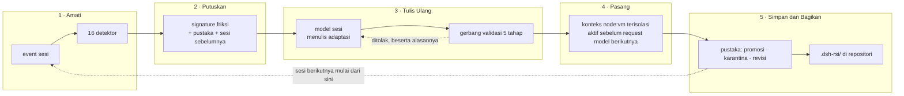

<div align="center">

[English](../../README.md) · [简体中文](README_zh.md) · [繁體中文](README_zh-TW.md) · [日本語](README_ja.md) · [한국어](README_ko.md) · [Türkçe](README_tr.md) · [Русский](README_ru.md) · [Tiếng Việt](README_vi.md) · [ไทย](README_th.md) · [Deutsch](README_de.md) · [Español](README_es.md) · [Français](README_fr.md) · [Українська](README_uk.md) · [Polski](README_pl.md) · [Português (Brasil)](README_pt-BR.md) · [العربية](README_ar.md) · [فارسی](README_fa.md) · **Bahasa Indonesia** · [Italiano](README_it.md) · [Ελληνικά](README_el.md) · [മലയാളം](README_ml.md) · [Roman Urdu](README_ur-Latn.md) · [Română](README_ro.md)

<br />


# DSHRSI: Recursive Self-Improvement (Perbaikan Diri Rekursif) untuk DeepSeek Harness

### **Amati → Perbaiki → Bangun di Atasnya → Ulangi Lagi. Harness yang makin lama makin menjadi milik Anda.**

<a href="https://qybaihe.github.io/dshrsi/trace.html">
  <picture>
    <source media="(prefers-color-scheme: dark)" srcset="../../assets/rsi-trace.dark.gif" />
    
  </picture>
</a>

**RSI adalah singkatan dari Recursive Self-Improvement (Perbaikan Diri Rekursif), dan DSHRSI adalah plugin open-source yang mewujudkannya untuk DeepSeek Harness. Harness mengamati eksekusinya sendiri, meminta model dari sesi itu sendiri menulis kode harness untuk masalah yang ditemukannya, membuktikan kode itu lewat gerbang 5 tahap, lalu memasangnya sebelum giliran berakhir. Setelah itu, harness yang sudah diperbaiki menjalankan sesi berikutnya, dan memperbaiki diri lagi. Tanpa fine-tuning. Tanpa tumpukan prompt. Yang ada adalah kode yang diukur, dipertahankan, ditulis ulang, atau dibuang.**

[](#rsi)
[](https://github.com/deepseek-ai/deepseek-harness)
[](#coverage)
[](#how-it-works)
[](#project-harness)
[](#benchmarks)
[](#contributing)
[](../../LICENSE)

**[🌐 Situs web](https://qybaihe.github.io/dshrsi/) · [📖 Referensi Plugin](../../packages/dsh-rsi/README.md) · [🧩 Harness Proyek](../../packages/dsh-rsi/README.md#layers-and-the-project-harness) · [🔬 Gerbang Validasi](../../packages/dsh-rsi/README.md#the-validation-gate) · [⚠️ Batasan yang Diketahui](../../packages/dsh-rsi/README.md#known-limits) · [🐛 Issues](https://github.com/qybaihe/dshrsi/issues)**

[Apa Itu RSI](#rsi) · [Mulai Cepat](#quick-start) · [Cara Kerja](#how-it-works) · [Hasil Terukur](#measured) · [Benchmark](#benchmarks) · [Detektor & Kapabilitas](#coverage) · [Harness Proyek](#project-harness) · [Default Keamanan](#security) · [FAQ](#faq)

</div>

---

> [!IMPORTANT]
> **Pratinjau Developer:** DSHRSI dibangun untuk DeepSeek Harness `0.2.2-rc.3`, yang juga masih berupa pratinjau developer. **Akan ada perubahan yang merusak kompatibilitas.**
> Adaptasi adalah kode yang ditulis model dan dijalankan di dalam harness Anda. Isolasinya melindungi dari kesalahan, **bukan dari kode jahat**. Baca tentang [gerbang validasi](../../packages/dsh-rsi/README.md#the-validation-gate) sebelum menjalankannya.

<div align="center">

</div>

<br />

<table>
<tr>
<td width="33%" valign="top">

### 🔴 Tanpa DSHRSI
Setiap sesi menemukan ulang fakta yang sama: mesin ini tidak punya `python`, repositori ini punya aturan yang sudah pernah Anda sebutkan, fix ini tidak pernah diverifikasi. Pada run kontrol, **5 dari 5 sesi** melakukan pemanggilan gagal yang sama, dan aturan yang sudah disebutkan pengguna dilanggar lagi satu sesi kemudian.

</td>
<td width="33%" valign="top">

### 🧬 Dengan DSHRSI
Saat masalah itu muncul lagi, model menulis sepotong kode harness, kode itu lolos gerbang, dan langsung aktif **di giliran yang sama**. Dalam 3 run terhadap model sungguhan, **7 dari 7 sesi** setelah adaptasi itu bebas dari pemanggilan gagal. Dan perbaikan berikutnya berangkat dari situ.

</td>
<td width="33%" valign="top">

### 🔒 Dirancang Hanya untuk Memperketat
Adaptasi bisa menambahkan informasi, menolak pemanggilan, bertanya dulu kepada Anda, atau menuntut verifikasi. **Tidak ada kapabilitas yang bisa mengizinkan apa yang akan ditolak harness.** Menulis ulang hasil, menambah tool, dan menjalankan perintah harus menunggu persetujuan Anda.

</td>
</tr>
</table>

---

<a id="rsi"></a>

## 🔁 RSI = Recursive Self-Improvement, Perbaikan Diri Rekursif

Bukan "menulis ulang dirinya sendiri". **Perbaikan Diri Rekursif**: sebuah sistem memakai kemampuannya sendiri untuk memperbaiki dirinya, dan sistem yang sudah diperbaiki itulah yang menjalankan putaran berikutnya. Tiga kata, dan DSHRSI harus layak menyandang setiap katanya:

| | Syaratnya | Cara DSHRSI Memenuhinya |
| :--- | :--- | :--- |
| **Diri (Self)** | Yang bertindak dan yang diubah adalah sistem yang sama | Harness mengubah harness. Adaptasi ditulis oleh model dari sesi yang mengalami masalah itu sendiri. Tidak ada yang menyetelnya dari luar |
| **Perbaikan (Improvement)** | "Lebih baik" harus bisa diperiksa | Setiap adaptasi melewati gerbang 5 tahap sebelum dipasang, dan sesi-sesi berikutnya terus mengujinya: yang berhasil dipromosikan, yang melempar error dikarantina |
| **Rekursif (Recursive)** | Keluaran satu putaran menjadi awal putaran berikutnya | Sesi berikutnya berjalan di atas harness yang sudah diperbaiki, dan diamati di atas harness itu pula. Adaptasi yang tidak mempan ditulis ulang lebih ketat berdasarkan bukti. Adaptasi yang dibutuhkan di workspace kedua diperluas ke seluruh mesin, dan aturan sebuah proyek ikut terbawa ke harness setiap rekan tim |

**Empat loop, masing-masing di dalam loop berikutnya:** di dalam satu giliran → dari sesi ke sesi → perbaikan itu sendiri diperbaiki → dari proyek ke mesin ke tim.

Yang sengaja **tidak** rekursif: bobot model tidak pernah berubah, dan detektor, kebijakan pemicu, serta gerbang validasi adalah kode tetap yang tidak bisa disentuh adaptasi mana pun. Bagian yang mengubah dirinya sendiri diperiksa oleh bagian yang tidak bisa diubahnya.

---

<a id="quick-start"></a>

## ⚡ Mulai Cepat 30 Detik

### 1. Instal di Tempat Anda Biasa Bekerja
Di aplikasi desktop atau Web UI DeepSeek Harness, buka **Plugins → Add plugin → Install a third-party plugin**, tempelkan alamat paket rilis, pilih **Install**, lalu **Enable now**:

```text
https://github.com/qybaihe/dshrsi/releases/download/v0.1.2/dsh-rsi-0.1.2.tgz
```

Atau lewat command line. Setiap profile menyimpan plugin-nya sendiri, dan `dsh plugin add` memanggil `pnpm`, yang harus tersedia di `PATH`:

```bash
dsh plugin --profile web add https://github.com/qybaihe/dshrsi/releases/download/v0.1.2/dsh-rsi-0.1.2.tgz
dsh web
```

### 2. Bekerja Saja Seperti Biasa
Tidak ada yang perlu dikonfigurasi. DSHRSI tidak terlihat sampai masalah yang sama muncul lagi. Saat itulah badge **RSI** menyala, pill di bawah kolom input memberi tahu Anda bahwa harness baru saja mengubah dirinya, dan sesi berikutnya langsung dimulai dalam keadaan sudah diperbaiki:

<div align="center">

</div>

Ketik `/rsi` di sesi mana pun untuk melihat apa saja yang terpasang, masing-masing masuk lapisan mana, dan apa yang sedang menunggu persetujuan Anda.

### 3. Beri Repositori Harness Miliknya Sendiri
Aturan yang dipelajari di sebuah repositori bisa disimpan di repositori itu juga, satu file per adaptasi:

```bash
# Perintah ini ikut bersama plugin, di dalam profile tempat plugin itu diinstal
alias dsh-rsi="$HOME/.dsh/profiles/web/node_modules/.bin/dsh-rsi"

dsh-rsi project init      # di repositori: membuat .dsh-rsi/, lalu commit folder itu
dsh-rsi trust             # di setiap mesin lain: terima file-filenya setelah Anda membacanya
```

### 4. Jalankan dari Kode Sumber

```bash
git clone https://github.com/qybaihe/dshrsi.git && cd dshrsi
npm install               # membawa dsh versi terkunci beserta pnpm yang dipanggilnya
npx dsh plugin --profile web add "$PWD/packages/dsh-rsi"
npx dsh web
```

Profile `desktop` dan `headless`, indeks plugin, tarball lokal, dan pemuatan untuk satu kali run saja dibahas di [referensi plugin](../../packages/dsh-rsi/README.md#install).

---

<a id="how-it-works"></a>

## 🧠 Cara Kerja DSHRSI: Loop Tertutup di Dalam Harness, Dijalankan Berulang Kali

<div align="center">
<picture>
  <source media="(prefers-color-scheme: dark)" srcset="../../assets/pit-stop.dark.svg" />
  
</picture>
</div>

Skill, file memori, dan system prompt yang lebih panjang semuanya bekerja di level konteks: menambahkan teks lalu berharap model mengikutinya. Ketika model tidak mengikutinya, pemanggilan gagal yang sama dilakukan lagi di sesi berikutnya.

**DSHRSI bekerja di level harness. Apa yang dipelajarinya menjadi kode pada titik ekstensi milik harness itu sendiri:**



| Tahap | Mekanisme | Efek |
| :--- | :--- | :--- |
| **1. Amati** | 16 detektor membaca event sesi yang sudah dinormalisasi: pemanggilan yang gagal lagi, penyebab kegagalan yang terus muncul kembali, perintah coba-coba tanpa arah, koreksi dari pengguna, giliran yang berakhir tanpa verifikasi apa pun. | Masalah mendapat signature yang stabil lintas sesi, misalnya `bash:command-not-found:python`. |
| **2. Tulis Ulang** | Model dari sesi itu sendiri menulis adaptasi JavaScript memakai API berisi 10 kapabilitas. Kode yang ditolak dikembalikan beserta alasannya, paling banyak dua kali, setelah itu template bawaan mengambil alih. | Perbaikannya berupa kode harness, bukan satu paragraf prompt lagi. |
| **3. Validasi** | Statis → muat → putar ulang → regresi → izin. Adaptasi harus bertindak atas pemanggilan yang memicunya dan tidak boleh mengusik satu pun pemanggilan yang berhasil di sesi ini. | Kode yang tidak melakukan apa-apa, atau yang merusak hal yang tadinya berjalan, tidak akan pernah dipasang. |
| **4. Pasang** | Adaptasi berjalan di konteks `node:vm` miliknya sendiri di balik sebuah bridge JSON, dengan timeout pada setiap pemanggilan, dan mulai berlaku sebelum request model berikutnya. | Giliran yang terkena masalah itulah yang pertama merasakan manfaatnya. |
| **5. Simpan dan Bagikan** | Satu pustaka per mesin, lengkap dengan ledger dan log audit. Yang berhasil dipromosikan, yang melempar error dikarantina, yang tidak mempan ditulis ulang lebih ketat, dan aturan proyek ditulis ke `.dsh-rsi/`. | Sesi berikutnya dimulai dalam keadaan sudah beradaptasi, dan rekan tim mendapat aturan proyek setelah `dsh-rsi trust`. |
| **↻ Ulangi Lagi** | Sesi berikutnya berjalan di atas harness yang ditinggalkan tahap 5, dan tahap 1 mengamatinya dengan semua adaptasi sudah terpasang. | Perbaikan dibangun di atas perbaikan. Itulah rekursinya. |

---

<a id="measured"></a>

## 🔬 Diukur dengan Model Sungguhan

Angka-angka ini berasal dari menjalankan model sungguhan, `mimo-v2.6-pro`, melalui sesi `dsh` sungguhan (`npm run test:live`). Tidak ada satu pun isi tabel ini yang disimulasikan.

> **Cara membacanya:** sampelnya kecil. Satu model, tiga skenario, segelintir sesi untuk masing-masing. Ini menunjukkan bahwa loop-nya bekerja dari ujung ke ujung. Ini **bukan** pernyataan statistik tentang tingkat keberhasilan, dan tidak ada yang jadi lebih cepat: menulis satu adaptasi berarti menunggu model selama 30–60 detik. Run yang lebih besar ada di [Benchmark](#benchmarks).

| Skenario | Tanpa DSHRSI | Dengan DSHRSI | Yang Ditulis Harness |
| :--- | :--- | :--- | :--- |
| **Perintah tidak ada**: README menyebut `python stats.py`, mesinnya hanya punya `python3` | ❌ **5 / 5** sesi melakukan pemanggilan gagal itu | ✅ **0 / 7** sesi setelah adaptasi (9 / 9 sebelumnya) | `deny` + `prompt`, ditulis model, lolos gerbang pada percobaan pertama |
| **Aturan yang hanya sekali disebut pengguna**: "jangan pernah mengubah `notes.txt`, tulis ke `notes.draft.txt`" | ❌ Sesi berikutnya mengedit `notes.txt` | ✅ Sesi berikutnya menulis ke `notes.draft.txt` tanpa diminta | `deny` + `prompt`, ditulis model tepat setelah koreksi itu |
| **Fix yang tidak diminta siapa pun untuk diverifikasi** | tidak dijalankan | ⚪ Tidak ada yang ditulis: model memverifikasi fix-nya di 3 / 3 sesi, jadi tidak ada yang perlu dipelajari | tidak ada |

Skenario pertama dijalankan tiga kali dengan plugin, setiap kali dari pustaka kosong, ditambah satu run kontrol. Skenario kedua dijalankan sekali dengan plugin dan sekali tanpa plugin.

**Perintah tidak ada, sesi demi sesi** (pemanggilan tool yang gagal per sesi):

| Run | S1 | S2 | S3 | S4 | S5 | S6 |
| :--- | :---: | :---: | :---: | :---: | :---: | :---: |
| **Tanpa DSHRSI** | ❌ 1 | ❌ 1 | ❌ 1 | ❌ 1 | ❌ 1 | |
| **Dengan DSHRSI · run 1** | ❌ 1 | ❌ 1 | ❌ 1 → 🧬 | ✅ 0 | ✅ 0 | ✅ 0 |
| **Dengan DSHRSI · run 2** | ❌ 1 | ❌ 1 | ❌ 1 → 🧬 | ✅ 0 | ✅ 0 | |
| **Dengan DSHRSI · run 3** | ❌ 1 | ❌ 1 | ❌ 1 → 🧬 | ✅ 0 | ✅ 0 | |

🧬 menandai giliran saat model menulis adaptasi dan harness memasangnya. Di 3 dari 7 sesi sesudahnya, model masih mencoba `python`, dan harness menolak pemanggilan itu sebelum dijalankan. Setiap sesi dalam skenario ini berakhir dengan jawaban yang benar, dengan atau tanpa plugin.

Reproduksi secara lokal:

```bash
MIMO_API_KEY=... npm run test:live -- python --sessions 6          # dengan plugin
MIMO_API_KEY=... npm run test:live -- python --sessions 5 --off    # run kontrol tanpa plugin
```

<details>
<summary><strong>Belum diverifikasi di mesin ini (klik untuk membuka)</strong></summary>

<br />

Jalur-jalur kode ini ada di repositori dan tercakup oleh unit test atau tes end-to-end dengan model simulasi, tetapi belum pernah diamati di sesi sungguhan atau aplikasi sungguhan:

| Area | Mengapa Belum Diverifikasi di Sini |
| :--- | :--- |
| Aplikasi desktop DeepSeek Harness | Tidak terinstal di mesin pengembangan. Diverifikasi pada profile `web` dan mekanisme instalasi yang dibungkus aplikasi itu |
| `negative-feedback`, `approval-denied`, `context-pressure`, `model-instability` | Hanya diuji dengan event buatan, belum pernah terpicu di sesi sungguhan |
| Tes browser otomatis | Tidak ada. UI-nya ditelusuri secara manual di halaman `dsh web` sungguhan, dalam mode terang dan gelap |
| Profile ACP dan SDK | Tidak ada UI di sana, dan belum diverifikasi |
| Model di luar keluarga MiMo v2.6 | Belum ada run. Benchmark memakai `mimo-v2.6-pro` dan `mimo-v2.6-flash`; tiga skenario di atas memakai `mimo-v2.6-pro` |

</details>

---

<a id="benchmarks"></a>

## 📊 Benchmark: Empat Suite, Dua Model, Tugas demi Tugas

DeepSeek Harness polos melawan DeepSeek Harness + DSHRSI, dalam 3,390 sesi `dsh` sungguhan: model yang sama, prompt yang sama, sandbox yang sama, tugas yang sama. Plugin berjalan dengan pengaturan default dan memulai setiap suite dengan pustaka kosong. Jumlah tugas yang berhasil diselesaikan pada tiga suite yang berjalan sampai tuntas:

<!-- bench:table:start -->
| Benchmark | Tugas | `mimo-v2.6-pro` Polos | `mimo-v2.6-pro` + DSHRSI | `mimo-v2.6-flash` Polos | `mimo-v2.6-flash` + DSHRSI |
| :--- | ---: | ---: | ---: | ---: | ---: |
| **Aider Polyglot**, percobaan pertama | 225 | 224 (99.6%) | 224 (99.6%) | 220 (97.8%) | 223 (99.1%) |
| **Aider Polyglot**, dalam dua percobaan | 225 | 225 (100.0%) | 225 (100.0%) | 225 (100.0%) | 225 (100.0%) |
| **HumanEval** | 164 | 163 (99.4%) | 162 (98.8%) | 162 (98.8%) | 162 (98.8%) |
| **HumanEval+** | 164 | 156 (95.1%) | 157 (95.7%) | 153 (93.3%) | 153 (93.3%) |
| **MBPP** | 378 | 374 (98.9%) | 371 (98.1%) | 368 (97.4%) | 369 (97.6%) |
| **MBPP+** | 378 | 320 (84.7%) | 319 (84.4%) | 308 (81.5%) | 315 (83.3%) |
<!-- bench:table:end -->

<div align="center">
<picture>
  <source media="(prefers-color-scheme: dark)" srcset="../../assets/bench-flash.dark.png" />
  
</picture>
</div>

> **Cara membacanya:** dari sisi jumlah tugas yang berhasil diselesaikan, kedua harness **tidak bisa dibedakan**. Kenaikan terbesar adalah +7 (MBPP+ dengan `mimo-v2.6-flash`), penurunan terbesar adalah −3 (MBPP dengan `mimo-v2.6-pro`), dan tidak ada selisih yang bertahan dalam uji McNemar eksak pada tugas yang sama (p terkecil = 0.17). Ketika agen bisa menjalankan kodenya sendiri, suite-suite ini sudah mendekati batas atasnya untuk kedua model, dan setiap tugas adalah direktori baru yang bersih: sangat sedikit hal yang muncul kembali untuk bisa dipelajari harness.

**Yang benar-benar dilakukan DSHRSI, tanpa satu petunjuk pun, adalah mengubah dirinya sendiri.** Sepanjang delapan run itu, model-model menulis **56 adaptasi**; 15 di antaranya bertindak, dan 10 dari yang bertindak itu sudah diperluas ke seluruh mesin. Untuk masing-masing dari 10 adaptasi itu, kami mengambil tugas-tugas yang dimulai sesudahnya dan membandingkannya dengan tugas yang persis sama pada DSH polos:

| Adaptasi yang Ditulis Model | Kegagalan yang Dijawabnya | DSH Polos | DSH + DSHRSI | p |
| :--- | :--- | ---: | ---: | ---: |
| *Stop inline python checks that abort on first mismatch* (MBPP, `mimo-v2.6-pro`) | Eksekusi tes yang mati pada assertion pertama yang gagal | 16 dari 310 tugas | **3 dari 310** | 0.002 |
| *Redirect missing lib.rs reads to a glob lookup* (Polyglot, `mimo-v2.6-flash`) | Membaca `lib.rs` di path yang tidak ada | 7 dari 151 tugas | **1 dari 151** | 0.07 |
| 8 lainnya | | tidak ada perubahan yang terukur | | |

Tidak satu pun dari keduanya membuat lebih banyak tugas lolos, dan plugin ini memakan sekitar 8–9% lebih banyak waktu agen dan token input. Kesepuluhnya tercantum di [`bench/README.md`](../../bench/README.md#did-those-adaptations-work).

**LiveCodeBench v6 terhenti di tengah jalan:** akun model kehabisan saldo sebelum selesai. Pada tugas-tugas yang saat itu sudah selesai dijalankan kedua sisi, DSH polos berhasil menyelesaikan 94 dan DSHRSI 96 dari 105 dengan `mimo-v2.6-pro`, serta 42 lawan 42 dari 51 dengan `mimo-v2.6-flash`. Karena alasan yang sama, putaran kedua, yaitu tugas-tugas yang sama sekali lagi di atas pustaka yang ditinggalkan putaran pertama, belum dijalankan.

Reproduksi secara lokal:

```bash
bench/setup.sh                                                        # toolchain, dataset, kode penilaian
MIMO_API_KEY=... node bench/run.mjs polyglot --arm dsh --run dsh-p1   # DeepSeek Harness polos
MIMO_API_KEY=... node bench/run.mjs polyglot --arm rsi --run rsi-p1   # dengan plugin
node bench/report.mjs --write                                         # tabel dan bench/results/*.json
```

Protokol, tabel biaya dan kegagalan, serta batasannya ada di [`bench/README.md`](../../bench/README.md); hasil per tugas ada di [`bench/results/`](../../bench/results).

---

<a id="coverage"></a>

## 🛡️ Detektor & Kapabilitas

**16 detektor** menentukan kapan harness harus berubah. Detektor yang sama berjalan pada sesi yang sedang berlangsung maupun pada sesi yang tersimpan di disk (`dsh-rsi mine`):

| Detektor | Yang Ditemukannya | Respons |
| :--- | :--- | :---: |
| `repeat-failing-call` | Pemanggilan yang sama gagal lagi dengan argumen yang sama | beradaptasi |
| `failure-signature` | Penyebab kegagalan yang sama terus muncul kembali: perintah tidak ada, dependensi tidak ada, jaringan, izin, port sedang dipakai, path tidak ditemukan, edit tidak cocok, argumen tidak valid, kehabisan memori | beradaptasi |
| `command-flailing` | Jenis perintah yang sama gagal berturut-turut dengan argumen yang berganti-ganti | beradaptasi |
| `read-thrash` | File yang sama, tanpa perubahan, dibaca berulang-ulang | beradaptasi |
| `edit-churn` | File yang sama diedit berkali-kali dalam satu giliran | beradaptasi |
| `error-storm` | Sebagian besar pemanggilan tool terakhir gagal | beradaptasi |
| `stall` | Kegagalan berturut-turut tanpa satu pun keberhasilan di antaranya | beradaptasi |
| `timeout-recurrence` | Jenis perintah yang sama terus-menerus timeout | beradaptasi |
| `output-flood` | Jenis perintah yang sama terus menghasilkan output yang terlalu besar | beradaptasi |
| `approval-denied` / `denied-repeat` | Pengguna terus menolak jenis tindakan yang sama, atau pemanggilan yang ditolak dicoba lagi tanpa perubahan | beradaptasi |
| `user-correction` | Pengguna mengoreksi model, atau menyela lalu mengubah arah | beradaptasi |
| `premature-completion` | Kode sudah diubah dan giliran akan berakhir tanpa ada pemeriksaan yang dijalankan | beradaptasi |
| `negative-feedback` | Pengguna menandai sebuah balasan sebagai buruk dan menuliskan alasannya | beradaptasi |
| `user-interrupt` | Pengguna menyela di tengah giliran | dicatat |
| `model-instability` | Request model terus gagal, diulang, atau mentok di batas output | dicatat |
| `context-pressure` | Konteks dipadatkan di tengah tugas | dicatat |

**10 kapabilitas** adalah semua yang bisa dilakukan sebuah adaptasi. Adaptasi hanya bisa menjangkau harness melalui kapabilitas ini:

| Kapabilitas | Fungsinya | Tingkat |
| :--- | :--- | :---: |
| `annotate` | Menambahkan catatan di akhir hasil tool | ✅ otomatis |
| `steer` | Menambahkan catatan sebelum request model berikutnya | ✅ otomatis |
| `deny` | Menolak pemanggilan tool dan memberikan alasannya | ✅ otomatis |
| `ask` | Mewajibkan persetujuan pengguna untuk sebuah pemanggilan | ✅ otomatis |
| `block` | Mengubah hasil tool menjadi error yang membawa koreksi | ✅ otomatis |
| `verify` | Menahan giliran agar tidak berakhir selama suatu kondisi belum terpenuhi | ✅ otomatis |
| `prompt` | Menambahkan bagian tetap ke system prompt | ✅ otomatis |
| `rewrite` | Mengganti teks hasil tool | 🔐 perlu persetujuan |
| `tool` | Mendaftarkan tool baru untuk model | 🔐 perlu persetujuan |
| `exec` | Menjalankan perintah melalui tool shell milik harness, di bawah aturan sandbox dan persetujuan yang sama | 🔐 perlu persetujuan |

Inilah adaptasi yang ditulis model pada skenario pertama di atas:

```js
define({
  title: 'Route python invocations to python3',
  description: '...',
  capabilities: ['deny', 'prompt'],
  setup(h) {
    h.promptSection('On this machine there is no `python` executable; use `python3`.')
    h.beforeTool({ tool: 'bash', command: /(^|[;&|(]\s*)python(\s|$)/ },
      () => h.deny('`python` is not installed on this machine. Use `python3` instead.'))
  },
})
```

---

<a id="project-harness"></a>

## 🧩 Tiga Lapisan, dan Satu Harness per Proyek

Setiap adaptasi termasuk dalam salah satu dari tiga lapisan. Setiap lapisan bisa dimatikan sendiri-sendiri:

| Lapisan | Isinya | Contoh | Tempat Berlakunya |
| :--- | :--- | :--- | :--- |
| **`machine`** | Fakta tentang komputer ini | Tidak ada `python`; sebuah port sudah terpakai; sebuah host internal tidak bisa di-resolve | Workspace tempat adaptasi itu dipelajari, lalu seluruh mesin begitu workspace kedua mengalaminya |
| **`user`** | Bagaimana Anda ingin diperlakukan | Balasan yang ditandai buruk dengan alasan "terlalu panjang" | Seluruh mesin |
| **`project`** | Aturan dan kebiasaan satu repositori | "Repositori ini selalu memakai pnpm" | Workspace itu, dan repositori itu sendiri melalui `.dsh-rsi/` |

**Lapisan proyek ikut bersama kodenya:**

```
.dsh-rsi/
  harness.json           penanda format dan pengaturan tingkat proyek
  adaptations/
    remember-the-user-s-instruction-3f2a1c.js     dipelajari, lalu ditulis di sini
    no-force-push.js                              yang ditulis tangan bekerja dengan cara yang sama
```

- **Commit untuk berbagi, hapus untuk mencabut.** Satu file adalah satu adaptasi.
- **Tidak ada yang berjalan hanya karena di-clone.** Setiap mesin menerima isi persis file-file itu dengan `dsh-rsi trust`, dan menerimanya lagi ketika file-file itu berubah.
- **Sebuah proyek hanya bisa membuat harness lebih konservatif**, tidak pernah sebaliknya. Pengaturan seperti `autonomy` berada di luar jangkauan proyek.
- **Bisa dibawa ke luar repositori.** `dsh-rsi export` dan `dsh-rsi import` membawa lapisan mesin dan pengguna ke komputer lain sebagai satu file.

---

<a id="security"></a>

## 🔒 Default Keamanan & Konfigurasi

- **Tingkat Otomatis Hanya Bisa Memperketat** — Tanpa persetujuan Anda, adaptasi hanya bisa menambahkan informasi, menolak, bertanya, atau menuntut verifikasi. `deny` dan `ask` miliknya hanya bisa membuat putusan kebijakan lain menjadi lebih ketat.
- **Persetujuan untuk Kapabilitas Kuat (`autonomy: tighten`)** — Adaptasi yang menulis ulang hasil, menambah tool, atau menjalankan perintah disimpan sebagai `proposed` dan menunggu `dsh-rsi approve <id>`.
- **Tak Terlihat Sampai Dibutuhkan** — Tanpa friksi dan tanpa adaptasi yang terpasang, system prompt, daftar tool, dan pesan tidak berubah byte demi byte. Sebuah tes end-to-end menjaga hal ini.
- **Kegagalan Terisolasi** — Handler yang melempar error tidak pernah memengaruhi pemanggilan tool tempat ia terpasang. Setelah tiga error, adaptasi itu dikarantina.
- **Semua Tercatat** — Setiap keputusan ada di `audit.jsonl`, setiap friksi, pemasangan, dan tindakan ada di `ledger.jsonl`. `dsh-rsi disable`, `retire`, dan `rollback` mencabut sebuah adaptasi atau memundurkannya.
- **Tiga Mode** — `adapt` langsung memasang (default), `propose` membuat adaptasi lalu menunggu Anda, `observe` hanya mencatat.

---

<a id="faq"></a>

## ❓ FAQ

<details>
<summary><strong>Apakah DSHRSI melakukan fine-tuning atau mengubah model?</strong></summary>

Tidak. Bobot model tidak disentuh dan tidak ada yang dilatih. Yang berubah adalah harness: kode yang berjalan di sekitar prompt dan pemanggilan tool milik model. RSI di sini adalah Perbaikan Diri Rekursif di level harness: harness memperbaiki dirinya dari eksekusinya sendiri, dan setiap putaran berangkat dari harness yang ditinggalkan putaran sebelumnya.
</details>

<details>
<summary><strong>Apakah ini benar-benar "rekursif", atau cuma harness yang belajar aturan?</strong></summary>

Rekursinya konkret dan ada di dalam kode. Sesi baru memasang semua isi pustaka, sehingga detektor mengamati harness yang sudah berubah. Ketika masalah yang sama terjadi dua kali di sesi-sesi yang sudah memasang sebuah adaptasi, model menerima kode sumber yang berlaku saat ini beserta buktinya, lalu menulis versi yang lebih ketat; versi lama disimpan untuk rollback. Masalah yang ditemui di workspace kedua memperluas adaptasi ke seluruh mesin. Yang tidak rekursif adalah hakimnya: detektor, kebijakan pemicu, dan gerbang validasi tidak bisa diubah oleh adaptasi mana pun.
</details>

<details>
<summary><strong>Apa bedanya dengan skill, file memori, atau system prompt yang lebih panjang?</strong></summary>

Semua itu menambahkan teks yang bisa saja diikuti model, bisa juga tidak. Adaptasi adalah kode pada titik ekstensi harness: ia bisa menolak pemanggilan tool sebelum dijalankan, mewajibkan persetujuan Anda, atau menahan giliran agar tidak berakhir selama belum ada yang diverifikasi. Pada run yang diukur, model masih mencoba `python` di 3 sesi setelah diberi tahu untuk tidak melakukannya, dan pemanggilan itu ditolak sebelum dijalankan.
</details>

<details>
<summary><strong>Apakah ini memperlambat sesi saya?</strong></summary>

Menulis satu adaptasi berarti menunggu satu respons penuh dari model: 30–60 detik pada `mimo-v2.6-pro`, dan selama itu langkah tersebut berhenti di tempat. Adaptasi yang sudah terpasang berjalan in-process dengan timeout. Tidak ada percepatan yang terukur, dan tidak ada yang diklaim.
</details>

<details>
<summary><strong>Bisakah adaptasi yang ditulis model melakukan sesuatu yang berbahaya?</strong></summary>

Tingkat otomatis tidak bisa mengizinkan apa pun yang akan ditolak harness, dan kapabilitas yang kuat menunggu persetujuan Anda. Kodenya berjalan di konteks `node:vm` miliknya sendiri di balik sebuah bridge JSON. Ini melindungi dari kesalahan dan penyalahgunaan iseng. Ini **bukan** batas keamanan terhadap kode jahat, jadi baca file-file `.dsh-rsi/` milik sebuah proyek sebelum Anda menjalankan `dsh-rsi trust`.
</details>

<details>
<summary><strong>Dengan model apa saja ini bisa bekerja?</strong></summary>

Adaptasi ditulis oleh model yang sedang dipakai sesi, atau oleh model yang Anda tetapkan lewat `provider` dan `model`. Jika model tidak mampu menghasilkan kode yang lolos gerbang, template bawaan mengambil alih. Run sejauh ini memakai dua model dari satu keluarga, `mimo-v2.6-pro` dan `mimo-v2.6-flash`.
</details>

<details>
<summary><strong>Apakah ini berjalan di aplikasi desktop DeepSeek Harness?</strong></summary>

DSHRSI hadir sebagai plugin pihak ketiga biasa dengan metadata yang dibaca halaman plugin, dan terinstal ke profile `web` yang dibungkus aplikasi itu. Plugin ini belum diverifikasi di dalam aplikasi desktop sungguhan.
</details>

<details>
<summary><strong>Bagaimana cara melihat, membatalkan, atau mematikan apa yang sudah dipelajarinya?</strong></summary>

`/rsi` di dalam sesi, atau `dsh-rsi status` di terminal. `dsh-rsi show <id>` mencetak kode sumber dan laporan validasi sebuah adaptasi; `disable`, `retire`, dan `rollback` mencabutnya atau memundurkannya. Setel `mode: observe` untuk mencatat tanpa mengubah apa pun.
</details>

---

<a id="docs"></a>

## 📚 Dokumentasi & Tautan

- [📖 Referensi Plugin](../../packages/dsh-rsi/README.md) — setiap detektor, kapabilitas, perintah, dan pengaturan
- [🚀 Sumber Instalasi & Profile](../../packages/dsh-rsi/README.md#install)
- [🧩 Lapisan & Harness Proyek](../../packages/dsh-rsi/README.md#layers-and-the-project-harness)
- [🔬 Gerbang Validasi](../../packages/dsh-rsi/README.md#the-validation-gate)
- [🛠️ Command Line `dsh-rsi`](../../packages/dsh-rsi/README.md#command-line) · [⚙️ Konfigurasi](../../packages/dsh-rsi/README.md#configuration)
- [⚠️ Batasan yang Diketahui](../../packages/dsh-rsi/README.md#known-limits)
- [📊 Protokol & Hasil Benchmark](../../bench/README.md)
- [🌐 Kode sumber situs web](../../website) — perbaikan diri rekursif, cara kerjanya, menulis adaptasi, evaluasi; buka `website/index.html` di browser
- [🧱 DeepSeek Harness](https://github.com/deepseek-ai/deepseek-harness) — harness tempat plugin ini dicolokkan

<a id="contributing"></a>

## 🤝 Kontribusi & Komunitas

Issue dan PR diterima dengan senang hati di [qybaihe/dshrsi](https://github.com/qybaihe/dshrsi). Sebelum mengirim PR:

```bash
npm install && npm test    # 130 unit test, lalu 29 tes end-to-end; tidak perlu key
```

Tes end-to-end mengganti endpoint model dengan endpoint simulasi. Selebihnya sungguhan: proses `dsh`, eksekusi tool, log sesi, dan instalasi plugin.

```
packages/dsh-rsi/        bundle plugin (ESM murni, tanpa langkah build)
  index.js               sisi host: binding ke titik ekstensi DSH
  client.js              sisi browser: badge RSI dan pill status
  src/engine.js          amati → putuskan → hasilkan → validasi → pasang → simpan → bagikan
  src/signals.js         16 detektor
  src/validate.js        gerbang validasi
  src/sandbox.js         tempat kode adaptasi berjalan
  src/project.js         harness proyek: <repositori>/.dsh-rsi
  bin/rsi.js             perintah dsh-rsi
market/index.json        indeks plugin yang bisa ditambahkan ke DSH
test/unit/  test/e2e/    unit test, dan tes end-to-end pada proses dsh sungguhan
test/live/               run terhadap model sungguhan (perlu MIMO_API_KEY)
bench/                   benchmark: DSH polos melawan DSH + dsh-rsi
website/                 situs web (halaman statis, tanpa langkah build)
```

## 📄 Lisensi

[MIT](../../LICENSE)

---

Created in [T3 Code](https://t3.codes).
