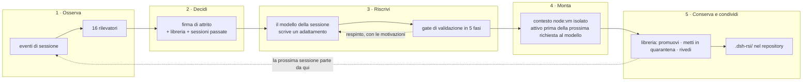

<div align="center">

[English](../../README.md) · [简体中文](README_zh.md) · [繁體中文](README_zh-TW.md) · [日本語](README_ja.md) · [한국어](README_ko.md) · [Türkçe](README_tr.md) · [Русский](README_ru.md) · [Tiếng Việt](README_vi.md) · [ไทย](README_th.md) · [Deutsch](README_de.md) · [Español](README_es.md) · [Français](README_fr.md) · [Українська](README_uk.md) · [Polski](README_pl.md) · [Português (Brasil)](README_pt-BR.md) · [العربية](README_ar.md) · [فارسی](README_fa.md) · [Bahasa Indonesia](README_id.md) · **Italiano** · [Ελληνικά](README_el.md) · [മലയാളം](README_ml.md) · [Roman Urdu](README_ur-Latn.md) · [Română](README_ro.md)

<br />


# DSHRSI: Recursive Self-Improvement (auto-miglioramento ricorsivo) per DeepSeek Harness

### **Osserva → Migliora → Costruiscici sopra → Da capo. Un harness che diventa sempre più tuo.**

<a href="https://qybaihe.github.io/dshrsi/trace.html">
  <picture>
    <source media="(prefers-color-scheme: dark)" srcset="../../assets/rsi-trace.dark.gif" />
    
  </picture>
</a>

**RSI sta per Recursive Self-Improvement, auto-miglioramento ricorsivo, e DSHRSI è il plugin open source che lo rende reale per DeepSeek Harness. L'harness osserva le proprie esecuzioni, fa scrivere al modello stesso della sessione codice dell'harness per i problemi che trova, mette alla prova quel codice in un gate in 5 fasi e lo monta prima che il turno finisca. Poi è l'harness migliorato a eseguire la sessione successiva, e a migliorarsi di nuovo. Niente fine-tuning. Niente montagne di prompt. Codice che viene misurato, tenuto, riscritto o buttato via.**

[](#rsi)
[](https://github.com/deepseek-ai/deepseek-harness)
[](#coverage)
[](#how-it-works)
[](#project-harness)
[](#benchmarks)
[](#contributing)
[](../../LICENSE)

**[🌐 Sito web](https://qybaihe.github.io/dshrsi/) · [📖 Riferimento del plugin](../../packages/dsh-rsi/README.md) · [🧩 Harness di progetto](../../packages/dsh-rsi/README.md#layers-and-the-project-harness) · [🔬 Gate di validazione](../../packages/dsh-rsi/README.md#the-validation-gate) · [⚠️ Limiti noti](../../packages/dsh-rsi/README.md#known-limits) · [🐛 Issue](https://github.com/qybaihe/dshrsi/issues)**

[Cosa significa RSI](#rsi) · [Avvio rapido](#quick-start) · [Come funziona](#how-it-works) · [Risultati misurati](#measured) · [Benchmark](#benchmarks) · [Rilevatori e capacità](#coverage) · [Harness di progetto](#project-harness) · [Default di sicurezza](#security) · [FAQ](#faq)

</div>

---

> [!IMPORTANT]
> **Anteprima per sviluppatori:** DSHRSI è sviluppato su DeepSeek Harness `0.2.2-rc.3`, che è a sua volta un'anteprima per sviluppatori. **Ci saranno modifiche che rompono la compatibilità.**
> Un adattamento è codice scritto da un modello ed eseguito dentro il tuo harness. Il suo isolamento protegge dagli errori, **non dal codice malevolo**. Prima di eseguirlo, leggi la sezione sul [gate di validazione](../../packages/dsh-rsi/README.md#the-validation-gate).

<div align="center">

</div>

<br />

<table>
<tr>
<td width="33%" valign="top">

### 🔴 Senza DSHRSI
Ogni sessione riscopre gli stessi fatti: su questa macchina non c'è `python`, questo repository ha una regola che avevi già dichiarato, questa correzione non è mai stata verificata. Nell'esecuzione di controllo, **5 sessioni su 5** hanno fatto la stessa chiamata fallita, e una regola dichiarata dall'utente è stata infranta di nuovo una sessione più tardi.

</td>
<td width="33%" valign="top">

### 🧬 Con DSHRSI
Quando il problema si ripresenta, il modello scrive un pezzo di codice dell'harness, quel codice supera il gate ed è attivo **in quello stesso turno**. In 3 esecuzioni con un modello reale, **7 sessioni su 7** dopo l'adattamento non hanno avuto nessuna chiamata fallita. E il miglioramento successivo parte da lì.

</td>
<td width="33%" valign="top">

### 🔒 Solo restrizioni, by design
Un adattamento può aggiungere informazioni, rifiutare una chiamata, chiedere prima a te o pretendere una verifica. **Nessuna capacità può consentire ciò che l'harness rifiuterebbe.** Riscrivere i risultati, aggiungere tool ed eseguire comandi restano in attesa della tua approvazione.

</td>
</tr>
</table>

---

<a id="rsi"></a>

## 🔁 RSI = Recursive Self-Improvement, auto-miglioramento ricorsivo

Non "riscrivere se stesso". **Auto-miglioramento ricorsivo**: un sistema usa le proprie abilità per migliorare se stesso, ed è il sistema migliorato a compiere il giro successivo. Tre parole, e DSHRSI deve meritarsele una per una:

| | Cosa richiede | Come lo fa DSHRSI |
| :--- | :--- | :--- |
| **Auto (Self)** | Chi agisce e chi viene modificato sono lo stesso sistema | L'harness modifica l'harness. L'adattamento lo scrive il modello della stessa sessione che ha incontrato il problema. Nessuno lo mette a punto dall'esterno |
| **Miglioramento (Improvement)** | "Migliore" deve essere verificabile | Ogni adattamento supera un gate in 5 fasi prima di essere montato, e viene poi giudicato sulle sessioni successive: ciò che funziona viene promosso, ciò che lancia eccezioni va in quarantena |
| **Ricorsivo (Recursive)** | Il risultato di un giro dà il via al successivo | La sessione successiva gira sull'harness migliorato e viene osservata con quello in funzione. Un adattamento che non ha retto viene riscritto in forma più restrittiva sulla base delle prove. Uno che serve in un secondo workspace si estende all'intera macchina, e le regole di un progetto arrivano nell'harness di ogni collega |

**Quattro cicli, ognuno dentro il successivo:** dentro un turno → da una sessione all'altra → il miglioramento stesso viene migliorato → da un progetto a una macchina a un team.

Ciò che volutamente **non** è ricorsivo: i pesi del modello non cambiano mai, e i rilevatori, la policy di attivazione e il gate di validazione sono codice fisso che nessun adattamento può toccare. La parte che modifica se stessa è controllata da una parte che non può modificare.

---

<a id="quick-start"></a>

## ⚡ Avvio rapido in 30 secondi

### 1. Installalo dove lavori già
Nell'app desktop di DeepSeek Harness o nella Web UI, apri **Plugins → Add plugin → Install a third-party plugin**, incolla l'URL del pacchetto di release, seleziona **Install** e poi **Enable now**:

```text
https://github.com/qybaihe/dshrsi/releases/download/v0.1.1/dsh-rsi-0.1.1.tgz
```

Oppure dalla riga di comando. Ogni profilo ha i suoi plugin, e `dsh plugin add` chiama `pnpm`, che deve trovarsi nel `PATH`:

```bash
dsh plugin --profile web add https://github.com/qybaihe/dshrsi/releases/download/v0.1.1/dsh-rsi-0.1.1.tgz
dsh web
```

### 2. Lavora e basta
Non c'è niente da configurare. DSHRSI non si fa vedere finché lo stesso problema non si ripresenta. A quel punto il badge **RSI** si accende, la pillola sotto il campo di input ti dice che l'harness ha appena modificato se stesso, e la sessione successiva parte già migliorata:

<div align="center">

</div>

Scrivi `/rsi` in qualsiasi sessione per vedere cosa è montato, a quale layer appartiene e cosa aspetta la tua approvazione.

### 3. Dai a un repository il suo harness
Le regole imparate in un repository possono vivere in quel repository, un file per adattamento:

```bash
# Il comando arriva insieme al plugin, dentro il profilo in cui è stato installato
alias dsh-rsi="$HOME/.dsh/profiles/web/node_modules/.bin/dsh-rsi"

dsh-rsi project init      # nel repository: crea .dsh-rsi/, poi fanne il commit
dsh-rsi trust             # su ogni altra macchina: accetta i file dopo averli letti
```

### 4. Esegui dai sorgenti

```bash
git clone https://github.com/qybaihe/dshrsi.git && cd dshrsi
npm install               # porta con sé un dsh a versione bloccata e il pnpm che questo chiama
npx dsh plugin --profile web add "$PWD/packages/dsh-rsi"
npx dsh web
```

I profili `desktop` e `headless`, gli indici di plugin, i tarball locali e il caricamento per una singola esecuzione sono trattati nel [riferimento del plugin](../../packages/dsh-rsi/README.md#install).

---

<a id="how-it-works"></a>

## 🧠 Come funziona DSHRSI: un ciclo chiuso dentro l'harness, ripetuto ancora e ancora

Skill, file di memoria e prompt di sistema più lunghi lavorano tutti a livello di contesto: aggiungono testo e sperano che il modello lo segua. Quando non lo fa, la stessa chiamata fallita viene ripetuta nella sessione successiva.

**DSHRSI lavora a livello di harness. Ciò che impara diventa codice sui punti di estensione dell'harness stesso:**



| Fase | Meccanismo | Effetto |
| :--- | :--- | :--- |
| **1. Osserva** | 16 rilevatori leggono eventi di sessione normalizzati: chiamate che falliscono di nuovo, cause di fallimento che continuano a ripresentarsi, tentativi alla cieca, correzioni dell'utente, turni che finiscono senza aver verificato nulla. | Il problema riceve una firma stabile da una sessione all'altra, per esempio `bash:command-not-found:python`. |
| **2. Riscrivi** | Il modello stesso della sessione scrive un adattamento in JavaScript usando un'API di 10 capacità. Il codice respinto torna indietro con le motivazioni, al massimo due volte, poi subentra un template integrato. | La correzione è codice dell'harness, non un altro paragrafo di prompt. |
| **3. Valida** | Analisi statica → caricamento → replay → regressione → permessi. L'adattamento deve agire sulle chiamate che l'hanno fatto scattare e deve lasciare in pace ogni chiamata riuscita in questa sessione. | Il codice che non fa nulla, o che rompe ciò che già funzionava, non viene mai montato. |
| **4. Monta** | L'adattamento gira in un proprio contesto `node:vm` dietro un bridge JSON, con un timeout su ogni chiamata, e ha effetto prima della successiva richiesta al modello. | Il primo a beneficiarne è il turno che ha incontrato il problema. |
| **5. Conserva e condividi** | Una libreria per macchina, con un registro e un log di audit. Ciò che funziona viene promosso, ciò che lancia eccezioni va in quarantena, ciò che non ha retto viene riscritto in forma più restrittiva, e le regole di progetto vengono scritte in `.dsh-rsi/`. | La sessione successiva parte già adattata, e i colleghi ricevono le regole del progetto dopo `dsh-rsi trust`. |
| **↻ Da capo** | La sessione successiva gira sull'harness lasciato dalla fase 5, e la fase 1 la osserva con tutti gli adattamenti al loro posto. | Il miglioramento si costruisce sul miglioramento. Questa è la ricorsione. |

---

<a id="measured"></a>

## 🔬 Misurato su un modello reale

Questi numeri vengono dall'esecuzione di un modello reale, `mimo-v2.6-pro`, in sessioni `dsh` reali (`npm run test:live`). In questa tabella non c'è niente di simulato.

> **Come leggerla:** il campione è piccolo. Un modello, tre scenari, una manciata di sessioni ciascuno. Dimostra che il ciclo funziona da un capo all'altro. **Non** è un'affermazione statistica sui tassi di successo, e niente è diventato più veloce: scrivere un adattamento significa aspettare il modello per 30–60 secondi. Le esecuzioni più ampie sono in [Benchmark](#benchmarks).

| Scenario | Senza DSHRSI | Con DSHRSI | Cosa ha scritto l'harness |
| :--- | :--- | :--- | :--- |
| **Comando mancante**: il README dice `python stats.py`, la macchina ha solo `python3` | ❌ **5 / 5** sessioni hanno fatto la chiamata fallita | ✅ **0 / 7** sessioni dopo l'adattamento (9 / 9 prima) | `deny` + `prompt`, scritto dal modello, ha superato il gate al primo tentativo |
| **Una regola che l'utente ha dichiarato una sola volta**: "non modificare mai `notes.txt`, scrivi in `notes.draft.txt`" | ❌ La sessione successiva ha modificato `notes.txt` | ✅ La sessione successiva ha scritto in `notes.draft.txt` senza che nessuno glielo ricordasse | `deny` + `prompt`, scritto dal modello subito dopo la correzione |
| **Una correzione che nessuno ha chiesto di verificare** | non eseguito | ⚪ Niente di scritto: il modello ha verificato la sua correzione in 3 / 3 sessioni, quindi non c'era nulla da imparare | niente |

Il primo scenario è stato eseguito tre volte con il plugin, ogni volta partendo da una libreria vuota, più un'esecuzione di controllo. Il secondo è stato eseguito una volta con il plugin e una senza.

**Comando mancante, sessione per sessione** (chiamate ai tool fallite per sessione):

| Esecuzione | S1 | S2 | S3 | S4 | S5 | S6 |
| :--- | :---: | :---: | :---: | :---: | :---: | :---: |
| **Senza DSHRSI** | ❌ 1 | ❌ 1 | ❌ 1 | ❌ 1 | ❌ 1 | |
| **Con DSHRSI · esecuzione 1** | ❌ 1 | ❌ 1 | ❌ 1 → 🧬 | ✅ 0 | ✅ 0 | ✅ 0 |
| **Con DSHRSI · esecuzione 2** | ❌ 1 | ❌ 1 | ❌ 1 → 🧬 | ✅ 0 | ✅ 0 | |
| **Con DSHRSI · esecuzione 3** | ❌ 1 | ❌ 1 | ❌ 1 → 🧬 | ✅ 0 | ✅ 0 | |

🧬 segna il turno in cui il modello ha scritto l'adattamento e l'harness lo ha montato. In 3 delle 7 sessioni successive il modello ha comunque provato `python`, e l'harness ha rifiutato la chiamata prima che venisse eseguita. In questo scenario ogni sessione si è conclusa con la risposta corretta, con o senza il plugin.

Riproduci in locale:

```bash
MIMO_API_KEY=... npm run test:live -- python --sessions 6          # con il plugin
MIMO_API_KEY=... npm run test:live -- python --sessions 5 --off    # esecuzione di controllo, senza plugin
```

<details>
<summary><strong>Non verificato su questa macchina (clicca per espandere)</strong></summary>

<br />

Questi percorsi di codice esistono nel repository e sono coperti da test unitari o end-to-end con un modello simulato, ma non sono stati osservati in una sessione reale o in un'app reale:

| Area | Perché qui non è verificata |
| :--- | :--- |
| L'app desktop di DeepSeek Harness | Non è installata sulla macchina di sviluppo. Verificato sul profilo `web` e sul meccanismo di installazione che l'app incapsula |
| `negative-feedback`, `approval-denied`, `context-pressure`, `model-instability` | Testati solo con eventi costruiti ad hoc, mai scattati in una sessione reale |
| Test automatici nel browser | Nessuno. La UI è stata provata a mano, passo per passo, nella vera pagina di `dsh web`, in tema chiaro e scuro |
| Profili ACP e SDK | Lì non c'è UI, e non sono stati verificati |
| Modelli fuori dalla famiglia MiMo v2.6 | Ancora nessuna esecuzione. I benchmark hanno usato `mimo-v2.6-pro` e `mimo-v2.6-flash`; i tre scenari qui sopra hanno usato `mimo-v2.6-pro` |

</details>

---

<a id="benchmarks"></a>

## 📊 Benchmark: quattro suite, due modelli, task per task

DeepSeek Harness di serie contro DeepSeek Harness + DSHRSI, in 3,390 sessioni `dsh` reali: lo stesso modello, gli stessi prompt, la stessa sandbox, gli stessi task. Il plugin gira con le impostazioni predefinite e inizia ogni suite con una libreria vuota. Task risolti nelle tre suite arrivate fino in fondo:

<!-- bench:table:start -->
| Benchmark | Task | `mimo-v2.6-pro` di serie | `mimo-v2.6-pro` + DSHRSI | `mimo-v2.6-flash` di serie | `mimo-v2.6-flash` + DSHRSI |
| :--- | ---: | ---: | ---: | ---: | ---: |
| **Aider Polyglot**, al primo tentativo | 225 | 224 (99.6%) | 224 (99.6%) | 220 (97.8%) | 223 (99.1%) |
| **Aider Polyglot**, entro due tentativi | 225 | 225 (100.0%) | 225 (100.0%) | 225 (100.0%) | 225 (100.0%) |
| **HumanEval** | 164 | 163 (99.4%) | 162 (98.8%) | 162 (98.8%) | 162 (98.8%) |
| **HumanEval+** | 164 | 156 (95.1%) | 157 (95.7%) | 153 (93.3%) | 153 (93.3%) |
| **MBPP** | 378 | 374 (98.9%) | 371 (98.1%) | 368 (97.4%) | 369 (97.6%) |
| **MBPP+** | 378 | 320 (84.7%) | 319 (84.4%) | 308 (81.5%) | 315 (83.3%) |
<!-- bench:table:end -->

<div align="center">
<picture>
  <source media="(prefers-color-scheme: dark)" srcset="../../assets/bench-flash.dark.png" />
  
</picture>
</div>

> **Come leggerla:** sui task risolti, i due harness **sono indistinguibili**. Il guadagno più grande è +7 (MBPP+ con `mimo-v2.6-flash`), la perdita più grande è −3 (MBPP con `mimo-v2.6-pro`), e nessuna differenza regge a un test esatto di McNemar sugli stessi task (p minimo = 0.17). Quando l'agente può eseguire il proprio codice, queste suite sono vicine al tetto per entrambi i modelli, e ogni task è una directory nuova e pulita: c'è ben poco che si ripresenti e da cui un harness possa imparare.

**Quello che DSHRSI ha fatto davvero, senza un solo suggerimento, è modificare se stesso.** Nelle otto esecuzioni i modelli hanno scritto **56 adattamenti**; 15 di questi sono entrati in azione, e 10 di essi erano stati estesi all'intera macchina. Per ciascuno dei 10 abbiamo preso i task iniziati dopo la sua comparsa e li abbiamo confrontati con gli stessi identici task sotto DSH di serie:

| Adattamento scritto dal modello | Il fallimento a cui risponde | DSH di serie | DSH + DSHRSI | p |
| :--- | :--- | ---: | ---: | ---: |
| *Stop inline python checks that abort on first mismatch* (MBPP, `mimo-v2.6-pro`) | Un'esecuzione dei test che muore alla prima asserzione fallita | 16 task su 310 | **3 su 310** | 0.002 |
| *Redirect missing lib.rs reads to a glob lookup* (Polyglot, `mimo-v2.6-flash`) | Leggere `lib.rs` in un percorso che non esiste | 7 task su 151 | **1 su 151** | 0.07 |
| Gli altri 8 | | nessuna variazione misurabile | | |

Nessuno dei due ha fatto passare più task, e il plugin è costato circa l'8–9% in più di tempo dell'agente e di token di input. Tutti e dieci sono elencati in [`bench/README.md`](../../bench/README.md#did-those-adaptations-work).

**LiveCodeBench v6 è stato interrotto prima della fine:** l'account del modello ha esaurito il credito a metà percorso. Sui task che entrambe le configurazioni avevano completato fino a quel momento, DSH di serie ne ha risolti 94 e DSHRSI 96 su 105 con `mimo-v2.6-pro`, e 42 contro 42 su 51 con `mimo-v2.6-flash`. Per lo stesso motivo il secondo passaggio, cioè gli stessi task rieseguiti sulla libreria lasciata dal primo, non è ancora stato eseguito.

Riproduci in locale:

```bash
bench/setup.sh                                                        # toolchain, dataset, codice di valutazione
MIMO_API_KEY=... node bench/run.mjs polyglot --arm dsh --run dsh-p1   # DeepSeek Harness di serie
MIMO_API_KEY=... node bench/run.mjs polyglot --arm rsi --run rsi-p1   # con il plugin
node bench/report.mjs --write                                         # tabelle e bench/results/*.json
```

Il protocollo, le tabelle dei costi e dei fallimenti e i limiti sono in [`bench/README.md`](../../bench/README.md); i risultati task per task sono in [`bench/results/`](../../bench/results).

---

<a id="coverage"></a>

## 🛡️ Rilevatori e capacità

**16 rilevatori** decidono quando l'harness deve cambiare. Gli stessi rilevatori girano su una sessione dal vivo e su una sessione salvata su disco (`dsh-rsi mine`):

| Rilevatore | Cosa trova | Risposta |
| :--- | :--- | :---: |
| `repeat-failing-call` | La stessa chiamata fallisce di nuovo con gli stessi argomenti | si adatta |
| `failure-signature` | La stessa causa di fallimento continua a ripresentarsi: comando mancante, dipendenza mancante, rete, permessi, porta occupata, percorso non trovato, modifica che non trova corrispondenza, argomenti non validi, memoria esaurita | si adatta |
| `command-flailing` | Lo stesso tipo di comando fallisce più volte di fila con argomenti diversi | si adatta |
| `read-thrash` | Lo stesso file, mai modificato, viene letto più e più volte | si adatta |
| `edit-churn` | Lo stesso file viene modificato molte volte in un solo turno | si adatta |
| `error-storm` | La maggior parte delle chiamate ai tool recenti è fallita | si adatta |
| `stall` | Fallimenti di fila senza un successo in mezzo | si adatta |
| `timeout-recurrence` | Lo stesso tipo di comando continua ad andare in timeout | si adatta |
| `output-flood` | Lo stesso tipo di comando continua a produrre output di dimensioni eccessive | si adatta |
| `approval-denied` / `denied-repeat` | L'utente continua a negare lo stesso tipo di azione, oppure una chiamata negata viene ritentata tale e quale | si adatta |
| `user-correction` | L'utente ha corretto il modello, oppure lo ha interrotto e ha cambiato direzione | si adatta |
| `premature-completion` | Il codice è stato modificato e il turno sta per finire senza che sia stato eseguito alcun controllo | si adatta |
| `negative-feedback` | L'utente ha segnato una risposta come negativa e ha scritto un motivo | si adatta |
| `user-interrupt` | L'utente ha interrotto a metà turno | registrato |
| `model-instability` | Le richieste al modello continuano a fallire, a essere ritentate o a raggiungere il limite di output | registrato |
| `context-pressure` | Il contesto è stato compattato nel mezzo del task | registrato |

**10 capacità** sono tutto ciò che un adattamento può fare. Raggiunge l'harness solo attraverso di esse:

| Capacità | Cosa fa | Livello |
| :--- | :--- | :---: |
| `annotate` | Aggiunge una nota in coda al risultato di un tool | ✅ automatico |
| `steer` | Aggiunge una nota prima della successiva richiesta al modello | ✅ automatico |
| `deny` | Rifiuta una chiamata a un tool e ne dà il motivo | ✅ automatico |
| `ask` | Richiede l'approvazione dell'utente per una chiamata | ✅ automatico |
| `block` | Trasforma il risultato di un tool in un errore che porta con sé una correzione | ✅ automatico |
| `verify` | Impedisce al turno di finire finché una condizione non è soddisfatta | ✅ automatico |
| `prompt` | Aggiunge una sezione permanente al prompt di sistema | ✅ automatico |
| `rewrite` | Sostituisce il testo del risultato di un tool | 🔐 richiede approvazione |
| `tool` | Registra un nuovo tool per il modello | 🔐 richiede approvazione |
| `exec` | Esegue un comando tramite il tool shell dell'harness, con le stesse regole di sandbox e di approvazione | 🔐 richiede approvazione |

Questo è l'adattamento che il modello ha scritto nel primo scenario qui sopra:

```js
define({
  title: 'Route python invocations to python3',
  description: '...',
  capabilities: ['deny', 'prompt'],
  setup(h) {
    h.promptSection('On this machine there is no `python` executable; use `python3`.')
    h.beforeTool({ tool: 'bash', command: /(^|[;&|(]\s*)python(\s|$)/ },
      () => h.deny('`python` is not installed on this machine. Use `python3` instead.'))
  },
})
```

---

<a id="project-harness"></a>

## 🧩 Tre layer, e un harness per progetto

Ogni adattamento appartiene a uno di tre layer. Ogni layer si può disattivare per conto suo:

| Layer | Cosa contiene | Esempio | Dove si applica |
| :--- | :--- | :--- | :--- |
| **`machine`** | Fatti su questo computer | Manca `python`; una porta è occupata; un host interno non si risolve | Il workspace in cui è stato imparato, poi l'intera macchina non appena lo incontra un secondo workspace |
| **`user`** | Come vuoi essere trattato | Una risposta segnata come negativa con il motivo "troppo lunga" | L'intera macchina |
| **`project`** | Le regole e le abitudini di un repository | "Questo repository usa pnpm, sempre" | Il workspace, e il repository stesso tramite `.dsh-rsi/` |

**Il layer di progetto viaggia insieme al codice:**

```
.dsh-rsi/
  harness.json           marcatore di formato e impostazioni a livello di progetto
  adaptations/
    remember-the-user-s-instruction-3f2a1c.js     imparato, poi scritto qui
    no-force-push.js                              uno scritto a mano funziona allo stesso modo
```

- **Fai commit per condividere, cancella per staccare.** Un file è un adattamento.
- **Niente viene eseguito solo perché è stato clonato.** Ogni macchina accetta il contenuto esatto dei file con `dsh-rsi trust`, e li accetta di nuovo quando cambiano.
- **Un progetto può solo rendere l'harness più prudente**, mai meno. Impostazioni come `autonomy` sono fuori dalla portata di un progetto.
- **Portabile anche oltre il repository.** `dsh-rsi export` e `dsh-rsi import` portano i layer macchina e utente su un altro computer in un unico file.

---

<a id="security"></a>

## 🔒 Sicurezza e configurazione predefinita

- **Livello automatico: solo restrizioni** — Senza la tua approvazione, un adattamento può solo aggiungere informazioni, rifiutare, chiedere o pretendere una verifica. I suoi `deny` e `ask` possono solo rendere più restrittivo il verdetto delle altre policy.
- **Approvazione per le capacità potenti (`autonomy: tighten`)** — Gli adattamenti che riscrivono risultati, aggiungono tool o eseguono comandi vengono salvati come `proposed` e aspettano `dsh-rsi approve <id>`.
- **Invisibile finché non serve** — Senza attrito e senza nulla di montato, il prompt di sistema, l'elenco dei tool e i messaggi restano invariati byte per byte. Un test end-to-end fa da guardia.
- **Errori contenuti** — Un handler che lancia un'eccezione non influisce mai sulla chiamata al tool a cui è agganciato. Dopo tre errori l'adattamento va in quarantena.
- **Tutto tracciato** — Ogni decisione è in `audit.jsonl`, ogni attrito, montaggio e azione in `ledger.jsonl`. `dsh-rsi disable`, `retire` e `rollback` tolgono un adattamento o lo riportano indietro.
- **Tre modalità** — `adapt` monta direttamente (è il default), `propose` genera e aspetta te, `observe` si limita a registrare.

---

<a id="faq"></a>

## ❓ FAQ

<details>
<summary><strong>DSHRSI fa fine-tuning del modello o lo modifica?</strong></summary>

No. I pesi del modello restano intatti e non viene addestrato nulla. Ciò che cambia è l'harness: il codice che gira intorno ai prompt e alle chiamate ai tool del modello. Qui RSI è auto-miglioramento ricorsivo a livello di harness: l'harness si migliora a partire dalle proprie esecuzioni, e ogni giro parte dall'harness lasciato dal giro precedente.
</details>

<details>
<summary><strong>È davvero "ricorsivo", o è solo un harness che impara regole?</strong></summary>

La ricorsione è concreta ed è nel codice. Una nuova sessione monta tutto ciò che la libreria contiene, quindi i rilevatori osservano un harness che è già cambiato. Quando lo stesso problema si presenta due volte in sessioni che avevano un adattamento montato, il modello riceve il sorgente attuale e le prove, e scrive una versione più restrittiva; quella vecchia viene conservata per il rollback. Un problema incontrato in un secondo workspace estende un adattamento all'intera macchina. Ciò che non è ricorsivo è il giudice: rilevatori, policy di attivazione e gate di validazione non possono essere modificati da nessun adattamento.
</details>

<details>
<summary><strong>In cosa è diverso da skill, file di memoria o un prompt di sistema più lungo?</strong></summary>

Quelli aggiungono testo che il modello può seguire oppure no. Un adattamento è codice sui punti di estensione dell'harness: può rifiutare una chiamata a un tool prima che venga eseguita, richiedere la tua approvazione, o impedire a un turno di finire quando nulla è stato verificato. Nelle esecuzioni misurate, il modello ha comunque provato `python` in 3 sessioni dopo che gli era stato detto di non farlo, e la chiamata è stata rifiutata prima di essere eseguita.
</details>

<details>
<summary><strong>Rallenta le mie sessioni?</strong></summary>

Scrivere un adattamento significa aspettare un'intera risposta del modello: 30–60 secondi con `mimo-v2.6-pro`, durante i quali quel passo resta fermo. Gli adattamenti montati girano nello stesso processo, con timeout. Nessuna accelerazione è stata misurata, e nessuna viene dichiarata.
</details>

<details>
<summary><strong>Un adattamento scritto dal modello può fare qualcosa di pericoloso?</strong></summary>

Il livello automatico non può consentire nulla che l'harness rifiuterebbe, e le capacità potenti aspettano la tua approvazione. Il codice gira in un proprio contesto `node:vm` dietro un bridge JSON. Questo protegge dagli errori e dagli usi impropri fatti con leggerezza. **Non** è un confine di sicurezza contro il codice malevolo, quindi leggi i file `.dsh-rsi/` di un progetto prima di eseguire `dsh-rsi trust`.
</details>

<details>
<summary><strong>Con quali modelli funziona?</strong></summary>

Gli adattamenti li scrive il modello corrente della sessione, oppure quello che imposti con `provider` e `model`. Se il modello non riesce a produrre codice che superi il gate, subentrano i template integrati. Finora le esecuzioni hanno usato due modelli di una stessa famiglia, `mimo-v2.6-pro` e `mimo-v2.6-flash`.
</details>

<details>
<summary><strong>Funziona nell'app desktop di DeepSeek Harness?</strong></summary>

Viene distribuito come un normale plugin di terze parti, con i metadati che le pagine dei plugin leggono, e si installa nel profilo `web` che l'app incapsula. Dentro la vera app desktop non è ancora stato verificato.
</details>

<details>
<summary><strong>Come faccio a vedere, annullare o disattivare ciò che ha imparato?</strong></summary>

`/rsi` in una sessione, oppure `dsh-rsi status` in un terminale. `dsh-rsi show <id>` stampa il sorgente di un adattamento e il suo report di validazione; `disable`, `retire` e `rollback` lo tolgono o lo riportano indietro. Imposta `mode: observe` per registrare senza cambiare nulla.
</details>

---

<a id="docs"></a>

## 📚 Documentazione e link

- [📖 Riferimento del plugin](../../packages/dsh-rsi/README.md) — tutti i rilevatori, le capacità, i comandi e le impostazioni
- [🚀 Fonti di installazione e profili](../../packages/dsh-rsi/README.md#install)
- [🧩 I layer e l'harness di progetto](../../packages/dsh-rsi/README.md#layers-and-the-project-harness)
- [🔬 Il gate di validazione](../../packages/dsh-rsi/README.md#the-validation-gate)
- [🛠️ Riga di comando `dsh-rsi`](../../packages/dsh-rsi/README.md#command-line) · [⚙️ Configurazione](../../packages/dsh-rsi/README.md#configuration)
- [⚠️ Limiti noti](../../packages/dsh-rsi/README.md#known-limits)
- [📊 Protocollo e risultati dei benchmark](../../bench/README.md)
- [🌐 Sorgenti del sito web](../../website) — auto-miglioramento ricorsivo, come funziona, come scrivere adattamenti, valutazione; apri `website/index.html` in un browser
- [🧱 DeepSeek Harness](https://github.com/deepseek-ai/deepseek-harness) — l'harness a cui questo plugin si aggancia

<a id="contributing"></a>

## 🤝 Contribuire e community

Issue e PR sono benvenute su [qybaihe/dshrsi](https://github.com/qybaihe/dshrsi). Prima di inviare una PR:

```bash
npm install && npm test    # 130 test unitari, poi 29 test end-to-end; non serve nessuna chiave
```

I test end-to-end sostituiscono l'endpoint del modello con uno simulato. Tutto il resto è reale: il processo `dsh`, l'esecuzione dei tool, il log di sessione e l'installazione del plugin.

```
packages/dsh-rsi/        il bundle del plugin (ESM puro, nessuno step di build)
  index.js               metà host: i binding verso i punti di estensione di DSH
  client.js              metà browser: badge RSI e pillola di stato
  src/engine.js          osserva → decidi → genera → valida → monta → conserva → condividi
  src/signals.js         i 16 rilevatori
  src/validate.js        il gate di validazione
  src/sandbox.js         dove gira il codice degli adattamenti
  src/project.js         l'harness di progetto: <repository>/.dsh-rsi
  bin/rsi.js             il comando dsh-rsi
market/index.json        un indice di plugin che si può aggiungere a DSH
test/unit/  test/e2e/    test unitari, e test end-to-end su un vero processo dsh
test/live/               esecuzioni con un modello reale (serve MIMO_API_KEY)
bench/                   benchmark: DSH di serie contro DSH + dsh-rsi
website/                 il sito web (pagine statiche, nessuno step di build)
```

## 📄 Licenza

[MIT](../../LICENSE)

---

Created in [T3 Code](https://t3.codes).
