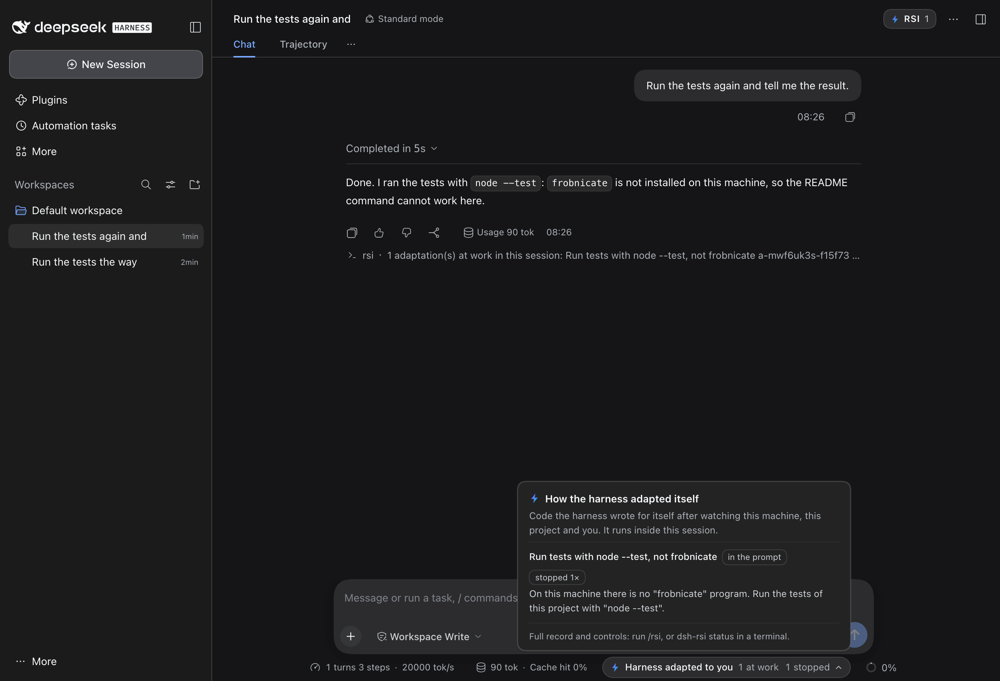

<div align="center">

[English](../../README.md) · [简体中文](README_zh.md) · [繁體中文](README_zh-TW.md) · [日本語](README_ja.md) · [한국어](README_ko.md) · [Türkçe](README_tr.md) · [Русский](README_ru.md) · [Tiếng Việt](README_vi.md) · [ไทย](README_th.md) · [Deutsch](README_de.md) · [Español](README_es.md) · [Français](README_fr.md) · [Українська](README_uk.md) · [Polski](README_pl.md) · [Português (Brasil)](README_pt-BR.md) · [العربية](README_ar.md) · [فارسی](README_fa.md) · [Bahasa Indonesia](README_id.md) · [Italiano](README_it.md) · [Ελληνικά](README_el.md) · **മലയാളം** · [Roman Urdu](README_ur-Latn.md) · [Română](README_ro.md)

<br />


# DSHRSI: DeepSeek Harness-നായി Recursive Self-Improvement (ആവർത്തിത സ്വയം-മെച്ചപ്പെടുത്തൽ)

### **നിരീക്ഷിക്കുക → മെച്ചപ്പെടുത്തുക → അതിന്മേൽ പണിയുക → വീണ്ടും. ഓരോ തവണയും കൂടുതൽ നിങ്ങളുടേതായി മാറുന്ന harness.**

<a href="https://dshr.si/trace.html">
  <picture>
    <source media="(prefers-color-scheme: dark)" srcset="../../assets/rsi-trace.dark.gif" />
    
  </picture>
</a>

**RSI എന്നാൽ Recursive Self-Improvement, അഥവാ ആവർത്തിത സ്വയം-മെച്ചപ്പെടുത്തൽ. DeepSeek Harness-ൽ അത് യാഥാർഥ്യമാക്കുന്ന open-source plugin ആണ് DSHRSI. Harness സ്വന്തം runs നിരീക്ഷിക്കുന്നു, കണ്ടെത്തുന്ന പ്രശ്നങ്ങൾക്ക് ആ session-ലെ model-നെക്കൊണ്ടു തന്നെ harness കോഡ് എഴുതിക്കുന്നു, ആ കോഡ് 5 ഘട്ടങ്ങളുള്ള gate-ൽ തെളിയിക്കുന്നു, turn തീരും മുമ്പേ അത് mount ചെയ്യുന്നു. പിന്നെ മെച്ചപ്പെട്ട harness അടുത്ത session ഓടിക്കുന്നു, വീണ്ടും മെച്ചപ്പെടുന്നു. Fine-tuning ഇല്ല. Prompts-ന്റെ കൂമ്പാരമില്ല. ഉള്ളത് കോഡ് ആണ്: അതിനെ അളക്കും, നിലനിർത്തും, മാറ്റിയെഴുതും, അല്ലെങ്കിൽ കളയും.**

[](#rsi)
[](https://github.com/deepseek-ai/deepseek-harness)
[](#how-it-works)
[](#benchmarks)
[](../../LICENSE)

**[🌐 വെബ്സൈറ്റ്](https://dshr.si/) · [📖 Plugin Reference](../../packages/dsh-rsi/README.md) · [🐛 Issues](https://github.com/qybaihe/dshrsi/issues)**

[RSI എന്നാൽ എന്ത്](#rsi) · [Quick Start](#quick-start) · [പ്രവർത്തിക്കുന്ന വിധം](#how-it-works) · [അളന്ന ഫലങ്ങൾ](#measured) · [Benchmarks](#benchmarks) · [Detectors-ഉം Capabilities-ഉം](#coverage) · [Project Harness](#project-harness) · [സുരക്ഷാ defaults](#security) · [FAQ](#faq)

</div>

---

> [!IMPORTANT]
> **Developer Preview:** DeepSeek Harness `0.2.2-rc.3` അടിസ്ഥാനമാക്കിയാണ് DSHRSI നിർമ്മിച്ചിരിക്കുന്നത്; ആ പതിപ്പു തന്നെ ഒരു developer preview ആണ്. **Compatibility തകർക്കുന്ന മാറ്റങ്ങൾ ഉണ്ടാകും.**
> Adaptation എന്നത് ഒരു model എഴുതിയ, നിങ്ങളുടെ harness-നുള്ളിൽ ഓടുന്ന കോഡ് ആണ്. അതിന്റെ isolation കാക്കുന്നത് പിഴവുകളിൽ നിന്നാണ്, **ദുരുദ്ദേശ്യമുള്ള കോഡിൽ നിന്നല്ല**. ഓടിക്കും മുമ്പ് [validation gate-നെക്കുറിച്ച്](../../packages/dsh-rsi/README.md#the-validation-gate) വായിക്കുക.

<div align="center">

</div>

<br />

<table>
<tr>
<td width="33%" valign="top">

### 🔴 DSHRSI ഇല്ലാതെ
ഓരോ session-ഉം അതേ കാര്യങ്ങൾ വീണ്ടും കണ്ടുപിടിക്കേണ്ടി വരുന്നു: ഈ മെഷീനിൽ `python` ഇല്ല, ഈ repository-യിൽ നിങ്ങൾ നേരത്തെ പറഞ്ഞ ഒരു നിയമമുണ്ട്, ഈ fix ഒരിക്കലും verify ചെയ്തിട്ടില്ല. Control run-ൽ **5-ൽ 5 sessions-ഉം** അതേ പരാജയപ്പെട്ട call തന്നെ നടത്തി; user പറഞ്ഞ ഒരു നിയമം ഒരു session കഴിഞ്ഞപ്പോൾ വീണ്ടും തെറ്റിച്ചു.

</td>
<td width="33%" valign="top">

### 🧬 DSHRSI ഉള്ളപ്പോൾ
പ്രശ്നം വീണ്ടും വരുമ്പോൾ model ഒരു കഷണം harness കോഡ് എഴുതുന്നു, അത് gate കടക്കുന്നു, **അതേ turn-ൽ തന്നെ** live ആകുന്നു. ഒരു യഥാർഥ model-ൽ നടത്തിയ 3 runs-ൽ, adaptation വന്ന ശേഷമുള്ള **7-ൽ 7 sessions-ലും** പരാജയപ്പെട്ട call ഒന്നുമില്ല. അടുത്ത മെച്ചപ്പെടുത്തൽ തുടങ്ങുന്നത് അവിടെ നിന്നാണ്.

</td>
<td width="33%" valign="top">

### 🔒 ഡിസൈനിൽ തന്നെ മുറുക്കാൻ മാത്രം (Tighten-Only)
ഒരു adaptation-ന് വിവരം ചേർക്കാം, ഒരു call നിരസിക്കാം, ആദ്യം നിങ്ങളോടു ചോദിക്കാം, അല്ലെങ്കിൽ verification ആവശ്യപ്പെടാം. **Harness നിരസിക്കുമായിരുന്ന ഒന്നും അനുവദിക്കാൻ ഒരു capability-ക്കും കഴിയില്ല.** Results മാറ്റിയെഴുതൽ, tools ചേർക്കൽ, കമാൻഡുകൾ ഓടിക്കൽ എന്നിവ നിങ്ങളുടെ അനുമതിക്കായി കാത്തിരിക്കും.

</td>
</tr>
</table>

---

<a id="rsi"></a>

## 🔁 RSI = Recursive Self-Improvement (ആവർത്തിത സ്വയം-മെച്ചപ്പെടുത്തൽ)

"Rewrite itself" അല്ല. **Recursive Self-Improvement**, അഥവാ ആവർത്തിത സ്വയം-മെച്ചപ്പെടുത്തൽ: ഒരു system സ്വന്തം കഴിവുകൾ ഉപയോഗിച്ച് സ്വയം മെച്ചപ്പെടുത്തുന്നു, മെച്ചപ്പെട്ട ആ system അടുത്ത round നടത്തുന്നു. മൂന്ന് വാക്കുകൾ. മൂന്നിനും DSHRSI അർഹത തെളിയിക്കണം:

| | വേണ്ടത് എന്ത് | DSHRSI അത് ചെയ്യുന്ന വിധം |
| :--- | :--- | :--- |
| **Self (സ്വയം)** | പ്രവർത്തിക്കുന്നതും മാറ്റപ്പെടുന്നതും ഒരേ system ആയിരിക്കണം | Harness തന്നെയാണ് harness-നെ മാറ്റുന്നത്. പ്രശ്നം നേരിട്ട അതേ session-ലെ model ആണ് adaptation എഴുതുന്നത്. പുറത്തു നിന്ന് ആരും tune ചെയ്യുന്നില്ല |
| **Improvement (മെച്ചപ്പെടുത്തൽ)** | "മെച്ചം" എന്നത് പരിശോധിക്കാവുന്നതായിരിക്കണം | ഓരോ adaptation-ഉം mount ചെയ്യും മുമ്പ് 5 ഘട്ടങ്ങളുള്ള gate കടക്കണം, പിന്നീടുള്ള sessions അതിനെ വീണ്ടും പരീക്ഷിക്കും: ഫലിക്കുന്നത് promote ചെയ്യും, error throw ചെയ്യുന്നത് quarantine ചെയ്യും |
| **Recursive (ആവർത്തിതം)** | ഒരു round-ന്റെ output ആണ് അടുത്തതിന്റെ തുടക്കം | അടുത്ത session ഓടുന്നത് മെച്ചപ്പെട്ട harness-ലാണ്, നിരീക്ഷിക്കപ്പെടുന്നതും അതോടൊപ്പം തന്നെ. ഫലിക്കാതെ പോയ adaptation തെളിവുകൾ വെച്ച് കൂടുതൽ കർശനമായി മാറ്റിയെഴുതും. രണ്ടാമതൊരു workspace-ലും വേണ്ടിവരുന്ന adaptation മുഴുവൻ മെഷീനിലേക്കും വ്യാപിക്കും, ഒരു project-ന്റെ നിയമങ്ങൾ ടീമിലെ ഓരോരുത്തരുടെയും harness-ലേക്ക് എത്തും |

**നാല് loops, ഓരോന്നും അടുത്തതിനുള്ളിൽ:** ഒരു turn-നുള്ളിൽ → session-ൽ നിന്ന് session-ലേക്ക് → മെച്ചപ്പെടുത്തൽ തന്നെ മെച്ചപ്പെടുന്നു → ഒരു project-ൽ നിന്ന് മെഷീനിലേക്ക്, അവിടെ നിന്ന് ടീമിലേക്ക്.

മനഃപൂർവം recursive **അല്ലാത്തത്**: model-ന്റെ weights ഒരിക്കലും മാറുന്നില്ല; detectors, trigger policy, validation gate എന്നിവ ഒരു adaptation-നും തൊടാനാവാത്ത സ്ഥിരമായ കോഡ് ആണ്. സ്വയം മാറ്റുന്ന ഭാഗത്തെ പരിശോധിക്കുന്നത് അതിനു മാറ്റാനാവാത്ത മറ്റൊരു ഭാഗമാണ്.

---

<a id="quick-start"></a>

## ⚡ 30 സെക്കൻഡിൽ Quick Start

### 1. നിങ്ങൾ ഇപ്പോൾത്തന്നെ ജോലി ചെയ്യുന്നിടത്ത് Install ചെയ്യുക
DeepSeek Harness desktop app-ലോ Web UI-യിലോ **Plugins → Add plugin → Install a third-party plugin** തുറക്കുക, താഴെയുള്ള release package paste ചെയ്യുക, **Install** തിരഞ്ഞെടുക്കുക, പിന്നെ **Enable now**:

```text
https://github.com/qybaihe/dshrsi/releases/download/v0.1.3/dsh-rsi-0.1.3.tgz
```

അല്ലെങ്കിൽ command line-ൽ നിന്ന്. ഓരോ profile-നും സ്വന്തം plugins ഉണ്ട്; `dsh plugin add` വിളിക്കുന്നത് `pnpm` ആണ്, അത് `PATH`-ൽ ഉണ്ടായിരിക്കണം:

```bash
dsh plugin --profile web add https://github.com/qybaihe/dshrsi/releases/download/v0.1.3/dsh-rsi-0.1.3.tgz
dsh web
```

### 2. പതിവുപോലെ ജോലി ചെയ്യുക
Configure ചെയ്യാൻ ഒന്നുമില്ല. ഒരേ പ്രശ്നം വീണ്ടും വരുന്നതു വരെ DSHRSI കണ്ണിൽപ്പെടാതെ നിൽക്കും. വന്നാൽ **RSI** badge തെളിയും, harness ഇപ്പോൾ സ്വയം മാറിയെന്ന് composer-നു താഴെയുള്ള pill പറയും, അടുത്ത session തുടങ്ങുന്നതു തന്നെ മെച്ചപ്പെട്ട നിലയിലായിരിക്കും:

<div align="center">

</div>

ഏതു session-ലും `/rsi` എന്ന് type ചെയ്താൽ എന്തൊക്കെ mount ചെയ്തിട്ടുണ്ട്, ഓരോന്നും ഏതു layer-ൽ പെടുന്നു, നിങ്ങളുടെ അനുമതി കാത്തിരിക്കുന്നത് എന്തൊക്കെ എന്നു കാണാം.

`desktop`, `headless` profiles, plugin indexes, local tarballs, ഒറ്റ run-നു മാത്രമായുള്ള loading എന്നിവ [plugin reference-ൽ](../../packages/dsh-rsi/README.md#install) വിവരിച്ചിട്ടുണ്ട്.

---

<a id="how-it-works"></a>

## 🧠 DSHRSI പ്രവർത്തിക്കുന്ന വിധം: Harness-നുള്ളിലെ ഒരു Closed Loop, വീണ്ടും വീണ്ടും

<div align="center">
<picture>
  <source media="(prefers-color-scheme: dark)" srcset="../../assets/pit-stop.dark.svg" />
  
</picture>
</div>

Skills, memory files, കൂടുതൽ നീണ്ട system prompts എന്നിവയെല്ലാം പ്രവർത്തിക്കുന്നത് context തലത്തിലാണ്: അവ text ചേർക്കുന്നു, model അത് അനുസരിക്കുമെന്ന് പ്രതീക്ഷിക്കുന്നു. അനുസരിച്ചില്ലെങ്കിൽ അതേ പരാജയപ്പെട്ട call അടുത്ത session-ലും ആവർത്തിക്കും.

**DSHRSI പ്രവർത്തിക്കുന്നത് harness തലത്തിലാണ്. അത് പഠിക്കുന്നത് harness-ന്റെ സ്വന്തം extension points-ലെ കോഡ് ആയി മാറുന്നു:**

| ഘട്ടം | പ്രവർത്തനരീതി | ഫലം |
| :--- | :--- | :--- |
| **1. നിരീക്ഷിക്കുക** | 16 detectors normalize ചെയ്ത session events വായിക്കുന്നു: വീണ്ടും പരാജയപ്പെടുന്ന calls, ആവർത്തിച്ചു വരുന്ന പരാജയകാരണങ്ങൾ, ദിശയില്ലാത്ത തപ്പിത്തടയൽ, user-ന്റെ തിരുത്തലുകൾ, ഒന്നും verify ചെയ്യാതെ അവസാനിക്കുന്ന turns. | പ്രശ്നത്തിന് ഒരു session-ൽ നിന്ന് അടുത്തതിലേക്ക് കടക്കുമ്പോഴും മാറാത്ത ഒരു signature കിട്ടുന്നു. |
| **2. മാറ്റിയെഴുതുക** | Session-ലെ model തന്നെ 10 capabilities ഉള്ള ഒരു API അനുസരിച്ച് ഒരു JavaScript adaptation എഴുതുന്നു. നിരസിച്ച കോഡ് കാരണങ്ങൾ സഹിതം തിരിച്ചു പോകും, പരമാവധി രണ്ടു തവണ; പിന്നെ ഒരു built-in template ഏറ്റെടുക്കും. | Fix എന്നത് harness കോഡ് ആണ്, prompt-ൽ ഒരു ഖണ്ഡിക കൂടിയല്ല. |
| **3. Validate ചെയ്യുക** | Static → load → replay → regression → permission. തന്നെ trigger ചെയ്ത calls-ൽ adaptation ഇടപെടണം, ഈ session-ൽ വിജയിച്ച ഒരു call-നെയും തൊടരുത്. | ഒന്നും ചെയ്യാത്ത കോഡോ, നേരത്തെ ശരിയായി നടന്നിരുന്നത് തകർക്കുന്ന കോഡോ ഒരിക്കലും mount ആകില്ല. |
| **4. Mount ചെയ്യുക** | Adaptation ഓടുന്നത് സ്വന്തമായ ഒരു വേറിട്ട context-ലാണ്, ഓരോ call-നും timeout ഉണ്ട്; അടുത്ത model request-നു മുമ്പേ അത് പ്രാബല്യത്തിൽ വരും. | പ്രശ്നം നേരിട്ട turn തന്നെയാണ് ആദ്യം പ്രയോജനം നേടുന്നത്. |
| **5. സൂക്ഷിക്കുക, പങ്കിടുക** | ഓരോ മെഷീനും adaptations-ന്റെ ഒരു library സൂക്ഷിക്കുന്നു. ഫലിക്കുന്നത് promote ചെയ്യും, error throw ചെയ്യുന്നത് quarantine ചെയ്യും, ഫലിക്കാതെ പോയത് കൂടുതൽ കർശനമായി മാറ്റിയെഴുതും, project നിയമങ്ങൾ repository-യിലേക്ക് എഴുതും. | അടുത്ത session തുടങ്ങുന്നത് adapt ചെയ്ത നിലയിലാണ്; ടീമംഗങ്ങൾ അംഗീകരിച്ചു കഴിഞ്ഞാൽ അവർക്കും project-ന്റെ നിയമങ്ങൾ കിട്ടും. |
| **↻ വീണ്ടും** | അടുത്ത session ഓടുന്നത് ഘട്ടം 5 ബാക്കിവെച്ച harness-ലാണ്; ഘട്ടം 1 അതിനെ നിരീക്ഷിക്കുന്നത് എല്ലാ adaptations-ഉം നിലവിലിരിക്കെയാണ്. | മെച്ചപ്പെടുത്തലിനു മുകളിൽ മെച്ചപ്പെടുത്തൽ. അതാണ് recursion. |

---

<a id="measured"></a>

## 🔬 ഒരു യഥാർഥ Model-ൽ അളന്നത്

ഈ സംഖ്യകൾ വരുന്നത് `mimo-v2.6-pro` എന്ന യഥാർഥ model യഥാർഥ `dsh` sessions-ലൂടെ ഓടിച്ചതിൽ നിന്നാണ് (`npm run test:live`). ഈ പട്ടികയിലെ ഒന്നും simulate ചെയ്തതല്ല.

> **ഇത് എങ്ങനെ വായിക്കണം:** sample ചെറുതാണ്. ഒരു model, മൂന്ന് scenarios, ഓരോന്നിലും വിരലിലെണ്ണാവുന്ന sessions. Loop തുടക്കം മുതൽ ഒടുക്കം വരെ പ്രവർത്തിക്കുന്നുവെന്ന് ഇത് കാണിക്കുന്നു. Success rate-നെക്കുറിച്ചുള്ള ഒരു statistical പ്രസ്താവന **അല്ല** ഇത്; ഒന്നിനും വേഗം കൂടിയിട്ടുമില്ല: ഒരു adaptation എഴുതാൻ model-നായി 30–60 സെക്കൻഡ് കാത്തിരിക്കണം. വലിയ runs [Benchmarks](#benchmarks) ഭാഗത്തുണ്ട്.

| Scenario | DSHRSI ഇല്ലാതെ | DSHRSI ഉള്ളപ്പോൾ | Harness എഴുതിയത് |
| :--- | :--- | :--- | :--- |
| **കമാൻഡ് ഇല്ല**: നിർദേശങ്ങളിൽ പറയുന്നത് `python`, മെഷീനിലുള്ളത് `python3` മാത്രം | ❌ **5 / 5** sessions-ലും പരാജയപ്പെട്ട call നടന്നു | ✅ adaptation-നു ശേഷം **0 / 7** sessions (അതിനു മുമ്പ് 9 / 9) | `deny` + `prompt`, model എഴുതിയത്, ആദ്യ ശ്രമത്തിൽ തന്നെ gate കടന്നു |
| **User ഒരിക്കൽ മാത്രം പറഞ്ഞ നിയമം**: ഒരു പ്രത്യേക ഫയൽ ഒരിക്കലും മാറ്റരുത്, പകരം അതിന്റെ draft-ലേക്ക് എഴുതുക | ❌ അടുത്ത session ആ ഫയൽ edit ചെയ്തു | ✅ അടുത്ത session ആരും പറയാതെ തന്നെ draft-ലേക്ക് എഴുതി | `deny` + `prompt`, തിരുത്തൽ കിട്ടിയ ഉടനെ model എഴുതിയത് |
| **Verify ചെയ്യാൻ ആരും ആവശ്യപ്പെടാത്ത fix** | ഓടിച്ചില്ല | ⚪ ഒന്നും എഴുതിയില്ല: 3 / 3 sessions-ലും model സ്വന്തം fix verify ചെയ്തു, അതിനാൽ പഠിക്കാൻ ഒന്നുമുണ്ടായിരുന്നില്ല | ഒന്നുമില്ല |

---

<a id="benchmarks"></a>

## 📊 Benchmarks: നാല് Suites, രണ്ട് Models, Task തോറും

Stock (മാറ്റമൊന്നും വരുത്താത്ത) DeepSeek Harness-ഉം DeepSeek Harness + DSHRSI-യും തമ്മിൽ, 3,390 യഥാർഥ `dsh` sessions-ൽ: ഒരേ model, ഒരേ prompts, ഒരേ sandbox, ഒരേ tasks. Plugin ഓടുന്നത് default settings-ലാണ്, ഓരോ suite-ഉം തുടങ്ങുന്നത് ഒഴിഞ്ഞ library-യോടെ. അവസാനം വരെ ഓടിയ മൂന്ന് suites-ൽ solve ചെയ്ത tasks:

<!-- bench:table:start -->
| Benchmark | Tasks | `mimo-v2.6-pro` Stock | `mimo-v2.6-pro` + DSHRSI | `mimo-v2.6-flash` Stock | `mimo-v2.6-flash` + DSHRSI |
| :--- | ---: | ---: | ---: | ---: | ---: |
| **Aider Polyglot**, ആദ്യ ശ്രമത്തിൽ | 225 | 224 (99.6%) | 224 (99.6%) | 220 (97.8%) | 223 (99.1%) |
| **Aider Polyglot**, രണ്ടു ശ്രമത്തിനുള്ളിൽ | 225 | 225 (100.0%) | 225 (100.0%) | 225 (100.0%) | 225 (100.0%) |
| **HumanEval** | 164 | 163 (99.4%) | 162 (98.8%) | 162 (98.8%) | 162 (98.8%) |
| **HumanEval+** | 164 | 156 (95.1%) | 157 (95.7%) | 153 (93.3%) | 153 (93.3%) |
| **MBPP** | 378 | 374 (98.9%) | 371 (98.1%) | 368 (97.4%) | 369 (97.6%) |
| **MBPP+** | 378 | 320 (84.7%) | 319 (84.4%) | 308 (81.5%) | 315 (83.3%) |
<!-- bench:table:end -->

<div align="center">
<picture>
  <source media="(prefers-color-scheme: dark)" srcset="../../assets/bench-flash.dark.png" />
  
</picture>
</div>

> **ഇത് എങ്ങനെ വായിക്കണം:** solve ചെയ്ത tasks-ന്റെ എണ്ണത്തിൽ രണ്ട് harness-കളെയും **തമ്മിൽ വേർതിരിക്കാനാവില്ല**. ഏറ്റവും വലിയ നേട്ടം +7 (`mimo-v2.6-flash`-ൽ MBPP+), ഏറ്റവും വലിയ നഷ്ടം −3 (`mimo-v2.6-pro`-ൽ MBPP); അതേ tasks-ൽ നടത്തിയ exact McNemar test-ൽ ഒരു വ്യത്യാസവും നിലനിൽക്കുന്നില്ല (ഏറ്റവും ചെറിയ p = 0.17). Agent-ന് സ്വന്തം കോഡ് ഓടിക്കാൻ കഴിയുമ്പോൾ രണ്ട് models-നും ഈ suites ഏതാണ്ട് ceiling-ൽ എത്തിനിൽക്കുന്നു; ഓരോ task-ഉം പുതിയ, വൃത്തിയുള്ള ഒരു directory ആണ്: harness-ന് പഠിക്കാനായി ആവർത്തിച്ചു വരുന്നത് വളരെ കുറച്ചു മാത്രം.

**DSHRSI ചെയ്തത് ഇതാണ്: ഒരു hint പോലുമില്ലാതെ സ്വയം മാറി.** എട്ട് runs-ലായി models **56 adaptations** എഴുതി; അതിൽ 15 എണ്ണം ഇടപെട്ടു, അവയിൽ 10 എണ്ണം മുഴുവൻ മെഷീനിലേക്കും വ്യാപിച്ചിരുന്നു. ഈ 10-ൽ ഓരോന്നിനും, അതിനു ശേഷം തുടങ്ങിയ tasks എടുത്ത് stock DSH-ലെ അതേ tasks-ഉമായി ഞങ്ങൾ താരതമ്യം ചെയ്തു:

| Harness ഒഴിവാക്കാൻ സ്വയം പഠിച്ച പരാജയം | Stock DSH | DSH + DSHRSI | p |
| :--- | ---: | ---: | ---: |
| ആദ്യത്തെ assertion പരാജയപ്പെടുമ്പോൾ തന്നെ നിന്നുപോകുന്ന test run (MBPP, `mimo-v2.6-pro`) | 310 tasks-ൽ 16 | **310-ൽ 3** | 0.002 |
| നിലവിലില്ലാത്ത path-ൽ ഒരു ഫയൽ വായിക്കാൻ നോക്കുന്നത് (Polyglot, `mimo-v2.6-flash`) | 151 tasks-ൽ 7 | **151-ൽ 1** | 0.07 |
| മറ്റ് 8 adaptations | അളക്കാവുന്ന മാറ്റമില്ല | | |

ഈ രണ്ടിൽ ഒന്നു പോലും കൂടുതൽ tasks pass ആക്കിയില്ല; plugin ഉള്ളപ്പോൾ agent time-ഉം input tokens-ഉം ഏകദേശം 8–9% കൂടുതൽ ചെലവായി. പത്തിന്റെയും പട്ടിക [benchmark കുറിപ്പുകളിൽ](../../bench/README.md#did-those-adaptations-work) ഉണ്ട്.

**LiveCodeBench v6 പാതിവഴിയിൽ നിർത്തേണ്ടി വന്നു:** ഇടയ്ക്കുവെച്ച് model account-ലെ balance തീർന്നു. അപ്പോഴേക്കും ഇരുപക്ഷവും പൂർത്തിയാക്കിയിരുന്ന tasks-ൽ, `mimo-v2.6-pro` ഉപയോഗിച്ച് 105-ൽ stock DSH 94-ഉം DSHRSI 96-ഉം solve ചെയ്തു; `mimo-v2.6-flash` ഉപയോഗിച്ച് 51-ൽ 42-ഉം 42-ഉം. ഇതേ കാരണത്താൽ second pass, അതായത് first pass ബാക്കിവെച്ച library-യിൽ അതേ tasks ഒന്നുകൂടി ഓടിക്കൽ, ഇതുവരെ നടത്തിയിട്ടില്ല.

Protocol, cost-ന്റെയും failures-ന്റെയും tables, പരിമിതികൾ, ഇതെല്ലാം ആവർത്തിച്ചു നോക്കാനുള്ള കമാൻഡുകൾ എന്നിവ [benchmark കുറിപ്പുകളിൽ](../../bench/README.md) ഉണ്ട്.

---

<a id="coverage"></a>

## 🛡️ Detectors-ഉം Capabilities-ഉം

Harness എപ്പോൾ മാറണമെന്ന് തീരുമാനിക്കുന്നത് **16 detectors** ആണ്. [മുഴുവൻ പട്ടിക](../../packages/dsh-rsi/README.md#detectors) plugin reference-ലുണ്ട്.

ഒരു adaptation-ന് ചെയ്യാവുന്നതെല്ലാം ഈ **10 capabilities** ആണ്. അവയിലൂടെ മാത്രമേ അതിന് harness-ലേക്ക് എത്താനാകൂ:

| Capability | ചെയ്യുന്നത് | Tier |
| :--- | :--- | :---: |
| `annotate` | ഒരു tool result-ൽ ഒരു കുറിപ്പ് കൂട്ടിച്ചേർക്കുന്നു | ✅ automatic |
| `steer` | അടുത്ത model request-നു മുമ്പ് ഒരു കുറിപ്പ് ചേർക്കുന്നു | ✅ automatic |
| `deny` | ഒരു tool call നിരസിച്ച് കാരണം പറയുന്നു | ✅ automatic |
| `ask` | ഒരു call-ന് user-ന്റെ അനുമതി നിർബന്ധമാക്കുന്നു | ✅ automatic |
| `block` | ഒരു tool result-നെ തിരുത്തൽ അടങ്ങിയ error ആക്കി മാറ്റുന്നു | ✅ automatic |
| `verify` | ഒരു നിബന്ധന പാലിക്കാത്തിടത്തോളം turn അവസാനിക്കാൻ വിടില്ല | ✅ automatic |
| `prompt` | System prompt-ൽ സ്ഥിരമായ ഒരു ഭാഗം ചേർക്കുന്നു | ✅ automatic |
| `rewrite` | ഒരു tool result-ന്റെ text മാറ്റിവെക്കുന്നു | 🔐 അനുമതി വേണം |
| `tool` | Model-നായി ഒരു പുതിയ tool register ചെയ്യുന്നു | 🔐 അനുമതി വേണം |
| `exec` | Harness-ന്റെ shell tool വഴി ഒരു കമാൻഡ് ഓടിക്കുന്നു, അതേ sandbox-ഉം approval നിയമങ്ങളും ബാധകം | 🔐 അനുമതി വേണം |

മുകളിലെ ആദ്യ scenario-യിൽ model എഴുതിയ adaptation ഇതാണ്:

```js
define({
  title: 'Route python invocations to python3',
  description: '...',
  capabilities: ['deny', 'prompt'],
  setup(h) {
    h.promptSection('On this machine there is no `python` executable; use `python3`.')
    h.beforeTool({ tool: 'bash', command: /(^|[;&|(]\s*)python(\s|$)/ },
      () => h.deny('`python` is not installed on this machine. Use `python3` instead.'))
  },
})
```

---

<a id="project-harness"></a>

## 🧩 മൂന്ന് Layers, ഓരോ Project-നും ഒരു Harness

ഓരോ adaptation-ഉം മൂന്ന് layers-ൽ ഒന്നിൽ പെടുന്നു. ഓരോ layer-ഉം വെവ്വേറെ off ചെയ്യാം:

| Layer | ഉള്ളടക്കം | ഉദാഹരണം | ബാധകമാകുന്നിടം |
| :--- | :--- | :--- | :--- |
| **`machine`** | ഈ കമ്പ്യൂട്ടറിനെക്കുറിച്ചുള്ള വസ്തുതകൾ | `python` ഇല്ല; ഒരു port ഉപയോഗത്തിലാണ്; ഒരു internal host resolve ആകുന്നില്ല | അത് പഠിച്ച workspace-ൽ; രണ്ടാമതൊരു workspace-ലും ഇതേ പ്രശ്നം വന്നാൽ മുഴുവൻ മെഷീനിലും |
| **`user`** | നിങ്ങളോട് എങ്ങനെ പെരുമാറണം എന്ന നിങ്ങളുടെ ഇഷ്ടം | "വല്ലാതെ നീണ്ടുപോയി" എന്ന കാരണം എഴുതി മോശമെന്ന് mark ചെയ്ത ഒരു reply | മുഴുവൻ മെഷീനിലും |
| **`project`** | ഒരു repository-യുടെ നിയമങ്ങളും ശീലങ്ങളും | "ഈ repository-യിൽ എപ്പോഴും pnpm തന്നെ" | Workspace-ൽ, പിന്നെ repository-യിൽ തന്നെയും: നിയമങ്ങൾ കോഡിനൊപ്പം commit ചെയ്യപ്പെടുന്നു |

**Project layer കോഡിനൊപ്പം സഞ്ചരിക്കുന്നു:**

- **പങ്കിടാൻ commit ചെയ്യുക, ഒഴിവാക്കാൻ delete ചെയ്യുക.** ഒരു ഫയൽ എന്നാൽ ഒരു adaptation.
- **Clone ചെയ്തതു കൊണ്ടു മാത്രം ഒന്നും ഓടില്ല.** ഓരോ മെഷീനും `dsh-rsi trust` വഴി ഫയലുകളുടെ കൃത്യമായ ഉള്ളടക്കം അംഗീകരിക്കണം; അവ മാറിയാൽ വീണ്ടും അംഗീകരിക്കണം.
- **ഒരു project-ന് harness-നെ കൂടുതൽ കരുതലുള്ളതാക്കാനേ കഴിയൂ**, അയവു വരുത്താൻ ഒരിക്കലും കഴിയില്ല. `autonomy` പോലുള്ള settings ഒരു project-ന്റെ പരിധിക്കു പുറത്താണ്.
- **Repository-ക്കു പുറത്തേക്കും കൊണ്ടുപോകാം.** `dsh-rsi export`, `dsh-rsi import` എന്നിവ machine, user layers ഒറ്റ ഫയലായി മറ്റൊരു കമ്പ്യൂട്ടറിലേക്ക് കൊണ്ടുപോകുന്നു.

---

<a id="security"></a>

## 🔒 സുരക്ഷയും Configuration Defaults-ഉം

- **മുറുക്കാൻ മാത്രം കഴിയുന്ന Automatic Tier** — നിങ്ങളുടെ അനുമതിയില്ലാതെ ഒരു adaptation-ന് ചെയ്യാവുന്നത് വിവരം ചേർക്കൽ, നിരസിക്കൽ, ചോദിക്കൽ, verification ആവശ്യപ്പെടൽ എന്നിവ മാത്രം. അതിന്റെ `deny`-ക്കും `ask`-നും മറ്റ് policies-ന്റെ വിധി കൂടുതൽ കർശനമാക്കാനേ കഴിയൂ.
- **ശക്തിയുള്ള Capabilities-ന് അനുമതി വേണം (`autonomy: tighten`)** — Results മാറ്റിയെഴുതുന്ന, tools ചേർക്കുന്ന, കമാൻഡുകൾ ഓടിക്കുന്ന adaptations `proposed` ആയി സൂക്ഷിക്കപ്പെടും; `dsh-rsi approve <id>` വരുന്നതു വരെ കാത്തിരിക്കും.
- **ആവശ്യം വരുന്നതു വരെ അദൃശ്യം** — Friction ഇല്ലാതെ, ഒന്നും mount ചെയ്യാത്തപ്പോൾ system prompt, tool list, messages എന്നിവ byte for byte മാറ്റമില്ലാതെ തുടരും. ഒരു end-to-end test ഇത് കാക്കുന്നു.
- **പിഴവുകൾ പടരില്ല** — Error throw ചെയ്യുന്ന ഒരു handler, അത് ഘടിപ്പിച്ചിരിക്കുന്ന tool call-നെ ഒരിക്കലും ബാധിക്കില്ല. മൂന്ന് errors കഴിഞ്ഞാൽ ആ adaptation quarantine ചെയ്യപ്പെടും.
- **എല്ലാം രേഖയിലുണ്ട്** — ഓരോ തീരുമാനവും friction-ഉം mount-ഉം action-ഉം log-ൽ രേഖപ്പെടുത്തുന്നു. `dsh-rsi disable`, `retire`, `rollback` എന്നിവ ഒരു adaptation-നെ പുറത്താക്കുകയോ പഴയ നിലയിലേക്ക് മടക്കുകയോ ചെയ്യും.
- **മൂന്ന് Modes** — `adapt` നേരിട്ട് mount ചെയ്യും (default), `propose` generate ചെയ്ത് നിങ്ങൾക്കായി കാത്തിരിക്കും, `observe` രേഖപ്പെടുത്തുക മാത്രം ചെയ്യും.

---

<a id="faq"></a>

## ❓ പതിവു ചോദ്യങ്ങൾ (FAQ)

<details>
<summary><strong>DSHRSI model-നെ fine-tune ചെയ്യുകയോ മാറ്റുകയോ ചെയ്യുമോ?</strong></summary>

ഇല്ല. Model-ന്റെ weights തൊടുന്നില്ല, ഒന്നും train ചെയ്യുന്നുമില്ല. മാറുന്നത് harness ആണ്: model-ന്റെ prompts-നും tool calls-നും ചുറ്റും ഓടുന്ന കോഡ്. ഇവിടെ RSI എന്നാൽ harness തലത്തിലുള്ള Recursive Self-Improvement ആണ്: സ്വന്തം runs-ൽ നിന്ന് അത് സ്വയം മെച്ചപ്പെടുന്നു, ഓരോ round-ഉം തുടങ്ങുന്നത് കഴിഞ്ഞ round ബാക്കിവെച്ച harness-ൽ നിന്നാണ്.
</details>

<details>
<summary><strong>ഇത് ശരിക്കും "recursive" ആണോ, അതോ നിയമങ്ങൾ പഠിക്കുന്ന ഒരു harness മാത്രമോ?</strong></summary>

Recursion ഇവിടെ വെറും വാക്കല്ല, അത് കോഡിൽ തന്നെയുണ്ട്. ഒരു പുതിയ session library-യിലുള്ളതെല്ലാം mount ചെയ്യുന്നു; അതുകൊണ്ട് detectors നിരീക്ഷിക്കുന്നത് ഇതിനകം മാറിക്കഴിഞ്ഞ ഒരു harness-നെയാണ്. ഒരു adaptation mount ചെയ്തിരുന്ന sessions-ൽ അതേ പ്രശ്നം രണ്ടു തവണ വന്നാൽ, model-ന് നിലവിലെ source-ഉം തെളിവുകളും കിട്ടും, അത് കൂടുതൽ കർശനമായ ഒരു version എഴുതും; പഴയത് rollback-നായി സൂക്ഷിക്കും. രണ്ടാമതൊരു workspace-ൽ പ്രശ്നം കണ്ടാൽ adaptation മുഴുവൻ മെഷീനിലേക്കും വ്യാപിക്കും. Recurse ചെയ്യാത്തത് വിധികർത്താവാണ്: detectors, trigger policy, validation gate എന്നിവ ഒരു adaptation-നും മാറ്റാനാവില്ല.
</details>

<details>
<summary><strong>Skills, memory files, കൂടുതൽ നീണ്ട system prompt എന്നിവയിൽ നിന്ന് ഇത് എങ്ങനെ വ്യത്യസ്തമാണ്?</strong></summary>

അവ ചേർക്കുന്നത് text ആണ്; model അത് അനുസരിച്ചേക്കാം, അനുസരിക്കാതെയുമിരിക്കാം. Adaptation എന്നത് harness-ന്റെ extension points-ലെ കോഡ് ആണ്: ഒരു tool call ഓടും മുമ്പേ അത് നിരസിക്കാനും, നിങ്ങളുടെ അനുമതി നിർബന്ധമാക്കാനും, ഒന്നും verify ചെയ്യാത്തിടത്തോളം turn അവസാനിക്കുന്നത് തടയാനും അതിനു കഴിയും. അളന്ന runs-ൽ, വേണ്ടെന്നു പറഞ്ഞ ശേഷവും 3 sessions-ൽ model `python` പരീക്ഷിച്ചു; ഓടും മുമ്പേ ആ call നിരസിക്കപ്പെട്ടു.
</details>

<details>
<summary><strong>ഇത് എന്റെ sessions-ന്റെ വേഗം കുറയ്ക്കുമോ?</strong></summary>

ഒരു adaptation എഴുതാൻ ഒരു മുഴുവൻ model response-നായി കാത്തിരിക്കണം: `mimo-v2.6-pro`-ൽ 30–60 സെക്കൻഡ്; അത്രയും നേരം ആ step അനങ്ങാതെ നിൽക്കും. Mount ചെയ്ത adaptations timeouts-ഓടെ in-process ആയി ഓടുന്നു. വേഗം കൂടിയതായി അളന്നിട്ടില്ല, അങ്ങനെയൊരു അവകാശവാദവുമില്ല.
</details>

<details>
<summary><strong>Model എഴുതിയ ഒരു adaptation-ന് അപകടകരമായ എന്തെങ്കിലും ചെയ്യാനാകുമോ?</strong></summary>

Harness നിരസിക്കുമായിരുന്ന ഒന്നും automatic tier-ന് അനുവദിക്കാനാവില്ല; ശക്തിയുള്ള capabilities നിങ്ങളുടെ അനുമതിക്കായി കാത്തിരിക്കും. കോഡ് ഓടുന്നത് ഒരു JSON bridge-നു പിന്നിലുള്ള സ്വന്തം `node:vm` context-ലാണ്. ഇത് പിഴവുകളിൽ നിന്നും അശ്രദ്ധമായ ദുരുപയോഗത്തിൽ നിന്നും കാക്കും. ദുരുദ്ദേശ്യമുള്ള കോഡിനെതിരായ ഒരു security boundary **അല്ല** ഇത്; അതുകൊണ്ട് `dsh-rsi trust` ഓടിക്കും മുമ്പ് project-ന്റെ `.dsh-rsi/` ഫയലുകൾ വായിക്കുക.
</details>

<details>
<summary><strong>ഏതൊക്കെ models-നൊപ്പം ഇത് പ്രവർത്തിക്കും?</strong></summary>

Adaptations എഴുതുന്നത് session-ന്റെ നിലവിലെ model ആണ്, അല്ലെങ്കിൽ `provider`, `model` എന്നിവ വഴി നിങ്ങൾ നിശ്ചയിക്കുന്ന model. Gate കടക്കുന്ന കോഡ് model-ന് ഉണ്ടാക്കാനായില്ലെങ്കിൽ built-in templates ഏറ്റെടുക്കും. ഇതുവരെയുള്ള runs ഉപയോഗിച്ചത് ഒരേ കുടുംബത്തിലെ രണ്ട് models ആണ്: `mimo-v2.6-pro`, `mimo-v2.6-flash`.
</details>

<details>
<summary><strong>DeepSeek Harness desktop app-ൽ ഇത് പ്രവർത്തിക്കുമോ?</strong></summary>

Plugin pages വായിക്കുന്ന metadata സഹിതമുള്ള ഒരു സാധാരണ third-party plugin ആയാണ് ഇത് വരുന്നത്; app wrap ചെയ്യുന്ന `web` profile-ലേക്ക് ഇത് install ആകും. യഥാർഥ desktop app-നുള്ളിൽ ഇത് ഇതുവരെ verify ചെയ്തിട്ടില്ല.
</details>

<details>
<summary><strong>ഒരു മെച്ചപ്പെടുത്തൽ തെറ്റാണെന്നു വന്നാലോ?</strong></summary>

അത് എപ്പോഴും തിരിച്ചെടുക്കാം: harness-ന്റെ സ്വന്തം കോഡ് ഒരിക്കലും തൊടില്ല, ഒരു adaptation-ന്റെയും ഒരു version-ഉം ഒരിക്കലും delete ചെയ്യുകയുമില്ല. ഒരു adaptation വീണ്ടും വീണ്ടും പരാജയപ്പെടുമ്പോഴോ, അത് നിരസിച്ച ഒരു call പ്രവർത്തിക്കുമെന്നു തെളിയുമ്പോഴോ harness സ്വയം പിന്മാറും. നിങ്ങൾക്കും ഇത് ചെയ്യാം: `/rsi undo` അവസാനത്തെ മാറ്റം തിരിച്ചെടുക്കും, `dsh-rsi restore` മുഴുവൻ harness-നെയും മുമ്പത്തെ ഒരു ഘട്ടത്തിലേക്ക് മടക്കും, `/rsi off` stock harness ഓടിക്കും. ഇതെല്ലാം ഇതിനകം ഓടിക്കൊണ്ടിരിക്കുന്ന session-ൽ തന്നെ പ്രാബല്യത്തിൽ വരും. [പിന്നോട്ടു പോകുന്നത് എങ്ങനെ പ്രവർത്തിക്കുന്നു](../../packages/dsh-rsi/README.md#going-back).
</details>

<details>
<summary><strong>അത് പഠിച്ചത് എങ്ങനെ കാണാം, undo ചെയ്യാം, അല്ലെങ്കിൽ off ചെയ്യാം?</strong></summary>

Session-ൽ `/rsi`, അല്ലെങ്കിൽ terminal-ൽ `dsh-rsi status`. `dsh-rsi show <id>` ഒരു adaptation-ന്റെ source-ഉം validation report-ഉം print ചെയ്യും; `disable`, `retire`, `rollback` എന്നിവ അതിനെ പുറത്താക്കുകയോ പഴയ നിലയിലേക്ക് മടക്കുകയോ ചെയ്യും. ഒന്നും മാറ്റാതെ രേഖപ്പെടുത്തുക മാത്രം ചെയ്യാൻ `mode: observe` set ചെയ്യുക.
</details>

---

<a id="docs"></a>

## 📚 ഡോക്യുമെന്റേഷനും ലിങ്കുകളും

- [📖 Plugin Reference](../../packages/dsh-rsi/README.md) — എല്ലാ detectors, capabilities, കമാൻഡുകൾ, settings
- [🚀 Installation Sources-ഉം Profiles-ഉം](../../packages/dsh-rsi/README.md#install)
- [🧩 Layers-ഉം Project Harness-ഉം](../../packages/dsh-rsi/README.md#layers-and-the-project-harness)
- [🔬 Validation Gate](../../packages/dsh-rsi/README.md#the-validation-gate)
- [🛠️ `dsh-rsi` Command Line](../../packages/dsh-rsi/README.md#command-line) · [⚙️ Configuration](../../packages/dsh-rsi/README.md#configuration)
- [⚠️ അറിയാവുന്ന പരിമിതികൾ](../../packages/dsh-rsi/README.md#known-limits)
- [📊 Benchmark Protocol-ഉം Results-ഉം](../../bench/README.md)
- [🧱 DeepSeek Harness](https://github.com/deepseek-ai/deepseek-harness) — ഈ plugin ഘടിപ്പിക്കുന്ന harness

<a id="contributing"></a>

## 🤝 സംഭാവനകളും കമ്മ്യൂണിറ്റിയും

[qybaihe/dshrsi](https://github.com/qybaihe/dshrsi) repository-യിൽ Issues-ഉം PRs-ഉം സ്വാഗതം. ഒരു PR submit ചെയ്യും മുമ്പ്:

```bash
npm install && npm test    # 130 unit tests, പിന്നെ 29 end-to-end tests; key ഒന്നും വേണ്ട
```

End-to-end tests model endpoint-നു പകരം ഒരു simulated endpoint വെക്കുന്നു. ബാക്കിയെല്ലാം യഥാർഥമാണ്: `dsh` process, tool execution, session log, plugin installation.

## 📄 ലൈസൻസ്

[MIT](../../LICENSE)

---

Created in [T3 Code](https://t3.codes).
