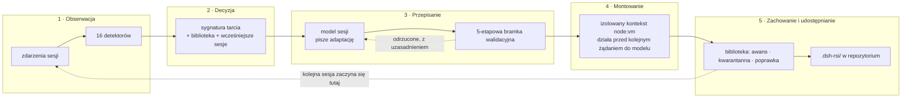

<div align="center">

[English](../../README.md) · [简体中文](README_zh.md) · [繁體中文](README_zh-TW.md) · [日本語](README_ja.md) · [한국어](README_ko.md) · [Türkçe](README_tr.md) · [Русский](README_ru.md) · [Tiếng Việt](README_vi.md) · [ไทย](README_th.md) · [Deutsch](README_de.md) · [Español](README_es.md) · [Français](README_fr.md) · [Українська](README_uk.md) · **Polski** · [Português (Brasil)](README_pt-BR.md) · [العربية](README_ar.md) · [فارسی](README_fa.md) · [Bahasa Indonesia](README_id.md) · [Italiano](README_it.md) · [Ελληνικά](README_el.md) · [മലയാളം](README_ml.md) · [Roman Urdu](README_ur-Latn.md) · [Română](README_ro.md)

<br />


# DSHRSI: Recursive Self-Improvement (rekurencyjne samodoskonalenie) dla DeepSeek Harness

### **Obserwuj → Ulepszaj → Buduj na tym → I od nowa. Harness, który staje się coraz bardziej twój.**

<a href="https://qybaihe.github.io/dshrsi/trace.html">
  <picture>
    <source media="(prefers-color-scheme: dark)" srcset="../../assets/rsi-trace.dark.gif" />
    
  </picture>
</a>

**RSI to Recursive Self-Improvement, czyli rekurencyjne samodoskonalenie, a DSHRSI to wtyczka open source, która urzeczywistnia je w DeepSeek Harness. Harness obserwuje własne przebiegi, każe modelowi z tej samej sesji napisać kod harnessu w odpowiedzi na napotkane problemy, sprawdza ten kod w 5-etapowej bramce i montuje go, zanim tura się skończy. Potem ulepszony harness prowadzi kolejną sesję i ulepsza się ponownie. Bez fine-tuningu. Bez sterty promptów. Kod, który jest mierzony, zachowywany, przepisywany albo wyrzucany.**

[](#rsi)
[](https://github.com/deepseek-ai/deepseek-harness)
[](#coverage)
[](#how-it-works)
[](#project-harness)
[](#benchmarks)
[](#contributing)
[](../../LICENSE)

**[🌐 Strona WWW](https://qybaihe.github.io/dshrsi/) · [📖 Dokumentacja wtyczki](../../packages/dsh-rsi/README.md) · [🧩 Harness projektu](../../packages/dsh-rsi/README.md#layers-and-the-project-harness) · [🔬 Bramka walidacyjna](../../packages/dsh-rsi/README.md#the-validation-gate) · [⚠️ Znane ograniczenia](../../packages/dsh-rsi/README.md#known-limits) · [🐛 Issues](https://github.com/qybaihe/dshrsi/issues)**

[Co znaczy RSI](#rsi) · [Szybki start](#quick-start) · [Jak to działa](#how-it-works) · [Wyniki pomiarów](#measured) · [Benchmarki](#benchmarks) · [Detektory i możliwości](#coverage) · [Harness projektu](#project-harness) · [Bezpieczne ustawienia domyślne](#security) · [FAQ](#faq)

</div>

---

> [!IMPORTANT]
> **Wersja zapoznawcza (Developer Preview):** DSHRSI jest zbudowany pod DeepSeek Harness `0.2.2-rc.3`, który sam jest wersją zapoznawczą dla deweloperów. **Będą zmiany łamiące kompatybilność.**
> Adaptacja to kod napisany przez model i uruchamiany wewnątrz twojego harnessu. Jej izolacja chroni przed pomyłkami, **a nie przed złośliwym kodem**. Przed uruchomieniem przeczytaj o [bramce walidacyjnej](../../packages/dsh-rsi/README.md#the-validation-gate).

<div align="center">

</div>

<br />

<table>
<tr>
<td width="33%" valign="top">

### 🔴 Bez DSHRSI
Każda sesja odkrywa od nowa te same fakty: na tej maszynie nie ma polecenia `python`, w tym repozytorium obowiązuje reguła, która już raz padła, ta poprawka nigdy nie została zweryfikowana. W przebiegu kontrolnym **5 sesji na 5** wykonało to samo nieudane wywołanie, a reguła podana przez użytkownika została znów złamana sesję później.

</td>
<td width="33%" valign="top">

### 🧬 Z DSHRSI
Gdy problem wraca, model pisze kawałek kodu harnessu, kod przechodzi bramkę i działa **jeszcze w tej samej turze**. W 3 przebiegach z prawdziwym modelem **7 sesji na 7** po adaptacji nie miało ani jednego nieudanego wywołania. A kolejne ulepszenie startuje już z tego miejsca.

</td>
<td width="33%" valign="top">

### 🔒 Z założenia tylko zaostrza
Adaptacja może dodać informację, odrzucić wywołanie, najpierw zapytać cię o zgodę albo zażądać weryfikacji. **Żadna możliwość nie przepuści tego, co harness by odrzucił.** Przepisywanie wyników, dodawanie narzędzi i uruchamianie poleceń czekają na twoją zgodę.

</td>
</tr>
</table>

---

<a id="rsi"></a>

## 🔁 RSI = Recursive Self-Improvement, rekurencyjne samodoskonalenie

Nie „przepisywanie samego siebie”. **Recursive Self-Improvement**, czyli rekurencyjne samodoskonalenie: system używa własnych zdolności, żeby ulepszyć samego siebie, a ulepszony system wykonuje kolejną rundę. Trzy słowa i na każde z nich DSHRSI musi zapracować:

| | Czego to wymaga | Jak robi to DSHRSI |
| :--- | :--- | :--- |
| **Self** (samo) | To, co działa, i to, co jest zmieniane, to ten sam system | Harness zmienia harness. Adaptację pisze model tej samej sesji, która trafiła na problem. Nikt nie stroi tego z zewnątrz |
| **Improvement** (doskonalenie) | „Lepiej” musi dać się sprawdzić | Każda adaptacja przed zamontowaniem przechodzi 5-etapową bramkę, a kolejne sesje ją rozliczają: co działa, awansuje, co rzuca wyjątki, trafia do kwarantanny |
| **Recursive** (rekurencyjne) | Wynik jednej rundy jest początkiem następnej | Kolejna sesja działa na ulepszonym harnessie i jest obserwowana razem z nim. Adaptacja, która nie powstrzymała problemu, zostaje na podstawie dowodów przepisana na ostrzejszą. Ta, która okazuje się potrzebna w drugim obszarze roboczym, rozszerza się na całą maszynę, a reguły projektu wędrują do harnessu każdej osoby z zespołu |

**Cztery pętle, jedna w drugiej:** wewnątrz tury → z sesji na sesję → samo ulepszenie jest ulepszane → od projektu przez maszynę po zespół.

Co celowo **nie** jest rekurencyjne: wagi modelu nigdy się nie zmieniają, a detektory, polityka wyzwalania i bramka walidacyjna to stały kod, którego żadna adaptacja nie może tknąć. Część, która modyfikuje samą siebie, jest sprawdzana przez część, której zmodyfikować nie może.

---

<a id="quick-start"></a>

## ⚡ Szybki start w 30 sekund

### 1. Zainstaluj tam, gdzie już pracujesz
W aplikacji desktopowej DeepSeek Harness albo w interfejsie webowym otwórz **Plugins → Add plugin → Install a third-party plugin**, wklej adres paczki z wydania, wybierz **Install**, a potem **Enable now**:

```text
https://github.com/qybaihe/dshrsi/releases/download/v0.1.1/dsh-rsi-0.1.1.tgz
```

Albo z wiersza poleceń. Każdy profil trzyma własne wtyczki, a `dsh plugin add` wywołuje `pnpm`, który musi być w `PATH`:

```bash
dsh plugin --profile web add https://github.com/qybaihe/dshrsi/releases/download/v0.1.1/dsh-rsi-0.1.1.tgz
dsh web
```

### 2. Po prostu pracuj
Nie ma czego konfigurować. DSHRSI pozostaje w cieniu, dopóki ten sam problem nie wróci. Wtedy zapala się plakietka **RSI**, pigułka pod polem wiadomości informuje, że harness właśnie sam się zmienił, a kolejna sesja startuje już ulepszona:

<div align="center">

</div>

Wpisz `/rsi` w dowolnej sesji, żeby zobaczyć, co jest zamontowane, do której warstwy należy i co czeka na twoją zgodę.

### 3. Daj repozytorium jego własny harness
Reguły poznane w repozytorium mogą mieszkać w tym repozytorium, po jednym pliku na adaptację:

```bash
# Polecenie przychodzi razem z wtyczką, w profilu, w którym ją zainstalowano
alias dsh-rsi="$HOME/.dsh/profiles/web/node_modules/.bin/dsh-rsi"

dsh-rsi project init      # w repozytorium: tworzy .dsh-rsi/, potem zacommituj ten katalog
dsh-rsi trust             # na każdej innej maszynie: zaakceptuj pliki po ich przeczytaniu
```

### 4. Uruchom ze źródeł

```bash
git clone https://github.com/qybaihe/dshrsi.git && cd dshrsi
npm install               # instaluje przypiętą wersję dsh i pnpm, którego dsh wywołuje
npx dsh plugin --profile web add "$PWD/packages/dsh-rsi"
npx dsh web
```

Profile `desktop` i `headless`, indeksy wtyczek, lokalne tarballe i ładowanie na jedno uruchomienie opisuje [dokumentacja wtyczki](../../packages/dsh-rsi/README.md#install).

---

<a id="how-it-works"></a>

## 🧠 Jak działa DSHRSI: zamknięta pętla wewnątrz harnessu, powtarzana raz za razem

Skille, pliki pamięci i dłuższe prompty systemowe działają na poziomie kontekstu: dokładają tekst i liczą, że model się do niego zastosuje. Kiedy się nie zastosuje, to samo nieudane wywołanie wraca w następnej sesji.

**DSHRSI działa na poziomie harnessu. To, czego się nauczy, staje się kodem podpiętym do punktów rozszerzeń samego harnessu:**



| Etap | Mechanizm | Efekt |
| :--- | :--- | :--- |
| **1. Obserwacja** | 16 detektorów czyta znormalizowane zdarzenia sesji: wywołania, które znów zawodzą, powracające przyczyny błędów, miotanie się, poprawki od użytkownika, tury kończone bez żadnej weryfikacji. | Problem dostaje sygnaturę stabilną między sesjami, na przykład `bash:command-not-found:python`. |
| **2. Przepisanie** | Model tej samej sesji pisze adaptację w JavaScripcie pod API z 10 możliwościami. Odrzucony kod wraca z uzasadnieniem, najwyżej dwa razy, potem sprawę przejmuje wbudowany szablon. | Poprawka to kod harnessu, a nie kolejny akapit promptu. |
| **3. Walidacja** | Analiza statyczna → ładowanie → odtworzenie → regresja → uprawnienia. Adaptacja musi zadziałać na wywołania, które ją wyzwoliły, i nie może ruszyć żadnego wywołania, które w tej sesji się powiodło. | Kod, który nic nie robi albo psuje to, co już działało, nigdy nie zostanie zamontowany. |
| **4. Montowanie** | Adaptacja działa we własnym kontekście `node:vm` za mostem JSON, z timeoutem na każdym wywołaniu, i zaczyna obowiązywać przed kolejnym żądaniem do modelu. | Pierwsza korzysta ta tura, która trafiła na problem. |
| **5. Zachowanie i udostępnianie** | Biblioteka na każdej maszynie, z rejestrem i dziennikiem audytu. Co działa, awansuje, co rzuca wyjątki, trafia do kwarantanny, co nie powstrzymało problemu, jest przepisywane na ostrzejsze, a reguły projektu są zapisywane w `.dsh-rsi/`. | Kolejna sesja startuje już zaadaptowana, a reszta zespołu dostaje reguły projektu po `dsh-rsi trust`. |
| **↻ Od nowa** | Kolejna sesja działa na harnessie, który zostawił etap 5, a etap 1 obserwuje ją ze wszystkimi adaptacjami na miejscu. | Ulepszenie buduje się na ulepszeniu. To właśnie jest rekurencja. |

---

<a id="measured"></a>

## 🔬 Zmierzone na prawdziwym modelu

Te liczby pochodzą z uruchomień prawdziwego modelu, `mimo-v2.6-pro`, w prawdziwych sesjach `dsh` (`npm run test:live`). Nic w tej tabeli nie jest symulowane.

> **Jak to czytać:** próba jest mała. Jeden model, trzy scenariusze, po kilka sesji na każdy. Pokazuje, że pętla działa od początku do końca. To **nie** jest statystyczny wniosek o wskaźnikach powodzenia i nic nie przyspieszyło: napisanie adaptacji to 30–60 sekund czekania na model. Większe przebiegi są w sekcji [Benchmarki](#benchmarks).

| Scenariusz | Bez DSHRSI | Z DSHRSI | Co napisał harness |
| :--- | :--- | :--- | :--- |
| **Brakujące polecenie**: README każe uruchomić `python stats.py`, a na maszynie jest tylko `python3` | ❌ **5 / 5** sesji wykonało nieudane wywołanie | ✅ **0 / 7** sesji po adaptacji (9 / 9 przed nią) | `deny` + `prompt`, napisane przez model, przeszły bramkę za pierwszym podejściem |
| **Reguła, którą użytkownik podał raz**: „nigdy nie modyfikuj `notes.txt`, pisz do `notes.draft.txt`” | ❌ Następna sesja zmieniła `notes.txt` | ✅ Następna sesja bez przypominania pisała do `notes.draft.txt` | `deny` + `prompt`, napisane przez model zaraz po poprawce |
| **Poprawka, której nikt nie kazał weryfikować** | nie uruchamiano | ⚪ Nic nie napisano: model sam zweryfikował swoją poprawkę w 3 / 3 sesjach, więc nie było się czego uczyć | brak |

Pierwszy scenariusz uruchomiono z wtyczką trzy razy, za każdym razem od pustej biblioteki, plus jeden przebieg kontrolny. Drugi uruchomiono raz z wtyczką i raz bez niej.

**Brakujące polecenie, sesja po sesji** (nieudane wywołania narzędzi na sesję):

| Przebieg | S1 | S2 | S3 | S4 | S5 | S6 |
| :--- | :---: | :---: | :---: | :---: | :---: | :---: |
| **Bez DSHRSI** | ❌ 1 | ❌ 1 | ❌ 1 | ❌ 1 | ❌ 1 | |
| **Z DSHRSI · przebieg 1** | ❌ 1 | ❌ 1 | ❌ 1 → 🧬 | ✅ 0 | ✅ 0 | ✅ 0 |
| **Z DSHRSI · przebieg 2** | ❌ 1 | ❌ 1 | ❌ 1 → 🧬 | ✅ 0 | ✅ 0 | |
| **Z DSHRSI · przebieg 3** | ❌ 1 | ❌ 1 | ❌ 1 → 🧬 | ✅ 0 | ✅ 0 | |

🧬 oznacza turę, w której model napisał adaptację, a harness ją zamontował. W 3 z 7 sesji po niej model nadal próbował użyć `python`, a harness odrzucił wywołanie, zanim się wykonało. Każda sesja w tym scenariuszu zakończyła się poprawną odpowiedzią, z wtyczką czy bez.

Odtwórz lokalnie:

```bash
MIMO_API_KEY=... npm run test:live -- python --sessions 6          # z wtyczką
MIMO_API_KEY=... npm run test:live -- python --sessions 5 --off    # przebieg kontrolny bez niej
```

<details>
<summary><strong>Niezweryfikowane na tej maszynie (kliknij, aby rozwinąć)</strong></summary>

<br />

Te ścieżki istnieją w kodzie i pokrywają je testy jednostkowe albo end-to-end z symulowanym modelem, ale nie zaobserwowano ich w prawdziwej sesji ani w prawdziwej aplikacji:

| Obszar | Dlaczego tu niezweryfikowane |
| :--- | :--- |
| Aplikacja desktopowa DeepSeek Harness | Nie jest zainstalowana na maszynie deweloperskiej. Zweryfikowano na profilu `web` i mechanizmie instalacji, które aplikacja opakowuje |
| `negative-feedback`, `approval-denied`, `context-pressure`, `model-instability` | Testowane tylko na spreparowanych zdarzeniach, nigdy nie wyzwolone w prawdziwej sesji |
| Automatyczne testy w przeglądarce | Brak. UI przeklikano ręcznie na prawdziwej stronie `dsh web`, w trybie jasnym i ciemnym |
| Profile ACP i SDK | Nie mają UI i nie zostały zweryfikowane |
| Modele spoza rodziny MiMo v2.6 | Jeszcze bez przebiegów. W benchmarkach użyto `mimo-v2.6-pro` i `mimo-v2.6-flash`; w trzech scenariuszach powyżej użyto `mimo-v2.6-pro` |

</details>

---

<a id="benchmarks"></a>

## 📊 Benchmarki: cztery zestawy, dwa modele, zadanie po zadaniu

Czysty DeepSeek Harness kontra DeepSeek Harness + DSHRSI, w 3,390 prawdziwych sesjach `dsh`: ten sam model, te same prompty, ten sam sandbox, te same zadania. Wtyczka działa na ustawieniach domyślnych i każdy zestaw zaczyna z pustą biblioteką. Zadania rozwiązane w trzech zestawach, które dobiegły do końca:

<!-- bench:table:start -->
| Benchmark | Zadania | `mimo-v2.6-pro` czysty DSH | `mimo-v2.6-pro` + DSHRSI | `mimo-v2.6-flash` czysty DSH | `mimo-v2.6-flash` + DSHRSI |
| :--- | ---: | ---: | ---: | ---: | ---: |
| **Aider Polyglot**, za pierwszym podejściem | 225 | 224 (99.6%) | 224 (99.6%) | 220 (97.8%) | 223 (99.1%) |
| **Aider Polyglot**, w dwóch podejściach | 225 | 225 (100.0%) | 225 (100.0%) | 225 (100.0%) | 225 (100.0%) |
| **HumanEval** | 164 | 163 (99.4%) | 162 (98.8%) | 162 (98.8%) | 162 (98.8%) |
| **HumanEval+** | 164 | 156 (95.1%) | 157 (95.7%) | 153 (93.3%) | 153 (93.3%) |
| **MBPP** | 378 | 374 (98.9%) | 371 (98.1%) | 368 (97.4%) | 369 (97.6%) |
| **MBPP+** | 378 | 320 (84.7%) | 319 (84.4%) | 308 (81.5%) | 315 (83.3%) |
<!-- bench:table:end -->

<div align="center">
<picture>
  <source media="(prefers-color-scheme: dark)" srcset="../../assets/bench-flash.dark.png" />
  
</picture>
</div>

> **Jak to czytać:** pod względem liczby rozwiązanych zadań tych dwóch harnessów **nie da się odróżnić**. Największy zysk to +7 (MBPP+ z `mimo-v2.6-flash`), największa strata to −3 (MBPP z `mimo-v2.6-pro`), a żadna różnica nie utrzymuje się w dokładnym teście McNemara na tych samych zadaniach (najmniejsze p = 0.17). Gdy agent może uruchamiać własny kod, te zestawy są dla obu modeli blisko sufitu, a każde zadanie to świeży, czysty katalog: bardzo niewiele się powtarza, więc harness ma mało materiału do nauki.

**DSHRSI zrobił za to coś innego, i to bez ani jednej podpowiedzi: zmieniał sam siebie.** W ośmiu przebiegach modele napisały **56 adaptacji**; 15 z nich zadziałało, a 10 z tych ostatnich zostało rozszerzonych na całą maszynę. Dla każdej z tych 10 wzięliśmy zadania, które zaczęły się po niej, i porównaliśmy je z dokładnie tymi samymi zadaniami na czystym DSH:

| Adaptacja napisana przez model | Błąd, na który odpowiada | Czysty DSH | DSH + DSHRSI | p |
| :--- | :--- | ---: | ---: | ---: |
| *Stop inline python checks that abort on first mismatch* (MBPP, `mimo-v2.6-pro`) | Uruchomienie testów, które pada na pierwszej niespełnionej asercji | 16 z 310 zadań | **3 z 310** | 0.002 |
| *Redirect missing lib.rs reads to a glob lookup* (Polyglot, `mimo-v2.6-flash`) | Odczyt `lib.rs` spod ścieżki, która nie istnieje | 7 z 151 zadań | **1 z 151** | 0.07 |
| Pozostałe 8 | | brak mierzalnej zmiany | | |

Żadna z tych dwóch nie sprawiła, że przeszło więcej zadań, a wtyczka kosztowała około 8–9% więcej czasu pracy agenta i tokenów wejściowych. Wszystkie dziesięć jest wymienionych w [`bench/README.md`](../../bench/README.md#did-those-adaptations-work).

**LiveCodeBench v6 został przerwany:** w trakcie skończyły się środki na koncie modelu. Na zadaniach, które obie strony zdążyły do tego czasu ukończyć, czysty DSH rozwiązał 94, a DSHRSI 96 ze 105 przy `mimo-v2.6-pro` oraz 42 wobec 42 z 51 przy `mimo-v2.6-flash`. Z tego samego powodu nie uruchomiono jeszcze drugiego przejścia, czyli tych samych zadań jeszcze raz, na bibliotece pozostawionej przez pierwsze.

Odtwórz lokalnie:

```bash
bench/setup.sh                                                        # toolchainy, zbiory danych, kod oceniający
MIMO_API_KEY=... node bench/run.mjs polyglot --arm dsh --run dsh-p1   # czysty DeepSeek Harness
MIMO_API_KEY=... node bench/run.mjs polyglot --arm rsi --run rsi-p1   # z wtyczką
node bench/report.mjs --write                                         # tabele i bench/results/*.json
```

Protokół, tabele kosztów i błędów oraz ograniczenia są w [`bench/README.md`](../../bench/README.md); wyniki dla poszczególnych zadań są w [`bench/results/`](../../bench/results).

---

<a id="coverage"></a>

## 🛡️ Detektory i możliwości

**16 detektorów** decyduje, kiedy harness powinien się zmienić. Te same detektory działają na sesji na żywo i na sesji zapisanej na dysku (`dsh-rsi mine`):

| Detektor | Co wykrywa | Reakcja |
| :--- | :--- | :---: |
| `repeat-failing-call` | To samo wywołanie znów zawodzi z tymi samymi argumentami | adaptuje |
| `failure-signature` | Ta sama przyczyna błędu wciąż wraca: brak polecenia, brak zależności, sieć, uprawnienia, zajęty port, nieistniejąca ścieżka, niedopasowana edycja, nieprawidłowe argumenty, brak pamięci | adaptuje |
| `command-flailing` | Ten sam rodzaj polecenia zawodzi raz za razem z różnymi argumentami | adaptuje |
| `read-thrash` | Ten sam niezmieniony plik jest czytany w kółko | adaptuje |
| `edit-churn` | Ten sam plik jest edytowany wiele razy w jednej turze | adaptuje |
| `error-storm` | Większość ostatnich wywołań narzędzi się nie powiodła | adaptuje |
| `stall` | Błędy jeden po drugim, bez żadnego sukcesu pomiędzy | adaptuje |
| `timeout-recurrence` | Ten sam rodzaj polecenia wciąż przekracza limit czasu | adaptuje |
| `output-flood` | Ten sam rodzaj polecenia wciąż zwraca zbyt obszerne wyjście | adaptuje |
| `approval-denied` / `denied-repeat` | Użytkownik wciąż odmawia zgody na ten sam rodzaj akcji albo odrzucone wywołanie jest ponawiane bez zmian | adaptuje |
| `user-correction` | Użytkownik poprawił model albo przerwał i zmienił kierunek | adaptuje |
| `premature-completion` | Kod został zmieniony, a tura ma się zakończyć bez uruchomienia żadnego sprawdzenia | adaptuje |
| `negative-feedback` | Użytkownik oznaczył odpowiedź jako złą i podał powód | adaptuje |
| `user-interrupt` | Użytkownik przerwał w trakcie tury | odnotowuje |
| `model-instability` | Żądania do modelu wciąż zawodzą, są ponawiane albo dobijają do limitu wyjścia | odnotowuje |
| `context-pressure` | Kontekst został skompaktowany w środku zadania | odnotowuje |

**10 możliwości** to wszystko, co adaptacja może zrobić. Do harnessu sięga wyłącznie przez nie:

| Możliwość | Co robi | Poziom |
| :--- | :--- | :---: |
| `annotate` | Dopisuje notatkę do wyniku narzędzia | ✅ automatyczny |
| `steer` | Dodaje notatkę przed kolejnym żądaniem do modelu | ✅ automatyczny |
| `deny` | Odrzuca wywołanie narzędzia i podaje powód | ✅ automatyczny |
| `ask` | Wymaga zgody użytkownika na wywołanie | ✅ automatyczny |
| `block` | Zamienia wynik narzędzia w błąd zawierający korektę | ✅ automatyczny |
| `verify` | Nie pozwala zakończyć tury, dopóki warunek nie jest spełniony | ✅ automatyczny |
| `prompt` | Dodaje stałą sekcję do promptu systemowego | ✅ automatyczny |
| `rewrite` | Podmienia tekst wyniku narzędzia | 🔐 wymaga zgody |
| `tool` | Rejestruje nowe narzędzie dla modelu | 🔐 wymaga zgody |
| `exec` | Uruchamia polecenie przez narzędzie powłoki harnessu, w tym samym sandboxie i według tych samych reguł zatwierdzania | 🔐 wymaga zgody |

Oto adaptacja, którą model napisał w pierwszym scenariuszu powyżej:

```js
define({
  title: 'Route python invocations to python3',
  description: '...',
  capabilities: ['deny', 'prompt'],
  setup(h) {
    h.promptSection('On this machine there is no `python` executable; use `python3`.')
    h.beforeTool({ tool: 'bash', command: /(^|[;&|(]\s*)python(\s|$)/ },
      () => h.deny('`python` is not installed on this machine. Use `python3` instead.'))
  },
})
```

---

<a id="project-harness"></a>

## 🧩 Trzy warstwy i osobny harness dla każdego projektu

Każda adaptacja należy do jednej z trzech warstw. Każdą warstwę można wyłączyć osobno:

| Warstwa | Co przechowuje | Przykład | Gdzie obowiązuje |
| :--- | :--- | :--- | :--- |
| **`machine`** | Fakty o tym komputerze | Nie ma `python`; port jest zajęty; nazwa wewnętrznego hosta się nie rozwiązuje | Obszar roboczy, w którym się tego nauczono, a potem cała maszyna, gdy to samo spotka drugi obszar roboczy |
| **`user`** | Jak harness ma cię traktować | Odpowiedź oznaczona jako zła z powodem „za długa” | Cała maszyna |
| **`project`** | Reguły i zwyczaje jednego repozytorium | „To repozytorium zawsze używa pnpm” | Obszar roboczy oraz samo repozytorium poprzez `.dsh-rsi/` |

**Warstwa projektu podróżuje razem z kodem:**

```
.dsh-rsi/
  harness.json           znacznik formatu i ustawienia na poziomie projektu
  adaptations/
    remember-the-user-s-instruction-3f2a1c.js     wyuczona, potem zapisana tutaj
    no-force-push.js                              napisana ręcznie działa tak samo
```

- **Zacommituj, żeby udostępnić, usuń, żeby odłączyć.** Jeden plik to jedna adaptacja.
- **Nic nie uruchamia się tylko dlatego, że zostało sklonowane.** Każda maszyna akceptuje dokładną treść plików poleceniem `dsh-rsi trust` i akceptuje je ponownie, gdy się zmienią.
- **Projekt może uczynić harness tylko bardziej zachowawczym**, nigdy mniej. Ustawienia takie jak `autonomy` są poza zasięgiem projektu.
- **Przenośne także poza repozytorium.** `dsh-rsi export` i `dsh-rsi import` przenoszą warstwy maszyny i użytkownika na inny komputer w jednym pliku.

---

<a id="security"></a>

## 🔒 Bezpieczeństwo i ustawienia domyślne

- **Poziom automatyczny tylko zaostrza** — Bez twojej zgody adaptacja może jedynie dodać informację, odmówić, zapytać albo zażądać weryfikacji. Jej `deny` i `ask` mogą tylko zaostrzyć werdykt pozostałych polityk.
- **Moc wymaga zgody (`autonomy: tighten`)** — Adaptacje, które przepisują wyniki, dodają narzędzia albo uruchamiają polecenia, są zapisywane jako `proposed` i czekają na `dsh-rsi approve <id>`.
- **Niewidoczny, dopóki nie jest potrzebny** — Gdy nie ma tarcia i nic nie jest zamontowane, prompt systemowy, lista narzędzi i wiadomości pozostają niezmienione co do bajta. Pilnuje tego test end-to-end.
- **Izolowane awarie** — Handler, który rzuci wyjątek, nigdy nie wpływa na wywołanie narzędzia, do którego jest podpięty. Po trzech błędach adaptacja trafia do kwarantanny.
- **Wszystko zostaje w logach** — Każda decyzja jest w `audit.jsonl`, a każde tarcie, zamontowanie i zadziałanie w `ledger.jsonl`. `dsh-rsi disable`, `retire` i `rollback` wycofują adaptację albo przywracają jej poprzednią wersję.
- **Trzy tryby** — `adapt` montuje od razu (domyślny), `propose` generuje i czeka na ciebie, `observe` tylko zapisuje.

---

<a id="faq"></a>

## ❓ FAQ

<details>
<summary><strong>Czy DSHRSI robi fine-tuning modelu albo go zmienia?</strong></summary>

Nie. Wagi modelu pozostają nietknięte i nic nie jest trenowane. Zmienia się harness: kod, który działa wokół promptów modelu i wywołań narzędzi. RSI oznacza tu rekurencyjne samodoskonalenie na poziomie harnessu: harness ulepsza się na podstawie własnych przebiegów, a każda runda zaczyna od harnessu, który zostawiła poprzednia.
</details>

<details>
<summary><strong>Czy to naprawdę jest „rekurencyjne”, czy to po prostu harness, który uczy się reguł?</strong></summary>

Rekurencja jest konkretna i siedzi w kodzie. Nowa sesja montuje wszystko, co jest w bibliotece, więc detektory obserwują harness, który już się zmienił. Gdy ten sam problem wystąpi dwukrotnie w sesjach, które miały zamontowaną adaptację, model dostaje aktualny kod źródłowy oraz dowody i pisze ostrzejszą wersję; stara zostaje zachowana na potrzeby rollbacku. Problem napotkany w drugim obszarze roboczym rozszerza adaptację na całą maszynę. Rekurencji nie podlega sędzia: detektorów, polityki wyzwalania i bramki walidacyjnej nie może zmienić żadna adaptacja.
</details>

<details>
<summary><strong>Czym to się różni od skilli, plików pamięci albo dłuższego promptu systemowego?</strong></summary>

Tamte dokładają tekst, do którego model może się zastosować albo nie. Adaptacja to kod podpięty do punktów rozszerzeń harnessu: może odrzucić wywołanie narzędzia, zanim się wykona, zażądać twojej zgody albo nie pozwolić zakończyć tury, dopóki nic nie zostało zweryfikowane. W zmierzonych przebiegach model nadal próbował użyć `python` w 3 sesjach po tym, jak powiedziano mu, żeby tego nie robił, a wywołanie zostało odrzucone, zanim się wykonało.
</details>

<details>
<summary><strong>Czy to spowalnia moje sesje?</strong></summary>

Napisanie adaptacji wymaga zaczekania na jedną pełną odpowiedź modelu: 30–60 sekund na `mimo-v2.6-pro`, i przez ten czas krok stoi w miejscu. Zamontowane adaptacje działają w tym samym procesie, z timeoutami. Nie zmierzono żadnego przyspieszenia i żadnego nie deklarujemy.
</details>

<details>
<summary><strong>Czy adaptacja napisana przez model może zrobić coś niebezpiecznego?</strong></summary>

Poziom automatyczny nie może przepuścić niczego, co harness by odrzucił, a mocniejsze możliwości czekają na twoją zgodę. Kod działa we własnym kontekście `node:vm` za mostem JSON. To chroni przed pomyłkami i przypadkowym nadużyciem. To **nie** jest granica bezpieczeństwa wobec złośliwego kodu, więc przeczytaj pliki `.dsh-rsi/` projektu, zanim uruchomisz `dsh-rsi trust`.
</details>

<details>
<summary><strong>Z jakimi modelami to działa?</strong></summary>

Adaptacje pisze bieżący model sesji albo ten, który ustawisz przez `provider` i `model`. Jeśli model nie potrafi napisać kodu, który przejdzie bramkę, sprawę przejmują wbudowane szablony. Dotychczasowe przebiegi korzystały z dwóch modeli jednej rodziny: `mimo-v2.6-pro` i `mimo-v2.6-flash`.
</details>

<details>
<summary><strong>Czy to działa w aplikacji desktopowej DeepSeek Harness?</strong></summary>

DSHRSI jest dostarczany jako zwykła wtyczka zewnętrzna z metadanymi, które czytają strony wtyczek, i instaluje się w profilu `web`, który aplikacja opakowuje. W prawdziwej aplikacji desktopowej nie został jeszcze zweryfikowany.
</details>

<details>
<summary><strong>Jak zobaczyć, cofnąć albo wyłączyć to, czego się nauczył?</strong></summary>

`/rsi` w sesji albo `dsh-rsi status` w terminalu. `dsh-rsi show <id>` wypisuje kod źródłowy adaptacji i raport z walidacji; `disable`, `retire` i `rollback` wycofują ją albo przywracają poprzednią wersję. Ustaw `mode: observe`, żeby zapisywać bez zmieniania czegokolwiek.
</details>

---

<a id="docs"></a>

## 📚 Dokumentacja i linki

- [📖 Dokumentacja wtyczki](../../packages/dsh-rsi/README.md) — każdy detektor, możliwość, polecenie i ustawienie
- [🚀 Źródła instalacji i profile](../../packages/dsh-rsi/README.md#install)
- [🧩 Warstwy i harness projektu](../../packages/dsh-rsi/README.md#layers-and-the-project-harness)
- [🔬 Bramka walidacyjna](../../packages/dsh-rsi/README.md#the-validation-gate)
- [🛠️ Wiersz poleceń `dsh-rsi`](../../packages/dsh-rsi/README.md#command-line) · [⚙️ Konfiguracja](../../packages/dsh-rsi/README.md#configuration)
- [⚠️ Znane ograniczenia](../../packages/dsh-rsi/README.md#known-limits)
- [📊 Protokół i wyniki benchmarków](../../bench/README.md)
- [🌐 Źródła strony WWW](../../website) — rekurencyjne samodoskonalenie, jak to działa, pisanie adaptacji, ewaluacja; otwórz `website/index.html` w przeglądarce
- [🧱 DeepSeek Harness](https://github.com/deepseek-ai/deepseek-harness) — harness, do którego ta wtyczka się wpina

<a id="contributing"></a>

## 🤝 Współpraca i społeczność

Issues i PR-y są mile widziane w [qybaihe/dshrsi](https://github.com/qybaihe/dshrsi). Zanim wyślesz PR:

```bash
npm install && npm test    # 130 testów jednostkowych, potem 29 testów end-to-end; klucz nie jest potrzebny
```

Testy end-to-end podmieniają endpoint modelu na symulowany. Cała reszta jest prawdziwa: proces `dsh`, wykonywanie narzędzi, log sesji i instalacja wtyczki.

```
packages/dsh-rsi/        paczka wtyczki (czysty ESM, bez kroku budowania)
  index.js               część hosta: powiązania z punktami rozszerzeń DSH
  client.js              część przeglądarkowa: plakietka RSI i pigułka stanu
  src/engine.js          obserwacja → decyzja → generowanie → walidacja → montowanie → zachowanie → udostępnianie
  src/signals.js         16 detektorów
  src/validate.js        bramka walidacyjna
  src/sandbox.js         miejsce, w którym działa kod adaptacji
  src/project.js         harness projektu: <repozytorium>/.dsh-rsi
  bin/rsi.js             polecenie dsh-rsi
market/index.json        indeks wtyczek, który można dodać do DSH
test/unit/  test/e2e/    testy jednostkowe oraz testy end-to-end na prawdziwym procesie dsh
test/live/               przebiegi na prawdziwym modelu (wymagają MIMO_API_KEY)
bench/                   benchmarki: czysty DSH kontra DSH + dsh-rsi
website/                 strona WWW (statyczne strony, bez kroku budowania)
```

## 📄 Licencja

[MIT](../../LICENSE)

---

Created in [T3 Code](https://t3.codes).
