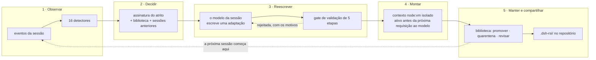

<div align="center">

[English](../../README.md) · [简体中文](README_zh.md) · [繁體中文](README_zh-TW.md) · [日本語](README_ja.md) · [한국어](README_ko.md) · [Türkçe](README_tr.md) · [Русский](README_ru.md) · [Tiếng Việt](README_vi.md) · [ไทย](README_th.md) · [Deutsch](README_de.md) · [Español](README_es.md) · [Français](README_fr.md) · [Українська](README_uk.md) · [Polski](README_pl.md) · **Português (Brasil)** · [العربية](README_ar.md) · [فارسی](README_fa.md) · [Bahasa Indonesia](README_id.md) · [Italiano](README_it.md) · [Ελληνικά](README_el.md) · [മലയാളം](README_ml.md) · [Roman Urdu](README_ur-Latn.md) · [Română](README_ro.md)

<br />


# DSHRSI: autoaperfeiçoamento recursivo (Recursive Self-Improvement) para o DeepSeek Harness

### **Observar → Aperfeiçoar → Construir em cima disso → De novo. Um harness que fica cada vez mais seu.**


**RSI significa Recursive Self-Improvement, autoaperfeiçoamento recursivo, e o DSHRSI é o plugin open source que torna isso realidade no DeepSeek Harness. O harness observa as próprias execuções, faz o modelo da própria sessão escrever código de harness para os problemas que encontra, comprova esse código em um gate de 5 etapas e o monta antes de o turno acabar. Depois, o harness aperfeiçoado roda a sessão seguinte e se aperfeiçoa de novo. Sem fine-tuning. Sem empilhar prompts. Código que é medido, mantido, reescrito ou descartado.**

[](#rsi)
[](https://github.com/deepseek-ai/deepseek-harness)
[](#coverage)
[](#how-it-works)
[](#project-harness)
[](#benchmarks)
[](#contributing)
[](../../LICENSE)

**[📖 Referência do plugin](../../packages/dsh-rsi/README.md) · [🧩 Harness de projeto](../../packages/dsh-rsi/README.md#layers-and-the-project-harness) · [🔬 Gate de validação](../../packages/dsh-rsi/README.md#the-validation-gate) · [⚠️ Limitações conhecidas](../../packages/dsh-rsi/README.md#known-limits) · [🐛 Issues](https://github.com/qybaihe/dshrsi/issues)**

[O que é RSI](#rsi) · [Início rápido](#quick-start) · [Como funciona](#how-it-works) · [Resultados medidos](#measured) · [Benchmarks](#benchmarks) · [Detectores e capacidades](#coverage) · [Harness de projeto](#project-harness) · [Padrões de segurança](#security) · [Perguntas frequentes](#faq)

</div>

---

> [!IMPORTANT]
> **Prévia para desenvolvedores:** o DSHRSI é construído em cima do DeepSeek Harness `0.2.2-rc.3`, que por si só já é uma prévia para desenvolvedores. **Haverá mudanças que quebram a compatibilidade.**
> Uma adaptação é código escrito por um modelo e executado dentro do seu harness. O isolamento dela protege contra erros, **não contra código malicioso**. Leia sobre [o gate de validação](../../packages/dsh-rsi/README.md#the-validation-gate) antes de rodar.

<div align="center">

</div>

<br />

<table>
<tr>
<td width="33%" valign="top">

### 🔴 Sem o DSHRSI
Toda sessão redescobre os mesmos fatos: esta máquina não tem `python`, este repositório tem uma regra que você já tinha dito, esta correção nunca foi verificada. Na execução de controle, **5 de 5 sessões** fizeram a mesma chamada que falha, e uma regra dita pelo usuário foi quebrada de novo uma sessão depois.

</td>
<td width="33%" valign="top">

### 🧬 Com o DSHRSI
Quando o problema volta, o modelo escreve um trecho de código de harness, o código passa pelo gate e entra em vigor **no mesmo turno**. Em 3 execuções contra um modelo real, **7 de 7 sessões** depois da adaptação não tiveram nenhuma chamada com falha. E o próximo aperfeiçoamento parte daí.

</td>
<td width="33%" valign="top">

### 🔒 Só restringe, por design
Uma adaptação pode acrescentar informação, recusar uma chamada, perguntar a você antes ou exigir verificação. **Nenhuma capacidade pode liberar o que o harness recusaria.** Reescrever resultados, adicionar ferramentas e executar comandos ficam esperando a sua aprovação.

</td>
</tr>
</table>

---

<a id="rsi"></a>

## 🔁 RSI = Recursive Self-Improvement, autoaperfeiçoamento recursivo

Não é "reescrever a si mesmo". É **Recursive Self-Improvement**, autoaperfeiçoamento recursivo: um sistema usa as próprias habilidades para se aperfeiçoar, e o sistema aperfeiçoado executa a rodada seguinte. Três palavras, e o DSHRSI precisa fazer jus a cada uma:

| | O que exige | Como o DSHRSI faz |
| :--- | :--- | :--- |
| **Auto (Self)** | Quem age e quem é alterado são o mesmo sistema | O harness altera o harness. A adaptação é escrita pelo modelo da própria sessão que esbarrou no problema. Ninguém ajusta nada de fora |
| **Aperfeiçoamento (Improvement)** | "Melhor" tem que ser verificável | Toda adaptação passa por um gate de 5 etapas antes de ser montada, e as sessões seguintes voltam a testá-la: o que funciona é promovido, o que lança exceção vai para a quarentena |
| **Recursivo (Recursive)** | A saída de uma rodada é o ponto de partida da próxima | A sessão seguinte roda no harness aperfeiçoado e é observada com ele. Uma adaptação que não deu conta é reescrita de forma mais rígida com base nas evidências. Uma que se mostra necessária em um segundo workspace passa a valer para a máquina inteira, e as regras de um projeto viajam para o harness de cada colega de time |

**Quatro loops, um dentro do outro:** dentro de um turno → de sessão em sessão → o próprio aperfeiçoamento é aperfeiçoado → de um projeto para uma máquina e daí para um time.

O que deliberadamente **não** é recursivo: os pesos do modelo nunca mudam, e os detectores, a política de disparo e o gate de validação são código fixo em que nenhuma adaptação consegue tocar. A parte que modifica a si mesma é verificada por uma parte que ela não pode modificar.

---

<a id="quick-start"></a>

## ⚡ Início rápido em 30 segundos

### 1. Instale onde você já trabalha
No app desktop do DeepSeek Harness ou na interface web, abra **Plugins → Add plugin → Install a third-party plugin**, cole o endereço do pacote da release, clique em **Install** e depois em **Enable now**:

```text
https://github.com/qybaihe/dshrsi/releases/download/v0.1.0/dsh-rsi-0.1.0.tgz
```

Ou pela linha de comando. Cada perfil mantém os próprios plugins, e o `dsh plugin add` chama o `pnpm`, que precisa estar no `PATH`:

```bash
dsh plugin --profile web add https://github.com/qybaihe/dshrsi/releases/download/v0.1.0/dsh-rsi-0.1.0.tgz
dsh web
```

### 2. É só trabalhar
Não há nada para configurar. O DSHRSI fica fora de vista até o mesmo problema voltar. Aí o badge **RSI** acende, a pílula abaixo da caixa de mensagem avisa que o harness acabou de se modificar, e a sessão seguinte já começa aperfeiçoada:

<div align="center">

</div>

Digite `/rsi` em qualquer sessão para ver o que está montado, a qual camada cada item pertence e o que está esperando a sua aprovação.

### 3. Dê a um repositório o seu próprio harness
Regras aprendidas em um repositório podem ficar nesse mesmo repositório, um arquivo por adaptação:

```bash
# O comando vem junto com o plugin, dentro do perfil em que ele foi instalado
alias dsh-rsi="$HOME/.dsh/profiles/web/node_modules/.bin/dsh-rsi"

dsh-rsi project init      # no repositório: cria .dsh-rsi/; depois faça o commit
dsh-rsi trust             # em cada outra máquina: aceite os arquivos depois de ler
```

### 4. Rode a partir do código-fonte

```bash
git clone https://github.com/qybaihe/dshrsi.git && cd dshrsi
npm install               # traz um dsh em versão fixada e o pnpm que ele chama
npx dsh plugin --profile web add "$PWD/packages/dsh-rsi"
npx dsh web
```

Os perfis `desktop` e `headless`, os índices de plugins, os tarballs locais e o carregamento para uma única execução estão na [referência do plugin](../../packages/dsh-rsi/README.md#install).

---

<a id="how-it-works"></a>

## 🧠 Como o DSHRSI funciona: um loop fechado dentro do harness, rodando de novo e de novo

Skills, arquivos de memória e prompts de sistema mais longos atuam todos no nível do contexto: acrescentam texto e torcem para o modelo seguir. Quando ele não segue, a mesma chamada que falha é feita de novo na sessão seguinte.

**O DSHRSI atua no nível do harness. O que ele aprende vira código nos pontos de extensão do próprio harness:**



| Etapa | Mecanismo | Efeito |
| :--- | :--- | :--- |
| **1. Observar** | 16 detectores leem eventos de sessão normalizados: chamadas que voltam a falhar, causas de falha que se repetem, tentativas às cegas, correções do usuário, turnos que terminam sem nada verificado. | O problema ganha uma assinatura estável entre sessões, como `bash:command-not-found:python`. |
| **2. Reescrever** | O próprio modelo da sessão escreve uma adaptação em JavaScript sobre uma API de 10 capacidades. Código rejeitado volta com os motivos, no máximo duas vezes; depois, um template embutido assume. | A correção é código de harness, não mais um parágrafo de prompt. |
| **3. Validar** | Estática → carga → replay → regressão → permissão. A adaptação precisa agir sobre as chamadas que a dispararam e não pode mexer em nenhuma chamada que deu certo nesta sessão. | Código que não faz nada, ou que quebra o que já funcionava, nunca é montado. |
| **4. Montar** | A adaptação roda no seu próprio contexto `node:vm`, atrás de uma ponte JSON, com timeout em cada chamada, e passa a valer antes da próxima requisição ao modelo. | O turno que esbarrou no problema é o primeiro a se beneficiar. |
| **5. Manter e compartilhar** | Uma biblioteca por máquina, com ledger e log de auditoria. O que funciona é promovido, o que lança exceção vai para a quarentena, o que não deu conta é reescrito de forma mais rígida, e as regras do projeto são gravadas em `.dsh-rsi/`. | A sessão seguinte já começa adaptada, e os colegas de time recebem as regras do projeto depois de um `dsh-rsi trust`. |
| **↻ De novo** | A sessão seguinte roda no harness que a etapa 5 deixou, e a etapa 1 a observa com todas as adaptações no lugar. | Aperfeiçoamento em cima de aperfeiçoamento. Essa é a recursão. |

---

<a id="measured"></a>

## 🔬 Medido contra um modelo real

Estes números vêm de um modelo real, o `mimo-v2.6-pro`, rodando em sessões reais do `dsh` (`npm run test:live`). Nada nesta tabela é simulado.

> **Como ler isto:** a amostra é pequena. Um modelo, três cenários, um punhado de sessões em cada. Ela mostra que o loop funciona de ponta a ponta. **Não** é uma afirmação estatística sobre taxas de sucesso, e nada ficou mais rápido: escrever uma adaptação significa esperar 30–60 segundos pelo modelo. As execuções maiores estão em [Benchmarks](#benchmarks).

| Cenário | Sem o DSHRSI | Com o DSHRSI | O que o harness escreveu |
| :--- | :--- | :--- | :--- |
| **Comando ausente**: o README diz `python stats.py`, a máquina só tem `python3` | ❌ **5 / 5** sessões fizeram a chamada que falha | ✅ **0 / 7** sessões depois da adaptação (9 / 9 antes dela) | `deny` + `prompt`, escritos pelo modelo, passaram pelo gate na primeira tentativa |
| **Uma regra que o usuário disse uma única vez**: "nunca modifique `notes.txt`, escreva em `notes.draft.txt`" | ❌ A sessão seguinte editou `notes.txt` | ✅ A sessão seguinte escreveu em `notes.draft.txt` sem ninguém pedir | `deny` + `prompt`, escritos pelo modelo logo depois da correção |
| **Uma correção que ninguém pediu para verificar** | não executado | ⚪ Nada escrito: o modelo verificou a própria correção em 3 / 3 sessões, então não havia o que aprender | nenhuma |

O primeiro cenário foi executado três vezes com o plugin, sempre a partir de uma biblioteca vazia, mais uma execução de controle. O segundo foi executado uma vez com o plugin e uma vez sem.

**Comando ausente, sessão por sessão** (chamadas de ferramenta com falha por sessão):

| Execução | S1 | S2 | S3 | S4 | S5 | S6 |
| :--- | :---: | :---: | :---: | :---: | :---: | :---: |
| **Sem o DSHRSI** | ❌ 1 | ❌ 1 | ❌ 1 | ❌ 1 | ❌ 1 | |
| **Com o DSHRSI · execução 1** | ❌ 1 | ❌ 1 | ❌ 1 → 🧬 | ✅ 0 | ✅ 0 | ✅ 0 |
| **Com o DSHRSI · execução 2** | ❌ 1 | ❌ 1 | ❌ 1 → 🧬 | ✅ 0 | ✅ 0 | |
| **Com o DSHRSI · execução 3** | ❌ 1 | ❌ 1 | ❌ 1 → 🧬 | ✅ 0 | ✅ 0 | |

🧬 marca o turno em que o modelo escreveu a adaptação e o harness a montou. Em 3 das 7 sessões seguintes, o modelo ainda tentou `python`, e o harness recusou a chamada antes que ela fosse executada. Todas as sessões deste cenário terminaram com a resposta correta, com ou sem o plugin.

Para reproduzir localmente:

```bash
MIMO_API_KEY=... npm run test:live -- python --sessions 6          # com o plugin
MIMO_API_KEY=... npm run test:live -- python --sessions 5 --off    # execução de controle, sem ele
```

<details>
<summary><strong>Não verificado nesta máquina (clique para expandir)</strong></summary>

<br />

Estes caminhos existem no código e são cobertos por testes unitários ou end-to-end com um modelo simulado, mas não foram observados em uma sessão real nem em um app real:

| Área | Por que não foi verificado aqui |
| :--- | :--- |
| O app desktop do DeepSeek Harness | Não está instalado na máquina de desenvolvimento. Verificado no perfil `web` e no mecanismo de instalação que o app encapsula |
| `negative-feedback`, `approval-denied`, `context-pressure`, `model-instability` | Testados apenas com eventos construídos, nunca disparados em uma sessão real |
| Testes automatizados de navegador | Nenhum. A interface foi percorrida à mão na página real do `dsh web`, nos modos claro e escuro |
| Perfis ACP e SDK | Não têm interface, e não foram verificados |
| Modelos fora da família MiMo v2.6 | Nenhuma execução ainda. Os benchmarks usaram `mimo-v2.6-pro` e `mimo-v2.6-flash`; os três cenários acima usaram `mimo-v2.6-pro` |

</details>

---

<a id="benchmarks"></a>

## 📊 Benchmarks: quatro suítes, dois modelos, tarefa por tarefa

DeepSeek Harness puro contra DeepSeek Harness + DSHRSI, em 3,390 sessões reais do `dsh`: o mesmo modelo, os mesmos prompts, o mesmo sandbox, as mesmas tarefas. O plugin roda com as configurações padrão e começa cada suíte com a biblioteca vazia. Tarefas resolvidas nas três suítes que rodaram até o fim:

<!-- bench:table:start -->
| Benchmark | Tarefas | `mimo-v2.6-pro` puro | `mimo-v2.6-pro` + DSHRSI | `mimo-v2.6-flash` puro | `mimo-v2.6-flash` + DSHRSI |
| :--- | ---: | ---: | ---: | ---: | ---: |
| **Aider Polyglot**, na primeira tentativa | 225 | 224 (99.6%) | 224 (99.6%) | 220 (97.8%) | 223 (99.1%) |
| **Aider Polyglot**, em até duas tentativas | 225 | 225 (100.0%) | 225 (100.0%) | 225 (100.0%) | 225 (100.0%) |
| **HumanEval** | 164 | 163 (99.4%) | 162 (98.8%) | 162 (98.8%) | 162 (98.8%) |
| **HumanEval+** | 164 | 156 (95.1%) | 157 (95.7%) | 153 (93.3%) | 153 (93.3%) |
| **MBPP** | 378 | 374 (98.9%) | 371 (98.1%) | 368 (97.4%) | 369 (97.6%) |
| **MBPP+** | 378 | 320 (84.7%) | 319 (84.4%) | 308 (81.5%) | 315 (83.3%) |
<!-- bench:table:end -->

<div align="center">

</div>

> **Como ler isto:** em tarefas resolvidas, **não dá para distinguir** os dois harnesses. O maior ganho é +7 (MBPP+ com `mimo-v2.6-flash`), a maior perda é −3 (MBPP com `mimo-v2.6-pro`), e nenhuma diferença se sustenta em um teste exato de McNemar sobre as mesmas tarefas (menor p = 0.17). Quando o agente pode rodar o próprio código, estas suítes ficam perto do teto para os dois modelos, e cada tarefa é um diretório novo e limpo: muito pouca coisa se repete para um harness aprender com ela.

**O que o DSHRSI de fato fez, sem uma única dica, foi alterar a si mesmo.** Ao longo das oito execuções, os modelos escreveram **56 adaptações**; 15 delas agiram, e 10 dessas tinham sido ampliadas para a máquina inteira. Para cada uma das 10, pegamos as tarefas que começaram depois dela e comparamos com exatamente as mesmas tarefas no DSH puro:

| Adaptação que o modelo escreveu | Falha a que ela responde | DSH puro | DSH + DSHRSI | p |
| :--- | :--- | ---: | ---: | ---: |
| *Stop inline python checks that abort on first mismatch* (MBPP, `mimo-v2.6-pro`) | Uma execução de testes que morre na primeira asserção que falha | 16 de 310 tarefas | **3 de 310** | 0.002 |
| *Redirect missing lib.rs reads to a glob lookup* (Polyglot, `mimo-v2.6-flash`) | Ler `lib.rs` em um caminho que não existe | 7 de 151 tarefas | **1 de 151** | 0.07 |
| As outras 8 | | nenhuma mudança mensurável | | |

Nenhuma das duas fez mais tarefas passarem, e o plugin custou cerca de 8–9% a mais em tempo de agente e em tokens de entrada. As dez estão listadas em [`bench/README.md`](../../bench/README.md#did-those-adaptations-work).

**O LiveCodeBench v6 foi interrompido antes do fim:** o saldo da conta do modelo acabou no meio do caminho. Nas tarefas que os dois lados já tinham terminado até ali, o DSH puro resolveu 94 e o DSHRSI 96 de 105 com `mimo-v2.6-pro`, e foram 42 contra 42 de 51 com `mimo-v2.6-flash`. Pelo mesmo motivo, a segunda passada, as mesmas tarefas de novo sobre a biblioteca que a primeira passada deixou, ainda não foi executada.

Para reproduzir localmente:

```bash
bench/setup.sh                                                        # toolchains, datasets, código de avaliação
MIMO_API_KEY=... node bench/run.mjs polyglot --arm dsh --run dsh-p1   # DeepSeek Harness puro
MIMO_API_KEY=... node bench/run.mjs polyglot --arm rsi --run rsi-p1   # com o plugin
node bench/report.mjs --write                                         # tabelas e bench/results/*.json
```

O protocolo, as tabelas de custo e de falhas e as limitações estão em [`bench/README.md`](../../bench/README.md); os resultados por tarefa estão em [`bench/results/`](../../bench/results).

---

<a id="coverage"></a>

## 🛡️ Detectores e capacidades

**16 detectores** decidem quando o harness deve mudar. Os mesmos detectores rodam em uma sessão ao vivo e em uma sessão guardada em disco (`dsh-rsi mine`):

| Detector | O que ele encontra | Resposta |
| :--- | :--- | :---: |
| `repeat-failing-call` | A mesma chamada falha de novo com os mesmos argumentos | adapta |
| `failure-signature` | A mesma causa de falha continua voltando: comando ausente, dependência ausente, rede, permissão, porta em uso, caminho não encontrado, edição que não casa, argumentos inválidos, falta de memória | adapta |
| `command-flailing` | O mesmo tipo de comando falha em sequência com argumentos que variam | adapta |
| `read-thrash` | O mesmo arquivo, sem alterações, é lido repetidas vezes | adapta |
| `edit-churn` | O mesmo arquivo é editado muitas vezes em um único turno | adapta |
| `error-storm` | A maioria das chamadas de ferramenta recentes falhou | adapta |
| `stall` | Falhas em sequência, sem nenhum sucesso no meio | adapta |
| `timeout-recurrence` | O mesmo tipo de comando continua estourando o timeout | adapta |
| `output-flood` | O mesmo tipo de comando continua gerando saída grande demais | adapta |
| `approval-denied` / `denied-repeat` | O usuário continua negando o mesmo tipo de ação, ou uma chamada negada é repetida sem alteração | adapta |
| `user-correction` | O usuário corrigiu o modelo, ou interrompeu e mudou de direção | adapta |
| `premature-completion` | O código foi alterado e o turno está prestes a terminar sem que nenhuma verificação tenha rodado | adapta |
| `negative-feedback` | O usuário marcou uma resposta como ruim e escreveu o motivo | adapta |
| `user-interrupt` | O usuário interrompeu no meio do turno | registra |
| `model-instability` | As requisições ao modelo continuam falhando, sendo repetidas ou batendo no limite de saída | registra |
| `context-pressure` | O contexto foi compactado no meio da tarefa | registra |

**10 capacidades** são tudo o que uma adaptação pode fazer. Ela só alcança o harness por meio delas:

| Capacidade | O que faz | Nível |
| :--- | :--- | :---: |
| `annotate` | Anexa uma nota a um resultado de ferramenta | ✅ automático |
| `steer` | Adiciona uma nota antes da próxima requisição ao modelo | ✅ automático |
| `deny` | Recusa uma chamada de ferramenta e dá o motivo | ✅ automático |
| `ask` | Exige a aprovação do usuário para uma chamada | ✅ automático |
| `block` | Transforma um resultado de ferramenta em um erro que traz uma correção | ✅ automático |
| `verify` | Impede o turno de terminar enquanto uma condição não for atendida | ✅ automático |
| `prompt` | Adiciona uma seção permanente ao prompt de sistema | ✅ automático |
| `rewrite` | Substitui o texto de um resultado de ferramenta | 🔐 exige aprovação |
| `tool` | Registra uma nova ferramenta para o modelo | 🔐 exige aprovação |
| `exec` | Executa um comando pela ferramenta de shell do harness, sob as mesmas regras de sandbox e de aprovação | 🔐 exige aprovação |

Esta é a adaptação que o modelo escreveu no primeiro cenário acima:

```js
define({
  title: 'Route python invocations to python3',
  description: '...',
  capabilities: ['deny', 'prompt'],
  setup(h) {
    h.promptSection('On this machine there is no `python` executable; use `python3`.')
    h.beforeTool({ tool: 'bash', command: /(^|[;&|(]\s*)python(\s|$)/ },
      () => h.deny('`python` is not installed on this machine. Use `python3` instead.'))
  },
})
```

---

<a id="project-harness"></a>

## 🧩 Três camadas, e um harness por projeto

Toda adaptação pertence a uma de três camadas. Cada camada pode ser desligada separadamente:

| Camada | O que guarda | Exemplo | Onde vale |
| :--- | :--- | :--- | :--- |
| **`machine`** | Fatos sobre este computador | Não há `python`; uma porta está ocupada; um host interno não resolve | O workspace onde foi aprendida e, depois, a máquina inteira, assim que um segundo workspace esbarra no mesmo problema |
| **`user`** | Como você quer ser tratado | Uma resposta marcada como ruim com o motivo "longa demais" | A máquina inteira |
| **`project`** | As regras e os hábitos de um repositório | "Este repositório usa pnpm, sempre" | O workspace, e o próprio repositório por meio de `.dsh-rsi/` |

**A camada de projeto viaja junto com o código:**

```
.dsh-rsi/
  harness.json           marcador de formato e configurações no nível do projeto
  adaptations/
    remember-the-user-s-instruction-3f2a1c.js     aprendida, depois gravada aqui
    no-force-push.js                              uma escrita à mão funciona do mesmo jeito
```

- **Faça commit para compartilhar, apague para desplugar.** Um arquivo é uma adaptação.
- **Nada roda só porque foi clonado.** Cada máquina aceita o conteúdo exato dos arquivos com `dsh-rsi trust`, e aceita de novo quando eles mudam.
- **Um projeto só pode deixar o harness mais conservador**, nunca menos. Configurações como `autonomy` ficam fora do alcance de um projeto.
- **Portátil para além de um repositório.** `dsh-rsi export` e `dsh-rsi import` levam as camadas de máquina e de usuário para outro computador em um único arquivo.

---

<a id="security"></a>

## 🔒 Segurança e configurações padrão

- **Nível automático que só restringe** — Sem a sua aprovação, uma adaptação só pode acrescentar informação, recusar, perguntar ou exigir verificação. O `deny` e o `ask` dela só conseguem tornar mais rígido o veredito das outras políticas.
- **Poder exige aprovação (`autonomy: tighten`)** — Adaptações que reescrevem resultados, adicionam ferramentas ou executam comandos ficam guardadas como `proposed` e esperam por `dsh-rsi approve <id>`.
- **Invisível até ser necessário** — Sem atrito e sem nada montado, o prompt de sistema, a lista de ferramentas e as mensagens ficam inalterados, byte a byte. Um teste end-to-end garante isso.
- **Falhas contidas** — Um handler que lança exceção nunca afeta a chamada de ferramenta a que está ligado. Depois de três erros, a adaptação vai para a quarentena.
- **Tudo registrado** — Toda decisão fica em `audit.jsonl`; todo atrito, montagem e ação, em `ledger.jsonl`. `dsh-rsi disable`, `retire` e `rollback` tiram uma adaptação de cena ou a fazem voltar à versão anterior.
- **Três modos** — `adapt` monta direto (o padrão), `propose` gera e espera por você, `observe` só registra.

---

<a id="faq"></a>

## ❓ Perguntas frequentes

<details>
<summary><strong>O DSHRSI faz fine-tuning ou altera o modelo?</strong></summary>

Não. Os pesos do modelo ficam intactos e nada é treinado. O que muda é o harness: o código que roda em volta dos prompts e das chamadas de ferramenta do modelo. RSI aqui é autoaperfeiçoamento recursivo no nível do harness: ele se aperfeiçoa a partir das próprias execuções, e cada rodada parte do harness que a rodada anterior deixou.
</details>

<details>
<summary><strong>Isso é mesmo "recursivo", ou só um harness que aprende regras?</strong></summary>

A recursão é concreta e está no código. Uma sessão nova monta tudo o que a biblioteca guarda, então os detectores observam um harness que já mudou. Quando o mesmo problema acontece duas vezes em sessões que tinham uma adaptação montada, o modelo recebe o código-fonte atual e as evidências e escreve uma versão mais rígida; a antiga fica guardada para rollback. Um problema encontrado em um segundo workspace amplia a adaptação para a máquina inteira. O que não entra na recursão é o juiz: detectores, política de disparo e gate de validação não podem ser alterados por nenhuma adaptação.
</details>

<details>
<summary><strong>Qual é a diferença em relação a skills, arquivos de memória ou um prompt de sistema mais longo?</strong></summary>

Esses recursos acrescentam texto que o modelo pode seguir ou não. Uma adaptação é código nos pontos de extensão do harness: ela pode recusar uma chamada de ferramenta antes que ela seja executada, exigir a sua aprovação ou impedir que um turno termine enquanto nada foi verificado. Nas execuções medidas, o modelo ainda tentou `python` em 3 sessões depois de ser avisado para não fazer isso, e a chamada foi recusada antes de ser executada.
</details>

<details>
<summary><strong>Ele deixa minhas sessões mais lentas?</strong></summary>

Escrever uma adaptação significa esperar uma resposta completa do modelo: 30–60 segundos no `mimo-v2.6-pro`, período em que o passo fica parado. As adaptações montadas rodam dentro do processo, com timeouts. Nenhum ganho de velocidade foi medido, e não alegamos nenhum.
</details>

<details>
<summary><strong>Uma adaptação escrita por um modelo pode fazer algo perigoso?</strong></summary>

O nível automático não consegue liberar nada que o harness recusaria, e as capacidades poderosas esperam a sua aprovação. O código roda no seu próprio contexto `node:vm`, atrás de uma ponte JSON. Isso protege contra erros e contra o mau uso casual. **Não** é uma fronteira de segurança contra código malicioso, então leia os arquivos `.dsh-rsi/` de um projeto antes de rodar `dsh-rsi trust`.
</details>

<details>
<summary><strong>Com quais modelos ele funciona?</strong></summary>

As adaptações são escritas pelo modelo atual da sessão, ou por aquele que você definir com `provider` e `model`. Se o modelo não conseguir produzir código que passe pelo gate, os templates embutidos assumem. As execuções até agora usaram dois modelos de uma mesma família, `mimo-v2.6-pro` e `mimo-v2.6-flash`.
</details>

<details>
<summary><strong>Funciona no app desktop do DeepSeek Harness?</strong></summary>

Ele é distribuído como um plugin de terceiros comum, com os metadados que as páginas de plugins leem, e é instalado no perfil `web` que o app encapsula. Ainda não foi verificado dentro do app desktop real.
</details>

<details>
<summary><strong>Como eu vejo, desfaço ou desligo o que ele aprendeu?</strong></summary>

`/rsi` em uma sessão, ou `dsh-rsi status` em um terminal. `dsh-rsi show <id>` imprime o código-fonte e o relatório de validação de uma adaptação; `disable`, `retire` e `rollback` a tiram de cena ou a fazem voltar à versão anterior. Defina `mode: observe` para registrar sem alterar nada.
</details>

---

<a id="docs"></a>

## 📚 Documentação e links

- [📖 Referência do plugin](../../packages/dsh-rsi/README.md) — todos os detectores, capacidades, comandos e configurações
- [🚀 Fontes de instalação e perfis](../../packages/dsh-rsi/README.md#install)
- [🧩 Camadas e o harness de projeto](../../packages/dsh-rsi/README.md#layers-and-the-project-harness)
- [🔬 O gate de validação](../../packages/dsh-rsi/README.md#the-validation-gate)
- [🛠️ Linha de comando `dsh-rsi`](../../packages/dsh-rsi/README.md#command-line) · [⚙️ Configuração](../../packages/dsh-rsi/README.md#configuration)
- [⚠️ Limitações conhecidas](../../packages/dsh-rsi/README.md#known-limits)
- [📊 Protocolo e resultados dos benchmarks](../../bench/README.md)
- [🌐 Código-fonte do site](../../website) — autoaperfeiçoamento recursivo, como funciona, como escrever adaptações, avaliação; abra `website/index.html` em um navegador
- [🧱 DeepSeek Harness](https://github.com/deepseek-ai/deepseek-harness) — o harness ao qual este plugin se conecta

<a id="contributing"></a>

## 🤝 Contribuição e comunidade

Issues e PRs são bem-vindos em [qybaihe/dshrsi](https://github.com/qybaihe/dshrsi). Antes de enviar um PR:

```bash
npm install && npm test    # 130 testes unitários, depois 29 testes end-to-end; não precisa de chave
```

Os testes end-to-end trocam o endpoint do modelo por um simulado. Todo o resto é real: o processo `dsh`, a execução de ferramentas, o log da sessão e a instalação do plugin.

```
packages/dsh-rsi/        o pacote do plugin (ESM puro, sem etapa de build)
  index.js               metade do host: ligações com os pontos de extensão do DSH
  client.js              metade do navegador: badge RSI e pílula de status
  src/engine.js          observar → decidir → gerar → validar → montar → manter → compartilhar
  src/signals.js         os 16 detectores
  src/validate.js        o gate de validação
  src/sandbox.js         onde o código das adaptações roda
  src/project.js         o harness de projeto: <repositório>/.dsh-rsi
  bin/rsi.js             o comando dsh-rsi
market/index.json        um índice de plugins que pode ser adicionado ao DSH
test/unit/  test/e2e/    testes unitários, e testes end-to-end em um processo dsh real
test/live/               execuções contra um modelo real (precisam de MIMO_API_KEY)
bench/                   benchmarks: DSH puro contra DSH + dsh-rsi
website/                 o site (páginas estáticas, sem etapa de build)
```

## 📄 Licença

[MIT](../../LICENSE)

---

Created in [T3 Code](https://t3.codes).
