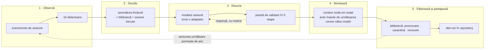

<div align="center">

[English](../../README.md) · [简体中文](README_zh.md) · [繁體中文](README_zh-TW.md) · [日本語](README_ja.md) · [한국어](README_ko.md) · [Türkçe](README_tr.md) · [Русский](README_ru.md) · [Tiếng Việt](README_vi.md) · [ไทย](README_th.md) · [Deutsch](README_de.md) · [Español](README_es.md) · [Français](README_fr.md) · [Українська](README_uk.md) · [Polski](README_pl.md) · [Português (Brasil)](README_pt-BR.md) · [العربية](README_ar.md) · [فارسی](README_fa.md) · [Bahasa Indonesia](README_id.md) · [Italiano](README_it.md) · [Ελληνικά](README_el.md) · [മലയാളം](README_ml.md) · [Roman Urdu](README_ur-Latn.md) · **Română**

<br />


# DSHRSI: Recursive Self-Improvement (auto-îmbunătățire recursivă) pentru DeepSeek Harness

### **Observă → Îmbunătățește → Clădește pe asta → Din nou. Un harness care se pricepe tot mai bine să fie al tău.**

<a href="https://qybaihe.github.io/dshrsi/trace.html">
  <picture>
    <source media="(prefers-color-scheme: dark)" srcset="../../assets/rsi-trace.dark.gif" />
    
  </picture>
</a>

**RSI înseamnă Recursive Self-Improvement, auto-îmbunătățire recursivă, iar DSHRSI este plugin-ul open-source care o face realitate pentru DeepSeek Harness. Harness-ul își urmărește propriile rulări, pune chiar modelul sesiunii să scrie cod de harness pentru problemele de care dă, pune acel cod la probă într-o poartă de validare în 5 etape și îl montează înainte ca tura să se termine. Apoi harness-ul îmbunătățit rulează sesiunea următoare și se îmbunătățește din nou. Fără fine-tuning. Fără un morman de prompt-uri. Cod care e măsurat, păstrat, rescris sau aruncat.**

[](#rsi)
[](https://github.com/deepseek-ai/deepseek-harness)
[](#coverage)
[](#how-it-works)
[](#project-harness)
[](#benchmarks)
[](#contributing)
[](../../LICENSE)

**[🌐 Site web](https://qybaihe.github.io/dshrsi/) · [📖 Referința plugin-ului](../../packages/dsh-rsi/README.md) · [🧩 Harness de proiect](../../packages/dsh-rsi/README.md#layers-and-the-project-harness) · [🔬 Poarta de validare](../../packages/dsh-rsi/README.md#the-validation-gate) · [⚠️ Limite cunoscute](../../packages/dsh-rsi/README.md#known-limits) · [🐛 Issues](https://github.com/qybaihe/dshrsi/issues)**

[Ce înseamnă RSI](#rsi) · [Pornire rapidă](#quick-start) · [Cum funcționează](#how-it-works) · [Rezultate măsurate](#measured) · [Benchmark-uri](#benchmarks) · [Detectoare și capabilități](#coverage) · [Harness de proiect](#project-harness) · [Setări implicite de siguranță](#security) · [Întrebări frecvente](#faq)

</div>

---

> [!IMPORTANT]
> **Versiune preliminară pentru dezvoltatori:** DSHRSI este construit pentru DeepSeek Harness `0.2.2-rc.3`, care este el însuși o versiune preliminară pentru dezvoltatori. **Vor exista schimbări care rup compatibilitatea.**
> O adaptare este cod scris de un model și rulat în interiorul harness-ului tău. Izolarea ei te apără de greșeli, **nu de cod rău-intenționat**. Citește despre [poarta de validare](../../packages/dsh-rsi/README.md#the-validation-gate) înainte să-l rulezi.

<div align="center">

</div>

<br />

<table>
<tr>
<td width="33%" valign="top">

### 🔴 Fără DSHRSI
Fiecare sesiune redescoperă aceleași lucruri: pe mașina asta nu există `python`, repository-ul ăsta are o regulă pe care ai spus-o deja, fix-ul ăsta n-a fost verificat niciodată. În rularea de control, **5 sesiuni din 5** au făcut același apel eșuat, iar o regulă spusă de utilizator a fost încălcată din nou o sesiune mai târziu.

</td>
<td width="33%" valign="top">

### 🧬 Cu DSHRSI
Când problema revine, modelul scrie o bucată de cod de harness, codul trece de poartă și e activ **chiar în aceeași tură**. În 3 rulări cu un model real, **7 sesiuni din 7** de după adaptare n-au avut niciun apel eșuat. Iar următoarea îmbunătățire pornește de acolo.

</td>
<td width="33%" valign="top">

### 🔒 Doar înăsprire, prin design
O adaptare poate adăuga informație, poate refuza un apel, te poate întreba întâi sau poate cere verificare. **Nicio capabilitate nu poate permite ce ar refuza harness-ul.** Rescrierea rezultatelor, adăugarea de tool-uri și rularea de comenzi așteaptă aprobarea ta.

</td>
</tr>
</table>

---

<a id="rsi"></a>

## 🔁 RSI = Recursive Self-Improvement, auto-îmbunătățire recursivă

Nu „se rescrie singur”. **Auto-îmbunătățire recursivă**: un sistem își folosește propriile abilități ca să se îmbunătățească, iar sistemul îmbunătățit duce la capăt runda următoare. Trei cuvinte, iar DSHRSI trebuie să-l merite pe fiecare:

| | Ce presupune | Cum o face DSHRSI |
| :--- | :--- | :--- |
| **Auto (Self)** | Cel care acționează și cel care e schimbat sunt același sistem | Harness-ul schimbă harness-ul. Adaptarea e scrisă chiar de modelul sesiunii care a dat de problemă. Nimeni nu-l reglează din afară |
| **Îmbunătățire (Improvement)** | „Mai bine” trebuie să poată fi verificat | Fiecare adaptare trece printr-o poartă în 5 etape înainte de a fi montată, iar sesiunile de după o pun la probă: ce funcționează e promovat, ce aruncă excepții intră în carantină |
| **Recursivă (Recursive)** | Rezultatul unei runde o pornește pe următoarea | Sesiunea următoare rulează pe harness-ul îmbunătățit și e observată cu el. O adaptare care n-a ținut e rescrisă mai strict, pe baza dovezilor. Una de care e nevoie și într-un al doilea workspace se extinde la toată mașina, iar regulile unui proiect ajung în harness-ul fiecărui coleg de echipă |

**Patru bucle, fiecare în interiorul următoarei:** în interiorul unei ture → de la o sesiune la alta → îmbunătățirea însăși e îmbunătățită → de la un proiect la o mașină, apoi la o echipă.

Ce **nu** e recursiv, în mod deliberat: ponderile modelului nu se schimbă niciodată, iar detectoarele, politica de declanșare și poarta de validare sunt cod fix, de care nicio adaptare nu se poate atinge. Partea care se modifică singură e verificată de o parte pe care nu o poate modifica.

---

<a id="quick-start"></a>

## ⚡ Pornire rapidă în 30 de secunde

### 1. Instalează-l acolo unde lucrezi deja
În aplicația desktop DeepSeek Harness sau în interfața web, deschide **Plugins → Add plugin → Install a third-party plugin**, lipește pachetul de release, alege **Install**, apoi **Enable now**:

```text
https://github.com/qybaihe/dshrsi/releases/download/v0.1.1/dsh-rsi-0.1.1.tgz
```

Sau din linia de comandă. Fiecare profil își ține propriile plugin-uri, iar `dsh plugin add` apelează `pnpm`, care trebuie să fie în `PATH`:

```bash
dsh plugin --profile web add https://github.com/qybaihe/dshrsi/releases/download/v0.1.1/dsh-rsi-0.1.1.tgz
dsh web
```

### 2. Lucrează ca de obicei
Nu e nimic de configurat. DSHRSI nu se arată până când nu revine aceeași problemă. Atunci badge-ul **RSI** se aprinde, pastila de sub câmpul de mesaj îți spune că harness-ul tocmai s-a schimbat singur, iar sesiunea următoare pornește deja îmbunătățită:

<div align="center">

</div>

Scrie `/rsi` în orice sesiune ca să vezi ce e montat, cărui strat îi aparține și ce așteaptă aprobarea ta.

### 3. Dă-i unui repository propriul harness
Regulile învățate într-un repository pot locui chiar în el, câte un fișier pentru fiecare adaptare:

```bash
# Comanda vine odată cu plugin-ul, în profilul în care a fost instalat
alias dsh-rsi="$HOME/.dsh/profiles/web/node_modules/.bin/dsh-rsi"

dsh-rsi project init      # în repository: creează .dsh-rsi/, apoi dă-i commit
dsh-rsi trust             # pe oricare altă mașină: acceptă fișierele după ce le-ai citit
```

### 4. Rulează din sursă

```bash
git clone https://github.com/qybaihe/dshrsi.git && cd dshrsi
npm install               # aduce un dsh cu versiune fixată și pnpm-ul pe care îl apelează
npx dsh plugin --profile web add "$PWD/packages/dsh-rsi"
npx dsh web
```

Profilurile `desktop` și `headless`, indexurile de plugin-uri, tarball-urile locale și încărcarea pentru o singură rulare sunt descrise în [referința plugin-ului](../../packages/dsh-rsi/README.md#install).

---

<a id="how-it-works"></a>

## 🧠 Cum funcționează DSHRSI: o buclă închisă în interiorul harness-ului, rulată iar și iar

Skill-urile, fișierele de memorie și prompt-urile de sistem tot mai lungi lucrează toate la nivel de context: adaugă text și speră că modelul îl va urma. Când nu-l urmează, același apel eșuat se repetă în sesiunea următoare.

**DSHRSI lucrează la nivelul harness-ului. Ce învață devine cod pe punctele de extensie ale harness-ului:**



| Etapă | Mecanism | Efect |
| :--- | :--- | :--- |
| **1. Observă** | 16 detectoare citesc evenimente de sesiune normalizate: apeluri care eșuează din nou, cauze de eșec care tot revin, bâjbâială, corecții ale utilizatorului, ture care se încheie fără nimic verificat. | Problema primește o semnătură stabilă de la o sesiune la alta, de exemplu `bash:command-not-found:python`. |
| **2. Rescrie** | Chiar modelul sesiunii scrie o adaptare în JavaScript, pe un API cu 10 capabilități. Codul respins se întoarce împreună cu motivele, de cel mult două ori, apoi preia un șablon încorporat. | Remediul e cod de harness, nu încă un paragraf de prompt. |
| **3. Validează** | Static → încărcare → reluare → regresie → permisiuni. Adaptarea trebuie să acționeze asupra apelurilor care au declanșat-o și să lase neatins orice apel care a reușit în această sesiune. | Codul care nu face nimic sau care strică ce mergea deja nu ajunge niciodată montat. |
| **4. Montează** | Adaptarea rulează în propriul context `node:vm`, în spatele unei punți JSON, cu timeout pe fiecare apel, și intră în vigoare înainte de următoarea cerere către model. | Tura care a dat de problemă e prima care are de câștigat. |
| **5. Păstrează și partajează** | O bibliotecă pe fiecare mașină, cu registru și jurnal de audit. Ce funcționează e promovat, ce aruncă excepții intră în carantină, ce n-a ținut e rescris mai strict, iar regulile de proiect sunt scrise în `.dsh-rsi/`. | Sesiunea următoare pornește gata adaptată, iar colegii de echipă primesc regulile proiectului după `dsh-rsi trust`. |
| **↻ Din nou** | Sesiunea următoare rulează pe harness-ul lăsat în urmă de etapa 5, iar etapa 1 o observă cu toate adaptările la locul lor. | Îmbunătățire clădită pe îmbunătățire. Asta e recursivitatea. |

---

<a id="measured"></a>

## 🔬 Măsurat pe un model real

Cifrele acestea vin din rularea unui model real, `mimo-v2.6-pro`, prin sesiuni `dsh` reale (`npm run test:live`). Nimic din acest tabel nu e simulat.

> **Cum se citește:** eșantionul e mic. Un model, trei scenarii, câte o mână de sesiuni pentru fiecare. Arată că bucla funcționează cap-coadă. **Nu** este o afirmație statistică despre rate de succes și nimic n-a devenit mai rapid: scrierea unei adaptări așteaptă 30–60 de secunde după model. Rulările mai mari sunt la [Benchmark-uri](#benchmarks).

| Scenariu | Fără DSHRSI | Cu DSHRSI | Ce a scris harness-ul |
| :--- | :--- | :--- | :--- |
| **Comandă lipsă**: README-ul spune `python stats.py`, mașina are doar `python3` | ❌ **5 / 5** sesiuni au făcut apelul eșuat | ✅ **0 / 7** sesiuni după adaptare (9 / 9 înaintea ei) | `deny` + `prompt`, scrise de model, au trecut de poartă din prima încercare |
| **O regulă spusă de utilizator o singură dată**: „nu modifica niciodată `notes.txt`, scrie în `notes.draft.txt`” | ❌ Sesiunea următoare a editat `notes.txt` | ✅ Sesiunea următoare a scris în `notes.draft.txt` fără să i se ceară | `deny` + `prompt`, scrise de model imediat după corecție |
| **Un fix pe care nimeni n-a cerut să fie verificat** | nerulat | ⚪ Nimic scris: modelul și-a verificat fix-ul în 3 / 3 sesiuni, deci nu era nimic de învățat | niciuna |

Primul scenariu a fost rulat de trei ori cu plugin-ul, de fiecare dată pornind de la o bibliotecă goală, plus o rulare de control. Al doilea a fost rulat o dată cu el și o dată fără.

**Comandă lipsă, sesiune cu sesiune** (apeluri de tool eșuate pe sesiune):

| Rulare | S1 | S2 | S3 | S4 | S5 | S6 |
| :--- | :---: | :---: | :---: | :---: | :---: | :---: |
| **Fără DSHRSI** | ❌ 1 | ❌ 1 | ❌ 1 | ❌ 1 | ❌ 1 | |
| **Cu DSHRSI · rularea 1** | ❌ 1 | ❌ 1 | ❌ 1 → 🧬 | ✅ 0 | ✅ 0 | ✅ 0 |
| **Cu DSHRSI · rularea 2** | ❌ 1 | ❌ 1 | ❌ 1 → 🧬 | ✅ 0 | ✅ 0 | |
| **Cu DSHRSI · rularea 3** | ❌ 1 | ❌ 1 | ❌ 1 → 🧬 | ✅ 0 | ✅ 0 | |

🧬 marchează tura în care modelul a scris adaptarea și harness-ul a montat-o. În 3 din cele 7 sesiuni de după ea, modelul a încercat tot `python`, iar harness-ul a refuzat apelul înainte să ruleze. Fiecare sesiune din acest scenariu s-a încheiat cu răspunsul corect, cu sau fără plugin.

Reproducere locală:

```bash
MIMO_API_KEY=... npm run test:live -- python --sessions 6          # cu plugin-ul
MIMO_API_KEY=... npm run test:live -- python --sessions 5 --off    # rulare de control, fără el
```

<details>
<summary><strong>Neverificat pe această mașină (click pentru a extinde)</strong></summary>

<br />

Aceste căi există în sursă și sunt acoperite de teste unitare sau end-to-end cu un model simulat, dar nu au fost observate într-o sesiune reală sau într-o aplicație reală:

| Zonă | De ce e neverificată aici |
| :--- | :--- |
| Aplicația desktop DeepSeek Harness | Nu e instalată pe mașina de dezvoltare. Verificat pe profilul `web` și pe mecanismul de instalare pe care le încapsulează aplicația |
| `negative-feedback`, `approval-denied`, `context-pressure`, `model-instability` | Testate doar cu evenimente construite, niciodată declanșate într-o sesiune reală |
| Teste automate în browser | Nu există. Interfața a fost parcursă de mână în pagina reală `dsh web`, pe tema deschisă și pe cea întunecată |
| Profilurile ACP și SDK | Acolo nu există interfață și nu au fost verificate |
| Modele din afara familiei MiMo v2.6 | Nicio rulare încă. Benchmark-urile au folosit `mimo-v2.6-pro` și `mimo-v2.6-flash`; cele trei scenarii de mai sus au folosit `mimo-v2.6-pro` |

</details>

---

<a id="benchmarks"></a>

## 📊 Benchmark-uri: patru suite, două modele, task cu task

DeepSeek Harness standard contra DeepSeek Harness + DSHRSI, în 3,390 de sesiuni `dsh` reale: același model, aceleași prompt-uri, același sandbox, aceleași task-uri. Plugin-ul rulează cu setările implicite și începe fiecare suită cu biblioteca goală. Task-uri rezolvate pe cele trei suite care au rulat până la capăt:

<!-- bench:table:start -->
| Benchmark | Task-uri | `mimo-v2.6-pro` standard | `mimo-v2.6-pro` + DSHRSI | `mimo-v2.6-flash` standard | `mimo-v2.6-flash` + DSHRSI |
| :--- | ---: | ---: | ---: | ---: | ---: |
| **Aider Polyglot**, din prima încercare | 225 | 224 (99.6%) | 224 (99.6%) | 220 (97.8%) | 223 (99.1%) |
| **Aider Polyglot**, în cel mult două încercări | 225 | 225 (100.0%) | 225 (100.0%) | 225 (100.0%) | 225 (100.0%) |
| **HumanEval** | 164 | 163 (99.4%) | 162 (98.8%) | 162 (98.8%) | 162 (98.8%) |
| **HumanEval+** | 164 | 156 (95.1%) | 157 (95.7%) | 153 (93.3%) | 153 (93.3%) |
| **MBPP** | 378 | 374 (98.9%) | 371 (98.1%) | 368 (97.4%) | 369 (97.6%) |
| **MBPP+** | 378 | 320 (84.7%) | 319 (84.4%) | 308 (81.5%) | 315 (83.3%) |
<!-- bench:table:end -->

<div align="center">
<picture>
  <source media="(prefers-color-scheme: dark)" srcset="../../assets/bench-flash.dark.png" />
  
</picture>
</div>

> **Cum se citește:** la task-uri rezolvate, cele două harness-uri **nu pot fi deosebite**. Cel mai mare câștig este +7 (MBPP+ cu `mimo-v2.6-flash`), cea mai mare pierdere este −3 (MBPP cu `mimo-v2.6-pro`) și nicio diferență nu rezistă la un test McNemar exact pe aceleași task-uri (cel mai mic p = 0.17). Când agentul își poate rula propriul cod, suitele acestea sunt aproape de plafon pentru ambele modele, iar fiecare task e un director nou și curat: revin foarte puține lucruri din care un harness să poată învăța.

**Ce a făcut totuși DSHRSI, fără niciun indiciu, a fost să se schimbe singur.** De-a lungul celor opt rulări, modelele au scris **56 de adaptări**; 15 dintre ele au acționat, iar 10 dintre acestea fuseseră extinse la toată mașina. Pentru fiecare dintre cele 10 am luat task-urile care au început după ea și le-am comparat cu exact aceleași task-uri sub DSH standard:

| Adaptarea scrisă de model | Eșecul căruia îi răspunde | DSH standard | DSH + DSHRSI | p |
| :--- | :--- | ---: | ---: | ---: |
| *Stop inline python checks that abort on first mismatch* (MBPP, `mimo-v2.6-pro`) | O rulare de teste care moare la prima aserțiune eșuată | 16 din 310 task-uri | **3 din 310** | 0.002 |
| *Redirect missing lib.rs reads to a glob lookup* (Polyglot, `mimo-v2.6-flash`) | Citirea lui `lib.rs` de la o cale care nu există | 7 din 151 de task-uri | **1 din 151** | 0.07 |
| Celelalte 8 | | nicio schimbare măsurabilă | | |

Niciuna dintre cele două n-a făcut să treacă mai multe task-uri, iar plugin-ul a costat cu aproximativ 8–9% mai mult timp de agent și mai mulți tokeni de intrare. Toate cele zece sunt enumerate în [`bench/README.md`](../../bench/README.md#did-those-adaptations-work).

**LiveCodeBench v6 a fost întrerupt înainte de final:** contul de model a rămas fără sold pe parcurs. Pe task-urile pe care ambele părți le terminaseră până atunci, DSH standard a rezolvat 94, iar DSHRSI 96 din 105 cu `mimo-v2.6-pro`, respectiv 42 față de 42 din 51 cu `mimo-v2.6-flash`. Din același motiv, a doua trecere, adică aceleași task-uri încă o dată pe biblioteca lăsată de prima trecere, n-a fost rulată încă.

Reproducere locală:

```bash
bench/setup.sh                                                        # toolchain-uri, seturi de date, cod de punctare
MIMO_API_KEY=... node bench/run.mjs polyglot --arm dsh --run dsh-p1   # DeepSeek Harness standard
MIMO_API_KEY=... node bench/run.mjs polyglot --arm rsi --run rsi-p1   # cu plugin-ul
node bench/report.mjs --write                                         # tabele și bench/results/*.json
```

Protocolul, tabelele de cost și de eșecuri și limitele sunt în [`bench/README.md`](../../bench/README.md); rezultatele pe fiecare task sunt în [`bench/results/`](../../bench/results).

---

<a id="coverage"></a>

## 🛡️ Detectoare și capabilități

**16 detectoare** decid când trebuie să se schimbe harness-ul. Aceleași detectoare rulează pe o sesiune live și pe o sesiune stocată pe disc (`dsh-rsi mine`):

| Detector | Ce găsește | Răspuns |
| :--- | :--- | :---: |
| `repeat-failing-call` | Același apel eșuează din nou cu aceleași argumente | adaptează |
| `failure-signature` | Aceeași cauză de eșec tot revine: comandă lipsă, dependență lipsă, rețea, permisiuni, port ocupat, cale negăsită, nepotrivire la editare, argumente invalide, memorie insuficientă | adaptează |
| `command-flailing` | Același tip de comandă eșuează de mai multe ori la rând, cu argumente diferite | adaptează |
| `read-thrash` | Același fișier, neschimbat, e citit iar și iar | adaptează |
| `edit-churn` | Același fișier e editat de multe ori într-o singură tură | adaptează |
| `error-storm` | Majoritatea apelurilor de tool recente au eșuat | adaptează |
| `stall` | Eșecuri la rând, fără niciun succes între ele | adaptează |
| `timeout-recurrence` | Același tip de comandă dă timeout iar și iar | adaptează |
| `output-flood` | Același tip de comandă produce iar și iar un output supradimensionat | adaptează |
| `approval-denied` / `denied-repeat` | Utilizatorul tot refuză același tip de acțiune sau un apel refuzat e reîncercat neschimbat | adaptează |
| `user-correction` | Utilizatorul a corectat modelul sau l-a întrerupt și a schimbat direcția | adaptează |
| `premature-completion` | Codul a fost modificat și tura e pe cale să se încheie fără nicio verificare rulată | adaptează |
| `negative-feedback` | Utilizatorul a marcat un răspuns ca prost și a scris un motiv | adaptează |
| `user-interrupt` | Utilizatorul a întrerupt în mijlocul turei | înregistrează |
| `model-instability` | Cererile către model tot eșuează, sunt reîncercate sau se lovesc de limita de output | înregistrează |
| `context-pressure` | Contextul a fost compactat în mijlocul task-ului | înregistrează |

**10 capabilități** sunt tot ce poate face o adaptare. Ea ajunge la harness doar prin ele:

| Capabilitate | Ce face | Nivel |
| :--- | :--- | :---: |
| `annotate` | Adaugă o notă la rezultatul unui tool | ✅ automat |
| `steer` | Adaugă o notă înainte de următoarea cerere către model | ✅ automat |
| `deny` | Refuză un apel de tool și dă motivul | ✅ automat |
| `ask` | Cere aprobarea utilizatorului pentru un apel | ✅ automat |
| `block` | Transformă rezultatul unui tool într-o eroare care poartă o corecție | ✅ automat |
| `verify` | Nu lasă tura să se încheie cât timp o condiție nu e îndeplinită | ✅ automat |
| `prompt` | Adaugă o secțiune permanentă în prompt-ul de sistem | ✅ automat |
| `rewrite` | Înlocuiește textul rezultatului unui tool | 🔐 necesită aprobare |
| `tool` | Înregistrează un tool nou pentru model | 🔐 necesită aprobare |
| `exec` | Rulează o comandă prin tool-ul de shell al harness-ului, sub aceleași reguli de sandbox și de aprobare | 🔐 necesită aprobare |

Aceasta este adaptarea pe care modelul a scris-o în primul scenariu de mai sus:

```js
define({
  title: 'Route python invocations to python3',
  description: '...',
  capabilities: ['deny', 'prompt'],
  setup(h) {
    h.promptSection('On this machine there is no `python` executable; use `python3`.')
    h.beforeTool({ tool: 'bash', command: /(^|[;&|(]\s*)python(\s|$)/ },
      () => h.deny('`python` is not installed on this machine. Use `python3` instead.'))
  },
})
```

---

<a id="project-harness"></a>

## 🧩 Trei straturi și un harness pentru fiecare proiect

Fiecare adaptare aparține unuia dintre cele trei straturi. Fiecare strat poate fi oprit separat:

| Strat | Ce conține | Exemplu | Unde se aplică |
| :--- | :--- | :--- | :--- |
| **`machine`** | Fapte despre acest calculator | Nu există `python`; un port e ocupat; un host intern nu se rezolvă | Workspace-ul în care a fost învățată, apoi toată mașina, odată ce un al doilea workspace se lovește de același lucru |
| **`user`** | Cum vrei să fii tratat | Un răspuns marcat ca prost, cu motivul „prea lung” | Toată mașina |
| **`project`** | Regulile și obiceiurile unui repository | „Repository-ul ăsta folosește pnpm, întotdeauna” | Workspace-ul și repository-ul însuși, prin `.dsh-rsi/` |

**Stratul de proiect călătorește odată cu codul:**

```
.dsh-rsi/
  harness.json           marcaj de format și setări la nivel de proiect
  adaptations/
    remember-the-user-s-instruction-3f2a1c.js     învățată, apoi scrisă aici
    no-force-push.js                              una scrisă de mână funcționează la fel
```

- **Dai commit ca să partajezi, ștergi ca să scoți din priză.** Un fișier înseamnă o adaptare.
- **Nimic nu rulează doar pentru că a fost clonat.** Fiecare mașină acceptă conținutul exact al fișierelor cu `dsh-rsi trust` și îl acceptă din nou când fișierele se schimbă.
- **Un proiect poate face harness-ul doar mai conservator**, niciodată mai puțin. Setări precum `autonomy` nu sunt la îndemâna unui proiect.
- **Portabil și dincolo de un repository.** `dsh-rsi export` și `dsh-rsi import` duc straturile de mașină și de utilizator pe alt calculator, într-un singur fișier.

---

<a id="security"></a>

## 🔒 Siguranță și configurare implicită

- **Nivelul automat doar înăsprește** — Fără aprobarea ta, o adaptare poate doar să adauge informație, să refuze, să întrebe sau să ceară verificare. `deny` și `ask` ale ei nu pot decât să înăsprească verdictul celorlalte politici.
- **Puterea cere aprobare (`autonomy: tighten`)** — Adaptările care rescriu rezultate, adaugă tool-uri sau rulează comenzi sunt stocate ca `proposed` și așteaptă `dsh-rsi approve <id>`.
- **Invizibil până e nevoie de el** — Când nu există fricțiune și nu e nimic montat, prompt-ul de sistem, lista de tool-uri și mesajele rămân neschimbate, octet cu octet. Un test end-to-end păzește asta.
- **Eșecuri care nu se propagă** — Un handler care aruncă o excepție nu afectează niciodată apelul de tool de care e atașat. După trei erori, adaptarea intră în carantină.
- **Totul e consemnat** — Fiecare decizie e în `audit.jsonl`, fiecare fricțiune, montare și acțiune în `ledger.jsonl`. `dsh-rsi disable`, `retire` și `rollback` scot o adaptare sau o dau înapoi.
- **Trei moduri** — `adapt` montează direct (implicit), `propose` generează și te așteaptă, `observe` doar înregistrează.

---

<a id="faq"></a>

## ❓ Întrebări frecvente

<details>
<summary><strong>Face DSHRSI fine-tuning sau schimbă modelul?</strong></summary>

Nu. Ponderile modelului rămân neatinse și nu se antrenează nimic. Ce se schimbă e harness-ul: codul care rulează în jurul prompt-urilor și al apelurilor de tool ale modelului. Aici RSI este auto-îmbunătățire recursivă la nivelul harness-ului: se îmbunătățește singur din propriile rulări, iar fiecare rundă pornește de la harness-ul lăsat de runda dinainte.
</details>

<details>
<summary><strong>Chiar e „recursiv” sau e doar un harness care învață reguli?</strong></summary>

Recursivitatea e concretă și e în cod. O sesiune nouă montează tot ce conține biblioteca, așa că detectoarele observă un harness care s-a schimbat deja. Când aceeași problemă apare de două ori în sesiuni care aveau o adaptare montată, modelul primește sursa curentă și dovezile și scrie o versiune mai strictă; cea veche e păstrată pentru rollback. O problemă întâlnită într-un al doilea workspace extinde o adaptare la toată mașina. Ce nu e recursiv e arbitrul: detectoarele, politica de declanșare și poarta de validare nu pot fi schimbate de nicio adaptare.
</details>

<details>
<summary><strong>Prin ce diferă de skill-uri, de fișiere de memorie sau de un prompt de sistem mai lung?</strong></summary>

Acelea adaugă text pe care modelul îl poate urma sau nu. O adaptare e cod pe punctele de extensie ale harness-ului: poate refuza un apel de tool înainte să ruleze, poate cere aprobarea ta sau poate împiedica încheierea unei ture cât timp nimic n-a fost verificat. În rulările măsurate, modelul a încercat tot `python` în 3 sesiuni după ce i s-a spus să n-o facă, iar apelul a fost refuzat înainte să ruleze.
</details>

<details>
<summary><strong>Îmi încetinește sesiunile?</strong></summary>

Scrierea unei adaptări așteaptă un răspuns complet al modelului: 30–60 de secunde pe `mimo-v2.6-pro`, timp în care pasul stă pe loc. Adaptările montate rulează în același proces, cu timeout-uri. Nu s-a măsurat nicio accelerare și nu pretindem niciuna.
</details>

<details>
<summary><strong>Poate o adaptare scrisă de model să facă ceva periculos?</strong></summary>

Nivelul automat nu poate permite nimic din ce ar refuza harness-ul, iar capabilitățile puternice așteaptă aprobarea ta. Codul rulează în propriul context `node:vm`, în spatele unei punți JSON. Asta te apără de greșeli și de abuzuri făcute în treacăt. **Nu** este o barieră de securitate împotriva codului rău-intenționat, așa că citește fișierele `.dsh-rsi/` ale unui proiect înainte să rulezi `dsh-rsi trust`.
</details>

<details>
<summary><strong>Cu ce modele funcționează?</strong></summary>

Adaptările sunt scrise de modelul curent al sesiunii sau de cel pe care îl setezi cu `provider` și `model`. Dacă modelul nu reușește să producă un cod care trece de poartă, preiau șabloanele încorporate. Rulările de până acum au folosit două modele din aceeași familie, `mimo-v2.6-pro` și `mimo-v2.6-flash`.
</details>

<details>
<summary><strong>Funcționează în aplicația desktop DeepSeek Harness?</strong></summary>

Se livrează ca un plugin terț obișnuit, cu metadatele pe care le citesc paginile de plugin-uri, și se instalează în profilul `web` pe care îl încapsulează aplicația. Încă n-a fost verificat în aplicația desktop reală.
</details>

<details>
<summary><strong>Cum văd, anulez sau opresc ce a învățat?</strong></summary>

`/rsi` într-o sesiune sau `dsh-rsi status` într-un terminal. `dsh-rsi show <id>` afișează sursa unei adaptări și raportul ei de validare; `disable`, `retire` și `rollback` o scot sau o dau înapoi. Setează `mode: observe` ca să înregistreze fără să schimbe nimic.
</details>

---

<a id="docs"></a>

## 📚 Documentație și linkuri

- [📖 Referința plugin-ului](../../packages/dsh-rsi/README.md) — fiecare detector, capabilitate, comandă și setare
- [🚀 Surse de instalare și profiluri](../../packages/dsh-rsi/README.md#install)
- [🧩 Straturile și harness-ul de proiect](../../packages/dsh-rsi/README.md#layers-and-the-project-harness)
- [🔬 Poarta de validare](../../packages/dsh-rsi/README.md#the-validation-gate)
- [🛠️ Linia de comandă `dsh-rsi`](../../packages/dsh-rsi/README.md#command-line) · [⚙️ Configurare](../../packages/dsh-rsi/README.md#configuration)
- [⚠️ Limite cunoscute](../../packages/dsh-rsi/README.md#known-limits)
- [📊 Protocolul și rezultatele benchmark-urilor](../../bench/README.md)
- [🌐 Sursa site-ului](../../website) — auto-îmbunătățire recursivă, cum funcționează, scrierea adaptărilor, evaluare; deschide `website/index.html` într-un browser
- [🧱 DeepSeek Harness](https://github.com/deepseek-ai/deepseek-harness) — harness-ul în care se conectează acest plugin

<a id="contributing"></a>

## 🤝 Contribuții și comunitate

Issue-urile și PR-urile sunt binevenite la [qybaihe/dshrsi](https://github.com/qybaihe/dshrsi). Înainte să trimiți un PR:

```bash
npm install && npm test    # 130 de teste unitare, apoi 29 de teste end-to-end; nu e nevoie de nicio cheie
```

Testele end-to-end înlocuiesc endpoint-ul modelului cu unul simulat. Restul e real: procesul `dsh`, execuția tool-urilor, jurnalul sesiunii și instalarea plugin-urilor.

```
packages/dsh-rsi/        pachetul plugin-ului (ESM simplu, fără pas de build)
  index.js               partea de host: legăturile cu punctele de extensie ale DSH
  client.js              partea de browser: badge-ul RSI și pastila de stare
  src/engine.js          observă → decide → generează → validează → montează → păstrează → partajează
  src/signals.js         cele 16 detectoare
  src/validate.js        poarta de validare
  src/sandbox.js         unde rulează codul adaptărilor
  src/project.js         harness-ul de proiect: <repository>/.dsh-rsi
  bin/rsi.js             comanda dsh-rsi
market/index.json        un index de plugin-uri care poate fi adăugat în DSH
test/unit/  test/e2e/    teste unitare și teste end-to-end pe un proces dsh real
test/live/               rulări cu un model real (au nevoie de MIMO_API_KEY)
bench/                   benchmark-uri: DSH standard contra DSH + dsh-rsi
website/                 site-ul (pagini statice, fără pas de build)
```

## 📄 Licență

[MIT](../../LICENSE)

---

Created in [T3 Code](https://t3.codes).
