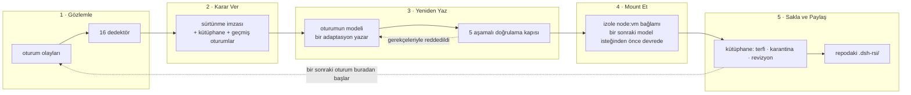

<div align="center">

[English](../../README.md) · [简体中文](README_zh.md) · [繁體中文](README_zh-TW.md) · [日本語](README_ja.md) · [한국어](README_ko.md) · **Türkçe** · [Русский](README_ru.md) · [Tiếng Việt](README_vi.md) · [ไทย](README_th.md) · [Deutsch](README_de.md) · [Español](README_es.md) · [Français](README_fr.md) · [Українська](README_uk.md) · [Polski](README_pl.md) · [Português (Brasil)](README_pt-BR.md) · [العربية](README_ar.md) · [فارسی](README_fa.md) · [Bahasa Indonesia](README_id.md) · [Italiano](README_it.md) · [Ελληνικά](README_el.md) · [മലയാളം](README_ml.md) · [Roman Urdu](README_ur-Latn.md) · [Română](README_ro.md)

<br />


# DSHRSI: DeepSeek Harness için Özyinelemeli Kendini Geliştirme (Recursive Self-Improvement)

### **Gözlemle → Geliştir → Üzerine İnşa Et → Yeniden. Giderek daha çok sizin olan bir harness.**

<a href="https://qybaihe.github.io/dshrsi/trace.html">
  <picture>
    <source media="(prefers-color-scheme: dark)" srcset="../../assets/rsi-trace.dark.gif" />
    
  </picture>
</a>

**RSI, Recursive Self-Improvement, yani Özyinelemeli Kendini Geliştirme demek; DSHRSI de bunu DeepSeek Harness için gerçeğe dönüştüren açık kaynaklı plugin. Harness kendi çalışmasını izler, bulduğu sorunlar için oturumun kendi modeline harness kodu yazdırır, bu kodun işe yaradığını 5 aşamalı bir kapıda kanıtlar ve tur bitmeden mount eder. Ardından kendini geliştirmiş harness bir sonraki oturumu yürütür ve bir kez daha gelişir. Fine-tuning yok. Prompt yığını yok. Ölçülen, saklanan, yeniden yazılan ya da çöpe atılan kod var.**

[](#rsi)
[](https://github.com/deepseek-ai/deepseek-harness)
[](#coverage)
[](#how-it-works)
[](#project-harness)
[](#benchmarks)
[](#contributing)
[](../../LICENSE)

**[🌐 Web Sitesi](https://qybaihe.github.io/dshrsi/) · [📖 Plugin Referansı](../../packages/dsh-rsi/README.md) · [🧩 Proje Harness'i](../../packages/dsh-rsi/README.md#layers-and-the-project-harness) · [🔬 Doğrulama Kapısı](../../packages/dsh-rsi/README.md#the-validation-gate) · [⚠️ Bilinen Sınırlar](../../packages/dsh-rsi/README.md#known-limits) · [🐛 Issue'lar](https://github.com/qybaihe/dshrsi/issues)**

[RSI Ne Demek](#rsi) · [Hızlı Başlangıç](#quick-start) · [Nasıl Çalışır](#how-it-works) · [Ölçülen Sonuçlar](#measured) · [Benchmark'lar](#benchmarks) · [Dedektörler ve Yetenekler](#coverage) · [Proje Harness'i](#project-harness) · [Güvenlik Varsayılanları](#security) · [SSS](#faq)

</div>

---

> [!IMPORTANT]
> **Geliştirici Önizlemesi:** DSHRSI, DeepSeek Harness `0.2.2-rc.3` sürümüne göre geliştirildi; o sürümün kendisi de bir geliştirici önizlemesi. **Uyumluluğu bozan değişiklikler olacak.**
> Bir adaptasyon, bir modelin yazdığı ve harness'inizin içinde çalışan koddur. İzolasyonu hatalara karşı korur, **kötü niyetli koda karşı korumaz**. Çalıştırmadan önce [doğrulama kapısı](../../packages/dsh-rsi/README.md#the-validation-gate) bölümünü okuyun.

<div align="center">

</div>

<br />

<table>
<tr>
<td width="33%" valign="top">

### 🔴 DSHRSI Olmadan
Her oturum aynı gerçekleri yeniden keşfeder: bu makinede `python` yok, bu repoda zaten söylediğiniz bir kural var, bu düzeltme hiç doğrulanmadı. Kontrol çalıştırmasında **5 oturumun 5'i** aynı başarısız çağrıyı yaptı; kullanıcının söylediği bir kural da bir oturum sonra yeniden çiğnendi.

</td>
<td width="33%" valign="top">

### 🧬 DSHRSI ile
Sorun yeniden ortaya çıktığında model bir parça harness kodu yazar, kod kapıdan geçer ve **aynı turda** devreye girer. Gerçek bir modelle yapılan 3 çalıştırmada, adaptasyondan sonraki **7 oturumun 7'sinde** hiç başarısız çağrı olmadı. Bir sonraki geliştirme de buradan başlar.

</td>
<td width="33%" valign="top">

### 🔒 Tasarım Gereği Yalnızca Sıkılaştırır
Bir adaptasyon bilgi ekleyebilir, bir çağrıyı reddedebilir, önce size sorabilir ya da doğrulama talep edebilir. **Hiçbir yetenek, harness'in reddedeceği bir şeye izin veremez.** Sonuçları yeniden yazmak, araç eklemek ve komut çalıştırmak ise onayınızı bekler.

</td>
</tr>
</table>

---

<a id="rsi"></a>

## 🔁 RSI = Recursive Self-Improvement, Özyinelemeli Kendini Geliştirme

"Kendini yeniden yazma" değil. **Özyinelemeli Kendini Geliştirme**: bir sistem kendini geliştirmek için kendi yeteneklerini kullanır, bir sonraki döngüyü de kendini geliştirmiş sistem yürütür. Üç kelime; DSHRSI her birini hak etmek zorunda:

| | Ne Gerektirir | DSHRSI Bunu Nasıl Yapar |
| :--- | :--- | :--- |
| **Kendini (Self)** | Harekete geçen de değiştirilen de aynı sistemdir | Harness'i değiştiren, harness'in kendisidir. Adaptasyonu, sorunla karşılaşan oturumun kendi modeli yazar. Kimse dışarıdan ayar yapmaz |
| **Geliştirme (Improvement)** | "Daha iyi" sınanabilir olmalıdır | Her adaptasyon mount edilmeden önce 5 aşamalı bir kapıdan geçer, sonraki oturumlarda da sınanmaya devam eder: işe yarayan terfi eder, hata fırlatan karantinaya alınır |
| **Özyinelemeli (Recursive)** | Bir döngünün çıktısı bir sonrakini başlatır | Bir sonraki oturum, kendini geliştirmiş harness üzerinde çalışır ve onunla birlikte gözlemlenir. Yetersiz kalan bir adaptasyon, kanıtlara dayanılarak daha katı biçimde yeniden yazılır. İkinci bir çalışma alanında da gerek duyulan adaptasyon tüm makineye genişler; bir projenin kuralları da her ekip arkadaşının harness'ine taşınır |

**İç içe dört döngü:** tek bir turun içinde → oturumdan oturuma → geliştirmenin kendisi de geliştirilir → projeden makineye, oradan ekibe.

Bilerek özyinelemeli **olmayan** kısım: modelin ağırlıkları asla değişmez; dedektörler, tetikleme politikası ve doğrulama kapısı ise hiçbir adaptasyonun dokunamayacağı sabit koddur. Kendini değiştiren kısmı, onun değiştiremediği bir kısım denetler.

---

<a id="quick-start"></a>

## ⚡ 30 Saniyede Hızlı Başlangıç

### 1. Zaten Çalıştığınız Yere Kurun
DeepSeek Harness masaüstü uygulamasında ya da Web arayüzünde **Plugins → Add plugin → Install a third-party plugin** yolunu izleyin, sürüm paketinin adresini yapıştırın, önce **Install**'ı, ardından **Enable now**'ı seçin:

```text
https://github.com/qybaihe/dshrsi/releases/download/v0.1.2/dsh-rsi-0.1.2.tgz
```

Ya da komut satırından. Her profil kendi plugin'lerini ayrı tutar; `dsh plugin add` ise `pnpm`'i çağırır, onun da `PATH` üzerinde olması gerekir:

```bash
dsh plugin --profile web add https://github.com/qybaihe/dshrsi/releases/download/v0.1.2/dsh-rsi-0.1.2.tgz
dsh web
```

### 2. Her Zamanki Gibi Çalışın
Yapılandırılacak hiçbir şey yok. Aynı sorun yeniden ortaya çıkana kadar DSHRSI ortalıkta görünmez. Çıktığında **RSI** rozeti yanar, mesaj kutusunun altındaki durum etiketi harness'in az önce kendini değiştirdiğini bildirir ve bir sonraki oturum kendini geliştirmiş bir harness'le başlar:

<div align="center">

</div>

Neyin mount edildiğini, hangi katmana ait olduğunu ve neyin onayınızı beklediğini görmek için herhangi bir oturumda `/rsi` yazın.

### 3. Bir Repoya Kendi Harness'ini Verin
Bir repoda öğrenilen kurallar o repoda yaşayabilir; her adaptasyon tek bir dosyadır:

```bash
# Komut plugin ile birlikte gelir; plugin'in kurulduğu profilin içindedir
alias dsh-rsi="$HOME/.dsh/profiles/web/node_modules/.bin/dsh-rsi"

dsh-rsi project init      # repoda: .dsh-rsi/ dizinini oluşturur; sonra onu commit'leyin
dsh-rsi trust             # diğer her makinede: dosyaları okuduktan sonra kabul edin
```

### 4. Kaynak Koddan Çalıştırın

```bash
git clone https://github.com/qybaihe/dshrsi.git && cd dshrsi
npm install               # sabitlenmiş bir dsh sürümünü ve onun çağırdığı pnpm'i getirir
npx dsh plugin --profile web add "$PWD/packages/dsh-rsi"
npx dsh web
```

`desktop` ve `headless` profilleri, plugin index'leri, yerel tarball'lar ve yalnızca tek bir çalıştırma için yükleme [plugin referansında](../../packages/dsh-rsi/README.md#install) anlatılıyor.

---

<a id="how-it-works"></a>

## 🧠 DSHRSI Nasıl Çalışır: Harness'in İçinde Tekrar Tekrar Dönen Kapalı Bir Döngü

<div align="center">
<picture>
  <source media="(prefers-color-scheme: dark)" srcset="../../assets/pit-stop.dark.svg" />
  
</picture>
</div>

Skill'ler, bellek dosyaları ve daha uzun sistem prompt'ları bağlam düzeyinde çalışır: metin eklerler ve modelin buna uymasını umarlar. Model uymadığında, aynı başarısız çağrı bir sonraki oturumda yeniden yapılır.

**DSHRSI ise harness düzeyinde çalışır. Öğrendiği şey, harness'in kendi genişletme noktalarına oturan koda dönüşür:**



| Aşama | Mekanizma | Etki |
| :--- | :--- | :--- |
| **1. Gözlemle** | 16 dedektör normalize edilmiş oturum olaylarını okur: yeniden başarısız olan çağrılar, tekrar tekrar ortaya çıkan başarısızlık nedenleri, bocalama, kullanıcı düzeltmeleri, hiçbir şey doğrulanmadan biten turlar. | Sorun, oturumlar arasında sabit kalan bir imza kazanır; örneğin `bash:command-not-found:python`. |
| **2. Yeniden Yaz** | Oturumun kendi modeli, 10 yetenek sunan bir API'yi kullanarak JavaScript ile bir adaptasyon yazar. Reddedilen kod gerekçeleriyle birlikte geri gönderilir; bu en fazla iki kez olur, sonra yerleşik bir şablon devreye girer. | Çözüm, prompt'a eklenen bir paragraf daha değil, harness kodudur. |
| **3. Doğrula** | Statik → yükleme → tekrar oynatma → regresyon → izin. Adaptasyon, kendisini tetikleyen çağrılarda eyleme geçmek ve bu oturumda başarılı olmuş hiçbir çağrıya dokunmamak zorundadır. | Hiçbir şey yapmayan ya da zaten çalışan bir şeyi bozan kod asla mount edilmez. |
| **4. Mount Et** | Adaptasyon, bir JSON köprüsünün ardındaki kendi `node:vm` bağlamında, her çağrısı zaman aşımına tabi olarak çalışır ve bir sonraki model isteğinden önce etkinleşir. | Bundan ilk yararlanan, sorunla karşılaşan turun kendisidir. |
| **5. Sakla ve Paylaş** | Her makinede, bir defteri ve bir denetim günlüğü olan bir kütüphane bulunur. İşe yarayan terfi eder, hata fırlatan karantinaya alınır, yetersiz kalan daha katı biçimde yeniden yazılır, proje kuralları da `.dsh-rsi/` içine yazılır. | Bir sonraki oturum adapte olmuş hâlde başlar; ekip arkadaşları da `dsh-rsi trust` sonrasında projenin kurallarını alır. |
| **↻ Yeniden** | Bir sonraki oturum, 5. aşamanın geride bıraktığı harness üzerinde çalışır; 1. aşama da onu tüm adaptasyonlar yerindeyken gözlemler. | Gelişme, gelişmenin üzerine kurulur. Özyineleme işte budur. |

---

<a id="measured"></a>

## 🔬 Gerçek Bir Modelle Ölçüldü

Bu sayılar, gerçek bir modelin (`mimo-v2.6-pro`) gerçek `dsh` oturumlarında çalıştırılmasıyla elde edildi (`npm run test:live`). Bu tablodaki hiçbir şey simülasyon değil.

> **Nasıl okunmalı:** örneklem küçük. Tek model, üç senaryo, her birinde bir avuç oturum. Döngünün uçtan uca çalıştığını gösterir. Başarı oranları hakkında istatistiksel bir iddia **değildir** ve hiçbir şey hızlanmadı: bir adaptasyon yazmak, modeli 30–60 saniye beklemek demek. Daha büyük çalıştırmalar [Benchmark'lar](#benchmarks) bölümünde.

| Senaryo | DSHRSI Olmadan | DSHRSI ile | Harness Ne Yazdı |
| :--- | :--- | :--- | :--- |
| **Eksik komut**: README `python stats.py` diyor, makinede yalnızca `python3` var | ❌ **5 / 5** oturum başarısız çağrıyı yaptı | ✅ Adaptasyondan sonra **0 / 7** oturum (öncesinde 9 / 9) | `deny` + `prompt`; model yazdı, kapıdan ilk denemede geçti |
| **Kullanıcının bir kez söylediği kural**: "`notes.txt` dosyasını asla değiştirme, `notes.draft.txt` dosyasına yaz" | ❌ Bir sonraki oturum `notes.txt` dosyasını düzenledi | ✅ Bir sonraki oturum, hatırlatılmadan `notes.draft.txt` dosyasına yazdı | `deny` + `prompt`; model, düzeltmenin hemen ardından yazdı |
| **Kimsenin doğrulanmasını istemediği bir düzeltme** | çalıştırılmadı | ⚪ Hiçbir şey yazılmadı: model düzeltmesini 3 / 3 oturumda kendisi doğruladı, yani öğrenilecek bir şey yoktu | yok |

İlk senaryo plugin ile üç kez, her seferinde boş bir kütüphaneden başlanarak çalıştırıldı; buna bir de kontrol çalıştırması eklendi. İkincisi bir kez plugin ile, bir kez de plugin olmadan çalıştırıldı.

**Eksik komut, oturum oturum** (oturum başına başarısız araç çağrısı sayısı):

| Çalıştırma | S1 | S2 | S3 | S4 | S5 | S6 |
| :--- | :---: | :---: | :---: | :---: | :---: | :---: |
| **DSHRSI Olmadan** | ❌ 1 | ❌ 1 | ❌ 1 | ❌ 1 | ❌ 1 | |
| **DSHRSI ile · 1. çalıştırma** | ❌ 1 | ❌ 1 | ❌ 1 → 🧬 | ✅ 0 | ✅ 0 | ✅ 0 |
| **DSHRSI ile · 2. çalıştırma** | ❌ 1 | ❌ 1 | ❌ 1 → 🧬 | ✅ 0 | ✅ 0 | |
| **DSHRSI ile · 3. çalıştırma** | ❌ 1 | ❌ 1 | ❌ 1 → 🧬 | ✅ 0 | ✅ 0 | |

🧬, modelin adaptasyonu yazdığı ve harness'in onu mount ettiği turu gösterir. Sonraki 7 oturumun 3'ünde model yine `python`'ı denedi; harness çağrıyı daha çalışmadan reddetti. Bu senaryodaki her oturum, plugin olsun olmasın, doğru cevapla bitti.

Yerelde yeniden üretmek için:

```bash
MIMO_API_KEY=... npm run test:live -- python --sessions 6          # plugin ile
MIMO_API_KEY=... npm run test:live -- python --sessions 5 --off    # plugin olmadan kontrol çalıştırması
```

<details>
<summary><strong>Bu makinede doğrulanmayanlar (genişletmek için tıklayın)</strong></summary>

<br />

Bu yollar kod tabanında mevcut ve simüle edilmiş bir modelle çalışan birim ya da uçtan uca testlerle kapsanıyor; ancak gerçek bir oturumda ya da gerçek bir uygulamada gözlemlenmedi:

| Alan | Burada Neden Doğrulanmadı |
| :--- | :--- |
| DeepSeek Harness masaüstü uygulaması | Geliştirme makinesinde kurulu değil. Doğrulama, uygulamanın sarmaladığı `web` profili ve kurulum mekanizması üzerinde yapıldı |
| `negative-feedback`, `approval-denied`, `context-pressure`, `model-instability` | Yalnızca kurgulanmış olaylarla test edildi, gerçek bir oturumda hiç tetiklenmedi |
| Otomatik tarayıcı testleri | Yok. Arayüz, gerçek `dsh web` sayfasında açık ve koyu modda elle gezilerek kontrol edildi |
| ACP ve SDK profilleri | Orada arayüz yok; doğrulanmadı da |
| MiMo v2.6 ailesi dışındaki modeller | Henüz hiç çalıştırılmadı. Benchmark'larda `mimo-v2.6-pro` ve `mimo-v2.6-flash`, yukarıdaki üç senaryoda ise `mimo-v2.6-pro` kullanıldı |

</details>

---

<a id="benchmarks"></a>

## 📊 Benchmark'lar: Dört Set, İki Model, Görev Görev

3,390 gerçek `dsh` oturumunda stok DeepSeek Harness ile DeepSeek Harness + DSHRSI karşı karşıya: aynı model, aynı prompt'lar, aynı sandbox, aynı görevler. Plugin varsayılan ayarlarıyla çalışır ve her sete boş bir kütüphaneyle başlar. Sonuna kadar çalışan üç sette çözülen görevler:

<!-- bench:table:start -->
| Benchmark | Görev | `mimo-v2.6-pro` Stok | `mimo-v2.6-pro` + DSHRSI | `mimo-v2.6-flash` Stok | `mimo-v2.6-flash` + DSHRSI |
| :--- | ---: | ---: | ---: | ---: | ---: |
| **Aider Polyglot**, ilk denemede | 225 | 224 (99.6%) | 224 (99.6%) | 220 (97.8%) | 223 (99.1%) |
| **Aider Polyglot**, iki deneme içinde | 225 | 225 (100.0%) | 225 (100.0%) | 225 (100.0%) | 225 (100.0%) |
| **HumanEval** | 164 | 163 (99.4%) | 162 (98.8%) | 162 (98.8%) | 162 (98.8%) |
| **HumanEval+** | 164 | 156 (95.1%) | 157 (95.7%) | 153 (93.3%) | 153 (93.3%) |
| **MBPP** | 378 | 374 (98.9%) | 371 (98.1%) | 368 (97.4%) | 369 (97.6%) |
| **MBPP+** | 378 | 320 (84.7%) | 319 (84.4%) | 308 (81.5%) | 315 (83.3%) |
<!-- bench:table:end -->

<div align="center">
<picture>
  <source media="(prefers-color-scheme: dark)" srcset="../../assets/bench-flash.dark.png" />
  
</picture>
</div>

> **Nasıl okunmalı:** çözülen görev sayısı bakımından iki harness **birbirinden ayırt edilemiyor**. En büyük kazanç +7 (`mimo-v2.6-flash` ile MBPP+), en büyük kayıp −3 (`mimo-v2.6-pro` ile MBPP); aynı görevler üzerinde yapılan kesin McNemar testinde hiçbir fark ayakta kalmıyor (en küçük p = 0.17). Ajan kendi kodunu çalıştırabildiğinde bu setler her iki model için de tavana yakın; üstelik her görev yepyeni, temiz bir dizin: harness'in ders çıkarabileceği, tekrar eden çok az şey var.

**DSHRSI ise şunu gerçekten yaptı: tek bir ipucu bile verilmeden kendini değiştirdi.** Sekiz çalıştırma boyunca modeller **56 adaptasyon** yazdı; bunların 15'i eyleme geçti, onların da 10'u tüm makineye genişletilmişti. Bu 10 adaptasyonun her biri için, ondan sonra başlayan görevleri alıp stok DSH altındaki birebir aynı görevlerle karşılaştırdık:

| Modelin Yazdığı Adaptasyon | Karşılık Verdiği Hata | Stok DSH | DSH + DSHRSI | p |
| :--- | :--- | ---: | ---: | ---: |
| *Stop inline python checks that abort on first mismatch* (MBPP, `mimo-v2.6-pro`) | İlk başarısız assertion'da ölen bir test çalıştırması | 310 görevin 16'sı | **310 görevin 3'ü** | 0.002 |
| *Redirect missing lib.rs reads to a glob lookup* (Polyglot, `mimo-v2.6-flash`) | `lib.rs` dosyasını var olmayan bir yoldan okumak | 151 görevin 7'si | **151 görevin 1'i** | 0.07 |
| Diğer 8 adaptasyon | | ölçülebilir bir değişiklik yok | | |

Bu ikisinin hiçbiri daha fazla görevin geçmesini sağlamadı; plugin'in maliyeti ise yaklaşık 8–9% daha fazla ajan süresi ve girdi token'ı oldu. On adaptasyonun tamamı [`bench/README.md`](../../bench/README.md#did-those-adaptations-work) içinde listeleniyor.

**LiveCodeBench v6 yarıda kesildi:** model hesabının bakiyesi yolun ortasında tükendi. O ana kadar iki tarafın da bitirmiş olduğu görevlerde, `mimo-v2.6-pro` ile 105 görevin 94'ünü stok DSH, 96'sını DSHRSI çözdü; `mimo-v2.6-flash` ile 51 görevde durum 42'ye 42. Aynı nedenle ikinci geçiş, yani aynı görevlerin ilk geçişin bıraktığı kütüphaneyle bir kez daha çalıştırılması, henüz yapılmadı.

Yerelde yeniden üretmek için:

```bash
bench/setup.sh                                                        # araç zincirleri, veri setleri, puanlama kodu
MIMO_API_KEY=... node bench/run.mjs polyglot --arm dsh --run dsh-p1   # stok DeepSeek Harness
MIMO_API_KEY=... node bench/run.mjs polyglot --arm rsi --run rsi-p1   # plugin ile
node bench/report.mjs --write                                         # tablolar ve bench/results/*.json
```

Protokol, maliyet ve hata tabloları ile sınırlar [`bench/README.md`](../../bench/README.md) içinde; görev bazındaki sonuçlar ise [`bench/results/`](../../bench/results) altında.

---

<a id="coverage"></a>

## 🛡️ Dedektörler ve Yetenekler

Harness'in ne zaman değişmesi gerektiğine **16 dedektör** karar verir. Aynı dedektörler hem canlı bir oturumda hem de diskte saklanan bir oturumda (`dsh-rsi mine`) çalışır:

| Dedektör | Ne Bulur | Tepki |
| :--- | :--- | :---: |
| `repeat-failing-call` | Aynı çağrı aynı argümanlarla yeniden başarısız olur | adapte olur |
| `failure-signature` | Aynı başarısızlık nedeni tekrar tekrar ortaya çıkar: eksik komut, eksik bağımlılık, ağ, izin, kullanımda olan port, bulunamayan yol, düzenleme uyuşmazlığı, geçersiz argümanlar, bellek yetersizliği | adapte olur |
| `command-flailing` | Aynı türden komut, değişen argümanlarla art arda başarısız olur | adapte olur |
| `read-thrash` | Değişmemiş aynı dosya tekrar tekrar okunur | adapte olur |
| `edit-churn` | Aynı dosya tek bir turda defalarca düzenlenir | adapte olur |
| `error-storm` | Son araç çağrılarının çoğu başarısız olmuştur | adapte olur |
| `stall` | Arada tek bir başarı olmadan art arda gelen başarısızlıklar | adapte olur |
| `timeout-recurrence` | Aynı türden komut sürekli zaman aşımına uğrar | adapte olur |
| `output-flood` | Aynı türden komut sürekli aşırı büyük çıktı üretir | adapte olur |
| `approval-denied` / `denied-repeat` | Kullanıcı aynı türden eylemi tekrar tekrar reddeder ya da reddedilen bir çağrı hiç değiştirilmeden yeniden denenir | adapte olur |
| `user-correction` | Kullanıcı modeli düzeltti ya da araya girip yön değiştirdi | adapte olur |
| `premature-completion` | Kod değiştirildi ve tur hiçbir kontrol çalıştırılmadan bitmek üzere | adapte olur |
| `negative-feedback` | Kullanıcı bir yanıtı kötü olarak işaretledi ve bir gerekçe yazdı | adapte olur |
| `user-interrupt` | Kullanıcı turun ortasında araya girdi | kaydedilir |
| `model-instability` | Model istekleri sürekli başarısız oluyor, yeniden deneniyor ya da çıktı sınırına takılıyor | kaydedilir |
| `context-pressure` | Bağlam, görevin ortasında sıkıştırıldı | kaydedilir |

**10 yetenek**, bir adaptasyonun yapabileceği her şeydir. Harness'e yalnızca bunlar üzerinden ulaşır:

| Yetenek | Ne Yapar | Kademe |
| :--- | :--- | :---: |
| `annotate` | Bir araç sonucunun sonuna not ekler | ✅ otomatik |
| `steer` | Bir sonraki model isteğinden önce bir not ekler | ✅ otomatik |
| `deny` | Bir araç çağrısını reddeder ve gerekçesini bildirir | ✅ otomatik |
| `ask` | Bir çağrı için kullanıcının onayını şart koşar | ✅ otomatik |
| `block` | Bir araç sonucunu, düzeltme taşıyan bir hataya çevirir | ✅ otomatik |
| `verify` | Bir koşul sağlanmadıkça turun bitmesine izin vermez | ✅ otomatik |
| `prompt` | Sistem prompt'una kalıcı bir bölüm ekler | ✅ otomatik |
| `rewrite` | Bir araç sonucunun metnini değiştirir | 🔐 onay gerekir |
| `tool` | Model için yeni bir araç kaydeder | 🔐 onay gerekir |
| `exec` | Harness'in shell aracı üzerinden, aynı sandbox ve onay kurallarına tabi olarak bir komut çalıştırır | 🔐 onay gerekir |

Yukarıdaki ilk senaryoda modelin yazdığı adaptasyon şu:

```js
define({
  title: 'Route python invocations to python3',
  description: '...',
  capabilities: ['deny', 'prompt'],
  setup(h) {
    h.promptSection('On this machine there is no `python` executable; use `python3`.')
    h.beforeTool({ tool: 'bash', command: /(^|[;&|(]\s*)python(\s|$)/ },
      () => h.deny('`python` is not installed on this machine. Use `python3` instead.'))
  },
})
```

---

<a id="project-harness"></a>

## 🧩 Üç Katman ve Proje Başına Bir Harness

Her adaptasyon üç katmandan birine aittir. Her katman tek başına kapatılabilir:

| Katman | Ne Tutar | Örnek | Nerede Geçerli |
| :--- | :--- | :--- | :--- |
| **`machine`** | Bu bilgisayara dair gerçekler | `python` yok; bir port dolu; dahili bir host çözümlenmiyor | Öğrenildiği çalışma alanı; ikinci bir çalışma alanı da aynı şeye takılınca tüm makine |
| **`user`** | Size nasıl davranılmasını istediğiniz | "Çok uzun" gerekçesiyle kötü olarak işaretlenen bir yanıt | Tüm makine |
| **`project`** | Tek bir reponun kuralları ve alışkanlıkları | "Bu repo her zaman pnpm kullanır" | Çalışma alanı ve `.dsh-rsi/` aracılığıyla reponun kendisi |

**Proje katmanı kodla birlikte taşınır:**

```
.dsh-rsi/
  harness.json           biçim işaretçisi ve proje düzeyindeki ayarlar
  adaptations/
    remember-the-user-s-instruction-3f2a1c.js     öğrenildi, sonra buraya yazıldı
    no-force-push.js                              elle yazılmış olan da aynı şekilde çalışır
```

- **Paylaşmak için commit'leyin, fişini çekmek için silin.** Bir dosya, bir adaptasyondur.
- **Hiçbir şey sırf klonlandı diye çalışmaz.** Her makine dosyaların birebir içeriğini `dsh-rsi trust` ile kabul eder; dosyalar değiştiğinde de yeniden kabul eder.
- **Bir proje harness'i yalnızca daha temkinli yapabilir**, asla daha serbest değil. `autonomy` gibi ayarlar bir projenin erişimi dışındadır.
- **Reponun dışına da taşınabilir.** `dsh-rsi export` ve `dsh-rsi import`, makine ve kullanıcı katmanlarını tek bir dosya olarak başka bir bilgisayara taşır.

---

<a id="security"></a>

## 🔒 Güvenlik ve Yapılandırma Varsayılanları

- **Yalnızca Sıkılaştıran Otomatik Kademe** — Onayınız olmadan bir adaptasyon yalnızca bilgi ekleyebilir, reddedebilir, sorabilir ya da doğrulama talep edebilir. `deny` ve `ask` yetenekleri, diğer politikaların verdiği kararı ancak daha katı hâle getirebilir.
- **Güç İçin Onay (`autonomy: tighten`)** — Sonuçları yeniden yazan, araç ekleyen ya da komut çalıştıran adaptasyonlar `proposed` olarak saklanır ve `dsh-rsi approve <id>` komutunu bekler.
- **Gerekene Kadar Görünmez** — Sürtünme yokken ve hiçbir şey mount edilmemişken sistem prompt'u, araç listesi ve mesajlar baytı baytına aynı kalır. Bunu bir uçtan uca test güvence altına alır.
- **Hatalar Yayılmaz** — Hata fırlatan bir handler, bağlı olduğu araç çağrısını asla etkilemez. Üç hatadan sonra adaptasyon karantinaya alınır.
- **Her Şey Kayıt Altında** — Her karar `audit.jsonl` içinde, her sürtünme, mount ve eylem de `ledger.jsonl` içindedir. `dsh-rsi disable`, `retire` ve `rollback` bir adaptasyonu devreden çıkarır ya da geri alır.
- **Üç Mod** — `adapt` doğrudan mount eder (varsayılan), `propose` üretir ve sizi bekler, `observe` yalnızca kaydeder.

---

<a id="faq"></a>

## ❓ SSS

<details>
<summary><strong>DSHRSI modele fine-tuning yapar mı ya da modeli değiştirir mi?</strong></summary>

Hayır. Modelin ağırlıklarına dokunulmaz ve hiçbir şey eğitilmez. Değişen şey harness'tir: modelin prompt'ları ve araç çağrıları etrafında çalışan kod. Buradaki RSI, harness düzeyinde Özyinelemeli Kendini Geliştirme'dir: harness kendi çalışmalarından yola çıkarak kendini geliştirir ve her döngü, bir öncekinin geride bıraktığı harness'ten başlar.
</details>

<details>
<summary><strong>Bu gerçekten "özyinelemeli" mi, yoksa sadece kural öğrenen bir harness mi?</strong></summary>

Özyineleme somuttur ve kodun içindedir. Yeni bir oturum kütüphanedeki her şeyi mount eder; dolayısıyla dedektörler zaten değişmiş bir harness'i gözlemler. Aynı sorun, bir adaptasyonun mount edilmiş olduğu oturumlarda iki kez yaşanırsa model mevcut kaynak kodu ve kanıtları alır, daha katı bir sürüm yazar; eskisi geri alma için saklanır. İkinci bir çalışma alanında karşılaşılan sorun, adaptasyonu tüm makineye genişletir. Özyinelemeye girmeyen şey hakemdir: dedektörleri, tetikleme politikasını ve doğrulama kapısını hiçbir adaptasyon değiştiremez.
</details>

<details>
<summary><strong>Bunun skill'lerden, bellek dosyalarından ya da daha uzun bir sistem prompt'undan farkı ne?</strong></summary>

Onlar, modelin uyabileceği de uymayabileceği de bir metin ekler. Adaptasyon ise harness'in genişletme noktalarına oturan koddur: bir araç çağrısını daha çalışmadan reddedebilir, onayınızı şart koşabilir ya da hiçbir şey doğrulanmamışken bir turun bitmesini engelleyebilir. Ölçülen çalıştırmalarda model, yapmaması söylendikten sonra bile 3 oturumda `python`'ı denedi ve çağrı daha çalışmadan reddedildi.
</details>

<details>
<summary><strong>Oturumlarımı yavaşlatır mı?</strong></summary>

Bir adaptasyon yazmak, tam bir model yanıtını beklemek demektir: `mimo-v2.6-pro` üzerinde 30–60 saniye sürer ve bu sırada adım olduğu yerde bekler. Mount edilmiş adaptasyonlar süreç içinde, zaman aşımlarıyla çalışır. Herhangi bir hızlanma ölçülmedi, böyle bir iddia da yok.
</details>

<details>
<summary><strong>Modelin yazdığı bir adaptasyon tehlikeli bir şey yapabilir mi?</strong></summary>

Otomatik kademe, harness'in reddedeceği hiçbir şeye izin veremez; güçlü yetenekler ise onayınızı bekler. Kod, bir JSON köprüsünün ardında kendi `node:vm` bağlamında çalışır. Bu, hatalara ve dikkatsiz kötüye kullanıma karşı korur. Kötü niyetli koda karşı bir güvenlik sınırı **değildir**; bu yüzden `dsh-rsi trust` çalıştırmadan önce projenin `.dsh-rsi/` dosyalarını okuyun.
</details>

<details>
<summary><strong>Hangi modellerle çalışır?</strong></summary>

Adaptasyonları oturumun o anki modeli ya da `provider` ve `model` ile belirlediğiniz model yazar. Model kapıdan geçen bir kod üretemezse yerleşik şablonlar devreye girer. Şimdiye kadarki çalıştırmalarda tek bir ailenin iki modeli kullanıldı: `mimo-v2.6-pro` ve `mimo-v2.6-flash`.
</details>

<details>
<summary><strong>DeepSeek Harness masaüstü uygulamasında çalışır mı?</strong></summary>

Plugin sayfalarının okuduğu metadata'yı taşıyan sıradan bir üçüncü taraf plugin olarak gelir ve uygulamanın sarmaladığı `web` profiline kurulur. Gerçek masaüstü uygulamasının içinde henüz doğrulanmadı.
</details>

<details>
<summary><strong>Öğrendiklerini nasıl görür, geri alır ya da kapatırım?</strong></summary>

Bir oturumda `/rsi`, ya da terminalde `dsh-rsi status`. `dsh-rsi show <id>` bir adaptasyonun kaynak kodunu ve doğrulama raporunu yazdırır; `disable`, `retire` ve `rollback` onu devreden çıkarır ya da geri alır. Hiçbir şeyi değiştirmeden yalnızca kayıt tutmak için `mode: observe` ayarını yapın.
</details>

---

<a id="docs"></a>

## 📚 Dokümantasyon ve Bağlantılar

- [📖 Plugin Referansı](../../packages/dsh-rsi/README.md) — tüm dedektörler, yetenekler, komutlar ve ayarlar
- [🚀 Kurulum Kaynakları ve Profiller](../../packages/dsh-rsi/README.md#install)
- [🧩 Katmanlar ve Proje Harness'i](../../packages/dsh-rsi/README.md#layers-and-the-project-harness)
- [🔬 Doğrulama Kapısı](../../packages/dsh-rsi/README.md#the-validation-gate)
- [🛠️ `dsh-rsi` Komut Satırı](../../packages/dsh-rsi/README.md#command-line) · [⚙️ Yapılandırma](../../packages/dsh-rsi/README.md#configuration)
- [⚠️ Bilinen Sınırlar](../../packages/dsh-rsi/README.md#known-limits)
- [📊 Benchmark Protokolü ve Sonuçları](../../bench/README.md)
- [🌐 Web sitesinin kaynağı](../../website) — özyinelemeli kendini geliştirme, nasıl çalıştığı, adaptasyon yazımı, değerlendirme; `website/index.html` dosyasını bir tarayıcıda açın
- [🧱 DeepSeek Harness](https://github.com/deepseek-ai/deepseek-harness) — bu plugin'in takıldığı harness

<a id="contributing"></a>

## 🤝 Katkı ve Topluluk

Issue ve PR'larınızı [qybaihe/dshrsi](https://github.com/qybaihe/dshrsi) üzerinde memnuniyetle karşılıyoruz. PR göndermeden önce:

```bash
npm install && npm test    # 130 birim testi, ardından 29 uçtan uca test; anahtar gerekmez
```

Uçtan uca testler model endpoint'ini simüle edilmiş bir endpoint ile değiştirir. Geri kalan her şey gerçektir: `dsh` süreci, araç yürütme, oturum günlüğü ve plugin kurulumu.

```
packages/dsh-rsi/        plugin paketi (düz ESM, build adımı yok)
  index.js               host tarafı: DSH genişletme noktalarına bağlantılar
  client.js              tarayıcı tarafı: RSI rozeti ve durum etiketi
  src/engine.js          gözlemle → karar ver → üret → doğrula → mount et → sakla → paylaş
  src/signals.js         16 dedektör
  src/validate.js        doğrulama kapısı
  src/sandbox.js         adaptasyon kodunun çalıştığı yer
  src/project.js         proje harness'i: <repo>/.dsh-rsi
  bin/rsi.js             dsh-rsi komutu
market/index.json        DSH içine eklenebilen bir plugin index'i
test/unit/  test/e2e/    birim testleri ve gerçek bir dsh süreci üzerinde uçtan uca testler
test/live/               gerçek bir modelle çalıştırmalar (MIMO_API_KEY gerekir)
bench/                   benchmark'lar: stok DSH ile DSH + dsh-rsi karşı karşıya
website/                 web sitesi (statik sayfalar, build adımı yok)
```

## 📄 Lisans

[MIT](../../LICENSE)

---

Created in [T3 Code](https://t3.codes).
