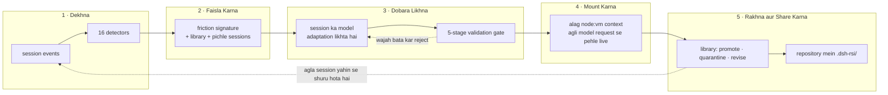

<div align="center">

[English](../../README.md) · [简体中文](README_zh.md) · [繁體中文](README_zh-TW.md) · [日本語](README_ja.md) · [한국어](README_ko.md) · [Türkçe](README_tr.md) · [Русский](README_ru.md) · [Tiếng Việt](README_vi.md) · [ไทย](README_th.md) · [Deutsch](README_de.md) · [Español](README_es.md) · [Français](README_fr.md) · [Українська](README_uk.md) · [Polski](README_pl.md) · [Português (Brasil)](README_pt-BR.md) · [العربية](README_ar.md) · [فارسی](README_fa.md) · [Bahasa Indonesia](README_id.md) · [Italiano](README_it.md) · [Ελληνικά](README_el.md) · [മലയാളം](README_ml.md) · **Roman Urdu** · [Română](README_ro.md)

<br />


# DSHRSI: DeepSeek Harness ke liye Recursive Self-Improvement

### **Dekhna → Behtar Banana → Usi par Aage Banana → Phir Se. Ek harness jo har baar pehle se zyada aap ka apna banta jata hai.**

<a href="https://qybaihe.github.io/dshrsi/trace.html">
  <picture>
    <source media="(prefers-color-scheme: dark)" srcset="../../assets/rsi-trace.dark.gif" />
    
  </picture>
</a>

**RSI ka matlab hai Recursive Self-Improvement, yani khud ko baar baar behtar banana, aur DSHRSI woh open-source plugin hai jo DeepSeek Harness ke liye ise haqeeqat banata hai. Harness apne hi runs par nazar rakhta hai, jo masla use milta hai us ke liye usi session ke model se harness code likhwata hai, us code ko 5-stage gate mein parakhta hai, aur turn khatam hone se pehle use mount kar deta hai. Phir behtar hua harness agla session chalata hai, aur dobara behtar hota hai. Koi fine-tuning nahin. Prompts ka koi dher nahin. Code, jise naapa jata hai, aur phir rakha jata hai, dobara likha jata hai ya phenk diya jata hai.**

[](#rsi)
[](https://github.com/deepseek-ai/deepseek-harness)
[](#coverage)
[](#how-it-works)
[](#project-harness)
[](#benchmarks)
[](#contributing)
[](../../LICENSE)

**[🌐 Website](https://qybaihe.github.io/dshrsi/) · [📖 Plugin Reference](../../packages/dsh-rsi/README.md) · [🧩 Project Harness](../../packages/dsh-rsi/README.md#layers-and-the-project-harness) · [🔬 Validation Gate](../../packages/dsh-rsi/README.md#the-validation-gate) · [⚠️ Maloom Limits](../../packages/dsh-rsi/README.md#known-limits) · [🐛 Issues](https://github.com/qybaihe/dshrsi/issues)**

[RSI ka Matlab](#rsi) · [Quick Start](#quick-start) · [Yeh Kaise Kaam Karta Hai](#how-it-works) · [Naape Hue Results](#measured) · [Benchmarks](#benchmarks) · [Detectors aur Capabilities](#coverage) · [Project Harness](#project-harness) · [Safety ke Defaults](#security) · [FAQ](#faq)

</div>

---

> [!IMPORTANT]
> **Developer Preview:** DSHRSI DeepSeek Harness `0.2.2-rc.3` ke mutabiq banaya gaya hai, jo khud bhi ek developer preview hai. **Aage chal kar aisi tabdeeliyan aayengi jo compatibility tor dengi.**
> Adaptation woh code hai jo ek model likhta hai aur jo aap ke harness ke andar chalta hai. Is ki isolation ghaltiyon se bachati hai, **malicious code se nahin**. Ise chalane se pehle [validation gate](../../packages/dsh-rsi/README.md#the-validation-gate) ke bare mein parh lein.

<div align="center">

</div>

<br />

<table>
<tr>
<td width="33%" valign="top">

### 🔴 DSHRSI ke Baghair
Har session wahi facts naye sire se dhoondta hai: is machine par `python` nahin hai, is repository ka ek rule hai jo aap pehle hi bata chuke hain, is fix ko kabhi verify hi nahin kiya gaya. Control run mein **5 mein se 5 sessions** ne wahi fail hone wali call ki, aur user ka bataya hua ek rule ek hi session baad phir tor diya gaya.

</td>
<td width="33%" valign="top">

### 🧬 DSHRSI ke Saath
Jab masla dobara aata hai to model harness code ka ek tukra likhta hai, woh gate pass karta hai, aur **usi turn mein** live ho jata hai. Asli model ke saath 3 runs mein, adaptation ke baad ke **7 mein se 7 sessions** mein ek bhi fail hone wali call nahin thi. Aur agli behtari wahin se shuru hoti hai.

</td>
<td width="33%" valign="top">

### 🔒 Tighten-Only, Design Hi Aisa Hai
Adaptation maloomat shamil kar sakti hai, kisi call se inkaar kar sakti hai, pehle aap se pooch sakti hai, ya verification ka mutalba kar sakti hai. **Koi bhi capability us cheez ki ijazat nahin de sakti jis se harness inkaar kar deta.** Results dobara likhna, tools shamil karna aur commands chalana aap ki approval ka intezar karte hain.

</td>
</tr>
</table>

---

<a id="rsi"></a>

## 🔁 RSI = Recursive Self-Improvement

"Rewrite itself" nahin. **Recursive Self-Improvement**: ek system apni hi salahiyaton se khud ko behtar banata hai, aur behtar hua system agla round chalata hai. Teen lafz hain, aur DSHRSI ko har ek par poora utarna parta hai:

| | Kya Chahiye | DSHRSI Yeh Kaise Karta Hai |
| :--- | :--- | :--- |
| **Self** (khud) | Jo kaam karta hai aur jo badla jata hai, dono ek hi system hain | Harness hi harness ko badalta hai. Adaptation usi session ka model likhta hai jise masla pesh aaya tha. Bahar se koi ise tune nahin karta |
| **Improvement** (behtari) | "Behtar" aisa ho jise check kiya ja sake | Har adaptation mount hone se pehle 5-stage gate se guzarti hai, aur baad ke sessions bhi use parakhte hain: jo kaam karti hai woh promote hoti hai, jo throw karti hai woh quarantine hoti hai |
| **Recursive** (baar baar) | Ek round ka output agle round ki shuruaat hai | Agla session behtar hue harness par chalta hai aur usi ke saath dekha jata hai. Jo adaptation masla rok na saki, use saboot ki buniyad par aur sakht kar ke dobara likha jata hai. Jis ki zaroorat doosri workspace mein bhi pare, woh poori machine tak phail jati hai, aur project ke rules har teammate ke harness tak pohanchte hain |

**Chaar loops, har ek agle ke andar:** ek turn ke andar → ek session se doosre session tak → behtari khud behtar hoti hai → project se machine aur phir team tak.

Jo cheez jaan boojh kar recursive **nahin** rakhi gayi: model ke weights kabhi nahin badalte, aur detectors, trigger policy aur validation gate fixed code hain jinhein koi adaptation chhu nahin sakti. Jo hissa khud ko badalta hai, use woh hissa check karta hai jise woh badal nahin sakta.

---

<a id="quick-start"></a>

## ⚡ 30 Second ka Quick Start

### 1. Wahin Install Karein Jahan Aap Pehle se Kaam Karte Hain
DeepSeek Harness ki desktop app ya Web UI mein **Plugins → Add plugin → Install a third-party plugin** kholein, release package paste karein, **Install** select karein, phir **Enable now**:

```text
https://github.com/qybaihe/dshrsi/releases/download/v0.1.2/dsh-rsi-0.1.2.tgz
```

Ya phir command line se. Har profile ke apne alag plugins hote hain, aur `dsh plugin add` jis `pnpm` ko call karta hai, us ka `PATH` par hona zaroori hai:

```bash
dsh plugin --profile web add https://github.com/qybaihe/dshrsi/releases/download/v0.1.2/dsh-rsi-0.1.2.tgz
dsh web
```

### 2. Bas Kaam Karte Rahein
Configure karne ke liye kuch nahin hai. Jab tak wahi masla dobara na aaye, DSHRSI nazar se ojhal rehta hai. Phir **RSI** badge roshan ho jata hai, composer ke neeche wali pill batati hai ke harness ne abhi abhi khud ko badla hai, aur agla session pehle se behtar ho kar shuru hota hai:

<div align="center">

</div>

Kisi bhi session mein `/rsi` type karein aur dekhein ke kya kya mount hai, kis layer ka hai, aur kya aap ki approval ka intezar kar raha hai.

### 3. Repository ko Us ka Apna Harness Dein
Kisi repository mein seekhe gaye rules usi repository mein reh sakte hain, har adaptation ki ek file:

```bash
# Yeh command plugin ke saath aati hai, usi profile ke andar jis mein plugin install hua tha
alias dsh-rsi="$HOME/.dsh/profiles/web/node_modules/.bin/dsh-rsi"

dsh-rsi project init      # repository ke andar: .dsh-rsi/ banata hai, phir use commit karein
dsh-rsi trust             # har doosri machine par: files parhne ke baad unhein accept karein
```

### 4. Source se Chalayein

```bash
git clone https://github.com/qybaihe/dshrsi.git && cd dshrsi
npm install               # ek pinned dsh aur woh pnpm lata hai jise dsh call karta hai
npx dsh plugin --profile web add "$PWD/packages/dsh-rsi"
npx dsh web
```

`desktop` aur `headless` profiles, plugin indexes, local tarballs aur sirf ek run ke liye load karna, yeh sab [plugin reference](../../packages/dsh-rsi/README.md#install) mein bayan kiya gaya hai.

---

<a id="how-it-works"></a>

## 🧠 DSHRSI Kaise Kaam Karta Hai: Harness ke Andar Ek Closed Loop, jo Baar Baar Chalta Hai

<div align="center">
<picture>
  <source media="(prefers-color-scheme: dark)" srcset="../../assets/pit-stop.dark.svg" />
  
</picture>
</div>

Skills, memory files aur lambe system prompts sab context ke level par kaam karte hain: yeh text barhate hain aur umeed rakhte hain ke model us par amal karega. Jab woh amal nahin karta to agle session mein wahi fail hone wali call phir se ki jati hai.

**DSHRSI harness ke level par kaam karta hai. Jo kuch yeh seekhta hai woh harness ke apne extension points par code ban jata hai:**



| Stage | Mechanism | Asar |
| :--- | :--- | :--- |
| **1. Dekhna** | 16 detectors normalized session events parhte hain: dobara fail hone wali calls, fail hone ki baar baar laut aane wali wajah, andha dhund koshishein, user ki corrections, aur woh turns jo kuch bhi verify hue baghair khatam ho jati hain. | Masle ko ek aisa signature milta hai jo har session mein ek jaisa rehta hai, jaise `bash:command-not-found:python`. |
| **2. Dobara Likhna** | Session ka apna model 10 capabilities wali API ke mutabiq JavaScript mein ek adaptation likhta hai. Reject hua code wajah ke saath wapas jata hai, zyada se zyada do baar, phir ek built-in template kaam sambhal leta hai. | Fix harness ka code hota hai, prompt ka ek aur paragraph nahin. |
| **3. Validate Karna** | Static → load → replay → regression → permission. Adaptation ko un calls par asar dikhana hota hai jinhon ne use trigger kiya, aur is session mein kamyab hone wali har call ko waise hi chhor dena hota hai. | Jo code kuch nahin karta, ya jo pehle se chalti hui cheez tor deta hai, woh kabhi mount nahin hota. |
| **4. Mount Karna** | Adaptation ek JSON bridge ke peeche apne alag `node:vm` context mein chalti hai, har call par timeout hota hai, aur agli model request se pehle hi asar dikhane lagti hai. | Jis turn ko masla pesh aaya, sab se pehle faida bhi usi ko hota hai. |
| **5. Rakhna aur Share Karna** | Har machine ki apni library, ledger aur audit log ke saath. Jo kaam karti hai woh promote hoti hai, jo throw karti hai woh quarantine hoti hai, jo masla rok na saki use aur sakht kar ke dobara likha jata hai, aur project ke rules `.dsh-rsi/` mein likhe jate hain. | Agla session pehle se adapt ho kar shuru hota hai, aur teammates ko `dsh-rsi trust` ke baad project ke rules mil jate hain. |
| **↻ Phir Se** | Agla session us harness par chalta hai jo stage 5 chhor gaya tha, aur stage 1 use tamam adaptations samet dekhta hai. | Behtari par behtari banti hai. Yahi recursion hai. |

---

<a id="measured"></a>

## 🔬 Asli Model par Naapa Gaya

Yeh numbers ek asli model, `mimo-v2.6-pro`, ko asli `dsh` sessions mein chala kar aaye hain (`npm run test:live`). Is table mein kuch bhi simulated nahin hai.

> **Ise kaise parhein:** sample chhota hai. Ek model, teen scenarios, aur har ek mein ginti ke chand sessions. Is se yeh pata chalta hai ke loop shuru se aakhir tak kaam karta hai. Yeh success rates ke bare mein koi statistical dawa **nahin** hai, aur kuch bhi tez nahin hua: adaptation likhne mein model ka 30–60 seconds intezar karna parta hai. Bare runs [Benchmarks](#benchmarks) mein hain.

| Scenario | DSHRSI ke Baghair | DSHRSI ke Saath | Harness ne Kya Likha |
| :--- | :--- | :--- | :--- |
| **Command na milna**: README mein `python stats.py` likha hai, machine par sirf `python3` hai | ❌ **5 / 5** sessions ne fail hone wali call ki | ✅ adaptation ke baad **0 / 7** sessions ne (us se pehle 9 / 9 ne) | `deny` + `prompt`, model ne likha, pehli hi koshish mein gate pass kiya |
| **Woh rule jo user ne ek hi baar bataya**: "`notes.txt` ko kabhi modify na karna, `notes.draft.txt` mein likhna" | ❌ Agle session ne `notes.txt` edit kar di | ✅ Agle session ne kahe baghair `notes.draft.txt` mein likha | `deny` + `prompt`, model ne correction ke foran baad likha |
| **Woh fix jise verify karne ko kisi ne nahin kaha** | nahin chalaya gaya | ⚪ Kuch nahin likha gaya: model ne 3 / 3 sessions mein apna fix verify kiya, is liye seekhne ko kuch tha hi nahin | kuch nahin |

Pehla scenario plugin ke saath teen baar chalaya gaya, har baar khali library se, aur is ke ilawa ek control run hua. Doosra scenario ek baar plugin ke saath aur ek baar us ke baghair chalaya gaya.

**Command na milna, ek ek session kar ke** (har session mein fail hone wali tool calls):

| Run | S1 | S2 | S3 | S4 | S5 | S6 |
| :--- | :---: | :---: | :---: | :---: | :---: | :---: |
| **DSHRSI ke baghair** | ❌ 1 | ❌ 1 | ❌ 1 | ❌ 1 | ❌ 1 | |
| **DSHRSI ke saath · run 1** | ❌ 1 | ❌ 1 | ❌ 1 → 🧬 | ✅ 0 | ✅ 0 | ✅ 0 |
| **DSHRSI ke saath · run 2** | ❌ 1 | ❌ 1 | ❌ 1 → 🧬 | ✅ 0 | ✅ 0 | |
| **DSHRSI ke saath · run 3** | ❌ 1 | ❌ 1 | ❌ 1 → 🧬 | ✅ 0 | ✅ 0 | |

🧬 us turn ka nishan hai jis mein model ne adaptation likhi aur harness ne use mount kiya. Us ke baad ke 7 mein se 3 sessions mein model ne phir bhi `python` chalane ki koshish ki, aur harness ne call ke chalne se pehle hi us se inkaar kar diya. Is scenario ka har session sahi jawab par khatam hua, plugin ho ya na ho.

Locally reproduce karein:

```bash
MIMO_API_KEY=... npm run test:live -- python --sessions 6          # plugin ke saath
MIMO_API_KEY=... npm run test:live -- python --sessions 5 --off    # control run, plugin ke baghair
```

<details>
<summary><strong>Jo is machine par verify nahin hua (kholne ke liye click karein)</strong></summary>

<br />

Yeh paths code mein maujood hain aur simulated model wale unit ya end-to-end tests inhein cover karte hain, lekin inhein kisi asli session ya asli app mein chalte hue nahin dekha gaya:

| Hissa | Yahan Verify Kyun Nahin Hua |
| :--- | :--- |
| DeepSeek Harness ki desktop app | Development machine par install nahin hai. Verification `web` profile aur us installation mechanism par hui jinhein app wrap karti hai |
| `negative-feedback`, `approval-denied`, `context-pressure`, `model-instability` | Sirf khud banaye gaye events se test hue, asli session mein kabhi trigger nahin hue |
| Automated browser tests | Koi nahin. UI ko asli `dsh web` page mein haath se chala kar dekha gaya, light aur dark dono mode mein |
| ACP aur SDK profiles | Wahan koi UI nahin, aur verify bhi nahin hue |
| MiMo v2.6 family se bahar ke models | Abhi tak koi run nahin. Benchmarks mein `mimo-v2.6-pro` aur `mimo-v2.6-flash` istemal hue; upar ke teen scenarios mein `mimo-v2.6-pro` |

</details>

---

<a id="benchmarks"></a>

## 📊 Benchmarks: Chaar Suites, Do Models, Ek Ek Task Kar ke

Stock DeepSeek Harness banam DeepSeek Harness + DSHRSI, 3,390 asli `dsh` sessions mein: wahi model, wahi prompts, wahi sandbox, wahi tasks. Plugin apni default settings par chalta hai aur har suite khali library se shuru karta hai. Jo teen suites aakhir tak chale, un par solve hone wale tasks:

<!-- bench:table:start -->
| Benchmark | Tasks | `mimo-v2.6-pro` Stock | `mimo-v2.6-pro` + DSHRSI | `mimo-v2.6-flash` Stock | `mimo-v2.6-flash` + DSHRSI |
| :--- | ---: | ---: | ---: | ---: | ---: |
| **Aider Polyglot**, pehli koshish mein | 225 | 224 (99.6%) | 224 (99.6%) | 220 (97.8%) | 223 (99.1%) |
| **Aider Polyglot**, do koshishon ke andar | 225 | 225 (100.0%) | 225 (100.0%) | 225 (100.0%) | 225 (100.0%) |
| **HumanEval** | 164 | 163 (99.4%) | 162 (98.8%) | 162 (98.8%) | 162 (98.8%) |
| **HumanEval+** | 164 | 156 (95.1%) | 157 (95.7%) | 153 (93.3%) | 153 (93.3%) |
| **MBPP** | 378 | 374 (98.9%) | 371 (98.1%) | 368 (97.4%) | 369 (97.6%) |
| **MBPP+** | 378 | 320 (84.7%) | 319 (84.4%) | 308 (81.5%) | 315 (83.3%) |
<!-- bench:table:end -->

<div align="center">
<picture>
  <source media="(prefers-color-scheme: dark)" srcset="../../assets/bench-flash.dark.png" />
  
</picture>
</div>

> **Ise kaise parhein:** solve hone wale tasks ke lihaz se dono harnesses mein **farq nahin kiya ja sakta**. Sab se bara izafa +7 hai (MBPP+, `mimo-v2.6-flash` ke saath), sab se bari kami −3 hai (MBPP, `mimo-v2.6-pro` ke saath), aur unhi tasks par exact McNemar test mein koi bhi farq tik nahin pata (sab se chhota p = 0.17). Jab agent apna code khud chala sakta hai to yeh suites dono models ke liye apni ceiling ke qareeb hote hain, aur har task ek nayi, saaf directory hota hai: harness ke seekhne ke liye bohat kam cheezein dobara saamne aati hain.

**DSHRSI ne jo kaam waqai kiya, woh yeh tha ke ek bhi hint ke baghair khud ko badla.** Aath runs mein models ne **56 adaptations** likhin; in mein se 15 harkat mein aayin, aur un mein se 10 poori machine tak phailai ja chuki thin. In 10 mein se har ek ke liye hum ne woh tasks liye jo us ke baad shuru hue aur un ka muqabla stock DSH ke tehat bilkul unhi tasks se kiya:

| Model ki Likhi Hui Adaptation | Yeh Kis Failure ka Jawab Hai | Stock DSH | DSH + DSHRSI | p |
| :--- | :--- | ---: | ---: | ---: |
| *Stop inline python checks that abort on first mismatch* (MBPP, `mimo-v2.6-pro`) | Aisa test run jo pehli hi fail hone wali assertion par khatam ho jata hai | 310 mein se 16 tasks | **310 mein se 3** | 0.002 |
| *Redirect missing lib.rs reads to a glob lookup* (Polyglot, `mimo-v2.6-flash`) | `lib.rs` ko aise path se parhna jo maujood hi nahin | 151 mein se 7 tasks | **151 mein se 1** | 0.07 |
| Baqi 8 | | koi naapne laiq tabdeeli nahin | | |

In dono mein se kisi ne bhi zyada tasks pass nahin karwaye, aur plugin ki wajah se agent time aur input tokens taqreeban 8–9% zyada lage. Yeh dason [`bench/README.md`](../../bench/README.md#did-those-adaptations-work) mein darj hain.

**LiveCodeBench v6 beech mein hi ruk gaya:** model account ka balance raaste mein khatam ho gaya. Jo tasks us waqt tak dono taraf mukammal ho chuke the, un mein `mimo-v2.6-pro` ke saath 105 mein se stock DSH ne 94 aur DSHRSI ne 96 solve kiye, aur `mimo-v2.6-flash` ke saath 51 mein se 42 banam 42. Isi wajah se doosra pass, yani wahi tasks dobara us library par jo pehla pass chhor gaya tha, abhi tak nahin chalaya gaya.

Locally reproduce karein:

```bash
bench/setup.sh                                                        # toolchains, datasets, scoring ka code
MIMO_API_KEY=... node bench/run.mjs polyglot --arm dsh --run dsh-p1   # stock DeepSeek Harness
MIMO_API_KEY=... node bench/run.mjs polyglot --arm rsi --run rsi-p1   # plugin ke saath
node bench/report.mjs --write                                         # tables aur bench/results/*.json
```

Protocol, cost aur failure ke tables aur limits [`bench/README.md`](../../bench/README.md) mein hain; har task ke results [`bench/results/`](../../bench/results) mein hain.

---

<a id="coverage"></a>

## 🛡️ Detectors aur Capabilities

**16 detectors** tay karte hain ke harness ko kab badalna chahiye. Yahi detectors live session par bhi chalte hain aur disk par mehfooz session par bhi (`dsh-rsi mine`):

| Detector | Yeh Kya Pakarta Hai | Response |
| :--- | :--- | :---: |
| `repeat-failing-call` | Wahi call unhi arguments ke saath dobara fail hoti hai | adapt hota hai |
| `failure-signature` | Fail hone ki wahi wajah baar baar laut aati hai: command na milna, dependency na milna, network, permission, port ka pehle se istemal mein hona, path na milna, edit mismatch, ghalat arguments, memory khatam ho jana | adapt hota hai |
| `command-flailing` | Ek hi qisam ki command badalte arguments ke saath lagataar fail hoti hai | adapt hota hai |
| `read-thrash` | Wahi file, jo badli hi nahin, baar baar parhi jati hai | adapt hota hai |
| `edit-churn` | Ek hi turn mein wahi file kai baar edit hoti hai | adapt hota hai |
| `error-storm` | Haal ki zyada tar tool calls fail huin | adapt hota hai |
| `stall` | Lagataar failures, beech mein ek bhi kamyabi nahin | adapt hota hai |
| `timeout-recurrence` | Ek hi qisam ki command baar baar timeout hoti hai | adapt hota hai |
| `output-flood` | Ek hi qisam ki command baar baar had se zyada bara output deti hai | adapt hota hai |
| `approval-denied` / `denied-repeat` | User ek hi qisam ke action ko baar baar deny karta hai, ya deny ki hui call kisi tabdeeli ke baghair dobara try ki jati hai | adapt hota hai |
| `user-correction` | User ne model ko correct kiya, ya beech mein rok kar rukh badal diya | adapt hota hai |
| `premature-completion` | Code badla gaya aur turn koi check chalaye baghair khatam hone wali hai | adapt hota hai |
| `negative-feedback` | User ne kisi reply ko bura mark kiya aur wajah likhi | adapt hota hai |
| `user-interrupt` | User ne turn ke beech mein interrupt kiya | record hota hai |
| `model-instability` | Model requests baar baar fail hoti hain, retry hoti hain, ya output limit se takrati hain | record hota hai |
| `context-pressure` | Task ke beech mein context compact kiya gaya | record hota hai |

**10 capabilities** hi woh sab kuch hain jo ek adaptation kar sakti hai. Harness tak us ki pohanch sirf inhi ke zariye hai:

| Capability | Yeh Kya Karti Hai | Tier |
| :--- | :--- | :---: |
| `annotate` | Tool result ke aakhir mein ek note jorti hai | ✅ automatic |
| `steer` | Agli model request se pehle ek note shamil karti hai | ✅ automatic |
| `deny` | Tool call se inkaar karti hai aur wajah batati hai | ✅ automatic |
| `ask` | Call ke liye user ki approval lazmi karti hai | ✅ automatic |
| `block` | Tool result ko aise error mein badal deti hai jis ke saath correction hoti hai | ✅ automatic |
| `verify` | Jab tak koi shart poori na ho, turn ko khatam nahin hone deti | ✅ automatic |
| `prompt` | System prompt mein ek mustaqil section shamil karti hai | ✅ automatic |
| `rewrite` | Tool result ka text badal deti hai | 🔐 approval chahiye |
| `tool` | Model ke liye ek naya tool register karti hai | 🔐 approval chahiye |
| `exec` | Harness ke shell tool ke zariye command chalati hai, usi sandbox aur approval ke unhi rules ke tehat | 🔐 approval chahiye |

Yeh woh adaptation hai jo model ne upar wale pehle scenario mein likhi:

```js
define({
  title: 'Route python invocations to python3',
  description: '...',
  capabilities: ['deny', 'prompt'],
  setup(h) {
    h.promptSection('On this machine there is no `python` executable; use `python3`.')
    h.beforeTool({ tool: 'bash', command: /(^|[;&|(]\s*)python(\s|$)/ },
      () => h.deny('`python` is not installed on this machine. Use `python3` instead.'))
  },
})
```

---

<a id="project-harness"></a>

## 🧩 Teen Layers, aur Har Project ka Apna Harness

Har adaptation teen layers mein se kisi ek ki hoti hai. Har layer ko alag se band kiya ja sakta hai:

| Layer | Is mein Kya Hota Hai | Misaal | Kahan Lagu Hoti Hai |
| :--- | :--- | :--- | :--- |
| **`machine`** | Is computer ke bare mein facts | `python` nahin hai; koi port pehle se istemal mein hai; koi internal host resolve nahin hota | Woh workspace jahan yeh seekhi gayi, phir jaise hi doosri workspace mein bhi yahi masla aaye, poori machine |
| **`user`** | Aap apne saath kaisa bartao chahte hain | Ek reply jise "bohat lamba" ki wajah ke saath bura mark kiya gaya | Poori machine |
| **`project`** | Ek repository ke rules aur aadatein | "Is repository mein pnpm chalta hai, hamesha" | Workspace, aur `.dsh-rsi/` ke zariye khud repository |

**Project layer code ke saath saath chalti hai:**

```
.dsh-rsi/
  harness.json           format marker aur project-level settings
  adaptations/
    remember-the-user-s-instruction-3f2a1c.js     seekhi gayi, phir yahan likhi gayi
    no-force-push.js                              haath se likhi hui bhi isi tarah kaam karti hai
```

- **Share karne ke liye commit karein, hatane ke liye delete karein.** Ek file ek adaptation hai.
- **Sirf clone hone se kuch nahin chalta.** Har machine `dsh-rsi trust` ke zariye files ka bilkul wahi content accept karti hai, aur jab files badlein to unhein dobara accept karti hai.
- **Project harness ko sirf zyada mohtaat bana sakta hai**, kam kabhi nahin. `autonomy` jaisi settings project ki pohanch se bahar hain.
- **Repository se bahar bhi portable.** `dsh-rsi export` aur `dsh-rsi import` machine aur user layers ko ek file ki shakal mein doosre computer tak le jate hain.

---

<a id="security"></a>

## 🔒 Safety aur Configuration ke Defaults

- **Automatic Tier Sirf Tighten Karta Hai** — Aap ki approval ke baghair adaptation sirf maloomat shamil kar sakti hai, inkaar kar sakti hai, pooch sakti hai, ya verification ka mutalba kar sakti hai. Is ke `deny` aur `ask` doosri policies ke faisle ko sirf aur sakht hi kar sakte hain.
- **Taqat ke liye Approval (`autonomy: tighten`)** — Jo adaptations results dobara likhti hain, tools shamil karti hain ya commands chalati hain, woh `proposed` ke taur par mehfooz hoti hain aur `dsh-rsi approve <id>` ka intezar karti hain.
- **Zaroorat se Pehle Nazar Nahin Aata** — Jab koi friction na ho aur kuch mount na ho, to system prompt, tool list aur messages byte ba byte waise ke waise rehte hain. Ek end-to-end test is ki nigrani karta hai.
- **Failures Wahin Ruk Jate Hain** — Jo handler throw kare woh us tool call par kabhi asar nahin dalta jis se woh jura hota hai. Teen errors ke baad adaptation quarantine ho jati hai.
- **Har Cheez Record Par** — Har faisla `audit.jsonl` mein hai, aur har friction, mount aur action `ledger.jsonl` mein. `dsh-rsi disable`, `retire` aur `rollback` kisi adaptation ko hata dete hain ya peeche le jate hain.
- **Teen Modes** — `adapt` seedha mount karta hai (yahi default hai), `propose` generate kar ke aap ka intezar karta hai, `observe` sirf record karta hai.

---

<a id="faq"></a>

## ❓ FAQ

<details>
<summary><strong>Kya DSHRSI model ko fine-tune karta hai ya badalta hai?</strong></summary>

Nahin. Model ke weights ko haath nahin lagaya jata aur kuch bhi train nahin hota. Jo badalta hai woh harness hai: woh code jo model ke prompts aur tool calls ke ird gird chalta hai. Yahan RSI ka matlab harness ke level par Recursive Self-Improvement hai: yeh apne hi runs se khud ko behtar banata hai, aur har round us harness se shuru hota hai jo pichla round chhor gaya tha.
</details>

<details>
<summary><strong>Kya yeh waqai "recursive" hai, ya bas ek harness jo rules seekh leta hai?</strong></summary>

Recursion thos hai aur code ke andar hai. Naya session woh sab kuch mount karta hai jo library mein hai, is liye detectors ek aise harness ko dekhte hain jo pehle hi badal chuka hai. Jab wahi masla un sessions mein do baar pesh aaye jin mein adaptation mount thi, to model ko maujooda source aur saboot milte hain aur woh ek zyada sakht version likhta hai; purana version rollback ke liye rakh liya jata hai. Doosri workspace mein pesh aane wala masla adaptation ko poori machine tak phaila deta hai. Jo cheez recurse nahin karti woh judge hai: detectors, trigger policy aur validation gate ko koi adaptation nahin badal sakti.
</details>

<details>
<summary><strong>Yeh skills, memory files ya lambe system prompt se kaise mukhtalif hai?</strong></summary>

Woh sab text barhate hain jis par model amal kare ya na kare. Adaptation harness ke extension points par laga hua code hai: yeh kisi tool call se us ke chalne se pehle inkaar kar sakti hai, aap ki approval lazmi kar sakti hai, ya turn ko us waqt tak khatam hone se rok sakti hai jab tak kuch verify na hua ho. Naape gaye runs mein, mana kiye jane ke baad bhi model ne 3 sessions mein `python` chalane ki koshish ki, aur call se us ke chalne se pehle hi inkaar kar diya gaya.
</details>

<details>
<summary><strong>Kya yeh mere sessions ko slow karta hai?</strong></summary>

Adaptation likhne mein model ke ek poore response ka intezar karna parta hai: `mimo-v2.6-pro` par 30–60 seconds, aur is dauran woh step ruka rehta hai. Mount shuda adaptations timeouts ke saath in-process chalti hain. Koi speedup naapa nahin gaya aur na hi is ka koi dawa hai.
</details>

<details>
<summary><strong>Kya model ki likhi hui adaptation koi khatarnak kaam kar sakti hai?</strong></summary>

Automatic tier aisi kisi cheez ki ijazat nahin de sakta jis se harness inkaar kar deta, aur taqatwar capabilities aap ki approval ka intezar karti hain. Code ek JSON bridge ke peeche apne alag `node:vm` context mein chalta hai. Yeh ghaltiyon aur be-dhyani mein hone wale ghalat istemal se bachata hai. Yeh malicious code ke khilaf security boundary **nahin** hai, is liye `dsh-rsi trust` chalane se pehle project ki `.dsh-rsi/` files parh lein.
</details>

<details>
<summary><strong>Yeh kin models ke saath kaam karta hai?</strong></summary>

Adaptations session ka maujooda model likhta hai, ya woh model jo aap `provider` aur `model` se set karein. Agar model aisa code na likh sake jo gate pass kare to built-in templates kaam sambhal lete hain. Ab tak ke runs mein ek hi family ke do models istemal hue, `mimo-v2.6-pro` aur `mimo-v2.6-flash`.
</details>

<details>
<summary><strong>Kya yeh DeepSeek Harness ki desktop app mein kaam karta hai?</strong></summary>

Yeh ek aam third-party plugin ke taur par aata hai, us metadata ke saath jo plugin pages parhte hain, aur us `web` profile mein install hota hai jise app wrap karti hai. Asli desktop app ke andar ise abhi tak verify nahin kiya gaya.
</details>

<details>
<summary><strong>Jo kuch is ne seekha use kaise dekhun, undo karun ya band karun?</strong></summary>

Session mein `/rsi`, ya terminal mein `dsh-rsi status`. `dsh-rsi show <id>` adaptation ka source aur validation report print karta hai; `disable`, `retire` aur `rollback` use hata dete hain ya peeche le jate hain. Kuch bhi badle baghair sirf record karne ke liye `mode: observe` set karein.
</details>

---

<a id="docs"></a>

## 📚 Documentation aur Links

- [📖 Plugin Reference](../../packages/dsh-rsi/README.md) — har detector, capability, command aur setting
- [🚀 Installation ke Sources aur Profiles](../../packages/dsh-rsi/README.md#install)
- [🧩 Layers aur Project Harness](../../packages/dsh-rsi/README.md#layers-and-the-project-harness)
- [🔬 Validation Gate](../../packages/dsh-rsi/README.md#the-validation-gate)
- [🛠️ `dsh-rsi` ki Command Line](../../packages/dsh-rsi/README.md#command-line) · [⚙️ Configuration](../../packages/dsh-rsi/README.md#configuration)
- [⚠️ Maloom Limits](../../packages/dsh-rsi/README.md#known-limits)
- [📊 Benchmark ka Protocol aur Results](../../bench/README.md)
- [🌐 Website ka source](../../website) — recursive self-improvement, yeh kaise kaam karta hai, adaptations likhna, evaluation; `website/index.html` ko browser mein kholein
- [🧱 DeepSeek Harness](https://github.com/deepseek-ai/deepseek-harness) — woh harness jis mein yeh plug hota hai

<a id="contributing"></a>

## 🤝 Contributing aur Community

Issues aur PRs ka [qybaihe/dshrsi](https://github.com/qybaihe/dshrsi) par khair maqdam hai. PR submit karne se pehle:

```bash
npm install && npm test    # 130 unit tests, phir 29 end-to-end tests; koi key nahin chahiye
```

End-to-end tests model endpoint ki jagah ek simulated endpoint laga dete hain. Baqi sab kuch asli hai: `dsh` process, tool execution, session log aur plugin installation.

```
packages/dsh-rsi/        plugin bundle (plain ESM, koi build step nahin)
  index.js               host wala hissa: DSH ke extension points se bindings
  client.js              browser wala hissa: RSI badge aur status pill
  src/engine.js          dekhna → faisla → generate → validate → mount → rakhna → share
  src/signals.js         16 detectors
  src/validate.js        validation gate
  src/sandbox.js         jahan adaptation ka code chalta hai
  src/project.js         project harness: <repository>/.dsh-rsi
  bin/rsi.js             dsh-rsi command
market/index.json        plugin index jo DSH mein add kiya ja sakta hai
test/unit/  test/e2e/    unit tests, aur asli dsh process par end-to-end tests
test/live/               asli model ke saath runs (MIMO_API_KEY chahiye)
bench/                   benchmarks: stock DSH banam DSH + dsh-rsi
website/                 website (static pages, koi build step nahin)
```

## 📄 License

[MIT](../../LICENSE)

---

Created in [T3 Code](https://t3.codes).
