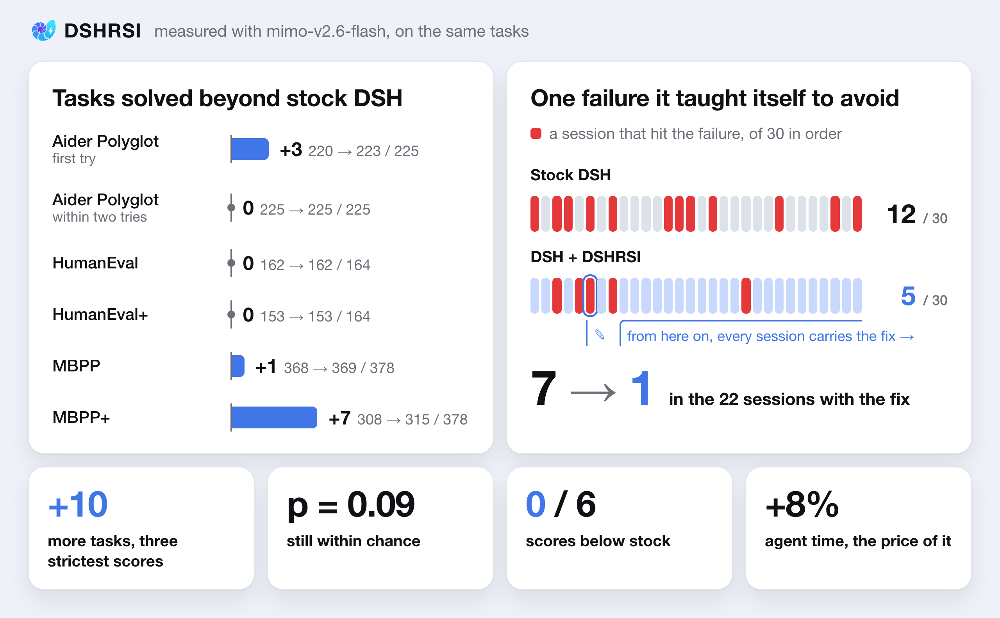

<div align="center">

[English](../../README.md) · [简体中文](README_zh.md) · **繁體中文** · [日本語](README_ja.md) · [한국어](README_ko.md) · [Türkçe](README_tr.md) · [Русский](README_ru.md) · [Tiếng Việt](README_vi.md) · [ไทย](README_th.md) · [Deutsch](README_de.md) · [Español](README_es.md) · [Français](README_fr.md) · [Українська](README_uk.md) · [Polski](README_pl.md) · [Português (Brasil)](README_pt-BR.md) · [العربية](README_ar.md) · [فارسی](README_fa.md) · [Bahasa Indonesia](README_id.md) · [Italiano](README_it.md) · [Ελληνικά](README_el.md) · [മലയാളം](README_ml.md) · [Roman Urdu](README_ur-Latn.md) · [Română](README_ro.md)

<br />


# DSHRSI：DeepSeek Harness 的 Recursive Self-Improvement（遞迴自我改進）

### **觀察 → 改進 → 在改進之上再往上蓋 → 再來一輪。一套越用越懂你的 Harness。**

<a href="https://qybaihe.github.io/dshrsi/trace.html">
  <picture>
    <source media="(prefers-color-scheme: dark)" srcset="../../assets/rsi-trace.dark.gif" />
    
  </picture>
</a>

**RSI 就是 Recursive Self-Improvement，遞迴自我改進；DSHRSI 則是讓它在 DeepSeek Harness 上成真的開源外掛。Harness 盯著自己的每一次執行，讓工作階段自己的模型針對發現的麻煩寫出 Harness 程式碼，用 5 道關卡證明這段程式碼站得住腳，並在這個回合結束前把它掛載上去。接著，改進過的 Harness 去跑下一個工作階段，然後再改進一次。不微調模型，不堆提示詞。只有程式碼：經過量測，然後留下、改寫或丟掉。**

[](#rsi)
[](https://github.com/deepseek-ai/deepseek-harness)
[](#how-it-works)
[](#benchmarks)
[](../../LICENSE)

**[🌐 官網](https://qybaihe.github.io/dshrsi/) · [📖 外掛參考文件](../../packages/dsh-rsi/README.md) · [🐛 Issues](https://github.com/qybaihe/dshrsi/issues)**

[RSI 是什麼](#rsi) · [快速上手](#quick-start) · [運作原理](#how-it-works) · [實測結果](#measured) · [基準測試](#benchmarks) · [偵測器與能力](#coverage) · [專案 Harness](#project-harness) · [安全預設值](#security) · [常見問題](#faq)

</div>

---

> [!IMPORTANT]
> **開發者預覽版：** DSHRSI 是針對 DeepSeek Harness `0.2.2-rc.3` 開發的，而後者本身也還是開發者預覽版。**日後會有破壞相容性的變更。**
> 調適（adaptation）是模型寫的程式碼，會在你的 Harness 內部執行。它的隔離機制防的是失誤，**防不了惡意程式碼**。執行之前，請先讀過[驗證關卡](../../packages/dsh-rsi/README.md#the-validation-gate)的說明。

<div align="center">

</div>

<br />

<table>
<tr>
<td width="33%" valign="top">

### 🔴 沒有 DSHRSI
每個工作階段都得重新發現同樣的事實：這台機器沒有 `python`、這個儲存庫有一條你早就講過的規矩、這次修正根本沒驗證過。在對照組裡，**5 個工作階段中的 5 個**都發出了同一個失敗的呼叫；使用者講過的規矩，隔一個工作階段就又被打破。

</td>
<td width="33%" valign="top">

### 🧬 有了 DSHRSI
麻煩再次出現時，模型寫出一段 Harness 程式碼，通過關卡，**在同一個回合內**就生效。對真實模型跑的 3 輪裡，調適寫出之後的 **7 個工作階段中的 7 個**全都沒有失敗的呼叫。而下一次改進，就從這裡出發。

</td>
<td width="33%" valign="top">

### 🔒 設計上只能收緊
調適可以補充資訊、拒絕一次呼叫、先徵求你的同意，或是要求先驗證。**沒有任何一種能力可以放行 Harness 原本會拒絕的操作。** 改寫結果、新增工具、執行指令，都要等你核准。

</td>
</tr>
</table>

---

<a id="rsi"></a>

## 🔁 RSI = Recursive Self-Improvement，遞迴自我改進

不是「rewrite itself」（改寫自己）。**遞迴自我改進**：一個系統用自己的能力改進自己，而改進後的系統再去執行下一輪。三個詞，DSHRSI 每一個都得名副其實：

| | 需要做到什麼 | DSHRSI 怎麼做到 |
| :--- | :--- | :--- |
| **自我（Self）** | 動手的和被改的是同一個系統 | Harness 改的就是 Harness。調適由碰上麻煩的那個工作階段自己的模型來寫，沒有人從外部替它調校 |
| **改進（Improvement）** | 「更好」必須能夠檢驗 | 每個調適在掛載前都得通過 5 道關卡，之後的工作階段還會繼續檢驗它：管用的升格，拋出例外的隔離 |
| **遞迴（Recursive）** | 這一輪的產出，就是下一輪的起點 | 下一個工作階段跑在改進過的 Harness 上，也帶著它一起被觀察。沒守住的調適，會依據證據改寫得更嚴格；在第二個工作區也用得上的，擴大到整台機器；專案的規矩則會跟著進到每位隊友的 Harness 裡 |

**四個迴圈，一環套一環：** 一個回合之內 → 工作階段與工作階段之間 → 改進本身再被改進 → 從專案到機器，再到團隊。

刻意**不**遞迴的部分：模型的權重永遠不變；偵測器、觸發策略和驗證關卡則是固定的程式碼，任何調適都碰不到。會修改自己的那一部分，由它改不了的那一部分來把關。

---

<a id="quick-start"></a>

## ⚡ 30 秒快速上手

### 1. 裝在你原本就在用的地方
在 DeepSeek Harness 桌面應用程式或 Web UI 中，開啟 **Plugins → Add plugin → Install a third-party plugin**，貼上發行套件的網址，點選 **Install**，再點選 **Enable now**：

```text
https://github.com/qybaihe/dshrsi/releases/download/v0.1.3/dsh-rsi-0.1.3.tgz
```

也可以從命令列安裝。每個 profile 各有自己的一套外掛；`dsh plugin add` 會呼叫 `pnpm`，後者必須在 `PATH` 中：

```bash
dsh plugin --profile web add https://github.com/qybaihe/dshrsi/releases/download/v0.1.3/dsh-rsi-0.1.3.tgz
dsh web
```

### 2. 照常工作就好
不需要任何設定。在同樣的麻煩再次出現之前，DSHRSI 都不會現身。一旦出現，**RSI** 徽章就會亮起，輸入框下方的狀態膠囊會告訴你 Harness 剛剛改了自己，而下一個工作階段一開始就已經是改進過的：

<div align="center">

</div>

在任何工作階段輸入 `/rsi`，就能看到掛載了哪些調適、各自屬於哪一層，以及哪些正在等你核准。

`desktop` 與 `headless` profile、外掛索引、本機 tarball，以及只在單次執行時載入的做法，都寫在[外掛參考文件](../../packages/dsh-rsi/README.md#install)裡。

---

<a id="how-it-works"></a>

## 🧠 DSHRSI 如何運作：Harness 內部的封閉迴圈，一遍又一遍地跑

<div align="center">
<picture>
  <source media="(prefers-color-scheme: dark)" srcset="../../assets/pit-stop.dark.svg" />
  
</picture>
</div>

Skill、記憶檔、更長的系統提示詞，全都是在上下文這一層下功夫：加一段文字，然後期待模型照做。模型不照做的時候，同一個失敗的呼叫在下一個工作階段還會再來一次。

**DSHRSI 則是在 Harness 這一層下功夫。它學到的東西，會變成掛在 Harness 自身擴充點上的程式碼：**

| 階段 | 機制 | 效果 |
| :--- | :--- | :--- |
| **1. 觀察** | 16 個偵測器讀取正規化後的工作階段事件：再次失敗的呼叫、一再出現的失敗原因、亂槍打鳥式的嘗試、使用者的糾正，以及什麼都沒驗證就結束的回合。 | 麻煩有了一個特徵碼，從這個工作階段到下一個都不會變。 |
| **2. 改寫** | 工作階段自己的模型依照一套有 10 種能力的 API，寫出一個 JavaScript 調適。沒通過的程式碼會連同原因退回重寫，最多兩次，之後就由內建範本接手。 | 修正的方式是 Harness 程式碼，而不是在提示詞裡再多塞一段話。 |
| **3. 驗證** | 靜態 → 載入 → 重播 → 回歸 → 權限。調適必須對觸發它的那些呼叫有所作為，而且不能動到這個工作階段裡任何一個成功的呼叫。 | 什麼都沒做的程式碼，或是會把原本好好的東西弄壞的程式碼，永遠不會被掛載。 |
| **4. 掛載** | 調適在自己的隔離 context 裡執行，每次呼叫都有逾時限制，並在下一次模型請求之前生效。 | 碰上麻煩的那個回合，就是第一個受惠的。 |
| **5. 留存與共享** | 每台機器都有自己的調適庫。管用的升格，拋出例外的隔離，沒守住的改寫得更嚴格，專案的規矩則寫進儲存庫。 | 下一個工作階段一開始就是調適過的；隊友接受之後，就能拿到專案的規矩。 |
| **↻ 再來一輪** | 下一個工作階段跑在第 5 階段留下的 Harness 上，而第 1 階段會帶著所有已就位的調適去觀察它。 | 改進建立在改進之上。這就是遞迴。 |

---

<a id="measured"></a>

## 🔬 對真實模型的實測

這些數字來自讓真實的模型 `mimo-v2.6-pro` 跑真實的 `dsh` 工作階段（`npm run test:live`）。這張表裡沒有任何模擬出來的東西。

> **如何解讀：** 樣本很小。一個模型、三個情境、每個情境只有寥寥幾個工作階段。它證明這個迴圈從頭到尾跑得通，但**不是**關於成功率的統計結論；速度也沒有變快：寫一個調適要等模型 30–60 秒。規模更大的測試請見[基準測試](#benchmarks)。

| 情境 | 沒有 DSHRSI | 有 DSHRSI | Harness 寫了什麼 |
| :--- | :--- | :--- | :--- |
| **缺少指令**：說明裡寫的是 `python`，但機器上只有 `python3` | ❌ **5 / 5** 個工作階段發出了失敗的呼叫 | ✅ 調適寫出之後 **0 / 7** 個工作階段（寫出之前是 9 / 9） | `deny` + `prompt`，由模型撰寫，第一次嘗試就通過關卡 |
| **使用者只講過一次的規矩**：絕對不要修改某個檔案，要寫就寫到它的草稿裡 | ❌ 下一個工作階段編輯了那個檔案 | ✅ 下一個工作階段不用提醒就寫到草稿裡 | `deny` + `prompt`，由模型在被糾正後當下撰寫 |
| **沒人要求驗證的修正** | 未執行 | ⚪ 什麼都沒寫：模型在 3 / 3 個工作階段都自己驗證了修正，所以沒有什麼可學的 | 無 |

---

<a id="benchmarks"></a>

## 📊 基準測試：四套基準、兩個模型，逐題對照

原版 DeepSeek Harness 對上 DeepSeek Harness + DSHRSI，總共跑了 3,390 個真實的 `dsh` 工作階段：同一個模型、同樣的提示詞、同樣的沙箱、同樣的題目。外掛採用預設設定，每套基準都從空的調適庫開始。以下是跑完全程的三套基準上解出的題數：

<!-- bench:table:start -->
| 基準 | 題數 | `mimo-v2.6-pro` 原版 | `mimo-v2.6-pro` + DSHRSI | `mimo-v2.6-flash` 原版 | `mimo-v2.6-flash` + DSHRSI |
| :--- | ---: | ---: | ---: | ---: | ---: |
| **Aider Polyglot**，第一次嘗試 | 225 | 224 (99.6%) | 224 (99.6%) | 220 (97.8%) | 223 (99.1%) |
| **Aider Polyglot**，兩次嘗試以內 | 225 | 225 (100.0%) | 225 (100.0%) | 225 (100.0%) | 225 (100.0%) |
| **HumanEval** | 164 | 163 (99.4%) | 162 (98.8%) | 162 (98.8%) | 162 (98.8%) |
| **HumanEval+** | 164 | 156 (95.1%) | 157 (95.7%) | 153 (93.3%) | 153 (93.3%) |
| **MBPP** | 378 | 374 (98.9%) | 371 (98.1%) | 368 (97.4%) | 369 (97.6%) |
| **MBPP+** | 378 | 320 (84.7%) | 319 (84.4%) | 308 (81.5%) | 315 (83.3%) |
<!-- bench:table:end -->

<div align="center">
<picture>
  <source media="(prefers-color-scheme: dark)" srcset="../../assets/bench-flash.dark.png" />
  
</picture>
</div>

> **如何解讀：** 就解出的題數而言，這兩套 Harness **分不出高下**。最大的增幅是 +7（`mimo-v2.6-flash` 的 MBPP+），最大的減幅是 −3（`mimo-v2.6-pro` 的 MBPP），而且在同一批題目上做精確 McNemar 檢定，沒有任何一項差異站得住腳（最小的 p = 0.17）。當 agent 可以自己執行程式碼時，這幾套基準對兩個模型來說都已接近天花板；再加上每一題都是一個全新、乾淨的資料夾，幾乎沒有什麼會重複出現、能讓 Harness 從中學習的東西。

**DSHRSI 真正做到的，是在沒有任何人提示的情況下改了自己。** 八輪執行下來，模型一共寫出 **56 個調適**；其中 15 個實際發揮過作用，而這當中又有 10 個已擴大到整台機器。針對這 10 個，我們逐一取出在它之後才開始的題目，拿來和原版 DSH 跑同樣這些題目的結果相比：

| Harness 自己學會避開的失敗 | 原版 DSH | DSH + DSHRSI | p |
| :--- | ---: | ---: | ---: |
| 測試一碰到第一個失敗的斷言就整個中止（MBPP，`mimo-v2.6-pro`） | 310 題中的 16 題 | **310 題中的 3 題** | 0.002 |
| 到一個不存在的路徑去讀檔案（Polyglot，`mimo-v2.6-flash`） | 151 題中的 7 題 | **151 題中的 1 題** | 0.07 |
| 其餘 8 個調適 | 量測不到變化 | | |

這兩個調適都沒有讓更多題目通過，而且裝上外掛後，agent 執行時間和輸入 token 大約多了 8–9%。十個調適全都列在[基準測試說明](../../bench/README.md#did-those-adaptations-work)裡。

**LiveCodeBench v6 沒能跑完：** 模型帳戶的餘額在半途用完了。就雙方當時都已完成的題目來看，`mimo-v2.6-pro` 是 105 題中原版 DSH 解出 94 題、DSHRSI 解出 96 題，`mimo-v2.6-flash` 則是 51 題中 42 對 42。基於同樣的原因，第二輪（帶著第一輪留下的調適庫，把同樣的題目再跑一次）也還沒有跑。

評測方法、成本與失敗的統計表、各項限制，以及重現這一切所需的指令，都寫在[基準測試說明](../../bench/README.md)裡。

---

<a id="coverage"></a>

## 🛡️ 偵測器與能力

**16 個偵測器**決定 Harness 什麼時候該改變。[完整清單](../../packages/dsh-rsi/README.md#detectors)在外掛參考文件裡。

**10 種能力**就是一個調適所能做的全部。它只能透過這些能力接觸到 Harness：

| 能力 | 它做什麼 | 等級 |
| :--- | :--- | :---: |
| `annotate` | 在工具結果後面附加一則備註 | ✅ 自動 |
| `steer` | 在下一次模型請求之前加入一則備註 | ✅ 自動 |
| `deny` | 拒絕一次工具呼叫，並說明原因 | ✅ 自動 |
| `ask` | 要求某次呼叫必須先經使用者核准 | ✅ 自動 |
| `block` | 把工具結果變成一個帶有修正指示的錯誤 | ✅ 自動 |
| `verify` | 在條件尚未滿足時，不讓回合結束 | ✅ 自動 |
| `prompt` | 在系統提示詞中加入一個常駐區段 | ✅ 自動 |
| `rewrite` | 取代工具結果的文字 | 🔐 需要核准 |
| `tool` | 為模型註冊一個新工具 | 🔐 需要核准 |
| `exec` | 透過 Harness 的 shell 工具執行指令，受同樣的沙箱與核准規則約束 | 🔐 需要核准 |

下面是模型在上述第一個情境中寫出的調適：

```js
define({
  title: 'Route python invocations to python3',
  description: '...',
  capabilities: ['deny', 'prompt'],
  setup(h) {
    h.promptSection('On this machine there is no `python` executable; use `python3`.')
    h.beforeTool({ tool: 'bash', command: /(^|[;&|(]\s*)python(\s|$)/ },
      () => h.deny('`python` is not installed on this machine. Use `python3` instead.'))
  },
})
```

---

<a id="project-harness"></a>

## 🧩 三層，以及每個專案專屬的 Harness

每個調適都屬於三層中的某一層。每一層都可以單獨關閉：

| 層 | 存放什麼 | 範例 | 適用範圍 |
| :--- | :--- | :--- | :--- |
| **`machine`** | 關於這台電腦的事實 | 沒有 `python`；某個連接埠被占用；某個內部主機名稱解析不了 | 先是學到它的那個工作區；等第二個工作區也碰上，就擴大到整台機器 |
| **`user`** | 你希望被怎麼對待 | 把某則回覆標記為不佳，原因是「太長」 | 整台機器 |
| **`project`** | 單一儲存庫的規矩與習慣 | 「這個儲存庫一律用 pnpm」 | 該工作區，以及儲存庫本身：規矩會跟著程式碼一起提交 |

**專案層會跟著程式碼一起走：**

- **提交就能共享，刪除就能拔掉。** 一個檔案就是一個調適。
- **不會因為被 clone 下來就執行。** 每台機器都要用 `dsh-rsi trust` 接受這些檔案的確切內容，檔案一有變動就得重新接受。
- **專案只能讓 Harness 變得更保守**，絕不會更寬鬆。像 `autonomy` 這類設定，專案碰不到。
- **出了儲存庫也帶得走。** `dsh-rsi export` 與 `dsh-rsi import` 可以把機器層和使用者層裝成一個檔案，帶到另一台電腦。

---

<a id="security"></a>

## 🔒 安全性與預設設定

- **自動等級只能收緊** — 沒有你的核准，調適只能補充資訊、拒絕、詢問，或要求驗證。它的 `deny` 和 `ask` 只會讓其他策略的判定變得更嚴格。
- **強大的能力需要核准（`autonomy: tighten`）** — 會改寫結果、新增工具或執行指令的調適，會以 `proposed` 狀態存放，等候 `dsh-rsi approve <id>`。
- **用不到時就隱形** — 沒有摩擦、也沒有掛載任何東西時，系統提示詞、工具清單和訊息逐位元組完全不變。有一項端對端測試守著這一點。
- **失敗不外溢** — 拋出例外的處理常式，絕不會影響它所附掛的那次工具呼叫。累計三次錯誤後，該調適就會被隔離。
- **一切留有紀錄** — 每個決定、每一次摩擦、掛載和動作都會記錄下來。`dsh-rsi disable`、`retire` 和 `rollback` 可以把一個調適撤下或退回。
- **三種模式** — `adapt` 直接掛載（預設），`propose` 產生後等你決定，`observe` 只記錄。

---

<a id="faq"></a>

## ❓ 常見問題

<details>
<summary><strong>DSHRSI 會微調或更動模型嗎？</strong></summary>

不會。模型的權重原封不動，也沒有進行任何訓練。改變的是 Harness：也就是圍繞著模型的提示詞與工具呼叫運作的那層程式碼。這裡的 RSI 是 Harness 這一層的遞迴自我改進：它從自己的執行中改進自己，而每一輪都從上一輪留下的 Harness 出發。
</details>

<details>
<summary><strong>這真的算「遞迴」嗎？還是只是一套會學規矩的 Harness？</strong></summary>

遞迴是具體的，而且就寫在程式碼裡。新的工作階段會掛載調適庫裡的所有內容，所以偵測器觀察到的，是一套已經改變過的 Harness。當同一個麻煩在已掛載調適的工作階段裡又發生兩次，模型就會拿到目前的原始碼和證據，寫出一個更嚴格的版本；舊版本則保留下來以便回復。在第二個工作區碰上的麻煩，會讓調適擴大到整台機器。不遞迴的是裁判：偵測器、觸發策略和驗證關卡，任何調適都改不了。
</details>

<details>
<summary><strong>這跟 Skill、記憶檔或更長的系統提示詞有什麼不同？</strong></summary>

那些做法加的是文字，模型可能照做，也可能不照做。調適則是掛在 Harness 擴充點上的程式碼：它可以在工具呼叫執行前就拒絕它、要求你核准，或是在什麼都還沒驗證時不讓回合結束。在實測中，模型被告知不要這麼做之後，仍有 3 個工作階段試著去跑 `python`，而這些呼叫在執行前就被拒絕了。
</details>

<details>
<summary><strong>它會拖慢我的工作階段嗎？</strong></summary>

寫一個調適要等模型給出一次完整的回應：在 `mimo-v2.6-pro` 上是 30–60 秒，這段期間該步驟會停住不動。已掛載的調適在行程內執行，並設有逾時限制。我們沒有量測到任何加速，也不宣稱有加速。
</details>

<details>
<summary><strong>模型寫的調適會不會做出危險的事？</strong></summary>

自動等級無法放行任何 Harness 原本會拒絕的操作，而強大的能力要等你核准。程式碼在自己獨立的 `node:vm` context 裡執行，隔著一道 JSON 橋接。這能防範失誤和隨手的誤用，但它**不是**用來抵擋惡意程式碼的安全邊界，所以在執行 `dsh-rsi trust` 之前，請先讀過專案的 `.dsh-rsi/` 檔案。
</details>

<details>
<summary><strong>它能搭配哪些模型？</strong></summary>

調適由工作階段目前的模型撰寫，或是由你用 `provider` 和 `model` 指定的模型來寫。如果模型寫不出能通過關卡的程式碼，就由內建範本接手。到目前為止的執行，用的是同一個系列的兩個模型：`mimo-v2.6-pro` 和 `mimo-v2.6-flash`。
</details>

<details>
<summary><strong>它能在 DeepSeek Harness 桌面應用程式裡使用嗎？</strong></summary>

它以一般第三方外掛的形式發行，帶有外掛頁面會讀取的中繼資料，並且會安裝到該應用程式所包裝的 `web` profile 裡。目前還沒有在真正的桌面應用程式中驗證過。
</details>

<details>
<summary><strong>改進要是改錯了怎麼辦？</strong></summary>

隨時可以撤回：Harness 自己的程式碼從不被更動，調適的任何一個版本也從不刪除。調適一再出錯，或者它擋下的呼叫其實能成功，Harness 會自己把它撤回。你也可以動手：`/rsi undo` 撤回最近一次變更，`dsh-rsi restore` 把整個 Harness 還原到先前的某個時間點，`/rsi off` 直接使用原版 Harness。這些都會在正在執行的工作階段裡立刻生效。[回退是怎麼做的](../../packages/dsh-rsi/README.md#going-back)。
</details>

<details>
<summary><strong>要怎麼查看、復原或關閉它學到的東西？</strong></summary>

在工作階段裡輸入 `/rsi`，或是在終端機執行 `dsh-rsi status`。`dsh-rsi show <id>` 會印出某個調適的原始碼和驗證報告；`disable`、`retire` 和 `rollback` 則可以把它撤下或退回。設定 `mode: observe`，就只記錄而不做任何變更。
</details>

---

<a id="docs"></a>

## 📚 文件與連結

- [📖 外掛參考文件](../../packages/dsh-rsi/README.md) — 每一個偵測器、能力、指令與設定
- [🚀 安裝來源與 profile](../../packages/dsh-rsi/README.md#install)
- [🧩 分層與專案 Harness](../../packages/dsh-rsi/README.md#layers-and-the-project-harness)
- [🔬 驗證關卡](../../packages/dsh-rsi/README.md#the-validation-gate)
- [🛠️ `dsh-rsi` 命令列](../../packages/dsh-rsi/README.md#command-line) · [⚙️ 設定](../../packages/dsh-rsi/README.md#configuration)
- [⚠️ 已知限制](../../packages/dsh-rsi/README.md#known-limits)
- [📊 基準測試方法與結果](../../bench/README.md)
- [🧱 DeepSeek Harness](https://github.com/deepseek-ai/deepseek-harness) — 這個外掛所接入的 Harness

<a id="contributing"></a>

## 🤝 貢獻與社群

歡迎到 [qybaihe/dshrsi](https://github.com/qybaihe/dshrsi) 提 Issue 和 PR。送出 PR 之前：

```bash
npm install && npm test    # 130 個單元測試，接著 29 個端對端測試；不需要金鑰
```

端對端測試會把模型端點換成一個模擬的端點。其餘全都是真的：`dsh` 行程、工具執行、工作階段紀錄和外掛安裝。

## 📄 授權條款

[MIT](../../LICENSE)

---

Created in [T3 Code](https://t3.codes).
