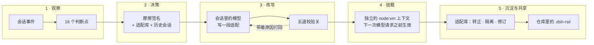

<div align="center">

[English](../../README.md) · **简体中文**

<br />


# DSHRSI：DeepSeek Harness RSI

### **观察 → 改写 → 挂载。一轮任务还没结束，Harness 已经把自己改好了。**

**一个开源的 DeepSeek Harness 插件，把反复出现的麻烦变成 Harness 代码。代码由会话里的模型自己写，过五道校验，在这一轮结束之前挂进运行中的会话。有效的留下来，按机器、按人、按项目各存一份。**

[](https://github.com/deepseek-ai/deepseek-harness)
[](#coverage)
[](#how-it-works)
[](#project-harness)
[](#contributing)
[](../../LICENSE)

**[📖 插件参考文档](../../packages/dsh-rsi/README.zh.md) · [🧩 项目 Harness](../../packages/dsh-rsi/README.zh.md#layers-and-the-project-harness) · [🔬 校验关](../../packages/dsh-rsi/README.zh.md#the-validation-gate) · [⚠️ 已知限制](../../packages/dsh-rsi/README.zh.md#known-limits) · [🐛 Issues](https://github.com/qybaihe/dshrsi/issues)**

[快速开始](#quick-start) · [工作原理](#how-it-works) · [实测结果](#measured) · [判断点与能力](#coverage) · [项目 Harness](#project-harness) · [安全默认值](#security) · [常见问题](#faq)

</div>

---

> [!IMPORTANT]
> **开发者预览：** DSHRSI 针对 DeepSeek Harness `0.2.2-rc.3` 开发，后者本身就是开发者预览版。**未来会有破坏兼容性的变更。**
> 适配是模型写的代码，运行在你的 Harness 内部。它的隔离防的是写错，**防不了恶意代码**。运行之前请先读[校验关](../../packages/dsh-rsi/README.zh.md#the-validation-gate)。

<div align="center">

</div>

<br />

<table>
<tr>
<td width="33%" valign="top">

### 🔴 没有 DSHRSI
每次会话都要重新发现同样的事实：这台机器没有 `python`，这个仓库有一条你早就说过的规矩，这次修改根本没验证过。对照组里 **5 次会话 5 次**都发出了同一个失败调用；用户说过的规矩，隔一次会话就又被打破。

</td>
<td width="33%" valign="top">

### 🧬 有了 DSHRSI
麻烦再次出现时，模型写一段 Harness 代码，过校验关，**当轮生效**。对真实模型跑的 3 轮里，适配写出之后的 **7 次会话 7 次**都没有失败调用。

</td>
<td width="33%" valign="top">

### 🔒 只能收紧，这是设计
适配可以补充信息、拒绝一次调用、要求先问你、要求先验证。**没有任何一种能力可以放行 Harness 本来会拒绝的操作。** 改写结果、新增工具、执行命令都要等你批准。

</td>
</tr>
</table>

---

<a id="quick-start"></a>

## ⚡ 30 秒快速开始

### 1. 装在你本来就在用的地方
在 DeepSeek Harness 桌面 App 或 Web 界面里，打开 **Plugins → Add plugin → Install a third-party plugin**，粘贴发布包地址，点 **Install**，再点 **Enable now**：

```text
https://github.com/qybaihe/dshrsi/releases/download/v0.1.0/dsh-rsi-0.1.0.tgz
```

也可以用命令行。每个 profile 有自己的一套插件；`dsh plugin add` 会调用 `pnpm`，它需要在 `PATH` 上：

```bash
dsh plugin --profile web add https://github.com/qybaihe/dshrsi/releases/download/v0.1.0/dsh-rsi-0.1.0.tgz
dsh web
```

### 2. 照常干活
不需要任何配置。同样的麻烦再次出现之前，DSHRSI 不露面。出现之后，**RSI** 徽标亮起，输入框下方的状态条显示 *The harness just rewrote itself*，下一次会话一开始就带着这次学到的东西：

<div align="center">

</div>

在任意会话里输入 `/rsi`，可以看到挂载了哪些适配、各属于哪一层、哪些在等你批准。

### 3. 给仓库一份专属的 Harness
在一个仓库里学到的规矩可以放在这个仓库里，一个文件一个适配：

```bash
# 这个命令随插件一起装在 profile 里
alias dsh-rsi="$HOME/.dsh/profiles/web/node_modules/.bin/dsh-rsi"

dsh-rsi project init      # 在仓库里运行：建立 .dsh-rsi/，然后提交它
dsh-rsi trust             # 在其他每台机器上：读过这些文件之后接受它们
```

### 4. 从源码运行

```bash
git clone https://github.com/qybaihe/dshrsi.git && cd dshrsi
npm install               # 带来一个固定版本的 dsh 和它要调用的 pnpm
npx dsh plugin --profile web add "$PWD/packages/dsh-rsi"
npx dsh web
```

`desktop` 和 `headless` profile、插件源索引、本地 tarball、只在单次运行时加载，见[插件参考文档](../../packages/dsh-rsi/README.zh.md#install)。

---

<a id="how-it-works"></a>

## 🧠 DSHRSI 的工作原理：Harness 内部的闭环

Skill、记忆文件、更长的系统提示词，都是上下文层面的做法：加一段文字，指望模型照做。它不照做的时候，同一个失败调用下一次会话还会再来一遍。

**DSHRSI 做在 Harness 这一层。它学到的东西变成挂在 Harness 扩展点上的代码：**



| 阶段 | 机制 | 效果 |
| :--- | :--- | :--- |
| **1. 观察** | 16 个判断点读归一化后的会话事件：再次失败的调用、反复出现的失败原因、乱试命令、用户的纠正、没验证就收工的一轮。 | 麻烦有了一个跨会话稳定的签名，比如 `bash:command-not-found:python`。 |
| **2. 改写** | 会话里的模型按一套 10 种能力的 API 写一段 JavaScript 适配。没通过的带着原因打回重写，最多两次，再不行用内置模板。 | 修复是 Harness 代码，不是提示词里再多一段话。 |
| **3. 校验** | 静态 → 加载 → 重演 → 回归 → 权限。适配必须对触发它的调用有所动作，并且不能碰本次会话里任何一个成功的调用。 | 什么都不做的代码、把本来好好的东西弄坏的代码，永远挂不上去。 |
| **4. 挂载** | 适配运行在独立的 `node:vm` 上下文里，和宿主之间只有一个 JSON 桥，每次调用都有超时；下一次模型请求之前生效。 | 踩坑的那一轮自己就先受益。 |
| **5. 沉淀与共享** | 每台机器一个适配库，带账本和审计记录。有效的转正，出错的隔离，没拦住的改写成更严的版本，项目规矩写进 `.dsh-rsi/`。 | 下一次会话一开始就是适配过的；同事 `dsh-rsi trust` 之后拿到项目的规矩。 |

---

<a id="measured"></a>

## 🔬 对真实模型的实测

这些数字来自真实模型 `mimo-v2.6-pro` 跑真实的 `dsh` 会话（`npm run test:live`）。表里没有任何模拟的数据。

> **怎么读这张表：** 样本很小。一个模型、三个场景、每个场景几次会话。它说明这条链路是通的，**不是**成功率的统计结论。速度也没有变快：写一次适配要等模型 30–60 秒。

| 场景 | 没有 DSHRSI | 有 DSHRSI | Harness 写了什么 |
| :--- | :--- | :--- | :--- |
| **缺命令**：README 写的是 `python stats.py`，机器上只有 `python3` | ❌ **5 / 5** 次会话发出了失败调用 | ✅ 适配写出之后 **0 / 7** 次（之前 9 / 9 次） | `deny` + `prompt`，模型所写，一次通过校验 |
| **用户只说过一次的规矩**：“不要直接改 `notes.txt`，写到 `notes.draft.txt`” | ❌ 下一次会话改了 `notes.txt` | ✅ 下一次会话不用提醒就写到了 `notes.draft.txt` | `deny` + `prompt`，模型在被纠正后当场所写 |
| **没人要求验证的修改** | 未运行 | ⚪ 什么都没写：3 / 3 次会话模型都自己验证了，没有可学的 | 无 |

第一个场景装着插件跑了三轮，每轮从空的适配库开始，另有一轮对照。第二个场景装和不装各跑了一轮。

**缺命令场景，逐次会话**（每次会话的失败工具调用数）：

| 轮次 | S1 | S2 | S3 | S4 | S5 | S6 |
| :--- | :---: | :---: | :---: | :---: | :---: | :---: |
| **没有 DSHRSI** | ❌ 1 | ❌ 1 | ❌ 1 | ❌ 1 | ❌ 1 | |
| **有 DSHRSI · 第 1 轮** | ❌ 1 | ❌ 1 | ❌ 1 → 🧬 | ✅ 0 | ✅ 0 | ✅ 0 |
| **有 DSHRSI · 第 2 轮** | ❌ 1 | ❌ 1 | ❌ 1 → 🧬 | ✅ 0 | ✅ 0 | |
| **有 DSHRSI · 第 3 轮** | ❌ 1 | ❌ 1 | ❌ 1 → 🧬 | ✅ 0 | ✅ 0 | |

🧬 表示模型在这一轮写出适配、Harness 当轮挂载。此后的 7 次会话里有 3 次模型仍然想跑 `python`，被 Harness 在执行前拦下。这个场景里所有会话的最终答案都正确，装不装插件都一样。

本地复现：

```bash
MIMO_API_KEY=... npm run test:live -- python --sessions 6          # 装了插件
MIMO_API_KEY=... npm run test:live -- python --sessions 5 --off    # 对照组，不装
```

<details>
<summary><strong>没有在这台机器上验证过的部分（点击展开）</strong></summary>

<br />

这些路径代码里都有，也有单元测试或用模拟模型跑的端到端测试，但没有在真实会话或真实 App 里观察到过：

| 范围 | 为什么没验证 |
| :--- | :--- |
| DeepSeek Harness 桌面 App | 开发用的机器上没有安装。验证做在它所包的 `web` profile 和安装机制上 |
| `negative-feedback`、`approval-denied`、`context-pressure`、`model-instability` | 只用构造的事件测过，没有在真实会话里触发过 |
| 自动化的浏览器测试 | 没有。界面是在真实的 `dsh web` 页面里手工走查的，亮色和暗色都看过 |
| ACP 和 SDK profile | 没有界面，也没有验证 |
| `mimo-v2.6-pro` 以外的模型 | 还没有实测 |

</details>

---

<a id="coverage"></a>

## 🛡️ 判断点与能力

**16 个判断点**决定 Harness 什么时候该改。同一套判断点既跑在实时会话上，也能跑在磁盘上存着的历史会话上（`dsh-rsi mine`）：

| 判断点 | 发现什么 | 响应 |
| :--- | :--- | :---: |
| `repeat-failing-call` | 同一个调用用同样的参数再次失败 | 适配 |
| `failure-signature` | 同一个失败原因反复出现：缺命令、缺依赖、网络、权限、端口占用、路径不存在、编辑不匹配、参数非法、内存不足 | 适配 |
| `command-flailing` | 同一类命令换着参数连续失败 | 适配 |
| `read-thrash` | 同一个文件没改过却被反复读 | 适配 |
| `edit-churn` | 一轮里对同一个文件改了很多次 | 适配 |
| `error-storm` | 最近的工具调用大部分在失败 | 适配 |
| `stall` | 连续失败，中间没有一次成功 | 适配 |
| `timeout-recurrence` | 同一类命令反复超时 | 适配 |
| `output-flood` | 同一类命令反复吐出超大输出 | 适配 |
| `approval-denied` / `denied-repeat` | 同类操作反复被用户拒绝，或被拒后原样重试 | 适配 |
| `user-correction` | 用户纠正了模型，或打断后改了方向 | 适配 |
| `premature-completion` | 改了代码，没跑任何检查就要结束这一轮 | 适配 |
| `negative-feedback` | 用户给某条回复点了差评并写了原因 | 适配 |
| `user-interrupt` | 用户中途打断 | 只记录 |
| `model-instability` | 模型请求反复失败、重试、撞输出上限 | 只记录 |
| `context-pressure` | 任务中途发生了上下文压缩 | 只记录 |

**10 种能力**是一段适配能做的全部事情。它只能通过这些能力接触 Harness：

| 能力 | 做什么 | 级别 |
| :--- | :--- | :---: |
| `annotate` | 工具结果后面追加一条说明 | ✅ 自动 |
| `steer` | 下一次模型请求前追加一条说明 | ✅ 自动 |
| `deny` | 拒绝一次工具调用并给出原因 | ✅ 自动 |
| `ask` | 要求这次调用先经用户批准 | ✅ 自动 |
| `block` | 把一次工具结果改成带纠正意见的错误 | ✅ 自动 |
| `verify` | 条件不满足时不让这一轮结束 | ✅ 自动 |
| `prompt` | 给系统提示词加一段常驻内容 | ✅ 自动 |
| `rewrite` | 替换工具结果的文本 | 🔐 需批准 |
| `tool` | 给模型注册一个新工具 | 🔐 需批准 |
| `exec` | 通过 Harness 的 shell 工具执行命令，受同样的沙箱和审批约束 | 🔐 需批准 |

下面是上面第一个场景里模型写出的适配：

```js
define({
  title: 'Route python invocations to python3',
  description: '...',
  capabilities: ['deny', 'prompt'],
  setup(h) {
    h.promptSection('On this machine there is no `python` executable; use `python3`.')
    h.beforeTool({ tool: 'bash', command: /(^|[;&|(]\s*)python(\s|$)/ },
      () => h.deny('`python` is not installed on this machine. Use `python3` instead.'))
  },
})
```

---

<a id="project-harness"></a>

## 🧩 三层，以及项目专属的 Harness

每个适配属于三层之一，每层可以单独关掉：

| 层 | 是什么 | 例子 | 作用范围 |
| :--- | :--- | :--- | :--- |
| **`machine`** | 这台电脑的事实 | 没有 `python`、端口被占、内网域名解析不了 | 学到它的工作区；第二个工作区再遇到就扩大到全机 |
| **`user`** | 你希望怎样被对待 | 给回复点了差评并说“太长了” | 全机 |
| **`project`** | 一个仓库的规矩和习惯 | “这个仓库一律用 pnpm” | 工作区，以及通过 `.dsh-rsi/` 跟着仓库走 |

**项目层跟着代码走：**

```
.dsh-rsi/
  harness.json           格式标记，和项目级设置
  adaptations/
    remember-the-user-s-instruction-3f2a1c.js     学到之后写在这里
    no-force-push.js                              手写的也一样
```

- **提交就是共享，删掉就是拔掉。** 一个文件就是一个适配。
- **不会因为克隆下来就运行。** 每台机器用 `dsh-rsi trust` 接受这些文件的确切内容，文件变了要重新接受。
- **项目只能让 Harness 更保守**，不能更激进。`autonomy` 这类设置项目碰不到。
- **不进仓库的也能带走。** `dsh-rsi export` 和 `dsh-rsi import` 把机器层和用户层打成一个文件，带到另一台电脑。

---

<a id="security"></a>

## 🔒 安全与默认配置

- **自动级只能收紧** — 没有你的批准，适配只能补充信息、拒绝、询问、要求验证。它的 `deny` 和 `ask` 只会让链路上其它策略的结论变得更严。
- **强能力要批准（`autonomy: tighten`）** — 改写结果、新增工具、执行命令的适配以 `proposed` 状态存下来，等 `dsh-rsi approve <id>`。
- **不需要时不可见** — 没有摩擦、没有挂载任何适配时，系统提示词、工具列表和消息逐字节不变，有端到端用例守着。
- **出错不扩散** — 处理函数抛错不会影响它所挂的那次工具调用；累计三次，这个适配就被隔离。
- **全部留痕** — 每个决定记在 `audit.jsonl` 里，每次摩擦、挂载、生效记在 `ledger.jsonl` 里。`dsh-rsi disable`、`retire`、`rollback` 可以把一个适配关掉、移除或退回上一版。
- **三种模式** — `adapt` 直接挂载（默认），`propose` 生成后等你批准，`observe` 只记录。

---

<a id="faq"></a>

## ❓ 常见问题

<details>
<summary><strong>DSHRSI 会微调或改动模型吗？</strong></summary>

不会。模型权重不动，也没有任何训练。变的是 Harness：围绕模型的提示词和工具调用运行的那层代码。这里的 RSI 指的是 Harness 从自己的执行过程里改进自己。
</details>

<details>
<summary><strong>这和 Skill、记忆文件、更长的系统提示词有什么不同？</strong></summary>

那些都是加一段文字，模型可能照做也可能不照做。适配是挂在 Harness 扩展点上的代码：它可以在工具调用执行之前拒绝它、要求你先批准、或者在没验证时不让这一轮结束。实测里，模型在被告知之后仍有 3 次会话想跑 `python`，调用在执行前被拒绝。
</details>

<details>
<summary><strong>会拖慢我的会话吗？</strong></summary>

写一个适配要等模型一次完整应答：在 `mimo-v2.6-pro` 上是 30–60 秒，期间这一步是停住的。挂载之后的适配在进程内运行，有超时。没有测到提速，也不声称提速。
</details>

<details>
<summary><strong>模型写的适配会不会做出危险的事？</strong></summary>

自动级的能力放行不了 Harness 会拒绝的任何操作，强能力要等你批准。代码运行在独立的 `node:vm` 上下文里，和宿主之间只有一个 JSON 桥。这防的是写错和随手滥用，**不是**对抗恶意代码的安全边界，所以 `dsh-rsi trust` 之前请先读一遍项目的 `.dsh-rsi/` 文件。
</details>

<details>
<summary><strong>支持哪些模型？</strong></summary>

适配由会话当前的模型来写，也可以用 `provider` 和 `model` 指定另一个。模型写不出能过校验关的代码时，由内置模板接手。目前的实测只用过一个模型：`mimo-v2.6-pro`。
</details>

<details>
<summary><strong>能在 DeepSeek Harness 桌面 App 里用吗？</strong></summary>

它是一个普通的第三方插件，带着插件页面要读的元数据，能装进 App 所包的 `web` profile。还没有在真实的桌面 App 里验证过。
</details>

<details>
<summary><strong>怎么查看、撤销或关掉它学到的东西？</strong></summary>

会话里输入 `/rsi`，或者终端里运行 `dsh-rsi status`。`dsh-rsi show <id>` 打印一个适配的源码和校验报告；`disable`、`retire`、`rollback` 可以关掉、移除或退回。把 `mode` 设成 `observe` 就只记录、什么都不改。
</details>

---

<a id="docs"></a>

## 📚 文档与链接

- [📖 插件参考文档](../../packages/dsh-rsi/README.zh.md) — 所有判断点、能力、命令和配置项
- [🚀 安装来源与 profile](../../packages/dsh-rsi/README.zh.md#install)
- [🧩 三层与项目 Harness](../../packages/dsh-rsi/README.zh.md#layers-and-the-project-harness)
- [🔬 校验关](../../packages/dsh-rsi/README.zh.md#the-validation-gate)
- [🛠️ `dsh-rsi` 命令行](../../packages/dsh-rsi/README.zh.md#command-line) · [⚙️ 配置](../../packages/dsh-rsi/README.zh.md#configuration)
- [⚠️ 已知限制](../../packages/dsh-rsi/README.zh.md#known-limits)
- [🧱 DeepSeek Harness](https://github.com/deepseek-ai/deepseek-harness) — 这个插件所接入的 Harness

<a id="contributing"></a>

## 🤝 参与贡献与社区

欢迎在 [qybaihe/dshrsi](https://github.com/qybaihe/dshrsi) 提 Issue 和 PR。提交 PR 之前：

```bash
npm install && npm test    # 先跑 129 个单元测试，再跑 29 个端到端测试，不需要任何密钥
```

端到端测试用一个模拟的模型服务顶替模型接口，其余都是真的：真实的 `dsh` 进程、工具执行、会话日志和插件安装。

```
packages/dsh-rsi/        插件包本体（纯 ESM，无构建步骤）
  index.js               宿主部分：与 DSH 扩展点的绑定
  client.js              浏览器部分：RSI 徽标和状态条
  src/engine.js          观察 → 决策 → 生成 → 校验 → 挂载 → 沉淀 → 共享
  src/signals.js         16 个判断点
  src/validate.js        校验关
  src/sandbox.js         适配代码的运行环境
  src/project.js         项目 Harness：<仓库>/.dsh-rsi
  bin/rsi.js             dsh-rsi 命令
market/index.json        可以加进 DSH 的插件源索引
test/unit/  test/e2e/    单元测试，和跑在真实 dsh 进程上的端到端测试
test/live/               真实模型实测（需要 MIMO_API_KEY）
```

## 📄 许可证

[MIT](../../LICENSE)

---

Created in [T3 Code](https://t3.codes).
