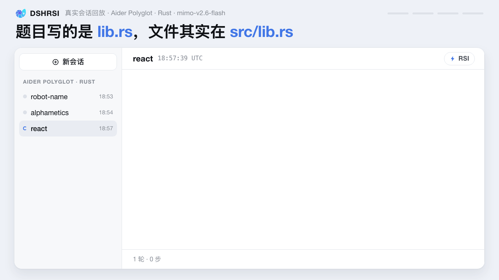
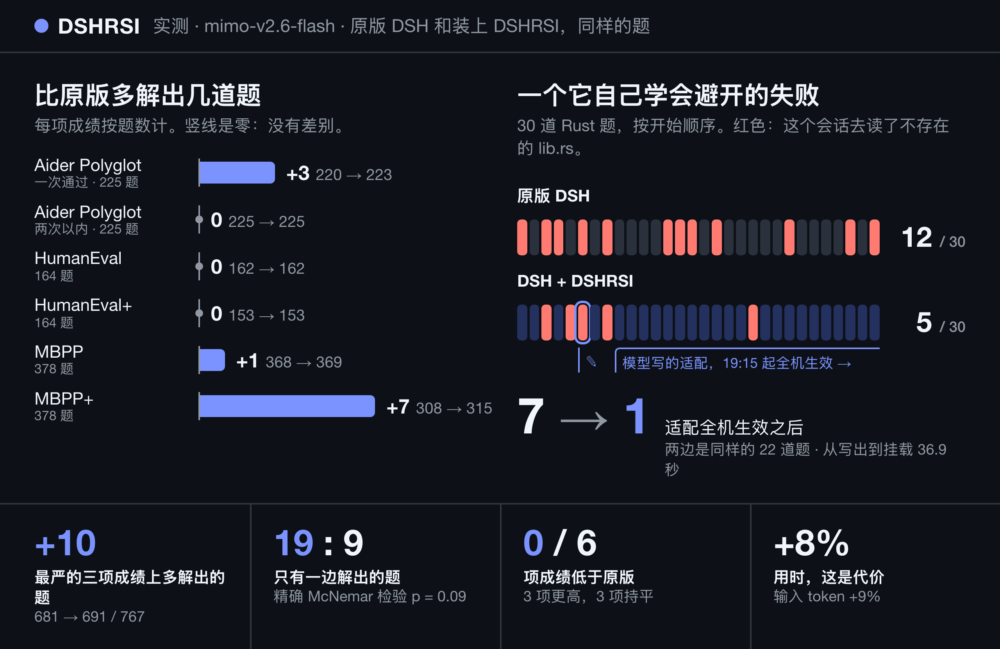

<div align="center">

[English](../../README.md) · **简体中文** · [繁體中文](README_zh-TW.md) · [日本語](README_ja.md) · [한국어](README_ko.md) · [Türkçe](README_tr.md) · [Русский](README_ru.md) · [Tiếng Việt](README_vi.md) · [ไทย](README_th.md) · [Deutsch](README_de.md) · [Español](README_es.md) · [Français](README_fr.md) · [Українська](README_uk.md) · [Polski](README_pl.md) · [Português (Brasil)](README_pt-BR.md) · [العربية](README_ar.md) · [فارسی](README_fa.md) · [Bahasa Indonesia](README_id.md) · [Italiano](README_it.md) · [Ελληνικά](README_el.md) · [മലയാളം](README_ml.md) · [Roman Urdu](README_ur-Latn.md) · [Română](README_ro.md)

<br />


# DSHRSI：DeepSeek Harness 上的递归自我改进

### **观察 → 改进 → 在改进之上再改进。一份越用越懂你的 Harness。**

<a href="https://dshr.si/trace.html">
  <picture>
    <source media="(prefers-color-scheme: dark)" srcset="../../assets/rsi-trace.zh.dark.gif" />
    
  </picture>
</a>

**RSI 是 Recursive Self-Improvement，递归自我改进。DSHRSI 是把它在 DeepSeek Harness 上做成现实的开源插件：Harness 盯着自己的每一次运行，让会话里的模型为发现的麻烦写一段 Harness 代码，过五道校验，在这一轮结束之前挂上去。然后，改进过的 Harness 去跑下一次会话，再改进一次。不微调模型，不堆提示词。是代码，会被度量，留下、改写或者扔掉。**

[](#rsi)
[](https://github.com/deepseek-ai/deepseek-harness)
[](#how-it-works)
[](#benchmarks)
[](../../LICENSE)

**[🌐 官网](https://dshr.si/) · [📖 插件参考文档](../../packages/dsh-rsi/README.zh.md) · [🐛 Issues](https://github.com/qybaihe/dshrsi/issues)**

[RSI 是什么](#rsi) · [快速开始](#quick-start) · [工作原理](#how-it-works) · [实测结果](#measured) · [基准评测](#benchmarks) · [判断点与能力](#coverage) · [项目 Harness](#project-harness) · [安全默认值](#security) · [常见问题](#faq)

</div>

---

> [!IMPORTANT]
> **开发者预览：** DSHRSI 针对 DeepSeek Harness `0.2.2-rc.3` 开发，后者本身就是开发者预览版。**未来会有破坏兼容性的变更。**
> 适配是模型写的代码，运行在你的 Harness 内部。它的隔离防的是写错，**防不了恶意代码**。运行之前请先读[校验关](../../packages/dsh-rsi/README.zh.md#the-validation-gate)。

<div align="center">

</div>

<br />

<table>
<tr>
<td width="33%" valign="top">

### 🔴 没有 DSHRSI
每次会话都要重新发现同样的事实：这台机器没有 `python`，这个仓库有一条你早就说过的规矩，这次修改根本没验证过。对照组里 **5 次会话 5 次**都发出了同一个失败调用；用户说过的规矩，隔一次会话就又被打破。

</td>
<td width="33%" valign="top">

### 🧬 有了 DSHRSI
麻烦再次出现时，模型写一段 Harness 代码，过校验关，**当轮生效**。对真实模型跑的 3 轮里，适配写出之后的 **7 次会话 7 次**都没有失败调用。下一次改进就从这里开始。

</td>
<td width="33%" valign="top">

### 🔒 只能收紧，这是设计
适配可以补充信息、拒绝一次调用、要求先问你、要求先验证。**没有任何一种能力可以放行 Harness 本来会拒绝的操作。** 改写结果、新增工具、执行命令都要等你批准。

</td>
</tr>
</table>

---

<a id="rsi"></a>

## 🔁 RSI = Recursive Self-Improvement，递归自我改进

不是 “rewrite itself”。**递归自我改进**：一个系统用自己的能力改进自己，改进后的系统再去做下一轮。三个词，DSHRSI 每一个都得做到：

| | 要满足什么 | DSHRSI 怎么做到 |
| :--- | :--- | :--- |
| **自我（Self）** | 动手的和被改的是同一个系统 | Harness 改的是 Harness。适配由踩到坑的那次会话里的模型来写，没有人在外面调它 |
| **改进（Improvement）** | “更好”必须能检验 | 每个适配挂载之前先过五道校验，之后的会话还要再考它：管用的转正，出错的隔离 |
| **递归（Recursive）** | 这一轮的产出是下一轮的起点 | 下一次会话跑在改进过的 Harness 上，也在它上面被观察。没管住的适配会根据证据被改写得更严；第二个工作目录里也用得上的，扩大到整台机器；项目的规矩跟着仓库走到每个同事的 Harness 里 |

**四个环，一环套一环**：一轮任务之内 → 会话与会话之间 → 改进本身被改进 → 从项目到机器再到团队。

有意**不**递归的部分：模型权重永远不变；判断点、触发策略和校验关是固定的代码，任何适配都碰不到。会改自己的那部分，由它改不了的那部分来检查。

---

<a id="quick-start"></a>

## ⚡ 30 秒快速开始

### 1. 装在你本来就在用的地方
在 DeepSeek Harness 桌面 App 或 Web 界面里，打开 **Plugins → Add plugin → Install a third-party plugin**，粘贴发布包地址，点 **Install**，再点 **Enable now**：

```text
https://github.com/qybaihe/dshrsi/releases/download/v0.1.3/dsh-rsi-0.1.3.tgz
```

也可以用命令行。每个 profile 有自己的一套插件；`dsh plugin add` 会调用 `pnpm`，它需要在 `PATH` 上：

```bash
dsh plugin --profile web add https://github.com/qybaihe/dshrsi/releases/download/v0.1.3/dsh-rsi-0.1.3.tgz
dsh web
```

### 2. 照常干活
不需要任何配置。同样的麻烦再次出现之前，DSHRSI 不露面。出现之后，**RSI** 徽标亮起，输入框下方的状态条告诉你 Harness 刚刚改了自己，下一次会话一开始就带着这次学到的东西：

<div align="center">

</div>

在任意会话里输入 `/rsi`，可以看到挂载了哪些适配、各属于哪一层、哪些在等你批准。

`desktop` 和 `headless` profile、插件源索引、本地 tarball、只在单次运行时加载，见[插件参考文档](../../packages/dsh-rsi/README.zh.md#install)。

---

<a id="how-it-works"></a>

## 🧠 DSHRSI 的工作原理：Harness 内部的闭环，一遍又一遍

<div align="center">
<picture>
  <source media="(prefers-color-scheme: dark)" srcset="../../assets/pit-stop.zh.dark.svg" />
  
</picture>
</div>

Skill、记忆文件、更长的系统提示词，都是上下文层面的做法：加一段文字，指望模型照做。它不照做的时候，同一个失败调用下一次会话还会再来一遍。

**DSHRSI 做在 Harness 这一层。它学到的东西变成挂在 Harness 扩展点上的代码：**

| 阶段 | 机制 | 效果 |
| :--- | :--- | :--- |
| **1. 观察** | 16 个判断点读归一化后的会话事件：再次失败的调用、反复出现的失败原因、乱试命令、用户的纠正、没验证就收工的一轮。 | 麻烦有了一个签名，换到下一次会话也还是同一个。 |
| **2. 改写** | 会话里的模型按一套 10 种能力的 API 写一段 JavaScript 适配。没通过的带着原因打回重写，最多两次，再不行用内置模板。 | 修复是 Harness 代码，不是提示词里再多一段话。 |
| **3. 校验** | 静态 → 加载 → 重演 → 回归 → 权限。适配必须对触发它的调用有所动作，并且不能碰本次会话里任何一个成功的调用。 | 什么都不做的代码、把本来好好的东西弄坏的代码，永远挂不上去。 |
| **4. 挂载** | 适配运行在自己的隔离上下文里，每次调用都有超时；下一次模型请求之前生效。 | 踩坑的那一轮自己就先受益。 |
| **5. 沉淀与共享** | 每台机器都有自己的适配库。有效的转正，出错的隔离，没拦住的改写成更严的版本，项目规矩写进仓库。 | 下一次会话一开始就是适配过的；同事接受之后，就能拿到项目的规矩。 |
| **↻ 再来一遍** | 下一次会话跑在第 5 步留下的 Harness 上，第 1 步带着所有已挂载的适配去观察它。 | 改进建立在改进之上。这就是递归。 |

---

<a id="measured"></a>

## 🔬 对真实模型的实测

这些数字来自真实模型 `mimo-v2.6-pro` 跑真实的 `dsh` 会话（`npm run test:live`）。表里没有任何模拟的数据。

> **怎么读这张表：** 样本很小。一个模型、三个场景、每个场景几次会话。它说明这条链路是通的，**不是**成功率的统计结论。速度也没有变快：写一次适配要等模型 30–60 秒。规模更大的对照在[基准评测](#benchmarks)里。

| 场景 | 没有 DSHRSI | 有 DSHRSI | Harness 写了什么 |
| :--- | :--- | :--- | :--- |
| **缺命令**：说明里写的是 `python`，机器上只有 `python3` | ❌ **5 / 5** 次会话发出了失败调用 | ✅ 适配写出之后 **0 / 7** 次（之前 9 / 9 次） | `deny` + `prompt`，模型所写，一次通过校验 |
| **用户只说过一次的规矩**：某个文件不要直接改，要写就写到它的草稿里 | ❌ 下一次会话改了那个文件 | ✅ 下一次会话不用提醒就写到了草稿里 | `deny` + `prompt`，模型在被纠正后当场所写 |
| **没人要求验证的修改** | 未运行 | ⚪ 什么都没写：3 / 3 次会话模型都自己验证了，没有可学的 | 无 |

---

<a id="benchmarks"></a>

## 📊 基准评测：四个基准，两个模型，逐题对照

原版 DeepSeek Harness 对装上 DSHRSI 的 DeepSeek Harness，跑了 3,390 个真实的 `dsh` 会话：同一个模型、同样的提示词、同样的沙箱、同样的题。插件用默认配置，每个基准都从空的适配库开始。跑完了的三个基准上解出的题数：

<!-- bench:table:start -->
| 基准 | 题数 | `mimo-v2.6-pro` 原版 | `mimo-v2.6-pro` + DSHRSI | `mimo-v2.6-flash` 原版 | `mimo-v2.6-flash` + DSHRSI |
| :--- | ---: | ---: | ---: | ---: | ---: |
| **Aider Polyglot**，一次通过 | 225 | 224 (99.6%) | 224 (99.6%) | 220 (97.8%) | 223 (99.1%) |
| **Aider Polyglot**，两次以内 | 225 | 225 (100.0%) | 225 (100.0%) | 225 (100.0%) | 225 (100.0%) |
| **HumanEval** | 164 | 163 (99.4%) | 162 (98.8%) | 162 (98.8%) | 162 (98.8%) |
| **HumanEval+** | 164 | 156 (95.1%) | 157 (95.7%) | 153 (93.3%) | 153 (93.3%) |
| **MBPP** | 378 | 374 (98.9%) | 371 (98.1%) | 368 (97.4%) | 369 (97.6%) |
| **MBPP+** | 378 | 320 (84.7%) | 319 (84.4%) | 308 (81.5%) | 315 (83.3%) |
<!-- bench:table:end -->

<div align="center">
<picture>
  <source media="(prefers-color-scheme: dark)" srcset="../../assets/bench-flash.zh.dark.png" />
  
</picture>
</div>

> **怎么读这张表：** 论解出的题数，两套 Harness **分不出高下**。最大的正差是 +7（`mimo-v2.6-flash` 的 MBPP+），最大的负差是 −3（`mimo-v2.6-pro` 的 MBPP），在同一批题上做精确 McNemar 检验，没有一项差别站得住（最小的 p = 0.17）。智能体可以自己跑代码时，这几个基准对两个模型都已接近到顶；而且每道题都是一个全新的干净目录，很少有麻烦会重复出现，Harness 没有多少可学的。

**DSHRSI 确实做了的事，是在没有任何提示的情况下改自己。** 八轮运行里，模型一共写出 **56 个适配**，其中 15 个起过作用，这当中又有 10 个扩大到了整台机器。对这 10 个，我们逐个取它生效之后才开始的题，和原版 DSH 在同样这些题上比：

| Harness 自己学会避开的失败 | 原版 DSH | DSH + DSHRSI | p |
| :--- | ---: | ---: | ---: |
| 测试脚本在第一个断言不符时就中断（MBPP，`mimo-v2.6-pro`） | 310 题里 16 题 | **310 题里 3 题** | 0.002 |
| 去一个不存在的路径读文件（Polyglot，`mimo-v2.6-flash`） | 151 题里 7 题 | **151 题里 1 题** | 0.07 |
| 另外 8 个适配 | 量不出变化 | | |

这两个都没有让更多的题通过；装上插件多花大约 8–9% 的用时和输入 token。十个都列在[基准评测说明](../../bench/README.md#did-those-adaptations-work)里。

**LiveCodeBench v6 没有跑完**：模型账户的余额在中途用尽。只看两边都在那之前完成的题：`mimo-v2.6-pro` 是 105 题里原版解出 94、DSHRSI 解出 96，`mimo-v2.6-flash` 是 51 题里 42 对 42。第 2 轮（带着第 1 轮留下的适配库把同样的题再跑一遍）也因为同样的原因还没有跑。

评测方法、开销和失败调用的表格、已知限制，还有复现这一切的命令，都在[基准评测说明](../../bench/README.md)里。

---

<a id="coverage"></a>

## 🛡️ 判断点与能力

**16 个判断点**决定 Harness 什么时候该改。[完整列表](../../packages/dsh-rsi/README.zh.md#detectors)在插件参考文档里。

**10 种能力**是一段适配能做的全部事情。它只能通过这些能力接触 Harness：

| 能力 | 做什么 | 级别 |
| :--- | :--- | :---: |
| `annotate` | 工具结果后面追加一条说明 | ✅ 自动 |
| `steer` | 下一次模型请求前追加一条说明 | ✅ 自动 |
| `deny` | 拒绝一次工具调用并给出原因 | ✅ 自动 |
| `ask` | 要求这次调用先经用户批准 | ✅ 自动 |
| `block` | 把一次工具结果改成带纠正意见的错误 | ✅ 自动 |
| `verify` | 条件不满足时不让这一轮结束 | ✅ 自动 |
| `prompt` | 给系统提示词加一段常驻内容 | ✅ 自动 |
| `rewrite` | 替换工具结果的文本 | 🔐 需批准 |
| `tool` | 给模型注册一个新工具 | 🔐 需批准 |
| `exec` | 通过 Harness 的 shell 工具执行命令，受同样的沙箱和审批约束 | 🔐 需批准 |

下面是上面第一个场景里模型写出的适配：

```js
define({
  title: 'Route python invocations to python3',
  description: '...',
  capabilities: ['deny', 'prompt'],
  setup(h) {
    h.promptSection('On this machine there is no `python` executable; use `python3`.')
    h.beforeTool({ tool: 'bash', command: /(^|[;&|(]\s*)python(\s|$)/ },
      () => h.deny('`python` is not installed on this machine. Use `python3` instead.'))
  },
})
```

---

<a id="project-harness"></a>

## 🧩 三层，以及项目专属的 Harness

每个适配属于三层之一，每层可以单独关掉：

| 层 | 是什么 | 例子 | 作用范围 |
| :--- | :--- | :--- | :--- |
| **`machine`** | 这台电脑的事实 | 没有 `python`、端口被占、内网域名解析不了 | 学到它的工作区；第二个工作区再遇到就扩大到全机 |
| **`user`** | 你希望怎样被对待 | 给回复点了差评并说“太长了” | 全机 |
| **`project`** | 一个仓库的规矩和习惯 | “这个仓库一律用 pnpm” | 工作区，以及仓库本身：规矩随代码一起提交 |

**项目层跟着代码走：**

- **提交就是共享，删掉就是拔掉。** 一个文件就是一个适配。
- **不会因为克隆下来就运行。** 每台机器用 `dsh-rsi trust` 接受这些文件的确切内容，文件变了要重新接受。
- **项目只能让 Harness 更保守**，不能更激进。`autonomy` 这类设置项目碰不到。
- **不进仓库的也能带走。** `dsh-rsi export` 和 `dsh-rsi import` 把机器层和用户层打成一个文件，带到另一台电脑。

---

<a id="security"></a>

## 🔒 安全与默认配置

- **自动级只能收紧** — 没有你的批准，适配只能补充信息、拒绝、询问、要求验证。它的 `deny` 和 `ask` 只会让链路上其它策略的结论变得更严。
- **强能力要批准（`autonomy: tighten`）** — 改写结果、新增工具、执行命令的适配以 `proposed` 状态存下来，等 `dsh-rsi approve <id>`。
- **不需要时不可见** — 没有摩擦、没有挂载任何适配时，系统提示词、工具列表和消息逐字节不变，有端到端用例守着。
- **出错不扩散** — 处理函数抛错不会影响它所挂的那次工具调用；累计三次，这个适配就被隔离。
- **全部留痕** — 每个决定、每次摩擦、挂载和生效都记录在案。`dsh-rsi disable`、`retire`、`rollback` 可以把一个适配关掉、移除或退回上一版。
- **三种模式** — `adapt` 直接挂载（默认），`propose` 生成后等你批准，`observe` 只记录。

---

<a id="faq"></a>

## ❓ 常见问题

<details>
<summary><strong>DSHRSI 会微调或改动模型吗？</strong></summary>

不会。模型权重不动，也没有任何训练。变的是 Harness：围绕模型的提示词和工具调用运行的那层代码。这里的 RSI 是 Harness 这一层的递归自我改进：它从自己的运行里改进自己，每一轮都从上一轮留下的 Harness 出发。
</details>

<details>
<summary><strong>这真的是“递归”吗，还是只是一个会记规矩的 Harness？</strong></summary>

递归是具体的，就在代码里。新会话会挂载适配库里的全部适配，所以判断点观察的是一份已经变过的 Harness。同一个麻烦在挂着适配的会话里又出现两次，模型会拿到当前的源码和“没管住”的证据，写一个更严的版本，旧版本留着以便回滚。同一个麻烦在第二个工作目录里出现，适配就扩大到整台机器。不递归的是裁判：判断点、触发策略和校验关，任何适配都改不了。
</details>

<details>
<summary><strong>这和 Skill、记忆文件、更长的系统提示词有什么不同？</strong></summary>

那些都是加一段文字，模型可能照做也可能不照做。适配是挂在 Harness 扩展点上的代码：它可以在工具调用执行之前拒绝它、要求你先批准、或者在没验证时不让这一轮结束。实测里，模型在被告知之后仍有 3 次会话想跑 `python`，调用在执行前被拒绝。
</details>

<details>
<summary><strong>会拖慢我的会话吗？</strong></summary>

写一个适配要等模型一次完整应答：在 `mimo-v2.6-pro` 上是 30–60 秒，期间这一步是停住的。挂载之后的适配在进程内运行，有超时。没有测到提速，也不声称提速。
</details>

<details>
<summary><strong>模型写的适配会不会做出危险的事？</strong></summary>

自动级的能力放行不了 Harness 会拒绝的任何操作，强能力要等你批准。代码运行在独立的 `node:vm` 上下文里，和宿主之间只有一个 JSON 桥。这防的是写错和随手滥用，**不是**对抗恶意代码的安全边界，所以 `dsh-rsi trust` 之前请先读一遍项目的 `.dsh-rsi/` 文件。
</details>

<details>
<summary><strong>支持哪些模型？</strong></summary>

适配由会话当前的模型来写，也可以用 `provider` 和 `model` 指定另一个。模型写不出能过校验关的代码时，由内置模板接手。目前跑过同一个系列的两个模型：`mimo-v2.6-pro` 和 `mimo-v2.6-flash`。
</details>

<details>
<summary><strong>能在 DeepSeek Harness 桌面 App 里用吗？</strong></summary>

它是一个普通的第三方插件，带着插件页面要读的元数据，能装进 App 所包的 `web` profile。还没有在真实的桌面 App 里验证过。
</details>

<details>
<summary><strong>改进要是改错了怎么办？</strong></summary>

随时可以撤回：Harness 自己的代码从不被改动，适配的任何一个版本也从不删除。适配一再出错，或者它拦下的调用其实能成功，Harness 会自己把它撤回。你也可以动手：`/rsi undo` 撤回最近一次改动，`dsh-rsi restore` 把整个 Harness 恢复到之前的某个时间点，`/rsi off` 直接用原版 Harness。这些都在正在运行的会话里立刻生效。[回退是怎么做的](../../packages/dsh-rsi/README.zh.md#going-back)。
</details>

<details>
<summary><strong>怎么查看、撤销或关掉它学到的东西？</strong></summary>

会话里输入 `/rsi`，或者终端里运行 `dsh-rsi status`。`dsh-rsi show <id>` 打印一个适配的源码和校验报告；`disable`、`retire`、`rollback` 可以关掉、移除或退回。把 `mode` 设成 `observe` 就只记录、什么都不改。
</details>

---

<a id="docs"></a>

## 📚 文档与链接

- [📖 插件参考文档](../../packages/dsh-rsi/README.zh.md) — 所有判断点、能力、命令和配置项
- [🚀 安装来源与 profile](../../packages/dsh-rsi/README.zh.md#install)
- [🧩 三层与项目 Harness](../../packages/dsh-rsi/README.zh.md#layers-and-the-project-harness)
- [🔬 校验关](../../packages/dsh-rsi/README.zh.md#the-validation-gate)
- [🛠️ `dsh-rsi` 命令行](../../packages/dsh-rsi/README.zh.md#command-line) · [⚙️ 配置](../../packages/dsh-rsi/README.zh.md#configuration)
- [⚠️ 已知限制](../../packages/dsh-rsi/README.zh.md#known-limits)
- [📊 评测方法与结果](../../bench/README.md)
- [🧱 DeepSeek Harness](https://github.com/deepseek-ai/deepseek-harness) — 这个插件所接入的 Harness

<a id="contributing"></a>

## 🤝 参与贡献与社区

欢迎在 [qybaihe/dshrsi](https://github.com/qybaihe/dshrsi) 提 Issue 和 PR。提交 PR 之前：

```bash
npm install && npm test    # 先跑 130 个单元测试，再跑 29 个端到端测试，不需要任何密钥
```

端到端测试用一个模拟的模型服务顶替模型接口，其余都是真的：真实的 `dsh` 进程、工具执行、会话日志和插件安装。

## 📄 许可证

[MIT](../../LICENSE)

---

Created in [T3 Code](https://t3.codes).
